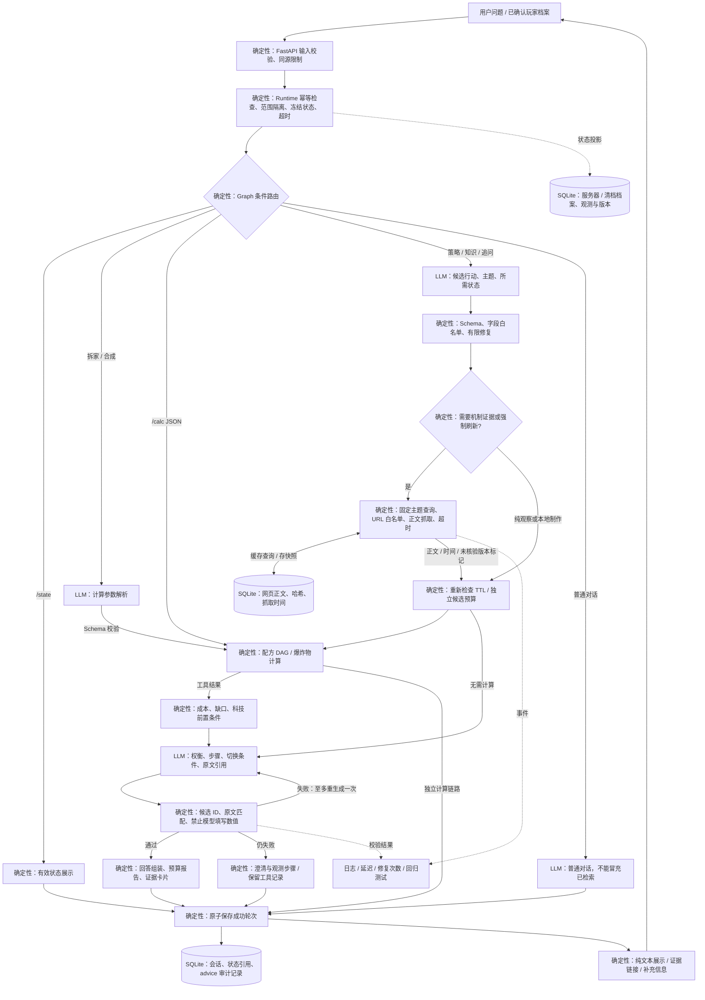

# 按需取证与状态建议：当前实现

此实现面向 PC 原版服、本机单用户。使用 LangGraph 串联有边界的决策步骤；不引入向量数据库，也不让模型自行执行任意网络请求或游戏操作。模型接口沿用配置的 OpenAI-compatible 服务。

## 如何使用

1. 打开 `/player-state`，录入当前服务器/清档周期的观测；在聊天页选择这个档案。
2. 若要核算候选制作方案，显式选择一个有效、完整盘点的库存容器。没有选择容器时，只能得到制作总需求，不能当作当前资源缺口。
3. 提问“现在该冲科技还是先加固基地？”等策略问题。`/coach 问题` 可强制进入决策；`/search 问题` 强制重新联网取证，不使用证据缓存。
4. 回复包含首选行动、替代方案（有足够依据时）、取舍、前置条件、操作、完成标准和切换条件。展开“取证与决策记录”查看来源、抓取时间、原文引用和快照。
5. 补充条件后继续追问。聊天陈述只用于临时条件分析；要影响准确库存计算，仍需在玩家状态页确认录入。建议不会扣减库存。

纯拆家/合成仍走原有计算器；`/calc JSON` 和 `/state` 不经过模型规划。未匹配的游戏问题可用显式命令重试。战斗伤害交换、图像布局诊断、全局最优策略尚未实现。

## 实际执行架构

图中所有标为 LLM 的模块生成内容；其余模块是代码、规则或存储。这是职责与数据流图，不是逐一对应的 LangGraph 节点图。实际子图为 `plan → retrieve → evaluate → compose → finish → END`；Schema 和引用校验在节点内部执行，修复是有界的内部重生成。解析失败直接进入 `finish`，不进入无限工具循环。

## 模块职责与状态边界

| 模块 | 职责 | 不承担的职责 |
| --- | --- | --- |
| `app.py` / `runtime.py` | 依赖注入、请求幂等、单请求锁、会话范围、时间预算 | 不内联配方或策略 |
| `workflows.py` | 普通对话、状态、计算、建议的条件边 | 不负责检索算法 |
| `advice/service.py` | 有界子图、规划与生成、调用领域服务、条件降级 | 不写玩家档案、不执行游戏行为 |
| `advice/schemas.py` | 候选、建议、引用的结构化协议 | 不把通过 Schema 当作语义正确 |
| `calculations/` | 配方展开、共享资源、批次、伤害阈值、来源 | 不由 LLM 补齐未知规则 |
| `knowledge/web.py` | 固定主题公开查询、白名单正文抓取、缓存策略 | 不发送背包或坐标给搜索引擎 |
| `knowledge/store.py` | 不可变正文快照、内容哈希、检索 TTL | 不自动认证网页适用版本 |
| `player_state/` | 观测有效期、范围、完整性、版本与显式更新 | 不自动把聊天猜测转成记忆 |
| `persistence.py` | 完整轮次、计算与建议审计元数据 | 不保存未完成中间执行状态 |

任务态仅活在这次图调用中；对话态在 SQLite turns；玩家长期状态按服务器/清档隔离，并在读取时投影 TTL。规划和回答各最多一次结构修复；最坏四次模型调用，网络总预算默认二十五秒，建议总预算默认一百八十秒。没有自动重试付费调用的无限循环。

当前是短请求、原子保存的交互，不使用 Checkpointer：进程中断后可重试同一请求 ID，但尚未保存的模型/检索步骤会重做；完成的请求会直接重放已保存结果。补充信息以新一轮进入，不伪装成 `interrupt/resume`。今后引入长耗时任务、人工审批或跨进程恢复时，再启用持久 Checkpointer，并为每个外部副作用加幂等键。

## 取证策略与知识时效

- 默认 `COACH_SEARCH_PROVIDER=tavily`：在本地 `.env` 配置 `COACH_SEARCH_API_KEY` 为 Tavily 密钥，重启后生效。旧的 Bing/Brave 搜索入口已移除；原配置需改为 `tavily` 并替换密钥。可选 `off`：禁用网络，只保留观察和本地工具。
- 通过共享 HTTP 客户端调用 [Tavily Search API](https://docs.tavily.com/documentation/api-reference/endpoint/search)（`POST https://api.tavily.com/search`，Bearer 鉴权），固定 `basic` 深度、关闭自动参数调整，每主题最多六条候选，限定来源域名。不请求生成式答案或原始正文，返回链接仍需独立抓取与核验。缺少密钥时明确提示，API 的 `web_search` 能力为 false；认证失败、限流、响应异常或超时按现有取证预算降级，不自动重试付费搜索。
- 规划器只能选择 building/upkeep/progression/recycling/monuments/combat/updates 主题，代码构造固定公开查询。玩家原文、库存、坐标、服务器标识不进入搜索参数；模型服务仍会收到问题与有效状态。
- 每轮至多两个主题、四份正文。抓取只允许 HTTPS 和已登记来源域名，检查 DNS 公网地址及每次重定向，限定内容类型、响应体大小和时间。不是通用 URL 浏览代理。
- 搜索结果与预登记的相关专题页面共同组成候选。排除首页、购买页等通用入口，并用主题词检查正文；主题词检查不代表语义蕴含验证。搜索失败明确标记“搜索不可用，使用直接资料”，不会把搜索摘要当正文。抓取失败保留成功部分；没有正文就不输出需要网页依据的策略。
- 干净成功的结果缓存默认六小时，可配置一至七十二小时。更新/最新版本问题和 `/search` 跳过缓存。抓取新鲜不代表规则新鲜；所有网页 `game_build=null`、`version_status=unverified`。
- 正文快照包含 URL、内容哈希、抓取时间、可提取的发布时间。模型最多读取每篇前九千字符；可能遗漏后文条件，因此不声称穷尽资料或解决所有来源冲突。
- 网页证据不会自动覆盖本地规则快照。规则发布仍需人工审核和计算回归，不能把互联网文本直接升级成确定性数值。

## 数值与建议的验证边界

候选只能调用支持的制作配方，模型提交目标数量，代码决定材料和条件。未知配方返回不可验证；未选择完整有效容器返回库存未知；缺料或工作台不足返回受阻；蓝图未知保留条件。多个候选各自从同一冻结库存计算，明确互斥，不能把分别可行误报成同时可行。一个候选内部的多个目标使用已有 DAG 统一核算，不重复消耗共享材料。

模型自然语言禁止直接填写消耗、伤害、概率或时长数值；校验器拦截阿拉伯数字与常见中文数量表达，精确数值仅由计算报告输出。这是防护措施，不能宣称覆盖全部自然语言变体。建议只检查局部资源与科技条件，未覆盖维护预留、交通风险、生产时间或对手行为；“快照下可行”不能理解为全局最优或保证成功。

引用 ID 必须来自本轮取证，quote 必须逐字出现在留存正文，strategy 必须带引用。此检查只能证明网页出现过这段文字，无法机械证明引用支持了全部推论。当前未实现独立语义蕴含评审；所有建议显示条件和版本限制。规则准确率与模型建议质量是不同指标，不能用测试通过率替代游戏内实测。

## 测试、观测与回流

`tests/test_advice.py` 覆盖路由、URL/重定向白名单、体积限制、缓存 TTL、强制更新、查询隐私、引用伪造、数字泄漏、一次修复、搜索失败降级、未知/过期/部分库存、独立候选预算、状态不变、请求重放、重启读取与跨范围隔离。

每条建议保存 `workflow`、`status`、`elapsed_ms`、`repairs`、规划、候选评估、引用、查询和检索事件。服务日志仅记录阶段结果与时间，不记录密钥或完整玩家原文。坏例可按会话请求 ID 与证据 ID 复现，并补到 ScriptedModel/MockTransport 回归用例。

上线前仍需独立的人工标注集：路由准确率、有效正文覆盖率、引用语义支持率、可执行步骤完成率、版本冲突识别率、拒绝/澄清合理性，以及按路由统计延迟和实际模型费用。当前尚无自动 token 账单采集，也没有战斗伤害的游戏内基准；不能声称已达到生产准确率/SLA。
