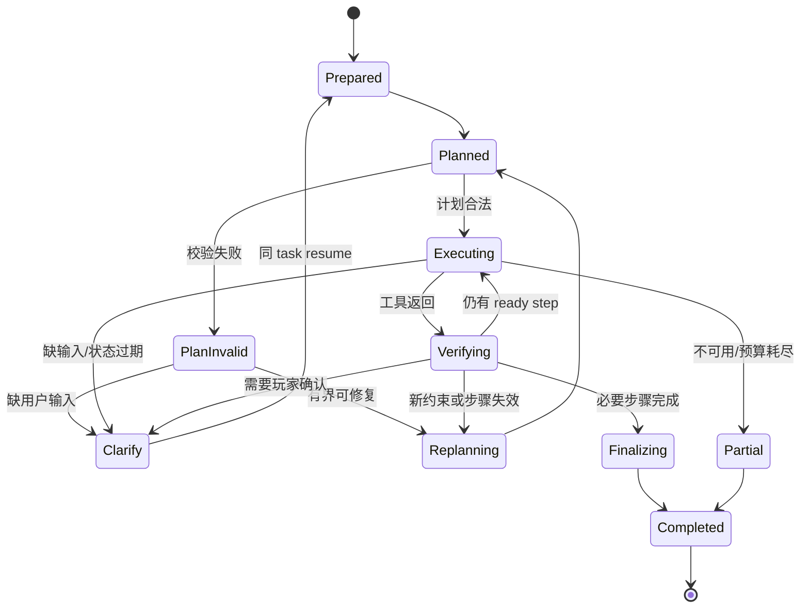

# Rust Coach 六层架构：决策层设计

修订日期：2026-11-03。决策层是理解层路由后的任务执行层：它接收结构化的 `CoachTaskRepresentation`，在知识、状态和工具能力约束下完成 Agent Loop、工具调用、结果验证和有限重规划，最后只把最终的任务解决结果交给生成层。`ExecutionPlan` 只存在于决策层内部，不是生成层的输入。决策层不重新解释原始图片，不以模型自由文本替代工具结果，也不直接操作游戏。

## 1. 六层架构定位

```text
输入层 → ParsedInput
理解层 → CoachTaskRepresentation + DecisionRequest
决策层内部 → ExecutionPlan / ToolCall / StepResult
决策层输出 → DecisionResult（TaskSolution）
生成层 → AnswerSpec → 最终回答
```

理解层回答“用户要完成什么，并且应该走哪条链路”；决策层回答“为了完成这个任务，需要执行哪些受约束的步骤，工具结果是否足够，下一步是什么”。

| 连接层 | 决策层接收/交付 | 边界 |
| --- | --- | --- |
| 理解层 | `DecisionRequest`：意图、约束、目标、状态引用、证据需求和路由 | 决策层可以提出缺口或重新理解请求，但不读取原始输入 |
| 知识层 | `KnowledgeQuery`、`KnowledgeContext`、规则、事实、历史、能力和业务约束 | 知识是依据，不是最终行动排序；工具能力由注册表校验 |
| 生成层 | `DecisionResult`：最终解决结果、声明、数值、假设、限制和引用 | 生成层只组织已验证结果，不能读取内部执行计划或改变结论 |

## 2. 核心职责与非职责

### 2.1 核心职责

1. **执行路由后的任务**：根据理解层给出的 `route`/`execution_mode` 进入简单调用链路或 Plan-and-Execute 链路。
2. **工具调用管理**：选择已注册的工具，校验 schema、能力、权限、预算、超时和幂等键，记录每次调用和结果。
3. **状态化 Agent Loop**：保存当前步骤、工具结果、证据需求、预算和恢复点；观察结果后决定继续、重试、重规划、澄清或完成。
4. **知识辅助规划**：向知识层请求规则、事实、行动定义、历史记忆、能力和约束，并检查适用版本和证据覆盖。
5. **结果验证**：校验计算输入/输出、行动前置条件、资源可行性、计划完成条件和引用完整性。
6. **有限重规划**：只修改尚未完成或已失效的步骤，复用仍然有效的结果，不通过删除用户目标或硬约束制造成功。
7. **结果交接**：把内部执行过程压缩为最终任务解决结果 `DecisionResult/TaskSolution`，供生成层组装；无法完整完成时明确 `partial`、`conditional`、`blocked` 或 `unavailable`。

### 2.2 非职责

- 不重新识别图片、解析原始多模态消息或猜测输入层未提供的状态。
- 不把 Planner 的文字建议直接视为事实，不让模型生成任意代码、SQL、工具名或工具参数。
- 不把搜索摘要、历史记忆或单个相似文档当作当前规则或当前库存。
- 不直接写入玩家长期状态；工具结果和玩家状态更新必须经过对应服务的确认、revision 和审计。
- 不生成最终面向用户的自由文本；语气、人设和回答结构属于生成层。

## 3. 两条处理链路

理解层必须在 `DecisionRequest.route` 中明确选择链路。决策层只做能力和前置条件校验，不把简单问题隐式升级为复杂 Agent Loop，也不把复杂建议降级成一次模型回答。

| 链路 | 适用任务 | 主要步骤 | demo 范围 |
| --- | --- | --- | --- |
| `simple_call` | 普通聊天转发、明确且单目标的强计算 | 规范化 → capability/schema 校验 → 一次工具调用或直接交生成层 → 结果校验 | 精确拆建筑/合成缺口；普通聊天可直接生成 |
| `plan_execute` | 基于玩家状态的建议、多目标取舍、需要多步证据或验证 | prepare → plan → validate → execute → observe/verify → replan → finalize | 当前状态下给出行动建议 |

### 3.1 简单调用链路

普通聊天不需要决策工具时，理解层可将 `conversation.general` 标记为 `direct_response`，直接交生成层；如果用户的问题包含领域事实，则先经过知识层的受限查询。强计算必须走确定性 CalculatorPort：

```text
DecisionRequest(simple_call)
  → normalize_tool_input
  → validate_slots_and_capability
  → invoke_calculator
  → validate_calculation_result
  → DecisionResult(calculation)
  → 生成层
```

首期强计算只包含：

- `raid.calculate`：拆建筑所需爆炸物和限定成本下的方案；
- `craft.plan_gap`：按配方、批次、已有成品/中间材料和库存计算资源缺口。

工具未配置时返回 `unavailable`，输入不完整时返回 `needs_input`，规则集不支持时返回 `unsupported`。模型不得回退为心算或补造数字。

### 3.2 Plan-and-Execute 链路

建议类请求需要把“研究执行计划”和“玩家行动计划”区分开：

```text
DecisionRequest(plan_execute)
  → prepare_decision
  → planner：生成 ExecutionPlan
  → validate_plan：白名单、依赖、预算、证据需求
  → select_next_step
  → executor：调用知识/计算/状态读取工具
  → verify_step：检查 success criteria 和结果来源
  → assess_progress
       ├─ continue：执行下一步
       ├─ replan：只修改未完成/失效步骤
       ├─ clarify：交理解层暂停并等待补充
       ├─ partial：保留已验证部分和限制
       └─ finalize：生成最终 TaskSolution
```

`ExecutionPlan` 是 Agent 为完成任务安排的研究和工具步骤，始终留在决策层内部。`finalize_decision` 将它和工具结果压缩成最终 `TaskSolution`；对于建议任务，`TaskSolution` 可以包含已选定的玩家行动建议（当前实现中的 `ActionPlan`），但生成层只接收这个最终结果，不接收执行步骤、工具轨迹或未选候选的内部推理。

## 4. 决策层输入输出协议

### 4.1 `DecisionRequest`

```json
{
  "request_id": "req-1",
  "task_id": "task-1",
  "understanding_revision": 1,
  "route": "plan_execute",
  "execution_mode": "plan_execute",
  "intent": {
    "kind": "decision.recommendation",
    "target": "next_progress_step",
    "desired_outcome": "在今晚 30 分钟内提升基地安全并推进科技"
  },
  "goals": [
    {"goal_id": "g1", "kind": "protect_base", "priority": "primary"},
    {"goal_id": "g2", "kind": "progress_technology", "priority": "secondary"}
  ],
  "constraints": [
    {"key": "available_time", "value": 30, "unit": "minute", "hard": true}
  ],
  "state_ref": {"scope_id": "scope-1", "revision": 12},
  "knowledge_context_refs": [],
  "required_evidence": ["action_prerequisites", "resource_feasibility"],
  "budget": {"max_steps": 6, "max_tool_calls": 12, "deadline_ms": 15000}
}
```

决策层只接受规范化引用和可序列化值。`state_ref` 不是玩家状态快照的副本；执行开始时读取并冻结需要的 revision，状态变化后按依赖使结果失效。

### 4.2 `DecisionState`

```json
{
  "task_id": "task-1",
  "route": "plan_execute",
  "plan_revision": 1,
  "execution_plan": {"steps": [], "status": "running"},
  "current_step_id": "step-2",
  "tool_calls": [],
  "knowledge_context_refs": [],
  "step_results": [],
  "evidence_needs": [],
  "assumptions": [],
  "clarification": null,
  "budget": {"tool_calls": 2, "steps": 1, "remaining_ms": 9000},
  "status": "running"
}
```

每个 `StepResult` 至少绑定 `step_id`、`plan_revision`、`input_hash`、`state_revision`、`evidence_set_id`、`provider_version`、`status` 和 `provenance`。相同幂等键的工具调用不得因重试重复产生副作用；当前 demo 工具均应保持无副作用。

### 4.3 `DecisionResult`

```json
{
  "task_id": "task-1",
  "status": "conditional",
  "result_kind": "recommendation_solution",
  "calculation": null,
  "solution": {
    "kind": "recommendation",
    "preferred": [],
    "alternatives": [],
    "preconditions": [],
    "first_step": null,
    "completion_criteria": [],
    "stop_or_switch_conditions": [],
    "feasibility_status": "conditional"
  },
  "supported_claims": [],
  "assumptions": [],
  "limitations": [],
  "evidence_refs": [],
  "state_ref": {"scope_id": "scope-1", "revision": 12},
  "plan_revision": 1
}
```

生成层可以把 `solution` 中已选定的建议、计算结果、假设和限制组织成回答，但不能改变 `status`、数字、候选 ID、前置条件或引用；它不接收 `execution_plan`、工具调用参数或中间步骤。

## 5. 工具调用管理

### 5.1 Tool Registry

所有工具先注册 capability，再允许 Agent 调用：

| 字段 | 作用 |
| --- | --- |
| `tool_id` / `provider_id` / `version` | 稳定身份和结果追溯 |
| `operation` | 允许的业务操作，如 `raid.calculate` |
| `input_schema` / `output_schema` | 代码校验参数和返回值 |
| `required_fields` | 由操作和 capability 决定的必填项 |
| `supported_rulesets` / `conditions` | 平台、版本和适用范围 |
| `side_effect` / `idempotency` | 是否写状态、重试策略和幂等要求 |
| `timeout_ms` / `cost_hint` | 单次调用守卫 |
| `traceability_level` | 是否能提供步骤、规则和来源引用 |

模型只能从 registry 中选择工具，不能生成新的工具名称或绕过 schema。决策层在调用前检查任务预算、用户权限、当前状态 revision 和工具可用性；调用后检查输出 schema、单位、范围、状态和 provenance。

### 5.2 重试和失败

| 情况 | 行为 | 任务状态 |
| --- | --- | --- |
| 临时网络/服务错误 | 按工具策略有限重试，重试使用同一幂等键 | `running` 或 `retrying` |
| 参数缺失或不合法 | 不重试，向理解层请求具体澄清 | `waiting_input` |
| provider 未配置 | 不循环追问玩家，报告能力缺失 | `unavailable`/`blocked` |
| 规则集不支持 | 保留不依赖该工具的结果，明确范围 | `unsupported`/`partial` |
| 返回值无法验证 | 丢弃不可信结果，记录错误和证据缺口 | `failed`/`partial` |
| 状态 revision 变化 | 使相关步骤 stale，刷新上下文后重选 | `stale`/`replanning` |

失败不能通过换一段模型措辞变成成功。预算耗尽、反复无新增信息和依赖死锁是明确的终止条件。

## 6. Plan-and-Execute Agent Loop

### 6.1 节点职责

| 节点 | 责任 | 关键门禁 |
| --- | --- | --- |
| `prepare_decision` | 冻结目标、约束、状态和能力上下文 | route、scope、revision、预算 |
| `planner` | 生成结构化 `ExecutionPlan` 和少量候选 | 只使用允许操作，不把结论当结果 |
| `validate_plan` | 校验步骤 schema、依赖 DAG、证据需求和预算 | 无环、无未知工具、无越权 |
| `select_next_step` | 选一个 ready step | 前置步骤成功、输入仍新鲜 |
| `executor` | 调用工具或知识子图 | capability、timeout、idempotency |
| `verify_step` | 比较输出和 success criteria | schema、状态、单位、来源 |
| `assess_progress` | 决定继续、重规划、澄清、部分或完成 | 有实际新增进展 |
| `replanner` | 只修改剩余或失效步骤 | 保留核心目标、硬约束和有效成果 |
| `finalize_decision` | 组装结构化结果 | 关键声明、行动条件、引用齐全 |

### 6.2 Loop 状态转移



每次循环都增加可观测的 `loop_iteration`，并检查 `max_steps`、`max_tool_calls`、`max_replans`、deadline 和无进展计数。Plan-and-Execute 不是无界自主循环。

## 7. 与理解层交互

决策层可以把执行中发现的缺口交给理解层，而不是自己猜测用户意图：

```json
{
  "feedback_kind": "needs_reinterpretation",
  "task_id": "task-1",
  "understanding_revision": 1,
  "reason": "玩家说的‘先加固’未说明是补墙还是修门",
  "affected_fields": ["intent.target", "goals", "constraints"],
  "evidence_refs": ["knowledge_claim:claim-7"],
  "preserve_results": ["step-1", "step-2"],
  "max_reinterpretations_remaining": 1
}
```

反馈类型：

- `needs_input`：缺少玩家状态、目标参数或确认；理解层生成 `ClarificationRequest` 并中断同一任务；
- `needs_reinterpretation`：新事实改变实体、目标或约束；理解层生成新的 representation revision；
- `conflicted`：知识、状态或用户目标冲突；保留来源并请求选择；
- `accepted`：任务表示足够，继续当前计划；
- `unsupported`：平台、能力或工具边界不支持，返回明确限制。

补充回答重新经过输入层，使用新的 `input_revision`，但沿用 `task_id`。理解层只重算受影响字段；决策层保留未失效的证据和工具结果，避免重复执行。

## 8. 与知识层交互

决策层按候选行动或执行步骤构造 `KnowledgeQuery`，至少说明：

```json
{
  "query_id": "q-7",
  "consumer": "decision",
  "purpose": "action_constraints",
  "task_id": "task-1",
  "step_id": "step-2",
  "entity_ids": ["action.reinforce_door"],
  "required_claims": ["preconditions", "resource_cost", "completion_criteria"],
  "context": {"platform": "pc", "ruleset": "vanilla", "build": null},
  "state_ref": {"scope_id": "scope-1", "revision": 12},
  "allowed_channels": ["structured", "vector", "graph", "memory", "web"],
  "budget": {"max_tool_calls": 4}
}
```

知识层返回的 `KnowledgeContext` 只作为规划输入和证据，必须经过适用性、版本、冲突和覆盖检查。决策层可使用：

1. 结构化规则和行动定义检查硬前置条件；
2. 历史记忆和策略案例生成候选，但不能替代当前玩家状态；
3. 工具 capability 判断是否能进行精确计算；
4. `EvidenceNeed` 请求证据，接收 `EvidenceBundle` 后验证每个关键声明。

知识缺口不等于玩家缺口：规则缺失走检索/降级，玩家状态缺失交理解层澄清。两者必须在 `DecisionResult.limitations` 中区分。

## 9. 与生成层交互

决策层交给生成层的是最终结构化解决结果，而不是 `ExecutionPlan` 或“请根据下面内容自由发挥”的长提示：

```text
DecisionResult
  ├─ CalculationResult（数字、单位、输入哈希、provider/data version）
  ├─ TaskSolution（计算解或建议解；可包含已选行动的前置/完成/改道条件）
  ├─ supported_claims / evidence_refs
  ├─ assumptions / limitations
  └─ status：verified / conditional / blocked / partial / unavailable
```

生成层可以选择解释顺序、语言和人设表达，但必须保持候选 ID、数字、单位、可行性、前置条件、限制和来源不变。若结果为 `partial` 或 `blocked`，生成层必须明确未完成原因，不能用积极语气伪装为完成。生成层不应展示 Agent 的研究步骤，除非这些步骤已经被决策层明确压缩为用户任务解决结果中的“下一步”。

## 10. Demo 范围与实现映射

### 10.1 两类用户需求

| 用户需求 | 理解层路由 | 决策层链路 | 必须交付 |
| --- | --- | --- | --- |
| 精确回答强计算问题 | `calculation.raid` / `calculation.craft_gap` → `simple_call` | 槽位校验 → CalculatorPort → 结果验证 | 可追溯数字、输入、单位、缺口和限制 |
| 基于当前玩家状态给出决策建议 | `decision.recommendation` → `plan_execute` | Planner → 工具/知识 → 验证 → 评估 → TaskSolution | 首选/备选、前置、第一步、完成和切换条件 |

简单聊天走生成层直达路径；当聊天出现游戏事实、状态或建议诉求时，由理解层重新路由到知识或决策链路。它不能因为表面上是聊天就绕过事实保护。

### 10.2 当前实现

| 设计对象 | 当前实现 | 差距 |
| --- | --- | --- |
| 简单计算调用 | `CalculationService`、`Calculator`、`workflows.py` 的 `calculate` | 已有受限实现；尚未统一为 Tool Registry/DecisionResult |
| 建议链路 | `AdviceService`、网页证据、玩家状态和记忆 | 已有局部 Plan/取证能力；尚未完整实现通用 Executor Loop |
| 理解层路由 | `workflows.py` 的 `route`、`is_advice`、计算匹配器 | 仍是代码分支，不是版本化 `DecisionRequest.route` |
| 知识调用 | `EvidenceStore`、`WebResearch`、建议服务 | 尚未统一 `KnowledgeQuery/KnowledgeContext` 到决策层 |
| 结果交接 | `AdviceAnswer`、计算回复和人设校验 | 尚未统一 `DecisionResult → AnswerSpec` 协议 |

目标是先把现有计算和建议服务包装在两个决策适配器后，再逐步抽取 Tool Registry、步骤结果、预算和恢复协议；不因为已有 `AdviceService` 就宣称完整 Agent Loop 已实现。

## 11. 评测与验收

1. **强计算正确性**：固定规则和输入下，结果由 CalculatorPort 产生；模型不能修改数字；每个结果能追溯到 input hash、规则/data version 和 provider。
2. **强计算失败边界**：缺字段、工具未配置、规则集不支持、超时和输出校验失败分别返回 `needs_input`、`unavailable`、`unsupported`、`partial` 或明确错误。
3. **建议状态一致性**：计划使用冻结的玩家 state revision；未知不等于零；状态变化会使相关步骤 stale，不重复扣减或虚构执行。
4. **建议可执行性**：每个首选行动有前置条件、资源/时间约束、第一步、完成标准和切换条件；候选排序理由来自证据或明确偏好。
5. **Agent Loop 安全性**：工具白名单、schema、权限、超时、幂等键、最大步骤/调用/重规划次数和无进展终止全部生效。
6. **跨层恢复**：决策层可以请求理解层澄清或重理解；同一任务恢复时保留有效成果，补充信息不会重复执行已有副作用。
7. **生成一致性**：生成层不能改动数字、候选、可行性、假设和引用；`partial/blocked` 必须显式呈现。

最低验收条件是：简单强计算不经过无必要的 Planner；状态建议必须经过 Plan-and-Execute；两条链路都将内部执行过程压缩为最终结构化 `DecisionResult/TaskSolution`；生成层看不到 `ExecutionPlan`；知识、状态、工具和模型调用均可追溯；无法完成时诚实降级。

## 12. 建议落地顺序

1. 定义 `DecisionRequest`、`DecisionState`、`ToolCall`、`StepResult`、`DecisionResult` 和状态枚举。
2. 把现有两个计算入口包装为只读、可校验、可追溯的 CalculatorPort，并实现 `simple_call`。
3. 把现有建议链路拆成 `prepare/plan/execute/verify/finalize` 节点，先支持串行步骤和有界重规划。
4. 接入统一 `KnowledgeQuery/KnowledgeContext` 和 `EvidenceNeed`，区分规则缺口与玩家状态缺口。
5. 将 `needs_input/needs_reinterpretation` 接到理解层的同任务恢复，补充幂等、依赖失效和预算测试。
6. 最后把最终 `DecisionResult/TaskSolution` 接入生成层的 `AnswerSpec` 和跨层评测，明确过滤 `ExecutionPlan`，而不是让生成层直接读取 Agent State。
