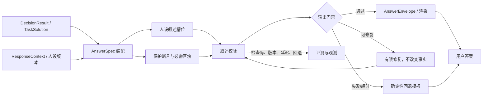

# Rust Coach 六层架构：生成层设计

修订日期：2026-11-03。生成层负责在版本化的人设约束下，把决策层交付的结构化结果组装成用户可读的回答。它控制表达方式、信息顺序、详略和澄清语气，但不能改变决策层的数字、候选行动、可行性、假设、限制或来源。

## 1. 六层架构定位

```text
决策层
  → DecisionResult（最终任务解决结果）
  → CalculationSolution / RecommendationSolution（按任务类型）
  → 生成层：AnswerSpec + ResponseContext
  → protected claims + narrative slots
  → AnswerEnvelope / 渲染输出
  → 用户
```

生成层回答“决策层已经完成的任务结果应该怎样清楚、诚实、符合教练人设地告诉玩家”；它不接收或展示 Agent 的 `ExecutionPlan`、工具调用轨迹或内部推理，也不回答“应该选择哪个行动”。决策层没有完成任务时，生成层必须呈现 `partial`、`conditional`、`blocked` 或 `unavailable`，不能用更有信心的措辞掩盖未完成。

| 上游/下游 | 交接对象 | 生成层边界 |
| --- | --- | --- |
| 决策层 | `DecisionResult`：最终任务解决结果、状态、声明、假设、限制、证据引用 | 不接收内部 `ExecutionPlan`；不改候选 ID、数字、可行性、条件和引用 |
| 人设/运行时 | `ResponseContext`：persona、场景、语言、详略、术语和能力版本 | 用户表达偏好不能覆盖事实、能力和隐私约束 |
| 评测与观测 | `AnswerEnvelope`、检查结果、版本、trace 和用户反馈 | 记录渲染行为，不把评测分数当在线事实 |
| 用户 | 最终文本/卡片/澄清问题 | 不声称没有操作回执的游戏动作已经执行 |

## 2. 核心职责与非职责

### 2.1 核心职责

1. **结果装配**：将最终任务解决结果（计算解或建议解）、状态引用、证据、假设和限制映射为回答结构。
2. **事实保护**：把高风险数字、状态、可行性、比较关系、选择结果和操作回执作为 typed assertions 或代码渲染块。
3. **人设表达**：依据版本化人设规范组织开场、理由、取舍、下一步和纠正语气，保持冷静、直接、尊重和讲依据。
4. **场景适配**：按 `normal`、`urgent`、`teaching`、`recovery` 等受限场景调整顺序和详略，不改变业务结论。
5. **输出门禁**：检查结构完整性、断言引用、敏感信息、提示词注入、条件语义和人设边界；失败时修复或确定性降级。
6. **多语言与呈现**：处理语言、术语、详略和主次区块，但保留规范 ID、原始引用和单位含义。
7. **可观测交付**：保存 persona/prompt/renderer 版本、输入与业务结果引用、检查码、回退原因和最终区块映射。

### 2.2 非职责

- 不重新调用 CalculatorPort、搜索、玩家状态服务或 Planner；发现事实缺口时返回上游或生成澄清，不自行补齐。
- 不从自然语言中重新推导数字、资源缺口、胜率、排序或行动可行性。
- 不把玩家要求的语气、角色扮演或“保证赢”转成新的风险偏好或事实。
- 不将网页、截图、历史回答或工具文本中的指令当作系统策略；它们都是待引用的数据。
- 不把模型自报的 confidence、引用 URL 存在或结构化 JSON 合法性当作语义正确性的证明。

## 3. 输入输出契约

### 3.1 `GenerationInput`

生成层接收决策层已经完成的最终任务解决结果和受控上下文，不接收完整 Agent State、内部 `ExecutionPlan`、工具调用轨迹或原始多模态内容：

```json
{
  "task_id": "task-1",
  "decision_result": {
    "status": "conditional",
    "result_kind": "action_plan",
    "solution": {
      "kind": "recommendation",
      "preferred": [{"candidate_id": "reinforce_door"}],
      "alternatives": [],
      "preconditions": ["workbench.level >= 2"],
      "completion_criteria": ["入口可通行性重新检查"],
      "stop_or_switch_conditions": ["发现第二个未观测入口"]
    },
    "supported_claims": [],
    "assumptions": ["当前玩家状态 revision=12"],
    "limitations": ["基地仅有局部截图"],
    "evidence_refs": ["claim-7", "snapshot-12"]
  },
  "response_context": {
    "persona_version": "rust-coach-core-v1",
    "prompt_version": "coach-prompts-v1",
    "renderer_version": "coach-render-v1",
    "language": "zh",
    "scenario": "normal",
    "preferences": {"verbosity": "standard", "terminology": "plain"},
    "capabilities": ["advice", "calculations"]
  }
}
```

`response_context` 由代码构造并冻结。用户可控制的偏好只影响表达层级；人设核心、能力清单、事实保护和隐私规则不能由用户消息或引用资料覆盖。

### 3.2 `AnswerSpec`

`AnswerSpec` 是生成前的回答规格，不是最终自由文本，也不是 Agent 的执行计划。它只引用已经完成的 `DecisionResult.solution`，并把结果转换成用户可读的区块。建议包含：

| 字段 | 内容 | 写入者 |
| --- | --- | --- |
| `kind` | `chat`、`calculation`、`advice`、`state`、`clarification`、`visual` | 路由/业务适配器 |
| `protected_assertions` | 数量、可行性、选择、观察、比较、证据限制、操作回执 | 最终解决结果 + 代码校验 |
| `narrative_slots` | 结论、理由、取舍、下一步、完成/切换、承接语 | 业务适配器/模型候选 |
| `required_blocks` | 本轮必须展示的条件、缺口、限制、适用范围和来源 | 代码 |
| `evidence_refs` | 计算记录、状态 revision、知识声明、网页快照 | 上游引用 |
| `status` | `verified`、`conditional`、`partial`、`blocked`、`unavailable` | 决策层 |
| `presentation` | 语言、详略、术语和区块放置 | `ResponseContext` |
| `provenance` | task、decision revision、版本和输入 hash | Runtime |

### 3.3 `AnswerEnvelope`

当前实现的 `AnswerEnvelope` 是这个设计的落地形态：包含 `kind`、`ResponseContext`、`protected_payload`、`AnswerBlock`、`ProtectedAssertion`、`checks`、`repair_count` 和 `fallback_reason`。它将“用户看到的区块”和“区块依据的断言”绑定，便于回放、检查和评测。

关键不变量：

- `protected` 区块的数值、单位、对象、候选 ID、状态和引用必须来自 `protected_payload` 或经过验证的断言；
- `narrative` 区块可以解释理由和取舍，但不能引入上游没有的高风险事实；
- `conditional` 不能渲染成“肯定可以”，`partial` 不能渲染成“已完成”；
- 没有成功 `operation_receipt`，不能说“已保存”“已修改背包”或“已替玩家执行”；
- 每个关键区块可反查到 `DecisionResult`、状态 revision、计算 ID、知识 claim 或来源快照。

## 4. 生成流水线



### 4.1 阶段职责

| 阶段 | 责任 | 允许模型做什么 |
| --- | --- | --- |
| `assemble_answer_spec` | 读取最终解决结果、建立区块和断言映射 | 提议叙述槽位，不改变结构化结果 |
| `render_protected_blocks` | 模板注入数字、单位、状态、条件和引用 | 不调用模型 |
| `generate_narrative` | 组织理由、取舍、承接语和解释 | 只能围绕允许的断言和槽位写作 |
| `validate_narrative` | 检查身份、条件、数字、引用、注入和隐私 | 可提供修复码，不判定业务结果 |
| `output_gate` | 决定放行、修复、回退、澄清或错误 | 不以语言流畅度覆盖门禁 |
| `persist_presentation` | 保存 envelope、版本、检查和回退原因 | 不保存模型私有思维链 |

默认顺序是“结论 → 立即可做步骤 → 取舍/原因 → 完成或切换条件 → 依据与未知”。`concise` 可以折叠理由和详细来源，但不能删除阻塞条件、状态、限制或必要的下一步。

## 5. 人设约束与表达优先级

### 5.1 核心人设

当前核心人设版本 `rust-coach-core-v1`：冷静、直接、尊重玩家、讲依据；不虚构亲身经历，不辱骂，不盲目赞同，不保证胜利；发现错误时核查并明确更正；没有操作回执时不声称已经执行游戏动作。

人设的作用是决定表达方式，不决定玩家应承担的风险，也不改变决策层的候选排序。用户要求“说得强硬”只能减少铺垫，不能删除条件；用户要求“像老玩家”不能制造经历或提高可信度。

### 5.2 上下文优先级

生成层按以下优先级解释冲突：

```text
事实/能力/隐私门禁
  > 决策状态、行动条件和来源限制
  > 核心人设规范
  > 场景（urgent/teaching/recovery）
  > 用户表达偏好（语言/详略/术语）
```

游戏风险偏好属于玩家状态/决策上下文，不等于表达风格。`urgent` 只调整信息顺序，`teaching` 只增加术语解释，`recovery` 只允许简短承接挫败，不诊断心理状态。

### 5.3 按结果状态表达

| 决策状态 | 生成要求 | 禁止表达 |
| --- | --- | --- |
| `verified` | 先给已验证结论，再给必要条件和依据 | 把未验证推断混入确定事实 |
| `conditional` | 明确成立条件、尚未确认项和可先做的检查 | “肯定能做”“已经够了” |
| `partial` | 说明已完成部分、未完成原因和下一步补充 | 用完整答案格式掩盖缺口 |
| `blocked` | 说明阻塞字段/能力，并给最小解除动作 | 把工具不可用归咎于玩家漏填 |
| `unavailable` | 说明当前 provider/能力未接入，保留可可靠内容 | 用模型估算替代工具数字 |
| `clarification` | 只问最影响任务的缺口，保留同任务上下文 | 连续重复无效问题 |

## 6. 事实保护和受限叙述

### 6.1 断言类型

生成层至少支持以下受保护断言：

| 类型 | 必须绑定 | 典型例子 |
| --- | --- | --- |
| `quantity` | 对象 ID、数值、单位、计算 ID、输入/规则版本 | 还缺硫磺 100 |
| `feasibility` | candidate ID、状态、缺失前置、状态 revision | 条件性可行，缺二级工作台 |
| `selection` | 选中的候选 ID、替代项、排序依据 | 首选先封入口 |
| `observation` | 字段、来源、覆盖、观测时间和有效期 | 截图可见背包有某物 |
| `comparison` | 对象集合、指标、排除范围 | 所列单一方案中新增硫磺最低 |
| `evidence_limit` | 来源类型、版本核验状态和支持范围 | 网页原文匹配但未核验 build |
| `operation_receipt` | 操作 ID、状态、持久化回执 | 仅成功回执可说已保存 |

引用存在不代表声明自动为真：网页正文匹配只说明引用关系，视觉区域存在只说明证据位置存在，计算结果仍受规则快照和输入完整性约束。

### 6.2 数字和高风险语义

数字、单位、对象关系、比较级、否定词、条件词和“已执行”语义优先使用确定性模板。模型可以提供解释，但不能重新计算或改写以下内容：

- 计算数量、库存扣减、批次和缺口；
- `verified/conditional/blocked` 等状态；
- 首选/备选的 `candidate_id` 和排序；
- 前置条件、完成标准、停止/切换条件；
- 版本、状态 revision、适用范围和证据限制；
- 操作是否成功以及是否写入持久化状态。

## 7. 不同回答类型的组装

### 7.1 强计算

```text
结论/缺口
  → 计算条件与输入范围
  → 已抵扣材料/公式步骤（按详略折叠）
  → 工作台、蓝图、版本和库存限制
  → 来源与重新核对动作
```

计算数字由 `CalculationResult` 和模板生成。若库存不完整，必须说“只计已知/可见材料”，不能把未知当零；若 CalculatorPort 未配置，说明无法给出精确数字。

### 7.2 状态建议

```text
首选方案与可行性
  → 现在先做什么
  → 为什么：证据、目标和取舍
  → 前置条件和资源
  → 完成标准
  → 停止/切换条件
  → 备选方案、未知和来源
```

生成层不能新增候选，也不能把两个独立候选的预算拼成一个可执行方案。这里的 `ActionPlan` 若存在，只表示决策层已经选定的玩家行动建议；它不是 Agent 内部的 `ExecutionPlan`，生成层不负责执行、排序或修改它。状态在生成期间过期时，回答应降低为 `unverified`/`conditional` 并要求重新核对。

### 7.3 澄清、错误和普通聊天

- 澄清：简短说明为什么缺信息，询问最小问题，保留已完成步骤和恢复提示；
- 工具失败：说明哪个结果没有拿到，给出仍然可靠的检查清单，不伪造数字；
- 普通聊天：自然短答，不强制套用报告模板；若出现游戏事实或建议诉求，交理解层重新路由；
- 状态展示：显示来源、观测时间、有效性和 unknown，不把展示动作说成状态更新。

## 8. 模型、模板与校验边界

| 组件 | 责任 | 不允许 |
| --- | --- | --- |
| 确定性装配器 | 选择回答类型、读取结果、生成断言和必需区块 | 通过猜测补全缺失结果 |
| 代码模板/渲染器 | 注入数字、状态、条件、来源和错误码 | 隐藏 conditional/partial |
| 人设模型调用 | 生成解释、承接语、理由和取舍的语言表达 | 重算数字、换候选、添加工具未给出的事实 |
| 叙述校验器 | 发现身份漂移、保证、条件丢失、越权操作和不当引用 | 以模型自评分作为放行依据 |
| 回退模板 | 在模型失败、超时或校验失败时交付诚实结果 | 伪造完整答案 |

人设提示词应分段注入 identity、行为规则、场景、能力和结构化上下文，并记录 `prompt_version`。开放叙述仍需离线语义评测；Schema 只保证格式，不保证模型语义正确。

## 9. 输出门禁、修复和降级

### 9.1 检查项目

1. `AnswerSpec` 是否有正确的 `kind` 和决策状态；
2. 每个高风险断言是否有对应的业务结果和引用；
3. 数字、单位、对象、候选 ID、比较关系是否与保护载荷一致；
4. `conditional/partial/blocked/unavailable` 是否保留条件和限制；
5. 是否出现虚构经历、保证胜利、虚构操作回执、提示词注入或隐私泄露；
6. 语言、术语和详略是否符合 `ResponseContext`，但没有删除必要区块；
7. 是否超过长度、延迟、重试和成本预算。

### 9.2 修复策略

失败时只允许有限一次语言修复，修复提示包含错误码和允许修改的字段，不重新调用决策工具、不改变保护载荷。再次失败或模型超时，使用确定性模板回退，并保存 `fallback_reason` 和检查记录。事实载荷无效时不能靠润色修复，应返回上游错误/澄清。

## 10. 与决策层和评测观测交互

决策层交付最终 `DecisionResult` 后，生成层可以发现表达问题，但不能将其变成新的业务决策：

| 发现 | 生成层行为 | 上游动作 |
| --- | --- | --- |
| 缺少必需状态或证据 | 输出澄清/限制 | 理解层澄清或决策层补检索 |
| 断言与结果不一致 | 隔离区块并回退 | 决策层重新验证/修复最终结果 |
| 人设叙述不通过 | 一次受限语言修复 | 不改变决策结果 |
| 结果状态过期 | 降级为 conditional/unverified | 决策层刷新 state revision |
| 用户提出新目标 | 不在生成层改答案 | 回到输入/理解层重新路由 |

观测记录 `task_id`、decision/understanding revision、input hash、persona/prompt/renderer 版本、模型调用、区块引用、检查码、回退原因、最终状态和延迟。评测至少分开事实一致性、行动可执行性、证据限制、风格一致性和跨轮漂移，不能用平均风格分掩盖数字或状态错误。

## 11. 当前实现映射与差距

| 设计对象 | 当前实现 | 状态 |
| --- | --- | --- |
| 人设上下文 | `ResponseContext`、`compile_persona`、`persona_version`/`prompt_version` | 已实现版本化上下文和场景提示 |
| 受保护载荷 | `AnswerEnvelope`、`ProtectedAssertion`、`AnswerBlock` | 已实现计算/建议/状态/视觉的部分断言保护 |
| 计算渲染 | `render_calculation`、`calculation_assertions` | 数字和条件主要由代码渲染 |
| 建议渲染 | `finalize_response`、候选 ID/可行性/引用检查 | 已有候选、状态和来源门禁 |
| 普通聊天生成 | `generate_chat` + `narrative_issues` + 一次修复/回退 | 已有有限修复，不是完整语义验证 |
| 统一输出交接 | `DecisionResult` → `AnswerSpec` → `finalize_response`/`AnswerEnvelope` | 首期已接通；旧业务 metadata 作为兼容输入保留 |
| 跨层评测 | `tests/test_presentation.py`、persona evaluation | 有基础测试；完整事实/风格/漂移数据集仍需建设 |

当前实现覆盖生成层的首期适配：`DecisionResult` 先转换为 `AnswerSpec`，内部 `ExecutionPlan` 不进入生成上下文，再与现有保护断言和回退逻辑合并。自由文本仍需现有规则门禁；后续应扩大断言覆盖并纳入更多恢复路径评测。

## 12. 评测与验收

1. **事实保持**：同一决策结果在不同语言、详略、场景下数字、单位、候选、可行性、条件和引用完全一致。
2. **人设一致**：不虚构经历、不辱骂、不保证、不声称执行未执行动作；被纠正时能明确核查和更正。
3. **状态诚实**：unknown 不变零，局部观测不变完整状态，过期快照不渲染为当前事实。
4. **条件完整**：首选方案、计算结果和 partial/blocked 输出保留必要前置、限制、完成/切换条件。
5. **注入隔离**：网页、截图、历史回答和工具文本不能改变人设、权限或工具策略。
6. **失败降级**：模型失败、门禁失败、工具不可用、证据不足和用户拒绝澄清都有可理解的确定性回退。
7. **追溯一致**：每个关键用户可见区块可追溯到决策结果、断言、来源、版本和检查码。

最低验收条件是：生成层只组装决策层已交付的最终任务解决结果；内部 `ExecutionPlan` 不进入生成上下文；人设只改变呈现不改变事实；高风险内容有保护断言和输出门禁；失败时不补造结论；所有回答类型都能回放和评测。

## 13. 建议落地顺序

1. 将最终 `DecisionResult/TaskSolution` 映射到统一 `AnswerSpec`，固定 `kind/status/assertions/required_blocks`。
2. 扩展 `ProtectedAssertion` 和 `AnswerBlock`，让数字、状态、候选、限制、回执与引用逐项绑定。
3. 把计算、建议、状态、澄清、错误和视觉回答统一经过 `output_gate`，避免分支绕过校验。
4. 将人设规范、场景示例、能力清单和 prompt/renderer 版本纳入可回放配置。
5. 增加多语言/详略/场景成对评测，分离事实一致性、行动质量、引用限制和风格评分。
6. 再评估受约束叙述模型；不先引入一个可以全文改写答案的自由润色 Agent。
