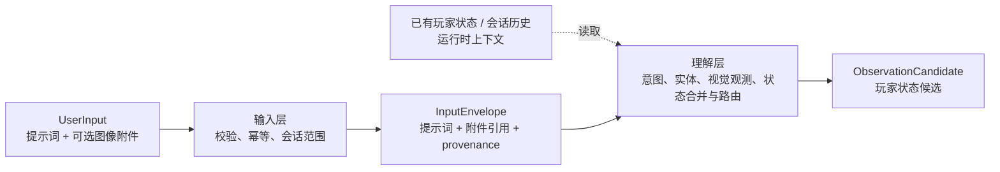

# Rust Coach 六层架构：输入层设计

修订日期：2026-11-03。本文先明确六层架构中的输入层，重点说明用户如何提交提示词和图像等多模态内容。输入层只接收用户输入并形成可追踪的请求对象；玩家状态的解析、合并和持久化由理解层及状态服务完成，知识检索、决策和回答生成由后续层完成。

## 1. 六层架构定位

系统按以下六层组织。层之间通过版本化的数据契约连接，避免模型调用、玩家状态和业务决策互相越权。

| 层 | 核心职责 | 输入层交付物 |
| --- | --- | --- |
| 输入层 | 接收用户提示词和可选多模态附件；校验、归一化、记录来源和范围 | `InputEnvelope` |
| 理解层 | 解析意图、实体、槽位和观测候选；合并有效上下文并路由 | `IntentSpec`、`ObservationCandidate`、有效状态引用 |
| 知识层 | 管理规则、机制资料、实时证据和版本；返回可引用依据 | `EvidenceBundle`、规则/版本引用 |
| 决策层 | 计算、计划、约束验证、候选比较和条件判断 | `ActionPlan`、`CalculationResult` |
| 生成层 | 按人设组织解释，注入已验证事实并执行输出门禁 | `AnswerSpec`、最终回答 |
| 评测与观测 | 记录 trace、质量指标、成本和 badcase，驱动回归与发布 | 评测样本、观测事件、改进反馈 |

输入层不解释图片中的物品，不把聊天里的愿望写成玩家事实，也不决定“应该先做什么”。它只保证后续层拿到合法的用户输入和清晰的 provenance。

## 2. 输入层边界

输入层只接收一种外部输入：**用户输入（`UserInput`）**。它由用户提示词和可选的图像附件组成：

```text
UserInput = prompt + optional attachments
```

- `prompt` 可以是自然语言问题、显式命令或对上一轮的补充回答；展示偏好、任务 ID 等是请求元数据或控制参数，不构成另一种业务输入。
- `attachments` 当前支持静态 PNG、JPEG、WebP。它们是用户输入的组成部分，不是独立的玩家状态输入。
- 玩家状态不作为输入层入口。它要么由理解层从 `prompt` 或图像中解析成观测候选，要么作为已有上下文由运行时读取；状态确认和持久化在输入层之后完成。

这样可以区分“用户提交了什么”和“系统据此理解出了什么”。`unknown`、库存数量、基地属性等状态字段只能出现在理解层或状态服务的结构化结果中，不能由输入层直接推断。



提示词和附件可以在同一用户输入中组合，例如“根据这张背包截图，计算还缺多少材料”；消息只携带附件引用，图片内容由理解层按授权读取。已有玩家状态和会话历史是理解层使用的上下文，不是输入层新增的输入类型。

## 3. 用户请求接入

### 3.1 入口和生命周期

聊天入口为 `POST /api/conversations/{conversation_id}/messages`。请求至少包含 `request_id` 和 `message` 或附件之一；继续同一任务时由运行时关联会话和历史上下文。请求 ID 用于幂等和重放，`conversation_id` 用于附件、玩家状态绑定和历史消息的范围隔离。

设计契约中的 `UserInput.prompt` 在当前实现中对应 `ChatRequest.message`；`UserInput.attachments` 对应上传后提交的 `attachment_ids`。当前 `ChatRequest` 的主要字段如下：

| 字段 | 用途 | 校验 |
| --- | --- | --- |
| `request_id` | 请求幂等键、结果回放 | UUID |
| `message` | 用户问题、命令或补充回答 | 去首尾空白，最多 6000 字符 |
| `attachment_ids` | 引用已上传的附件 | 最多 4 个，不允许重复 |
| `image_context` | 每张图的主体和采集时间提示 | 只能引用本请求中的附件 |
| `visual_draft_id` | 继续一个已保存的视觉草稿 | 不能与新附件同时提交 |
| `player_inventory_container` | 计算时选择的容器 | 仅接受规范化容器 ID |
| `presentation_preferences` | 本轮表达偏好 | 只影响生成层，不改变事实 |

这些可选字段是同一个 `UserInput` 请求的控制参数或元数据，不会把库存、偏好或状态拆成新的输入层类别；真正的玩家状态仍由理解层解析或由上下文服务提供。

原始请求应保留引用或脱敏审计记录，不能让模型自报的用户 ID 覆盖运行时身份。当前版本为本机单用户应用，实际权限边界由会话 ID 和本地存储实现；未来多用户部署时应在同一入口增加鉴权和租户范围。

### 3.2 请求处理顺序

```text
接收 HTTP 请求
  → 请求体与字段校验
  → request_id 幂等检查
  → 校验会话/附件归属
  → 读取会话/玩家状态上下文引用
  → 生成 InputEnvelope
  → 交给理解层解析意图和观测
```

输入层只做格式、大小、归属、版本和范围校验。诸如“这是拆家问题还是建议问题”“图片里是不是硫磺”“玩家有多少硫磺”属于理解层。

## 4. 玩家状态的形成与上下文读取

玩家状态不是输入层的独立入口，而是用户输入经过理解后的结构化结果，或运行时为当前会话加载的已有上下文。处理路径分为三种：

1. 用户在 `prompt` 中说“我有 140 个硫磺”，理解层生成状态观测候选；确认后由状态服务写入档案。
2. 用户提交截图，视觉解析生成带区域引用的观测候选；确认后才写入状态档案。
3. 用户没有在本轮提供状态，运行时按会话绑定读取已有玩家状态；它作为理解层上下文，不回流成新的用户输入。

当前项目的 `/api/player-state/*` API 虽然在部署上也接收 HTTP payload，但它是状态档案的管理和确认接口，归属于状态服务，不是 Coach 任务的输入层入口；输入层仍只有 `UserInput` 一种外部输入：

- `POST /api/player-state/scopes` 创建服务器/清档范围；
- `POST /api/player-state/scopes/{scope_id}/observations` 写入已确认的结构化观测；
- `POST /api/player-state/scopes/{scope_id}/preview` 将文本解析成待确认草稿；
- `POST /api/conversations/{conversation_id}/player-state` 将对话绑定到一个状态范围；
- 视觉识别结果必须经过视觉草稿确认接口，不能直接从截图写入状态档案。

状态服务使用 `observation_id + expected_revision` 做幂等和乐观并发控制。库存支持 `patch` 和完整 `replace` 两种模式；局部截图或“我又捡到 100 个”不能被当作完整库存。

### 4.1 状态观测契约

以下是理解层/状态服务之间的观测契约示例，不是输入层接收的第三种请求体。`scope` 用于说明状态范围；当前 API 中它由 URL 和对话绑定解析，不直接放在 `StateUpdate` 请求体内：

```json
{
  "observation_id": "uuid",
  "expected_revision": 12,
  "observed_at": "2026-11-03T10:00:00+08:00",
  "source": "manual",
  "scope": {
    "server_id": "server-a",
    "wipe_id": "wipe-42",
    "ruleset": "pc_vanilla"
  },
  "changes": {
    "facts": {"technology.workbench": 2},
    "inventory": [{"container_id": "backpack", "mode": "replace", "complete": true, "items": {"sulfur": 140}}]
  }
}
```

理解层和玩家状态服务负责实体规范化、冲突合并、TTL、事件失效和 revision 投影。每个字段或容器应保留 `source`、`observed_at`、`coverage`、`verification`、`valid_until`、`server_id` 和 `wipe_id` 等 provenance；输入层不擅自提高可信度。

### 4.2 状态来源和优先级

状态来源按“可追溯”而不是按“模型置信度”排序：人工表单/确认观测、明确文本草稿、图像候选、历史上下文。多个来源冲突时保留冲突并交给理解层或状态服务处理；不能因为旧值看起来更合理就覆盖新观测。换服、换清档、死亡、交易或被袭击等事件只作为输入事件记录，失效范围由状态服务决定。

## 5. 图像附件作为 UserInput 的一部分

### 5.1 上传和附件引用

浏览器先预览、选择或拖入图片，再调用 `POST /api/conversations/{conversation_id}/attachments` 上传单个 multipart `file`。这是构造 `UserInput.attachments` 的预处理步骤，输入层执行：

1. 限制请求体和单图大小，拒绝空文件；
2. 按真实解码格式检查，只接受静态 PNG/JPEG/WebP；
3. 解码并应用 EXIF 方向，转成 RGB PNG，生成缩略图；
4. 检查像素数和最长边，防止解压炸弹和异常大图；
5. 计算 SHA-256，生成 `attachment_id`、尺寸、字节数、创建时间和到期时间；
6. 将原图和元数据存到当前会话的私有附件目录，消息只携带附件 ID。

当前实现默认每图最多 8 MiB、2000 万像素、最长边 8192；总附件空间为有限本地配额。实际限制以运行时配置为准。

### 5.2 图像上下文

消息可为每个 `attachment_id` 提供 `image_context`。当前线上的 JSON 形态是以附件 ID 为键的对象：

```json
{
  "image_context": {
    "uuid": {
      "subject": "self",
      "captured_at": "2026-11-03T09:58:00+08:00"
    }
  }
}
```

`subject` 只表达“本人、对手、队友或未知”的上下文提示，不能证明图片内容；缺省时由理解层按当前会话规则形成候选假设。`captured_at` 必须带时区，缺省不补写拍摄时间。图片的像素读取、物品识别、区域框和未知项提取属于理解层视觉子图。

### 5.3 图像数据边界

- Graph State、消息历史和日志只保存附件引用、哈希、区域和抽取结果，不保存 Base64 或原始图片字节。
- 视觉模型调用前由附件服务按会话归属读取图片；模型输出必须经过 Schema、规范 ID、数量形式、区域引用和主体/时间校验。
- 一张图是局部观察还是完整盘点由理解层和状态服务判断。未展示的格子保持未知，不能当作零库存。
- 视觉识别结果默认是本轮临时观测；只有用户确认并调用保存流程，才进入玩家状态档案。图片本身不进入公共知识库。
- 删除、过期或失效附件不能继续用于新任务；历史回答保留当时的引用和结果，不因删除原图而伪造新的事实。

## 6. 统一输入对象

输入层向理解层交付的最小对象如下。外部输入只有 `user_input`；`context_refs` 是运行时按会话绑定加载的内部上下文引用：

```json
{
  "request": {
    "request_id": "uuid",
    "conversation_id": "uuid",
    "task_id": null,
    "presentation_preferences": null
  },
  "user_input": {
    "prompt": "合成一个 C4 还差哪些资源？",
    "attachments": [
      {"attachment_id": "uuid", "sha256": "...", "media_type": "image/png", "available": true}
    ],
    "image_context": {"uuid": {"subject": "self"}}
  },
  "context_refs": {
    "player_state": {"scope_id": "uuid", "revision": 12},
    "conversation_history": "conversation-scoped"
  },
  "provenance": {"received_at": "2026-11-03T10:01:00+08:00", "schema_version": "input-v1"}
}
```

`InputEnvelope` 是不可变的用户输入快照及其上下文引用。后续层可以生成新的状态 revision、意图或证据对象，但不能回写原始输入来掩盖来源或改变用户原话。

## 7. 与后续层的交接

输入层完成后，理解层按以下顺序工作：

```text
InputEnvelope
  → prompt 意图/实体/槽位解析
  → 图像观测解析（若有附件）
  → 玩家状态观测候选生成
  → 与已有上下文合并并校验范围/TTL/revision
  → 路由到知识层、决策层或普通对话
```

需要补充信息时，理解层返回缺口和来源；输入层只接收下一轮 prompt/附件，并用新的 `request_id` 形成新的 envelope。决策层不直接读取浏览器表单或图片文件，生成层不直接修改输入对象。

## 8. 当前实现映射与验收标准

| 设计对象 | 当前实现 |
| --- | --- |
| 用户请求 | `ChatRequest`、`POST /api/conversations/{id}/messages` |
| 玩家状态上下文 | `ScopeCreate`、`StateUpdate`、`PlayerStateService` 及状态绑定 API；属于理解层使用的上下文服务 |
| 图像附件 | `AttachmentStore`、上传/读取/删除附件 API |
| 视觉草稿 | `VisionService`、`VisualDraftStore`、确认/取消 API |
| 输入校验 | Pydantic schema、图片解码/尺寸/归属/过期校验 |
| 持久化 | SQLite 会话、状态、附件元数据和视觉草稿；图片存本地私有目录 |

输入层设计通过以下行为验收：只有 `UserInput` 作为 Coach 任务的外部输入契约；必须满足 `prompt` 非空或 `attachments` 非空，两者也可以同时存在；请求和附件可幂等重放；跨会话附件不能读取；无效格式、超限图片和重复附件被拒绝；理解层不会把局部观测升级为完整状态；未知不变成零；图片删除/过期后不能用于新计算；视觉结果未确认时不写长期玩家档案；所有下游结果都能追溯到请求、状态 revision 或附件哈希。

## 9. 后续扩展

音频、视频等未来多模态内容可以作为 `UserInput.attachments` 的扩展类型：先完成接入、解码、权限、时效和来源记录，再由理解层增加相应解析器。实时遥测若未来接入，应作为运行时上下文或外部状态服务处理，而不是新增输入层类别。扩展输入类型不能绕过统一 envelope 和输出可追溯性。
