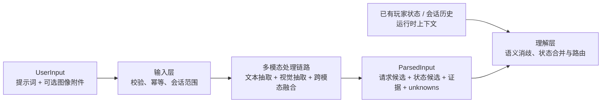

# Rust Coach 六层架构：输入层设计

修订日期：2026-11-03。本文先明确六层架构中的输入层，重点说明用户如何提交提示词和图像等多模态内容，以及输入层如何将它们解析为统一的结构化结果。输入层负责原始输入接入、文本/视觉解析、多模态融合和结果校验；理解层不再读取或解析原始图片，而是处理输入层交付的统一结果，并结合上下文完成语义理解、状态合并和路由。

## 1. 六层架构定位

系统按以下六层组织。层之间通过版本化的数据契约连接，避免模型调用、玩家状态和业务决策互相越权。

| 层 | 核心职责 | 输入层交付物 |
| --- | --- | --- |
| 输入层 | 接收用户提示词和可选多模态附件；解析、融合、校验并记录来源 | `ParsedInput` |
| 理解层 | 解析 `ParsedInput` 的语义、合并有效上下文并路由 | `IntentSpec`、有效玩家状态、任务路由 |
| 知识层 | 管理规则、机制资料、实时证据和版本；返回可引用依据 | `EvidenceBundle`、规则/版本引用 |
| 决策层 | 计算、计划、约束验证、候选比较和条件判断 | `ActionPlan`、`CalculationResult` |
| 生成层 | 按人设组织解释，注入已验证事实并执行输出门禁 | `AnswerSpec`、最终回答 |
| 评测与观测 | 记录 trace、质量指标、成本和 badcase，驱动回归与发布 | 评测样本、观测事件、改进反馈 |

输入层负责把图片中的可见内容和提示词中的明确内容提取出来，但不把候选观测直接当成已确认事实，不决定“应该先做什么”。它向理解层交付带置信度、覆盖范围、来源和未知项的结构化结果。

## 2. 设计判断与边界

### 2.1 设计判断

将多模态处理放在输入层更适合本项目，原因是：

1. **边界清晰**：原始文本和图片只在输入层进入系统，理解层只依赖稳定的结构化协议。
2. **避免重复解析**：不会让理解层、决策层或生成层分别读取同一张图并产生不一致的库存或物品识别结果。
3. **方便融合和回放**：提示词、截图、区域坐标、识别结果和校验错误在一个输入处理链路中留存，可以按输入版本重放。
4. **更容易评测**：可以单独评测图片识别、文本抽取、跨模态指代和未知项保留，再评测理解层的语义路由。

这个划分并不意味着输入层替代理解层。输入层完成“看懂并结构化表达用户输入”，理解层完成“在上下文中确定用户真正要做什么、哪些观测可以采用以及应该进入哪条业务链路”。

### 2.2 需要接受的代价

输入层承担视觉模型和文本抽取后，会增加首轮延迟、模型成本和输入链路的故障面。因此必须使用有界调用次数、缓存、明确的 `extractor_version` 和文本降级路径；视觉不可用时仍可把提示词交给理解层，不能因为图片解析失败而丢弃整条用户请求。

### 2.3 输入层边界

输入层只接收一种外部输入：**用户输入（`UserInput`）**。它由用户提示词和可选的图像附件组成：

```text
UserInput = prompt + optional attachments
```

- `prompt` 可以是自然语言问题、显式命令或对上一轮的补充回答；展示偏好、任务 ID 等是请求元数据或控制参数，不构成另一种业务输入。
- `attachments` 当前支持静态 PNG、JPEG、WebP。它们是用户输入的组成部分，不是独立的玩家状态输入。
- 玩家状态不是输入层的另一种外部入口。输入层可以从提示词和图像中提取玩家状态候选，但最终是否采用、是否覆盖已有状态、是否写入档案，由理解层和状态服务决定。

这样可以区分“用户提交了什么”和“输入层从中解析出的候选信息”。`unknown`、库存数量、基地属性等字段可以出现在输入层的解析结果中，但必须保留其来源、覆盖范围、置信度和确认状态，不能直接升级为权威玩家事实。



提示词和附件可以在同一用户输入中组合，例如“根据这张背包截图，计算还缺多少材料”。输入层负责读取附件、提取图像观测并将“这张图”与提示词中的指代绑定；理解层只接收绑定后的结构化结果，不再读取图片。已有玩家状态和会话历史作为上下文提供给理解层，用于消歧和状态合并。

## 3. 用户请求接入

### 3.1 入口和生命周期

聊天入口为 `POST /api/conversations/{conversation_id}/messages`。请求至少包含 `request_id` 和 `message` 或附件之一；继续同一任务时由运行时关联会话和历史上下文。请求 ID 用于幂等和重放，`conversation_id` 用于附件、玩家状态绑定和历史消息的范围隔离。

设计契约中的 `UserInput.prompt` 在当前实现中对应 `ChatRequest.message`；`UserInput.attachments` 对应上传后提交的 `attachment_ids`。当前 `ChatRequest` 的主要字段如下：

| 字段 | 用途 | 校验 |
| --- | --- | --- |
| `request_id` | 请求幂等键、结果回放 | UUID |
| `message` | 用户问题、命令或补充回答 | 去首尾空白，最多 6000 字符 |
| `attachment_ids` | 引用已上传的附件 | 最多 4 个，不允许重复 |
| `image_context` | 每张图的主体和采集时间提示 | 只能引用本请求中的附件 |
| `visual_draft_id` | 继续一个已保存的视觉草稿 | 不能与新附件同时提交 |
| `player_inventory_container` | 计算时选择的容器 | 仅接受规范化容器 ID |
| `presentation_preferences` | 本轮表达偏好 | 只影响生成层，不改变事实 |

这些可选字段是同一个 `UserInput` 请求的控制参数或元数据，不会把库存、偏好或状态拆成新的输入层类别；真正的玩家状态仍由理解层解析或由上下文服务提供。

原始请求应保留引用或脱敏审计记录，不能让模型自报的用户 ID 覆盖运行时身份。当前版本为本机单用户应用，实际权限边界由会话 ID 和本地存储实现；未来多用户部署时应在同一入口增加鉴权和租户范围。

### 3.2 请求处理顺序

```text
接收 HTTP 请求
  → 请求体与字段校验
  → request_id 幂等检查
  → 校验会话/附件归属
  → 读取附件并完成安全归一化
  → 文本解析、视觉解析和跨模态融合
  → 结构化 Schema、来源、覆盖和未知项校验
  → 生成 ParsedInput
  → 交给理解层进行语义消歧、状态合并和路由
```

输入层负责格式、大小、归属、版本、图像内容和抽取结果校验。理解层不再处理图片或原始多模态消息，而是处理 `ParsedInput` 中的请求候选、状态候选、证据引用和不确定项，完成“这是拆家问题还是建议问题”“这些候选是否适用于当前状态”等语义判断。

### 3.3 多模态处理链路

输入层内部的多模态链路如下：

```text
UserInput
  → IngressValidator
  → AttachmentNormalizer
  → TextExtractor ─────┐
  → VisionExtractor ───┼→ CrossModalFusion
  → ObservationValidator
  → ParsedInputBuilder
  → Understanding Layer
```

| 阶段 | 主要职责 | 产物 |
| --- | --- | --- |
| `IngressValidator` | 校验请求字段、幂等键、会话范围和附件归属 | 合法请求 |
| `AttachmentNormalizer` | 解码、方向归一化、缩放/裁剪、哈希和安全检查 | `AttachmentRef` |
| `TextExtractor` | 从提示词抽取用户目标、显式约束、实体、数量和状态陈述 | `RequestCandidate`、`StateCandidate` |
| `VisionExtractor` | 识别截图中的物品、数量、UI/基地/装备区域、可见关系和未知区域 | `VisualObservationCandidate` |
| `CrossModalFusion` | 将“这张图”“图里的材料”等文字指代绑定到附件和区域，合并互补信息 | 融合后的候选集合 |
| `ObservationValidator` | 校验 Schema、规范 ID、单位、数量、区域、覆盖范围和冲突 | 可交付候选、校验错误 |
| `ParsedInputBuilder` | 生成统一结构化输入、版本和 provenance | `ParsedInput` |

视觉模型可以输出候选值和置信度，但置信度不能直接替代事实确认。解析失败、图片不可读或关键字段模糊时，`ParsedInput` 应保留 `unknowns` 和 `needs_confirmation`，而不是让理解层重新读取原图猜测。

### 3.4 `ParsedInput` 交付内容

输入层交付给理解层的内容分为四组：

| 字段组 | 内容 | 理解层用途 |
| --- | --- | --- |
| `request_candidates` | 从提示词和图像上下文中提取的目标、问题、显式约束、对象和数量 | 消歧、确定任务意图和请求优先级 |
| `player_state_candidates` | 库存、装备、基地、科技、队伍、时间等观测候选 | 与已有快照合并，判断可用范围和是否需要确认 |
| `evidence_refs` | 附件 ID、SHA-256、区域坐标、文本片段、抽取模型/版本 | 追溯每个候选的来源，不把模型输出当无来源事实 |
| `unknowns / errors` | 未展示区域、模糊数量、无法识别的图片、Schema 错误和待确认项 | 生成澄清需求或降级处理 |

理解层收到的是结构化 JSON 和引用，不收到原始 Base64 图片。它可以要求输入层以新的请求重新解析补充图片，但不能在理解层内部自行调用视觉模型或绕过输入层校验。

## 4. 玩家状态候选与上下文读取

玩家状态的**观测候选**由输入层从用户提示词和附件中提取，玩家状态的**语义采用与权威合并**由理解层及状态服务完成。处理路径分为三种：

1. 用户在 `prompt` 中说“我有 140 个硫磺”，输入层的 `TextExtractor` 生成状态候选；理解层判断它是当前事实、历史描述还是假设，确认后由状态服务写入档案。
2. 用户提交截图，输入层的 `VisionExtractor` 生成带区域引用的观测候选；理解层根据任务和已有状态判断可用范围，确认后才写入状态档案。
3. 用户没有在本轮提供状态，Runtime 按会话绑定读取已有玩家状态；它作为 `context_refs` 提供给理解层，不回流成新的用户输入。

当前项目的 `/api/player-state/*` API 虽然在部署上也接收 HTTP payload，但它是状态档案的管理和确认接口，归属于状态服务，不是 Coach 任务输入的第二种来源；Coach 输入层仍只有 `UserInput` 一种外部输入：

- `POST /api/player-state/scopes` 创建服务器/清档范围；
- `POST /api/player-state/scopes/{scope_id}/observations` 写入已确认的结构化观测；
- `POST /api/player-state/scopes/{scope_id}/preview` 将文本解析成待确认草稿；
- `POST /api/conversations/{conversation_id}/player-state` 将对话绑定到一个状态范围；
- 视觉识别结果必须经过视觉草稿确认接口，不能直接从截图写入状态档案。

状态服务使用 `observation_id + expected_revision` 做幂等和乐观并发控制。库存支持 `patch` 和完整 `replace` 两种模式；局部截图或“我又捡到 100 个”不能被当作完整库存。

### 4.1 状态观测契约

以下是输入层交付给理解层、再由状态服务确认的观测候选契约示例，不是输入层接收的第二种请求体。`scope` 用于说明状态范围；当前 API 中它由 URL 和对话绑定解析，不直接放在 `StateUpdate` 请求体内：

```json
{
  "observation_id": "uuid",
  "expected_revision": 12,
  "observed_at": "2026-11-03T10:00:00+08:00",
  "source": "manual",
  "scope": {
    "server_id": "server-a",
    "wipe_id": "wipe-42",
    "ruleset": "pc_vanilla"
  },
  "changes": {
    "facts": {"technology.workbench": 2},
    "inventory": [{"container_id": "backpack", "mode": "replace", "complete": true, "items": {"sulfur": 140}}]
  }
}
```

输入层负责提取实体候选、数量、单位、区域和来源；理解层和玩家状态服务负责语义规范化、冲突合并、TTL、事件失效和 revision 投影。每个字段或容器应保留 `source`、`observed_at`、`coverage`、`verification`、`valid_until`、`server_id` 和 `wipe_id` 等 provenance；输入层不擅自提高可信度。

### 4.2 状态来源和优先级

状态来源按“可追溯”而不是按“模型置信度”排序：人工表单/确认观测、明确文本草稿、图像候选、历史上下文。多个来源冲突时保留冲突并交给理解层或状态服务处理；不能因为旧值看起来更合理就覆盖新观测。换服、换清档、死亡、交易或被袭击等事件只作为输入事件记录，失效范围由状态服务决定。

## 5. 图像附件作为 UserInput 的一部分

### 5.1 上传和附件引用

浏览器先预览、选择或拖入图片，再调用 `POST /api/conversations/{conversation_id}/attachments` 上传单个 multipart `file`。这是构造 `UserInput.attachments` 的预处理步骤，输入层执行：

1. 限制请求体和单图大小，拒绝空文件；
2. 按真实解码格式检查，只接受静态 PNG/JPEG/WebP；
3. 解码并应用 EXIF 方向，转成 RGB PNG，生成缩略图；
4. 检查像素数和最长边，防止解压炸弹和异常大图；
5. 计算 SHA-256，生成 `attachment_id`、尺寸、字节数、创建时间和到期时间；
6. 将原图和元数据存到当前会话的私有附件目录，消息只携带附件 ID。

当前实现默认每图最多 8 MiB、2000 万像素、最长边 8192；总附件空间为有限本地配额。实际限制以运行时配置为准。

### 5.2 图像上下文

消息可为每个 `attachment_id` 提供 `image_context`。当前线上的 JSON 形态是以附件 ID 为键的对象：

```json
{
  "image_context": {
    "uuid": {
      "subject": "self",
      "captured_at": "2026-11-03T09:58:00+08:00"
    }
  }
}
```

`subject` 只表达“本人、对手、队友或未知”的上下文提示，不能证明图片内容；缺省时由输入层保留为未知或形成待校验候选。`captured_at` 必须带时区，缺省不补写拍摄时间。图片的像素读取、物品识别、区域框和未知项提取属于输入层的 `VisionExtractor`，理解层只接收其结构化结果。

### 5.3 图像数据边界

- Graph State、消息历史和日志只保存附件引用、哈希、区域和抽取结果，不保存 Base64 或原始图片字节；原图留在附件存储中供输入链路回放和审计。
- 视觉模型调用前由输入层按会话归属读取图片；模型输出必须经过 Schema、规范 ID、数量形式、区域引用和主体/时间校验，再交给理解层。
- 输入层识别可见范围和未知区域，理解层结合任务判断该范围能否作为完整盘点或仅作局部预算。未展示的格子保持未知，不能当作零库存。
- 视觉识别结果默认是本轮临时观测；只有用户确认并调用保存流程，才进入玩家状态档案。图片本身不进入公共知识库。
- 删除、过期或失效附件不能继续用于新任务；历史回答保留当时的引用和结果，不因删除原图而伪造新的事实。

## 6. 统一输入对象

输入层向理解层交付的最小对象如下。外部输入只有 `user_input`；`parsed` 是输入层完成多模态处理后的结果；`context_refs` 是 Runtime 按会话绑定加载的内部上下文引用：

```json
{
  "request": {
    "request_id": "uuid",
    "conversation_id": "uuid",
    "task_id": null,
    "presentation_preferences": null
  },
  "user_input": {
    "prompt": "合成一个 C4 还差哪些资源？",
    "attachments": [
      {"attachment_id": "uuid", "sha256": "...", "media_type": "image/png", "available": true}
    ],
    "image_context": {"uuid": {"subject": "self"}}
  },
  "parsed": {
    "request_candidates": [{"kind": "craft.plan_gap", "target": "c4", "confidence": 0.93}],
    "player_state_candidates": [{"field": "inventory.sulfur", "value": 140, "status": "image_inferred", "coverage": "visible_region", "evidence": [{"attachment_id": "uuid", "bbox": [0.1, 0.2, 0.4, 0.5]}]}],
    "unknowns": ["inventory completeness"],
    "extractor_version": "multimodal-input-v1"
  },
  "context_refs": {
    "player_state": {"scope_id": "uuid", "revision": 12},
    "conversation_history": "conversation-scoped"
  },
  "provenance": {"received_at": "2026-11-03T10:01:00+08:00", "schema_version": "input-v1"}
}
```

`InputEnvelope` 是不可变的原始用户输入快照；`ParsedInput` 是输入层基于该快照生成的、可版本化的解析结果。后续层可以生成新的状态 revision、意图或证据对象，但不能回写原始输入或修改解析证据来掩盖来源。

## 7. 与后续层的交接

输入层完成后，理解层按以下顺序工作：

```text
InputEnvelope
  → InputPipeline：文本抽取 + 视觉抽取 + 跨模态融合 + 校验
  → ParsedInput：请求候选 + 玩家状态候选 + unknowns + provenance
  → 理解层：语义消歧、上下文合并、范围/TTL/revision 校验
  → 路由到知识层、决策层或普通对话
```

需要补充信息时，理解层返回缺口和来源；输入层只接收下一轮 prompt/附件，并用新的 `request_id` 重新运行输入链路。决策层不直接读取浏览器表单或图片文件，生成层不直接修改输入对象。

## 8. 当前实现映射与验收标准

| 设计对象 | 当前实现 |
| --- | --- |
| 用户请求 | `ChatRequest`、`POST /api/conversations/{id}/messages` |
| 玩家状态上下文 | `ScopeCreate`、`StateUpdate`、`PlayerStateService` 及状态绑定 API；属于理解层使用的上下文服务 |
| 图像附件 | `AttachmentStore`、上传/读取/删除附件 API |
| 视觉草稿 | `VisionService`、`VisualDraftStore`、确认/取消 API |
| 输入校验 | Pydantic schema、图片解码/尺寸/归属/过期校验 |
| 持久化 | SQLite 会话、状态、附件元数据和视觉草稿；图片存本地私有目录 |

当前实现与目标边界的关系：`AttachmentStore`、`VisionService` 和视觉草稿服务已经覆盖附件安全处理、视觉抽取、Schema 校验、缓存和确认回执；文本请求抽取、跨模态融合及统一 `ParsedInput` 仍应在后续重构中收敛到同一个输入处理链路。现有业务结果可以继续复用，但理解层不应再直接读取原始图片。

输入层设计通过以下行为验收：只有 `UserInput` 作为 Coach 任务的外部输入契约；必须满足 `prompt` 非空或 `attachments` 非空，两者也可以同时存在；请求和附件可幂等重放；跨会话附件不能读取；无效格式、超限图片和重复附件被拒绝；理解层不会把局部观测升级为完整状态；未知不变成零；图片删除/过期后不能用于新计算；视觉结果未确认时不写长期玩家档案；所有下游结果都能追溯到请求、状态 revision 或附件哈希。

## 9. 后续扩展

音频、视频等未来多模态内容可以作为 `UserInput.attachments` 的扩展类型：先完成接入、解码、权限、时效和来源记录，再由理解层增加相应解析器。实时遥测若未来接入，应作为运行时上下文或外部状态服务处理，而不是新增输入层类别。扩展输入类型不能绕过统一 envelope 和输出可追溯性。
