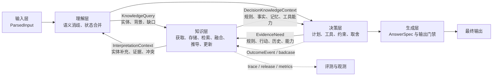
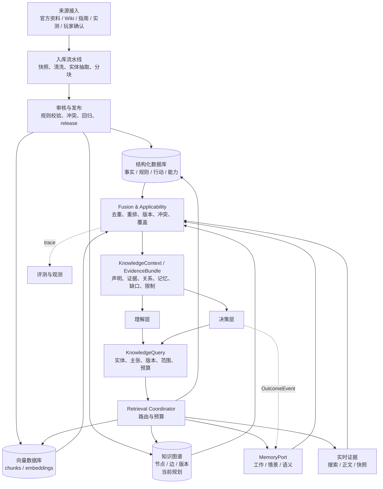

# Rust Coach 六层架构：知识层设计

修订日期：2026-11-03。本文定义知识层在“输入层 → 理解层 → 知识层 → 决策层 → 生成层 → 评测与观测”中的职责、存储、检索、推理、更新和可追溯性。输入层已经把提示词和截图解析为 `ParsedInput`；知识层不再读取原始图片，而是为理解层和决策层提供可验证的知识上下文。

2026-11-05实施说明：本次按固定演示版本实现结构化规则、SQLite FTS5、证据资格与覆盖检查、撤回和本地发布回退，详见 [G02/G06实施报告](knowledge-implementation.md)。本文下述向量库、独立图谱、通用语义推理和实时更新仍属目标设计；不应当作已交付能力。演示build未知，也未安排独立Rust专家复核。

## 1. 设计判断

用户提出的方向是合理的，但需要把“知识层帮助 Agent 推理”和“知识层替 Agent 做最终决策”分开：

- 结构化数据库、向量数据库和知识图谱解决的是不同问题，不能用一种索引替代另外两种。
- 工作记忆、情景记忆和语义记忆需要统一的记忆接口，但生命周期、可信度、范围和删除策略不同。
- 知识层可以做实体解析、关系遍历、规则推导、证据归纳等**知识级推理**；最终任务意图、行动排序、资源取舍和计划执行仍由理解层/决策层负责。
- 任何检索结果都必须带适用版本、范围、来源和时间。向量相似度、图路径长度或模型自评不能直接等同于事实可信度。
- 公共游戏知识、实时网页证据和私人玩家记忆分开存储。新网页、模型抽取结果和玩家反馈不能在线直接改写权威规则。

因此，知识层的输出不是一段自由回答，而是带证据和限制的 `KnowledgeContext` / `EvidenceBundle`。

## 2. 在六层架构中的位置



知识层与理解层是双向交互：理解层可因实体、版本或背景证据不足而重新查询并重新解释。知识层与决策层也是双向交互：决策层按候选行动的缺口请求规则、约束、历史和工具能力；决策结果和用户纠正可形成记忆事件或知识更新候选，但不能绕过审核直接发布。

## 3. 核心职责与非职责

### 3.1 核心职责

1. **获取**：接入正式资料、版本更新、审核案例、玩家确认经验和受限实时网页；保存原始快照与抓取元数据。
2. **存储**：按知识类型保存结构化事实、文本片段、关系、证据和私人记忆，保持版本、范围和生命周期。
3. **索引**：为精确过滤、全文/关键词、向量语义、关系遍历和记忆主题分别建立索引。
4. **检索**：根据 `KnowledgeQuery` 选择直查、混合检索、图遍历、记忆召回或实时取证，并受预算和权限限制。
5. **理解**：完成实体规范化、别名映射、文档分块语义、证据相关性和适用性判断，输出可引用知识单元。
6. **知识级推理**：执行已注册的规则推导、依赖遍历、条件过滤、冲突标记和来源链追踪；不运行模型生成的任意代码或表达式。
7. **更新**：通过 staging、审核、回归和不可变 release 更新公共知识；按明确规则写入、过期、撤销和遗忘私人记忆。
8. **追溯**：让最终声明可以反查到结构化记录、文档片段、图关系、记忆事件、查询和版本。

### 3.2 不负责的事情

- 不从原始图片重新识别物品；多模态解析已经由输入层完成。
- 不决定用户真正要执行的最终行动，不替决策层排序候选或编排计划。
- 不把玩家记忆当作当前库存、服务器规则或已执行结果。
- 不把搜索摘要、模型总结、未审核图谱边或单一相似片段直接升级为权威事实。
- 不在在线请求中直接修改正式规则、向量索引或知识图谱 release。

## 4. 知识对象分层

公共游戏知识和私人玩家记忆使用不同的 scope：

| 类别 | 主要内容 | 典型表示 | 可信度/生命周期 |
| --- | --- | --- | --- |
| K1 结构化事实与规则 | 物品、配方、工作台、蓝图、建筑、维护、版本规则、单位 | 关系表、JSON、规则记录 | 审核发布；按 build/ruleset 适用 |
| K2 行动与工具能力 | 行动定义、前置条件、反例、完成条件、工具 capability | `ActionDefinition`、谓词、能力注册 | 代码校验；版本化发布 |
| K3 文档与证据 | 官方更新、Wiki、指南、实测报告、网页正文和引用片段 | 文档、chunk、embedding、证据集 | 来源/时间/版本可追溯；实时证据可过期 |
| K4 知识图谱 | 实体和关系，例如配方依赖、科技解锁、行动支持、规则替代 | 节点、边、关系属性 | 当前规划；仅从审核资料生成 |
| M 个人记忆 | 当前任务、玩家历史、偏好、习惯、学习进度 | 工作/情景/语义记忆 | 私有范围、可撤销、按 TTL 或策略失效 |

K1/K2 是机器可执行约束的主要来源；K3 为上下文和证据补充；K4 适合多跳关系和影响分析；M 只用于个性化、历史复盘和理解上下文。策略卡可以同时引用 K1–K4，但不能复制一份没有版本的易变数值。

## 5. 三类游戏知识存储与索引

### 5.1 结构化数据库

结构化数据库是精确查询和确定性校验的主入口，建议使用 PostgreSQL；当前项目 SQLite 可以作为开发期实现。建议对象包括：

| 对象 | 示例字段 | 主要查询 |
| --- | --- | --- |
| `game_entity` | `id`、类型、别名、单位、平台、规则集 | 中文俗称/规范 ID 消歧 |
| `rule_record` | 规则值、条件、适用 build、revision、来源 | 精确规则查表 |
| `recipe` / `unlock_path` | 输入、产出、批次、工作台、蓝图前置 | 配方/科技依赖查询 |
| `action_definition` | 前置、反例、效果、完成检查、工具引用 | 决策候选和硬约束 |
| `tool_capability` | provider、操作、输入字段、版本、可用性 | 决策层能力门禁 |
| `source` / `release` | URL/hash、审核状态、发布时间、发布指针 | 版本和来源追踪 |
| `claim` / `claim_evidence` | 声明、支持片段、冲突、适用范围 | 声明级引用与冲突管理 |

结构化查询必须带 `platform`、`ruleset`、`build` 或明确 unknown。缺版本不能自动套用最新记录；未知字段返回 unknown/needs_input，而不是默认值。

### 5.2 向量数据库

向量数据库用于语义召回长尾表达、策略解释、案例和文档片段。它只负责提高召回，不负责证明事实。

每个 chunk 至少携带：`document_id`、`parent_id`、标题路径、正文、source/hash、published/fetched/verified 时间、platform/ruleset/build 范围、主题/实体标签、`evidence_type`、review 状态、`kb_release`、embedding 模型和维度版本。

检索流程为：metadata 硬过滤 → 向量/关键词召回 → 去重与重排 → 回取父段落/表头/限定条件 → 适用性和声明覆盖检查。不能只把 top-k 片段拼进 prompt；缺少条件、表头或单位的片段必须标记不完整。

### 5.3 知识图谱（当前仅设计）

知识图谱用于表达结构化数据库不便处理的多跳关系和影响链。首期不要求独立图数据库，可以先用关系表或 JSON 边表验证查询；当图遍历、版本管理和运营规模证明需要时再引入 Neo4j、Memgraph 或 PostgreSQL 图扩展。

建议节点：`Entity`、`Item`、`Recipe`、`Workbench`、`Blueprint`、`Rule`、`Action`、`Source`、`Build`、`StrategyCard`。建议边：

`requires`、`produces`、`consumes`、`unlocks`、`requires_station`、`supports`、`contradicts`、`supersedes`、`derived_from`、`applies_to`。

每条边必须有 `edge_id`、来源声明、适用范围、有效时间、release 和审核状态。图谱不能把“玩家拥有某物”写成公共边；私人状态以 `PlayerSnapshot` 引用参与查询，不进入公共图谱。

## 6. 三类记忆系统

记忆系统提供统一 `MemoryPort`，但三类记忆不能共用同一可信度和 TTL。工作记忆主要属于任务运行时，知识层提供读取/写入接口以便统一检索和追踪。

### 6.1 工作记忆（Working Memory）

保存当前任务短期上下文：`task_id`、`ParsedInput`、当前 `IntentSpec`、已确认状态 revision、EvidenceNeed、候选行动、假设、冲突、工具结果、预算和当前游标。它应放在 LangGraph checkpoint/TaskState 或短期缓存中，任务结束后按保留策略归档。

工作记忆的规则：

- 只服务当前任务和同任务恢复，不跨任务自动当作玩家事实。
- 每项内容有 `source_ref`、创建节点、revision 和失效条件。
- 新的玩家状态或知识 release 改变依赖时，相关工作记忆标记 stale。
- 生成层只能读取经过决策验证的工作记忆投影，不能修改原始候选。

### 6.2 情景记忆（Episodic Memory）

保存玩家发生过的事件和任务经历：被袭、下线、明确目标、用户纠正、已确认的观察、建议后的自报结果和复盘记录。每条事件至少包含：

`event_id`、`player_id`、`scope(server/wipe)`、`occurred_at`/`recorded_at`、原文引用、来源请求、事件类型、topics、verification、撤销状态和隐私范围。

情景记忆不自动推断事故原因、技能水平或当前库存；“昨晚被偷家”保留为玩家自报和记录时间，不擅自换算为精确游戏时间。服务器/清档范围默认隔离，跨服读取必须由用户明确要求。

### 6.3 语义记忆（Semantic Memory）

保存从多次交互中稳定确认的玩家偏好、习惯和学习进度，例如回答详略、术语偏好、常用玩法、风险偏好、常见游戏时间和知识点讲解进度。每项包含：

`memory_key`、值、来源事件、验证状态、更新时间、过期时间、版本和遗忘代次。

语义记忆只能来自用户明确设置、自报或受限且可追溯的候选提取；不能从失败、在线时长或一次行为直接推断人格。当前请求和当前状态优先于长期记忆，用户可以关闭、删除或覆盖记忆。

这里的“语义记忆”指玩家个人的稳定知识和偏好；游戏机制本身的语义知识仍属于 K1–K4 公共知识，不能混入个人记忆表。

## 7. 知识层内部组件



组件边界：

| 组件 | 负责 | 不负责 |
| --- | --- | --- |
| `SourceAdapter` | 获取来源、限流、快照和 hash | 不直接发布权威规则 |
| `IngestionPipeline` | 清洗、分块、实体/关系/声明候选 | 不把模型抽取当事实 |
| `ReleaseManager` | 审核、回归、不可变 release、原子切换 | 不在线热改生产规则 |
| `RetrievalCoordinator` | 选择检索通道、预算、并行和降级 | 不生成最终回答 |
| `KnowledgeInterpreter` | 实体映射、声明支持、关系推导、适用性 | 不替决策层排序行动 |
| `MemoryService` | 三类记忆读写、范围、TTL、遗忘和冲突 | 不把记忆升级为公共知识 |
| `ProvenanceService` | claim/evidence/source/version 链路 | 不用单一分数掩盖冲突 |

## 8. 查询与交付契约

### 8.1 `KnowledgeQuery`

理解层和决策层不传一段无结构的原问题，而是提交：

```json
{
  "query_id": "q-uuid",
  "consumer": "understanding",
  "purpose": "entity_resolution",
  "question": "C4 是否是当前规则集中的可制作物品？",
  "entity_ids": ["item.c4"],
  "required_claims": ["canonical_name", "recipe", "workbench_requirement"],
  "context": {"platform": "pc", "ruleset": "vanilla", "build": null},
  "memory_scope": {"player_id": "local", "server_id": "server-a", "wipe_id": "wipe-42"},
  "freshness": "release_or_live_if_required",
  "allowed_channels": ["structured", "vector", "graph", "memory", "web"],
  "budget": {"max_tool_calls": 4, "deadline_ms": 10000}
}
```

`purpose` 至少区分 `entity_resolution`、`background`、`rule_check`、`action_constraints`、`history_recall`、`capability_lookup` 和 `freshness_check`。它决定检索通道和返回粒度，避免理解层为消歧请求拿到一整篇攻略。

### 8.2 检索路由

| 缺口 | 首选通道 | 备选/补充 | 返回 |
| --- | --- | --- | --- |
| 规范实体、单位、配方、能力 | 结构化直查 | 图谱关系 | 精确记录和版本 |
| 多跳依赖、解锁链、影响关系 | 图谱遍历 | 结构化直查 + 文档证据 | 关系路径和来源 |
| 同义表达、策略解释、案例 | 向量 + 关键词 | 结构化标签过滤 | 文档片段和策略卡 |
| 玩家偏好、历史事件、学习进度 | 记忆服务 | 会话历史 | 受范围/TTL 限制的记忆 |
| “最近/本次更新” | 实时搜索/正文 | 本地 release 作对照 | live 快照和新旧差异 |

结构化、图谱、向量、记忆和 Web 可以混合，但每一路结果必须保留通道和版本。向量命中不能覆盖适用性过滤；图谱路径不能脱离来源声明；记忆命中不能覆盖当前明确输入。

### 8.3 `KnowledgeContext`

知识层返回：

```json
{
  "query_id": "q-uuid",
  "status": "sufficient",
  "facts": [],
  "relations": [],
  "document_spans": [],
  "memory_items": [],
  "capabilities": [],
  "claims": [],
  "gaps": [],
  "conflicts": [],
  "applicability": {"platform": "pc", "ruleset": "vanilla", "build_status": "unknown"},
  "provenance": {"kb_release": "kb-2026-11-03", "graph_release": null, "live_checked_at": null}
}
```

`status` 使用 `sufficient`、`partial`、`needs_input`、`conflicted`、`unavailable`。知识层只声明“哪些主张有何依据”，不直接生成玩家最终回答。决策层仍需要检查资源、状态和工具结果。

## 9. 与理解层的交互

理解层使用知识层完成四类工作：

1. **实体补充**：把俗称、缩写和截图解析出的候选映射到规范实体；发现多个候选时返回消歧问题。
2. **背景补充**：查询规则、版本、术语和必要的机制背景，减少模型凭记忆解释。
3. **输入重理解**：当知识返回实体冲突、版本不匹配或缺少前置条件时，理解层根据 `gaps/conflicts` 重新解释 `ParsedInput`，而不是重新读取原图。
4. **记忆个性化**：读取与当前主题相关的偏好、历史和学习进度；当前明确请求优先，旧记忆只能作为上下文。

理解层可以发起新的 `KnowledgeQuery`，但每次查询必须绑定当前 `input_revision` 和预算，不能通过循环不断扩大上下文。知识层发现玩家状态缺口时返回 `needs_input`，由理解层向用户澄清。

## 10. 与决策层的交互

决策层使用知识层完成：

- 获取候选行动的 `ActionDefinition`、前置条件、反例、完成标准和停止条件；
- 获取规则事实、适用 build、行动之间的依赖和冲突；
- 查询工具 capability、输入 schema、可用 provider、版本和 traceability；
- 召回与当前目标相关的策略卡、历史案例和玩家偏好；
- 为每个计划步骤构造 `EvidenceNeed`，接收 `EvidenceBundle` 并验证覆盖；
- 在决策完成后写入可追溯的 `OutcomeEvent`，供情景/语义记忆候选提取。

知识层不替代 `Planner`、`Executor`、`evaluate_actions` 或 `CalculatorPort`。例如知识层可以返回“某行动需要二级工作台”和“当前 provider 不支持该规则集”，但由决策层决定行动是否 blocked、是否重规划以及如何向用户表达。

## 11. 更新、版本和追溯

### 11.1 公共知识更新

```text
来源登记
  → 原文/网页快照与 hash
  → 清洗、分块、实体/声明/关系候选
  → 规则校验与人工审核
  → 结构化记录、向量索引、图谱边的候选 release
  → 回归/冲突/引用检查
  → 原子发布 kb_release / graph_release / embedding_version
```

结构化库、向量库和图谱必须记录兼容的 release；任一路失败不能发布半成品 active 指针。旧 release 保留用于历史结果回放。实时网页先成为 `web_snapshot`，不自动进入正式知识库。

### 11.2 记忆更新

- 工作记忆由任务图和 checkpoint 更新，任务恢复时校验版本和依赖。
- 情景记忆由明确用户陈述、确认观测和受限结果回报产生；保留原文和 scope。
- 语义记忆由明确设置或可审计候选提取产生；代码校验值域、冲突、时间和遗忘代次。
- 删除、关闭记忆或撤销来源会增加 epoch/遗忘代次；在途任务回写前必须再次检查，旧任务不能复活被删除内容。
- 记忆更新不改变公共 K1–K4 release；公共知识更新也不覆盖私人玩家偏好。

### 11.3 声明级追溯

最终回答中的每个关键声明应形成：

```text
Answer claim
  → AnswerSpec claim_id
  → decision/understanding step
  → KnowledgeQuery query_id
  → fact / graph edge / chunk / web snapshot / memory event
  → source hash + release/version + applicability + observed_at
```

结构化数字还要绑定 `calculation_id` 和 provider/data version；玩家事实绑定 `observation_id`/snapshot revision；历史偏好绑定 `memory_event_id`。引用存在不等于语义一定正确，仍需要独立评测和人工抽查。

## 12. 故障、冲突和降级

| 故障 | 知识层行为 | 对上层交付 |
| --- | --- | --- |
| 结构化库不可用 | 尝试已审核文档/图谱；不能补造精确数字 | `partial` 或 `unavailable` |
| 向量库不可用 | 结构化直查、关键词或图谱 | 可能缺少长尾背景，标记缺口 |
| 图谱未建设/不可用 | 结构化查询和文档证据 | 多跳关系降级为有限结果 |
| 记忆服务不可用 | 继续无个性化任务 | 不影响公共规则正确性 |
| Web 超时/无正文 | 使用满足条件的本地 release | 最新性不足时 `partial` |
| 来源冲突 | 按适用范围、版本和审核状态保留冲突 | `conflicted`，交给理解/决策处理 |
| 玩家状态缺失 | 不用知识替代玩家事实 | `needs_input` |

不能用“多数来源”或向量最高分简单解决冲突。规则适用性、来源审核、版本和具体主张优先级必须显式记录。

## 13. 当前实现与目标差距

| 能力 | 当前实现 | 目标状态 |
| --- | --- | --- |
| 结构化知识 | SQLite 中的计算规则/配方目录、玩家状态和证据元数据 | 独立 versioned Knowledge Registry，支持规则、行动和 capability 查询 |
| 文档/实时证据 | `EvidenceStore`、Tavily 搜索、白名单正文抓取和 hash | 文档分块、声明级证据和统一 `KnowledgeContext` |
| 向量数据库 | 尚未实现；README 明确当前无向量检索 | PostgreSQL + pgvector，metadata 过滤与混合召回 |
| 知识图谱 | 尚未实现，仅保留设计 | 从审核结构化知识生成 versioned nodes/edges |
| 工作记忆 | LangGraph/运行时短请求状态和视觉草稿 | 统一 TaskWorkingMemory/Checkpoint 读写 |
| 情景记忆 | `coach_memory_events` 的事件记录 | 绑定 server/wipe、结果回报和时间范围的事件检索 |
| 语义记忆 | `coach_profiles` 的偏好、习惯和学习进度 | 统一 MemoryPort、TTL、冲突、遗忘和审计 |

当前 `advice` 链路已经有有限的计划、网页取证、引用校验和玩家状态交互，但还不是完整的四库统一知识层。不能因为已有网页抓取或个人记忆就宣称已经实现向量检索、知识图谱或成熟 Agentic RAG。

## 14. 建议落地顺序与验收

1. **契约先行**：定义 `KnowledgeQuery`、`KnowledgeContext`、`Claim`、`EvidenceRef`、`MemoryItem` 和 release/version 字段。
2. **结构化注册表**：把现有规则、配方、行动和 capability 收敛为可版本化查询服务，并补齐来源。
3. **统一证据服务**：将本地文档、实时网页和计算结果包装为声明级 `EvidenceBundle`，建立 trace。
4. **向量召回**：在 metadata 过滤和关键词基线通过后引入 embedding/pgvector，用 Recall@k、支持率和版本污染率验收。
5. **图谱只读试点**：先覆盖配方、科技、工作台和行动前置关系，比较图遍历对多跳问题的收益；不先引入复杂写入系统。
6. **记忆统一接口**：把现有偏好/事件/学习记录映射到工作、情景、语义三类，补齐 scope、TTL、删除和引用。
7. **知识更新闭环**：staging → 审核 → 回归 → 原子 release → 失效旧缓存；增加来源撤回和冲突案例。

验收至少包括：结构化查表不造数字；向量结果经过版本/适用性过滤；图谱边有来源；记忆不覆盖当前状态；知识缺口会澄清或降级；最终关键声明可回溯到来源和版本；公共知识更新不会污染私人记忆；删除记忆不会被在途任务复活。
