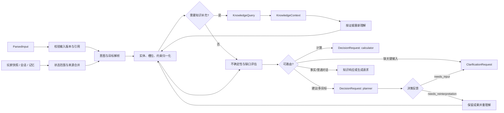

# Rust Coach 六层架构：理解层设计

修订日期：2026-11-03。本文定义理解层如何把输入层交付的 `ParsedInput` 和运行时上下文转换为带来源、不确定性和路由的教练任务表示，并说明它与知识层、决策层的双向交互。理解层回答的是“用户在当前上下文中要完成什么、哪些状态可以采用、还缺什么”，不直接替用户选择或执行游戏行动。

## 1. 六层架构定位

六层通过版本化契约交接：

```text
用户请求 / 图片
  → 输入层：文本/视觉抽取、跨模态融合、输入校验
  → ParsedInput
  → 理解层：意图、状态、实体、约束、目标、路由和不确定性
  → CoachTaskRepresentation
  → 知识层：补充实体、背景、规则、历史和能力证据
  → 决策层：计算、计划、候选行动和取舍
  → 生成层：基于已验证声明组织回答
```

输入层只负责“观察到什么”；理解层负责“这些观察在本轮任务中意味着什么”；决策层负责“为了目标应该采取什么行动”。因此，截图中识别出 `sulfur=140` 仍只是候选观测，不能在理解层直接变成完整库存或由此自动写入档案。

| 层 | 与理解层的交接 | 理解层的边界 |
| --- | --- | --- |
| 输入层 | `ParsedInput`：请求候选、状态候选、证据引用、未知项和解析版本 | 不读取原始图片，不重做视觉解析 |
| 知识层 | `KnowledgeQuery` → `KnowledgeContext`：实体、背景、规则、能力和历史依据 | 不把检索结果直接当作用户意图或最终行动 |
| 决策层 | `CoachTaskRepresentation` → `DecisionRequest`；反馈可要求澄清或重理解 | 不排序行动、不执行工具、不生成最终回答 |

## 2. 核心职责与非职责

### 2.1 核心职责

1. **意图识别**：从一个或多个请求候选确定操作类型、目标对象、期望结果和时间范围，保留歧义而不是强行选择。
2. **状态解析**：把文本、图像候选、已有快照、会话历史和记忆区分为当前事实、临时观测、假设、历史事件或未知，并按范围、revision、TTL 和来源合并。
3. **实体和语义归一化**：将俗称、缩写、数量和单位映射到规范实体；无法唯一映射时向知识层查询或产生澄清需求。
4. **约束与目标整理**：提取硬约束、软偏好、资源上限、风险偏好、完成条件和停止条件，明确哪些是用户明确说出的、哪些是系统推断的。
5. **请求路由**：根据意图、槽位、能力和证据缺口路由到知识查询、确定性计算、决策计划、状态确认、普通对话或澄清。
6. **不确定性管理**：记录语义、事实、覆盖、时效和能力不确定性；输出可解释的 `needs_input`、`partial`、`conflicted` 或 `unsupported`。
7. **双向恢复**：知识结果不足时重新解释输入，决策层发现目标或约束不一致时原地澄清或重新理解，并保留未失效的任务成果。

### 2.2 不负责的事情

- 不读取 Base64、原始图片或浏览器表单；图片只能通过输入层的结构化证据引用进入。
- 不把模型 confidence 当成事实确认，不把未展示区域当作零，不静默覆盖冲突的玩家状态。
- 不替决策层排序行动、编排执行步骤或调用计算器；精确数字必须来自确定性工具。
- 不替生成层决定语气，不把自由文本回答当作理解结果。
- 不把知识层召回片段、玩家记忆或历史建议直接当作当前状态；所有采用都要保留 provenance 和适用范围。

## 3. 理解层输入与输出契约

### 3.1 `UnderstandingInput`

理解层收到的是输入层的结构化结果和运行时上下文：

```json
{
  "input_revision": "input-17",
  "parsed_input": {
    "request_candidates": [],
    "player_state_candidates": [],
    "evidence_refs": [],
    "unknowns": [],
    "extractor_version": "multimodal-input-v1"
  },
  "context_refs": {
    "player_snapshot": {"scope_id": "scope-1", "revision": 12},
    "conversation": {"conversation_id": "conv-1", "turn": 8},
    "task": {"task_id": null, "understanding_revision": 0}
  },
  "runtime_context": {
    "platform": "pc",
    "ruleset": "vanilla",
    "build": null,
    "capabilities": ["craft_gap", "advice"]
  }
}
```

`context_refs` 是运行时按权限加载的内部引用，不是用户在输入层额外提交的输入。理解层不得把整个历史或图片二进制复制进状态；只保存必要的引用和摘要。

### 3.2 `CoachTaskRepresentation`

这是交给决策层的最小业务表示。它是版本化、不可变快照；新的理解结果生成新 revision，不能修改旧结果以掩盖模型误判。

```json
{
  "task_id": "task-1",
  "understanding_revision": 1,
  "intent": {
    "kind": "calculation.craft_gap",
    "target": {"entity_id": "item.c4", "display_name": "C4"},
    "desired_outcome": "计算还缺哪些资源",
    "mode": "exact",
    "confidence": 0.91
  },
  "goals": [{"goal_id": "g1", "kind": "craft_gap", "priority": "primary"}],
  "constraints": {
    "hard": [{"key": "quantity", "value": 1, "source_ref": "text:0"}],
    "soft": [],
    "assumptions": []
  },
  "state": {
    "facts": [],
    "candidates": [],
    "unknowns": ["inventory completeness"],
    "conflicts": []
  },
  "evidence_refs": [],
  "uncertainty": {
    "semantic": "resolved",
    "factual": "partial",
    "coverage": "unknown",
    "freshness": "known",
    "capability": "known"
  },
  "route": {"kind": "calculation", "status": "ready_for_slot_check"},
  "knowledge_queries": [],
  "clarification": null,
  "provenance": {"input_revision": "input-17", "schema_version": "understanding-v1"}
}
```

`intent.confidence` 只表示模型/规则对分类的信号，不是事实正确率。决策层必须同时检查 `state`, `uncertainty`, `evidence_refs` 和自己的工具校验。

### 3.3 状态项和不确定性

每个状态声明至少包含 `field`、规范值或 `unknown`、`status`、`scope`、`source_ref`、`observed_at`、`valid_until`、`coverage` 和 `evidence_refs`。`status` 使用：

| 状态 | 含义 | 是否可直接作为硬约束 |
| --- | --- | --- |
| `confirmed` | 用户确认或状态服务已接受的观测 | 可以，仍需检查 TTL/revision |
| `candidate` | 输入层抽取但尚未确认 | 只能作为候选或请求确认 |
| `inferred` | 根据上下文推断，存在明确推理链 | 不能替代缺失事实 |
| `unknown` | 未提供、不可读或未展示 | 不可当作零或否定 |
| `conflict` | 同一范围内有不一致来源 | 必须保留冲突并澄清/降级 |
| `stale` | 超过 TTL 或依赖已失效 | 不能用于精确结论 |

不确定性分维度记录：

- `semantic`：用户要做什么是否明确；
- `factual`：实体、数值或状态是否有可靠来源；
- `coverage`：截图/状态是否覆盖所需范围；
- `freshness`：版本、时间和状态是否仍有效；
- `capability`：当前 provider、规则集或工具是否支持。

只有所有路由所需维度满足门槛，任务才能进入 `ready`。一个高置信意图不能抵消缺失的玩家状态或过期规则。

## 4. 内部处理流程



建议将流程实现为一个理解子图，而不是一个不可观测的“大模型调用”。确定性节点负责 schema、版本、范围、能力和路由门禁；模型节点只提出结构化候选，所有候选都经过 Pydantic/领域校验后才能提交。

### 4.1 节点职责

| 节点 | 输入 | 输出 | 失败处理 |
| --- | --- | --- | --- |
| `validate_parsed_input` | `ParsedInput`、schema/version | 合法候选和输入错误 | 丢弃非法字段，保留错误引用 |
| `interpret_request` | 文本候选、历史指代 | 意图、目标、子目标候选 | 多候选进入消歧，不随意选一个 |
| `reconcile_state` | 状态候选、快照、记忆 | 状态声明、冲突、失效集合 | 保留冲突，生成缺口 |
| `resolve_entities` | 实体候选、规则集 | 规范实体或 `entity_candidates` | 通过知识层查询或澄清 |
| `normalize_constraints` | 数量、单位、偏好、时间 | 硬/软约束、假设、完成条件 | 不可解释的条件标为 unknown |
| `assess_uncertainty` | 意图、状态、知识上下文 | 各维度不确定性和 route gate | 产生 `needs_input`/`partial` |
| `route_request` | 完整任务表示、能力 | 路由和 `DecisionRequest` | 明确 unsupported，不伪造能力 |
| `validate_feedback` | 决策层反馈 | 澄清或重理解指令 | 绑定 revision 和预算后恢复 |

## 5. 意图识别、状态解析和请求路由

### 5.1 意图识别

意图不是单一分类标签，而是一个可执行的结构：`kind`、`target`、`desired_outcome`、`mode`、`goals`、`constraints` 和 `required_state`。首期路由类型建议固定为：

| `intent.kind` | 示例 | 下游 |
| --- | --- | --- |
| `calculation.raid` | “这面石墙要多少炸药” | 确定性拆建筑计算 |
| `calculation.craft_gap` | “合成一个 C4 还差什么” | 合成缺口计算 |
| `decision.recommendation` | “现在冲科技还是先加固” | Plan-and-Execute 决策 |
| `state.query` | “查看我的状态” | 玩家状态读取 |
| `state.update` | “我刚捡了 100 个硫磺” | 状态草稿/确认流程 |
| `knowledge.explanation` | “工作台二级有什么用” | 知识查询和解释 |
| `conversation.general` | 问候或不需要领域事实的聊天 | 普通对话 |
| `unsupported` | 超出能力、平台或规则集 | 诚实降级 |

多意图请求保存一个 `primary_goal` 和有依赖顺序的 `subgoals`。例如“根据截图算 C4 缺口并告诉我今晚先不先去挖硫磺”应先完成状态范围检查和计算，再把计算结果作为决策上下文；不能把两个目标拼成一条无类型的提示词。

模型可从自然语言生成候选意图，但以下字段必须由代码校验：路由枚举、实体 ID、数量/单位、范围、能力和必填槽位。用户明确纠正后，新的请求 revision 优先于旧的模型候选；旧候选保留用于追踪，不继续驱动路由。

### 5.2 状态解析和合并

状态合并只解决“哪些观测可用于本任务”，不等同于写入玩家档案：

1. 按 `server_id`、`wipe_id`、`ruleset` 和 `scope_id` 隔离候选；范围缺失时保持 unknown。
2. 当前请求中的明确陈述优先作为本轮候选，但仍记录其为 `user_reported`，不能自动变成长期确认事实。
3. 已确认快照可作为上下文；过期、被事件失效或与当前输入冲突时标记 `stale`/`conflict`。
4. 图片候选只能使用其可见区域和采集时间；局部截图不能推导完整库存或基地拓扑。
5. 语义记忆只提供偏好和历史背景，不能覆盖当前库存、当前服务器或明确纠正。

状态更新需要 `StateUpdate`/确认接口或明确的用户确认回合。理解层输出 `state_write_candidate` 和依赖，不直接执行持久化。

### 5.3 请求路由门禁

路由先识别任务，再检查前置条件：

| 路由 | 必备条件 | 缺失时行为 |
| --- | --- | --- |
| `calculation` | 目标实体、数量/参数、可用规则集和所需状态槽位 | 请求具体缺口；工具不可用则 `conditional`/`blocked` |
| `decision` | 目标、时间/风险等约束、当前状态或明确未知边界 | 先查知识/补状态；允许条件性建议 |
| `knowledge` | 可解析实体或问题范围 | 实体消歧或说明资料不足 |
| `state_update` | 可定位的状态字段、范围和来源 | 生成待确认草稿，不直接写档案 |
| `conversation` | 不依赖未验证领域事实 | 若出现事实断言，转知识/决策链路 |
| `clarification` | 至少一个可回答的缺口 | `ClarificationRequest`，暂停当前任务 |

## 6. 与知识层交互

理解层需要知识层时提交结构化 `KnowledgeQuery`，而不是把整段用户原话直接交给搜索：

```json
{
  "query_id": "q-1",
  "consumer": "understanding",
  "purpose": "entity_resolution",
  "input_revision": "input-17",
  "entity_ids": [],
  "entity_candidates": [{"surface": "C4", "kind": "item"}],
  "required_claims": ["canonical_id", "recipe", "workbench_requirement"],
  "context": {"platform": "pc", "ruleset": "vanilla", "build": null},
  "allowed_channels": ["structured", "vector", "graph", "web"],
  "budget": {"max_rounds": 2, "max_tool_calls": 4}
}
```

知识层返回 `KnowledgeContext`，其中的 facts、claims、relations、gaps、conflicts、适用范围和 release 都带来源。理解层使用它完成实体映射、术语背景、能力检查和历史指代；它不能把一段相似文档直接当成用户选择，也不能让知识层替用户排序行动。

知识辅助理解允许有限循环：

```text
ParsedInput → 初步意图/实体 → KnowledgeQuery
  → KnowledgeContext → 补充实体/约束/冲突
  → 新的 understanding_revision → 重新评估路由
```

每次查询绑定 `input_revision`、`understanding_revision`、当前规则集和预算。达到轮数、时间或无新增信息门槛时返回 `partial`/`needs_input`，不能无限改写查询。知识层指出“C4 存在多个规则版本”时，理解层应标记版本冲突或询问 build；不能选择最高相似度结果掩盖冲突。

## 7. 与决策层交互

理解层向决策层交付：

```json
{
  "request_id": "req-1",
  "task_id": "task-1",
  "understanding_revision": 1,
  "task": "CoachTaskRepresentation",
  "decision_request": {
    "kind": "recommendation",
    "goals": ["protect_base", "progress_technology"],
    "constraints": ["available_time=30m"],
    "state_ref": {"scope_id": "scope-1", "revision": 12},
    "knowledge_context_refs": ["kc-3"],
    "required_evidence": ["action_prerequisites", "resource_feasibility"]
  }
}
```

决策层不是单向终点，它可以返回类型化反馈：

| 反馈 | 含义 | 理解层行为 |
| --- | --- | --- |
| `accepted` | 任务表示足够，决策继续 | 保持 revision，等待结果 |
| `needs_input` | 缺少用户或玩家状态 | 生成澄清，持久化中断，等待同任务补充 |
| `needs_reinterpretation` | 新证据改变了目标、约束或实体含义 | 保留未失效结果，按指定字段重理解 |
| `conflicted` | 状态/知识/目标无法一致 | 暂停并展示冲突来源，不能静默选边 |
| `unsupported` | 能力、平台或规则集不支持 | 输出明确边界和可替代路径 |

`needs_reinterpretation` 必须包含 `reason`、受影响字段、证据引用、期望路由和最大重理解次数。理解层只重算受影响的实体/约束/路由，不重新读取原图，不抹除已完成的工具结果。若玩家状态 revision 变化，依赖该状态的 `StepResult` 标记 stale，独立证据仍可复用。

## 8. 澄清和恢复

```json
{
  "kind": "clarification",
  "status": "needs_input",
  "questions": [
    {
      "field": "inventory_scope",
      "question": "这张截图只展示背包，还是包含箱子？",
      "reason": "局部观测不能证明完整库存",
      "answer_type": "choice",
      "options": ["仅背包", "背包和箱子", "不确定"]
    }
  ],
  "blocks": ["calculation.craft_gap"],
  "source_refs": ["attachment:img-1", "unknown:inventory_completeness"],
  "resume_policy": "reuse_input_and_reconcile_state"
}
```

澄清问题应优先询问能解除最多下游依赖的缺口；不要把模型内部 confidence 暴露成“请确认我有多确定”。用户补充信息作为新的 `UserInput` 重新经过输入层，随后以同一 `task_id`、新的 `input_revision` 恢复。拒绝回答、超时或预算耗尽都是合法的 `partial` 结果。

## 9. 确定性组件与模型组件边界

| 能力 | 模型可做 | 必须由代码/领域服务完成 |
| --- | --- | --- |
| 意图 | 提出候选 kind、目标和子目标 | 枚举校验、必填槽位、依赖顺序和 route gate |
| 实体 | 提出俗称/缩写对应候选 | 规范 ID、版本/平台适用性和歧义检测 |
| 状态 | 从文字和 `ParsedInput` 提出候选 | scope、revision、TTL、覆盖、冲突和 unknown 语义 |
| 约束 | 提取自然语言偏好和时间表达 | 数量/单位规范化、硬约束安全检查 |
| 知识查询 | 生成查询改写候选 | 通道、权限、预算、release 和结果合并 |
| 路由 | 解释候选原因 | 实际条件边、能力检查和 unsupported 降级 |
| 澄清 | 生成用户可理解的问题措辞 | 缺口字段、阻塞依赖、恢复 token 和幂等 |

模型输出必须是受限 JSON，并经过 schema、实体、范围和业务不变量校验；解析失败时保留原始输入引用和错误，不让自由文本穿过路由门禁。

## 10. 当前实现映射与差距

| 设计对象 | 当前实现/对应位置 | 状态 |
| --- | --- | --- |
| 输入交付 | `workflows.py` 的 `visual_input`、`ChatRequest`、视觉证据对象 | 已有局部能力；尚未统一为 `ParsedInput` |
| 意图/路由 | `workflows.py` 的 `route`、`is_advice`、计算匹配器 | 已有受限分支；尚未形成版本化 `IntentSpec` |
| 状态上下文 | `PlayerStateService`、snapshot/revision/TTL、视觉草稿 | 已有状态边界；理解层合并协议仍需抽象 |
| 知识补充 | `EvidenceStore`、Tavily/WebResearch、建议链路 | 已有局部检索；尚未统一 `KnowledgeQuery/Context` |
| 决策交接 | `AdviceService` 和计算服务输入 | 已有业务调用；尚未统一 `DecisionRequest/Feedback` |
| 澄清恢复 | 计算多轮补充和视觉草稿确认 | 尚未形成跨子图的持久化 interrupt/resume 协议 |

当前实现可以继续复用，但不能把现有 `route` 函数或视觉草稿对象直接宣称为完整理解层。优先改造顺序是：先定义 `IntentSpec`、`StateClaim`、`CoachTaskRepresentation` 和 `ClarificationRequest`；再把现有计算/建议/视觉分支包在理解层适配器后；最后接入知识查询循环和决策反馈恢复。

## 11. 评测与验收

理解层评测应把“分类正确”和“状态采用正确”分开：

1. **意图路由**：计算、建议、状态查询、状态更新、知识解释、普通聊天和 unsupported 的混合案例；统计 route accuracy、漏转/误转和多意图顺序。
2. **状态解析**：文本、完整截图、局部截图、过期快照、跨服冲突和用户纠正；检查 unknown 不变零、局部不升级完整、scope 不泄漏。
3. **知识重理解**：俗称、多实体、版本冲突和缺前置条件；检查查询绑定 revision、冲突保留、循环有界和新证据确实改变表示。
4. **决策反馈**：缺状态、状态变更、目标纠正、工具不可用和中途澄清；检查只失效受影响步骤、同 task 恢复和不重复执行副作用。
5. **追溯与观测**：每个意图、状态声明、路由和澄清都能回到 input revision、context revision、KnowledgeQuery 或用户回答；记录节点耗时、模型调用、查询轮数、route 和降级原因。

最低验收条件是：理解层永远输出结构化任务表示；任一关键缺口会明确澄清或降级；知识层补充后可以生成新的理解 revision；决策层可以要求重新理解；所有来源和不确定性在跨层交接时不丢失。
