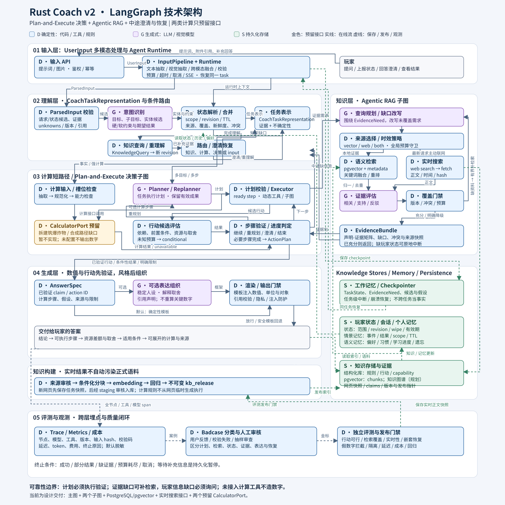

# Rust Coach：LangGraph 工程架构设计 v2

修订日期：2026-11-03。本版在既有 LangGraph、计算、玩家状态、网页取证和视觉输入设计上补充六层架构总览，并先细化输入层和理解层。目标能力与当前实现边界分别见 [首版实施说明](scaffold.md)、[建议链路](advice.md) 和 [截图实施说明](multimodal-implementation.md)。

## 1. 六层架构总览

项目按“输入层 → 理解层 → 知识层 → 决策层 → 生成层 → 评测与观测”组织。六层共享 Agent Runtime、任务状态和持久化，但通过版本化契约交接，避免模型直接改写玩家状态或绕过工具生成结论。

| 层 | 负责 | 主要产物 |
|---|---|---|
| 输入层 | 接收用户提示词和可选图像等多模态附件；完成文本/视觉解析、融合和校验 | `ParsedInput` |
| 理解层 | 处理结构化请求/状态候选；语义消歧、上下文合并与路由 | `CoachTaskRepresentation`、有效状态引用 |
| 知识层 | 结构化/向量/图谱知识与三类记忆的获取、存储、检索、推导、更新和追溯 | `KnowledgeContext`、`EvidenceBundle` |
| 决策层 | 计算、计划、约束校验、行动取舍 | `ActionPlan`、`CalculationResult` |
| 生成层 | 基于已验证结果组织解释、执行输出门禁 | `AnswerSpec`、最终回答 |
| 评测与观测 | 跨层 trace、质量评测、成本、badcase 与回归发布 | 指标、评测样本、改进反馈 |

本版细化了 [输入层设计](architecture-input-layer.md) 和 [理解层设计](architecture-understanding-layer.md)。输入层只接收 `UserInput = prompt + optional attachments`，并交付 `ParsedInput`；理解层再把请求候选、玩家状态候选和图像证据转换为带来源和不确定性的 `CoachTaskRepresentation`，通过知识查询补充实体/背景，并将任务路由给决策层。知识层的详细设计见 [知识层设计](architecture-knowledge-layer.md)。

## 2. 需求分析与本次架构决策

系统面向生存游戏 Rust，包含两条业务链路：**基于玩家当前状态的决策建议**和**两类确定性计算**。推荐 Python + LangGraph；游戏名称不约束后端语言。

| 本次要求 | 架构决策 | 交付边界 |
|---|---|---|
| 决策采用 Plan-and-Execute | Planner、计划校验、Executor、步骤验证、进度判定、Replanner、最终行动评估 | 明确节点、条件边、循环预算与终止条件 |
| 计算只覆盖拆建筑和合成缺口 | 输入抽取 → 槽位校验 → CalculatorPort → 验证 → 模板输出 | 仅设计接口和后续调研/接入标准，暂不实现计算器或接入网站 |
| 成熟 Agentic RAG | 独立检索子图，**向量数据库语义检索与互联网实时搜索均为必备能力** | 查询规划、来源选择、正文获取、证据评估、改写、停止与降级 |
| Loop 中途要求补充信息 | 计划、执行、RAG、行动验证都能产生 NeedsInput | 持久中断、同任务恢复、保留成果、按依赖失效重算 |

结论：**Plan-and-Execute 适合决策建议；Agentic RAG 是 Executor 可调用的知识获取子流程；精确计算保留独立短路径。** 外层决定“为完成玩家目标还需做什么”，内层决定“为这个证据问题还缺什么资料”，避免两层都在规划整段对话。

### 2.1 支持范围

| 问题 | 路径 | 输出边界 |
|---|---|---|
| 拆石墙需要多少爆炸物、哪种更省 | 拆建筑计算接口 | provider 接入并验证后才输出数量 |
| 造装备的路径、资源缺口 | 合成路径/缺口接口 | 考虑库存范围、蓝图、工作台；算法暂不实现 |
| 先科技还是加固、当前优先做什么 | Plan-and-Execute + Agentic RAG | 条件化取舍、行动步骤、完成与切换条件 |
| 基地布局有什么问题 | 决策路径 + 多模态观测 + RAG | 有证据的布局建议；精确入侵成本/突破路径计算不纳入当前工具 |
| 装备是否打得赢对方 | 超出当前精确计算范围 | 如回答，仅给有依据的条件性建议，不输出伤害交换、TTK 或精确胜率 |

不保留战斗模拟、护甲伤害引擎、基地攻击路径求解器作为当前建设项。装备和基地仍可作为决策背景。

### 2.2 正确性边界

- LLM 数字、搜索摘要和计算器网页上的孤立结果不能冒充确定性计算。
- 检索相关不等于支持当前版本、当前玩家的结论；未知状态不能默认成有利条件。
- Agent 的研究执行计划与最终给玩家的游戏行动计划是两种对象。
- 计算 provider 未接入时，依赖精确成本的行动为 conditional/blocked，不能声称资源已验证。
- 工具、检索、澄清与重规划都有预算；证据不足、拒绝补充和超时是合法退出情形。

## 3. 总体架构与技术栈

图源：[整体 Mermaid](architecture.mmd)、[Plan-and-Execute](plan-and-execute.mmd)、[Agentic RAG](agentic-rag.mmd)。[PNG](architecture.png) 用于预览；[生成器](render_architecture.py) 重建 SVG。

图例：D = 确定性代码/工具/规则；G = 生成式模型；S = 存储。D 仅表示实现方式，不表示数据与假设天然正确。计算接口明确标为预留。实线为在线调用/数据流，虚线为持久化、入库、观测或发布。

推荐 **模块化单体 + 主图 + Plan-and-Execute 子图 + Agentic RAG 子图**。它们是同一 Coach 的工作流模块，不需要多 Agent 协商或多套长期记忆。

| 能力 | 建议选择 | 原因 |
|---|---|---|
| API / Runtime | FastAPI、Pydantic、异步 I/O | 任务、鉴权、SSE、预算、依赖注入 |
| 工作流 | LangGraph StateGraph + PostgreSQL Checkpointer | 分支、子图、中断、恢复 |
| 向量数据库 | **PostgreSQL + pgvector，必备** | metadata 过滤与语义检索，无需首期独立向量服务 |
| 结构化知识库 | PostgreSQL（开发期 SQLite） | 事实、规则、行动、工具能力和 release 的精确查询 |
| 知识图谱 | 当前仅设计；先用关系表/JSON 边表验证 | 配方、科技、行动前置等多跳关系；从审核 release 生成 |
| 文本召回 | 别名/关键词索引与语义融合 | 中文俗称需分词和别名，不假定英文全文检索足够 |
| 实时网络 | WebSearchPort + WebFetchPort | 搜索发现页面，获取正文后形成证据；供应商可替换 |
| 计算 | 两个 CalculatorPort + capability registry | 当前无 provider；后续选型不影响图 |
| 其他存储 | PostgreSQL + 对象存储 | 会话、状态、结果、网页/图片快照 |
| 后台与观测 | 一个 worker、outbox、OpenTelemetry，可选 LangSmith | 入库、索引、回归、全链路观测 |

首期不要求独立图数据库、Kafka 或微服务网格。工具是能力契约，存储负责数据，Graph 负责控制流。

## 4. 模块职责与依赖方向

| 模块 | 负责 | 不负责 |
|---|---|---|
| Agent Runtime | 身份/权限、任务生命周期、幂等、单任务租约、预算、取消、客户端注入 | 不写领域公式或策略优先级 |
| Graph Workflow | State、Node、Edge、Conditional Edge、Subgraph、中断、恢复、终止 | 不内嵌 SQL、网页解析、算法实现 |
| Application / Domain | 行动目录、状态约束、计划依赖、可行性、比较和结果契约 | 不依赖 LangGraph 或模型 SDK |
| Tools / Ports | schema、权限、可用性、超时、外部适配 | 不接受任意代码、SQL、网络权限 |
| State | 本任务意图、计划、检索、中断、结果引用与版本 | 不存密钥、连接对象、图片二进制 |
| Player State | 观测范围、冲突、新鲜度、revision、当前快照 | 不将“建议执行”写成“已执行” |
| Memory | 会话指代、确认信息、稳定偏好、长期目标 | 不将旧库存或模型推测当永久事实 |
| Knowledge / RAG | 结构化/向量/图谱知识、三类记忆、实时证据、覆盖与适用性评估 | 不替代理解层语义消歧，不替决策层排序行动，不临时执行网页公式 |
| Persistence | Repository、Checkpoint、事务、对象存储、outbox | 不决定玩家行动 |
| Evaluation / Observability | 金标、回放、trace、指标、badcase、发布门禁 | 不在在线请求跑全量评测 |

依赖：API → Runtime → Graph → Application/Domain → Ports；具体 adapter 由 Runtime 注入。节点调用用例并返回增量。RAG 返回证据，不越过外层计划直接替玩家决定行动。

## 5. 输入层、理解层与玩家状态

输入层的独立设计和实际接入边界见 [输入层设计](architecture-input-layer.md)，理解层的职责、协议和恢复流程见 [理解层设计](architecture-understanding-layer.md)。输入层内部完成文本/视觉抽取和跨模态融合，向理解层交付 `ParsedInput`；理解层不再读取原始图片或解析原始多模态消息，只处理结构化候选和已有上下文。

### 5.1 输入与意图

CoachRequest 包含 request_id、conversation_id、task_id（继续任务时）、`user_input.prompt`、`user_input.attachments`、server_context 和 task_preferences。输入层将 prompt 和附件解析为 `ParsedInput.request_candidates`、`ParsedInput.player_state_candidates`、`unknowns` 与 provenance；`player_observations` 不属于外部输入字段。身份从鉴权上下文获得，不信任模型自报的 user ID。

服务器上下文区分 platform、server、wipe、build、ruleset/mod，允许 unknown。图片存对象引用/hash/采集时间。状态来自用户输入、截图或授权且实际支持相应字段的接口，不假定可自动读取完整游戏状态。

处理顺序：**输入层接入与校验 → 文本/视觉抽取 → 跨模态融合 → 解析结果校验 → 理解层语义消歧与状态合并 → 意图/信息需求检查 → 路由**。结构化内部结果可跳过原始输入解析，但不能绕过统一的 `ParsedInput` 契约。

理解层将候选整理为版本化的 `CoachTaskRepresentation`；其中的 `IntentSpec` 至少包含：

- intents：raid.calculate、craft.plan_gap、decision.recommend、knowledge.lookup。
- entities：规范 ID、原文表达、消歧状态。
- objective：目标、资源优先级、时间、风险偏好。
- required_slots、unknowns、conflicts、explicit_assumptions。

理解层还要输出状态声明的来源/范围/新鲜度、不确定性维度和 `route`。它可以通过 `KnowledgeQuery → KnowledgeContext` 补充实体和背景，也可以响应决策层的 `needs_input` 或 `needs_reinterpretation`；详细契约和有限循环见 [理解层设计](architecture-understanding-layer.md)。

多意图保留依赖，例如“先决定要不要拆，再算差额”以决策为主，内部调用计算接口。“最省”必须明确成本维度。初始 required_slots 不是所有字段：后续检索/工具发现新前置条件时，同样可以澄清。

### 5.2 玩家状态

PlayerSnapshot 包含库存/容器、蓝图/工作台、基地观测、装备背景、队伍、在线/离线时间、威胁信号、目标/偏好。字段或集合携带 source、observed_at、coverage、verification、valid_until、server_id、wipe_id；整体带 revision。

输入层视觉处理链输出 ObservationCandidate 与截图区域引用；代码核对实体、数量范围、覆盖和冲突。理解层消费这些结构化候选并结合任务与已有状态决定采用范围。关键模糊数量须确认，模型自报置信度不能直接当可信事实。未显示格子不是零库存，单张基地截图不是完整拓扑。

完整盘点替换相应容器；局部截图只 patch 可见范围。observation_id 去重，revision 乐观锁；增减事件须有可靠基准。冲突按字段、时间与范围处理，不能凭模型认为“更合理”覆盖。

换服、wipe、死亡、交易、被袭击等使相关字段失效。缺少事件接入时按 TTL 和决策风险重新确认。阶段是科技、资源、基地、队伍与时间的推断，不只按开服天数。

## 6. 状态、记忆和两种计划

### 6.1 生命周期

| 对象 | 存储 | 机制 |
|---|---|---|
| TaskState | PostgreSQL Checkpointer | 当前计划、游标、结果、子图和中断逐节点保存 |
| 跨轮会话 | conversations/messages | 指代与确认历史；摘要是派生视图 |
| 玩家当前状态 | observations/snapshots | 冻结 revision；确认更新后按依赖使结果失效 |
| 长期记忆 | user_memory | 明确偏好与稳定目标，带来源/范围，可撤销删除 |
| 正式知识 | documents/chunks/embeddings/sources | 经审核的语料 release |
| 实时证据 | web_snapshots/evidence_sets | 本次搜索/正文快照；审核后才正式入库 |

conversation_id 表示聊天，task_id 对应 LangGraph thread_id。同任务补充信息复用 thread；新目标创建新任务并加载相关对话。Checkpointer 负责执行恢复，MemoryService 负责跨任务数据，不能混为一谈。

### 6.2 TaskState 契约

| 字段组 | 内容 |
|---|---|
| identity | task/request/conversation ID、schema/graph version |
| input | 原始输入引用、IntentSpec、确认观测、假设 |
| context | snapshot_ref/revision、ruleset/build、kb_release、capabilities |
| decision | ExecutionPlan、plan_revision、current_step_id、StepResult map、ActionPlan |
| retrieval | evidence_need、rag_task_id、queries、coverage、conflicts、round、EvidenceBundle |
| clarification | request、interrupt ID 关联、origin_graph、return_policy、resume payload |
| validation | 类型化结果/错误、route enum、依赖失效集合 |
| execution | 调用记录、重试/重规划计数、预算视图 |
| output | 可用声明、AnswerSpec、最终结果引用 |

只存可序列化值/引用，客户端通过 Runtime 注入。共享通道使用明确字段白名单；无必要不并行。并行检索按稳定 evidence ID 幂等合并，不让多个节点无 reducer 写同一 scalar；共享资源由一个业务用例统一分配。

StepResult 绑定 step_id、plan_revision、input_hash、snapshot_revision、evidence_set_id、provider_version。依赖改变标记 stale，未受影响成果可以复用。

### 6.3 ExecutionPlan 与 ActionPlan

**ExecutionPlan 是 Agent 的研究执行计划**，例如核对离线时间、检索策略、比较候选、核算资源、验证建议。Planner 创建，Executor 消费。

ExecutionStep 包含 step_id、purpose、operation、depends_on、inputs/result_refs、required_player_fields、evidence_requirements、success_criteria、allowed_tool_family、budget_hint、status。

operation 限于 retrieve_evidence、request_information、calculate_raid、calculate_craft_gap、evaluate_actions、assemble_recommendation。状态为 pending/running/waiting_input/succeeded/blocked/failed/stale。输入引用由代码解析并校验，不运行模型生成的表达式或代码。

**ActionPlan 是玩家的游戏行动计划**。ActionSpec 包含 target、preconditions、dependencies、resource_budget、expected_effects、execution_steps、completion_criteria、stop_or_switch_conditions、evidence_refs、assumptions、feasibility_status。

可行性区分 verified、conditional、blocked。计划结构合法不等于资源可行；“执行”指 Agent 的检索/工具操作，不指自动操作游戏。未来资源和效果只在模拟状态，不扣真实背包。

## 7. 主图与计算短路径

### 7.1 主图

主链为 START → load_context → parse_and_reconcile → assess_request → 条件路由：

| 条件 | 执行链 |
|---|---|
| 缺必要输入 | clarify → validate_resume → refresh_context → assess_request |
| 拆建筑/合成缺口 | calculation_request → calculator_port → validate_result |
| 决策建议 | decision_subgraph → validate_result |
| 独立且需自适应取证的知识问题 | agentic_rag_subgraph → validate_result |
| 不支持/不可用 | partial_result |

结果通过后走 assemble_answer → output_gate → persist_outcome → END。validate_result 也能再次要求输入；不通过且无法修复进入部分结果。输出门禁失败用确定性模板回退，不无限生成。各节点均有预算与取消守卫。

已知简单事实走实体/版本直查；结构化计算直接调用同一用例，无需 Planner。子图执行中可原地持久中断，不需要先结束再重新运行。

### 7.2 两个 CalculatorPort，仅预留

**本次不调研/接入具体网站，不实现拆家公式、配方引擎或爬虫。** 先定义接口，后续调研选择 provider。当前 availability = not_configured；这和玩家漏填字段不同，不能反复问用户来掩盖缺少工具。

| 接口 | 输入 | 输出 |
|---|---|---|
| RaidCalculatorPort.calculate | 平台/build/ruleset、建筑类型/材质/数量、剩余 HP 或确认假设、攻击条件、允许爆炸物、可选库存/成本目标 | 爆炸物数量/方案、支持的成本维度、依据/步骤、适用范围与最优性范围 |
| CraftCalculatorPort.plan_gap | 目标/数量、已有成品/中间物、库存覆盖、蓝图、工作台、储备、配方版本 | 配方路径、批次、资源汇总/缺口、顺序、剩余物、科技阻塞与依据 |

必需字段由 operation/capability 决定；标准单目标数量不一定需要背包，限定“只用现有物资”才要求对应库存。不机械询问所有字段。

CalculatorCapabilities：provider_id/version、availability、supported_operations/rulesets/conditions、required_fields_by_operation、traceability_level。

CalculationResult：status（exact/conditional/bounded/needs_input/unavailable/unsupported）、normalized_inputs、input_hash、player_revision、ruleset/data_version、带单位的结果、路径/方案、feasibility、calculation_steps、rule/source_refs、provider_version、assumptions、limitations、optimization_scope。

固定路径：**抽取 → 规范化 → 完整性/schema 校验 → capability 检查 → 工具调用 → 结果验证 → 模板渲染**。缺输入返回 NeedsInput；未配置返回 unavailable；不支持版本返回 unsupported；均不回退为 LLM 心算。

### 7.3 后续网站调研与接入标准

优先可授权 API、可审查实现或本地复现的已验证算法。网页 UI 自动化只在没有稳定接口且满足使用约束时考虑。网站存在不代表可以稳定用于生产。

调研记录：支持版本/规则、输入假设、更新频率、单位/取整、公式来源、调用方式、授权、限制、可用性和独立回归样例。只返回数字且无依据/过程的站点不能满足可解释上线门槛。

后续算法需验证：拆建筑伤害适用性、组合/库存约束、成本目标；合成依赖、产出批次、共享库存、中间物、蓝图/工作台。原始公式到“几颗炸药”的推导由 provider 完成，可预计算，但 key 绑定版本和全部条件；不能从实时网页生成代码立即执行。

决策调用未配置接口时，将精确预算留为未知并继续不依赖该数字的部分；如果缺口会改变优先级，结果必须为 partial，不能声称已求得最优或可执行的完整方案。

## 8. Plan-and-Execute 决策子图

### 8.1 节点编排

| Node | 类型 | 输入 → 输出 |
|---|---|---|
| prepare_decision | D | 意图/快照/偏好/capabilities → 目标、约束、上下文 |
| planner | G | 上下文与行动目录 → ExecutionPlan 与初步 ActionCandidates；取证后有必要再修订 |
| validate_plan | D | 操作白名单、无环依赖、输入/证据需求、预算与计划合法性 |
| select_next_step | D | 计划/成果 → 一个 ready step；无剩余则 finalize，依赖死锁则 blocked |
| executor | D 调度边界 | 合法 step → 工具参数或静态子图调用 |
| agentic_rag_subgraph | G + D 分开 | EvidenceNeed → EvidenceBundle，期间可澄清 |
| calculator_port | D，预留 | 两类计算 → 结果/不可用 |
| evaluate_actions | D | 候选/事实 → 前置条件、资源状态、支配关系、可行性 |
| verify_step | D；语义检查可参考 G | 输出 + success criteria → StepResult、缺口/错误 |
| assess_progress | D | 成果/剩余工作 → continue/replan/clarify/finish/partial |
| replanner | G | 原目标、成果、新信息/失败 → 修改剩余步骤 |
| finalize_decision | D | 必要步骤成果 → ActionPlan；仍缺信息则返回对应分支 |
| clarify / validate_resume / refresh_context | D，共享实现 | 中断、补充信息校验、依赖失效与恢复 |

Planner 不把自己写出的结论当执行结果。Executor 是受限执行层，不是拥有任意权限的自由聊天 Agent。候选行动由模型提出，硬约束与状态转移由代码验证。

### 8.2 循环与条件边

完整节点图见 [Plan-and-Execute](plan-and-execute.mmd)。

正常路径：prepare_decision → planner → validate_plan → select_next_step → executor → 对应操作 → verify_step → assess_progress。

- 计划合法：执行；缺用户字段：clarify；可修复且有预算：replanner；不可继续：partial。
- 步骤成功且仍有待办：选下一步，不必每次调用 Replanner。
- 执行发现新约束/方案失效：replanner → validate_plan；临时故障：工具重试。
- 单个证据问题不足：RAG 在内部修复；超出其范围才回报外层调整计划。
- 必要步骤都通过：finalize_decision → 最终验证 → END；缺前置条件再次澄清或调整。
- 预算/来源/能力耗尽、重复步骤没有进展：partial → END。

Planner 通常生成 3–6 个任务级步骤。Replanner 只修改未完成或失效步骤，按依赖复用结果，不能删除用户核心目标/硬约束来假装成功。最终只有无关步骤成功时不能标记任务完成。

assemble_recommendation 操作映射到 finalize_decision，不另外调用一个不受约束的回答 Agent。候选来自 Planner/Replanner 的结构化输出或领域行动目录，evaluate_actions 只验证与比较，不隐藏一次模型调用。

### 8.3 行动评估

从行动目录与证据生成少量候选，先检查资源/科技/时间/风险等硬约束，再按明确偏好词典序或 Pareto 比较；权重须有来源或玩家确认。避免为不可校准的收益/风险编造精确分数。

计划内顺序应用模拟资源变化，避免重复消耗同一份库存。采集/解锁等前置步骤尚未完成时，后续行动是 conditional。未接入计算工具时不能填写虚构成本。输出首选、备选、第一步、完成标准和改道条件；未来收益仍可能是范围或经验判断。

## 9. 面向决策的知识库设计

本节是知识内容和 Agentic RAG 的既有设计摘要；结构化数据库、向量数据库、知识图谱、工作/情景/语义记忆、知识层接口和更新追溯流程见 [知识层设计](architecture-knowledge-layer.md)。知识层提供知识上下文，不替代理解层的语义消歧，也不替代决策层的计划与行动排序。

### 9.1 内容分层

| 层 | 内容 | 用途 |
|---|---|---|
| 来源 | 更新日志、版本资料、可信指南、专家案例、原文快照 | 审计和重新处理 |
| 决策知识 | 阶段目标、科技/防御取舍、前置条件、失败案例、反例 | RAG 主要语料 |
| 实体与约束 | 物品规范名/俗称、科技关系、可审核的行动条件 | 归一化与玩家状态对齐 |
| 索引 | 分块、父子关系、关键词、向量 embedding | 召回与定位 |
| 任务证据 | 检索片段、网页正文、覆盖矩阵、冲突、时效 | 当前决策依据，不自动成为正式知识 |
| 计算资产预留 | 未来 provider 的公式、参数、配方/派生结果引用 | 与策略文本分开，本次不建设计算引擎 |

StrategyCard 建议包含适用阶段/目标、前置条件、行动、收益风险、反例、停止/切换条件、平台/ruleset/build 范围、来源与审核状态。“先加固”应包含何时适用以及何种证据会推翻建议。

### 9.2 入库与向量索引

流水线：来源登记/允许抓取 → 原文快照/hash → 清洗与来源/日期/版本抽取 → 按主题和条件分块 → 模型抽取策略候选 → 规则/人工审核 → embedding 与关键词索引 → 检索/引用回归 → 不可变 kb_release → 原子发布。

切块保留限定条件、标题、表头/单位和父文档。可从 400–800 tokens、少量重叠开始调优，支持 parent-child 扩展；不能割掉“仅在某条件下”的前提。

chunk metadata 至少包含 chunk/document/parent ID、text、heading_path、source_id/url/hash、published_at、fetched_at、verified_at、platform、ruleset、valid_build_range、stage/goal/entity tags、evidence_type、review_status、kb_release、embedding_model_version。

pgvector 的模型/维度/预处理版本绑定索引，升级时重建并回归，不混用向量空间。平台/ruleset/release/审核状态硬过滤；不确定的阶段/目标推断做软排序，避免误判阶段导致漏召回。缺版本的经验可为低置信候选，不支持版本敏感机制。

语义与关键词召回可各 top 20，经去重/RRF/rerank 留 4–8 条，作为待调优起点。中文别名专门维护。ANN 过滤后候选不足需扩大召回、分区或小集合精确检索，以过滤后的 Recall@k 验证。

## 10. Agentic RAG：语义检索与互联网实时搜索

### 10.1 契约

EvidenceNeed：question、decision_step_id、required_claims、relevant_player_context、platform/ruleset/build、kb_release、freshness_requirement、allowed_sources、budget_slice。只传相关上下文，web query 不含玩家身份、私有基地坐标或完整背包。

EvidenceBundle：status（sufficient/partial/needs_input/conflict/unavailable）、supported_claims、evidence_refs、claim_evidence_matrix、gaps、conflicts、applicability、kb_release、web_snapshot_ids、query_history、retrieval_policy_version。

返回的是材料与支持范围，不是直接绕过 Executor 的最终决策。

### 10.2 节点

| Node | 类型 | 职责 |
|---|---|---|
| prepare_evidence_need | D | 校验玩家条件、规范实体、固定需求，初始化本次 rag_task_id |
| plan_queries | G | 拆分证据问题、提出少量查询/来源需求 |
| select_sources | D | 按时效、覆盖、冲突和预算选择 vector/web/both/clarify |
| vector_retrieve | D | 语义检索 + metadata + 关键词融合 |
| web_search | D，外部工具 | 实时发现页面，标题/URL/日期/摘要只是候选 |
| web_fetch | D，外部工具 | 获取正文/段落定位，记录时间/hash，处理失效 |
| normalize_evidence | D | 去重、来源归一、版本/范围检查、清理不可信指令 |
| grade_evidence | G | 评估具体 claim 的相关/支持/反驳、遗漏，输出结构化判断候选 |
| assess_coverage | D | 引用存在、必要覆盖、时效/冲突/预算门禁，选择下一步 |
| rewrite_query | G | 只改写未覆盖问题，不改变用户目标 |
| package_evidence | D | 固定证据集，输出覆盖矩阵和限制 |
| clarify / validate_resume / refresh_context | D | 发现未知玩家条件时暂停和恢复 |

完整图见 [Agentic RAG](agentic-rag.mmd)。

正常路径：prepare → plan_queries → select_sources → vector 或 search→fetch（或两路）→ normalize → grade → assess_coverage。

充分则输出；缺资料则改写/换来源；缺玩家条件则澄清；冲突未解/不可用/预算耗尽则 partial。不是“top-k 拼 prompt 后一次生成”。

both 使用明确的有限 fan-out/fan-in：向量分支与 search→fetch 分支都返回结果或类型化失败后合并。单路选择不等待未启动分支，超时分支不能让汇合永远挂起。

没有可用正文/片段时跳过 grade_evidence，直接按证据缺口进入 assess_coverage。prepare_evidence_need 仅在新 invocation 初始化检索状态；同任务澄清后重新进入时保留累计轮次和有效证据，按新条件失效相关部分。

grade 的语义判断仍可能错。代码能验证引用位置、来源、适用性和覆盖结构，不能自动证明所有自然语言事实为真；关键机制要有可信原文与独立评测，不能让模型自评越过门禁。

### 10.3 来源选择策略

| 条件 | 选择 |
|---|---|
| 一般策略，有适用且新鲜的知识 | 先 vector，证据够即停 |
| “最近/这次更新后”等明确时效需求 | **主动 web，通常 both**，不等向量失败才联网 |
| 本地覆盖不足、版本不匹配、关键冲突 | 有界改写 + web，优先原始/权威来源 |
| 玩家缺离线时长、蓝图、背包范围 | clarify，互联网不能替玩家提供状态 |
| 网络失败，本地仍满足全部需求 | 使用本地证据，说明核验范围 |
| 网络失败，结论依赖最新信息 | partial/unavailable，不将旧内容当当前核验结果 |

两通道均为正式必备能力，不强制每个问题都调用两者。最新请求需本次 live 搜索/抓取或对已有正文条件请求再验证，并记录 live_checked_at；历史搜索缓存只用来发现候选，不能替代实时核验。

搜索摘要不支持重要结论，必须取正文和定位/hash。published_at、fetched_at/live_checked_at、游戏适用版本分开；刚抓取不代表内容刚更新。同源镜像/转载不算多个独立来源，冲突按声明保留，不能简单投票或只按发布日期覆盖。

WebFetch 限公共 HTTP(S)、正文类型/大小/timeout，防私网目标和不安全重定向；页面指令不改变系统/工具权限。网页作为证据数据处理。

### 10.4 正式知识与实时证据边界

本地固定 kb_release；实时页面形成不可变 web_evidence_snapshot。可合并为一个 bundle，但每条声明检查平台/build/ruleset 兼容性，不能给新页面强贴旧 release 标签。

实时正文可为本次策略建议提供证据，不必等待入库；始终带来源/时间/适用性。新资料发现旧知识过期，标记依赖 stale 并提交更新候选；不能让两种互相矛盾的版本共同支持一个确定结论。

网页数字可作为有出处的资料事实引用，**“要几颗”“还差多少”的计算仍必须通过 CalculatorPort**。实时证据不得改写 provider 的规则/参数或冒充运行结果。

新来源进入 staging，审核/去重/切块/embedding/回归后才正式发布。禁止把模型总结、未经确认用户反馈直接回灌为权威语料。

### 10.5 停止条件

required_claims 的覆盖矩阵决定充分性：必要声明有适用证据、关键反证被处理、时效满足；不是拿到 k 篇或模型分数很高就停止。

连续一轮无新增有效证据、重复 query/URL、来源耗尽、冲突未解或预算触顶就 partial，列明缺口。外层改变证据需求可新建 rag_task_id，但总预算不重置，不允许内外循环互相重启绕过上限。

## 11. Agent Loop 中途澄清

### 11.1 发现点与缺口分类

入口、Planner、Executor、工具结果、RAG 覆盖评估和最终行动验证都可发现缺失字段。例如检索后才发现策略依赖“是否有队友守家”，不应要求初始 prompt 一次包含所有信息。

区分：
- player_input_missing：问玩家。
- knowledge_missing：检索/搜索。
- capability_unavailable：工具未接入/不支持，明确降级。
- evidence_conflict：交叉核验或保留冲突。

不能把公共知识缺口全部推给用户，也不能用网上信息补造私人状态。

### 11.2 NeedsInput

ClarificationRequest 包含 clarification_id、task_id、origin_graph、step_id、rag_task_id（若有）、missing_fields（类型/原因/范围/选项）、question、accepts_unknown、impact_on_result、return_policy、plan/player_revision、evidence_need_hash、expires_at。

return_policy 仅允许 reassess_request/retry_step/reassess_evidence/replan，由代码白名单控制，不接受任意 goto。优先问影响结论的最小相关字段组并说明原因；可给分支时允许未知，不静默假设。

### 11.3 interrupt / resume 机制

每个需要暂停的图有本地 clarify 节点，共享实现/schema。主图入口、决策子图和 RAG 子图都可原地中断；由顶层 Runtime 统一展示，用户只面对一个 Coach。

中断节点调用 LangGraph interrupt(clarification_request)，恢复值写入 resume_payload，再由 validate_resume 领域校验。Runtime 对同一 thread_id 调用 Command(resume=validated_answer)，而不是创建新任务或重放顶层初始输入。[L1]

中断保存 checkpoint，发 needs_input 事件后释放 worker/执行租约，不在 HTTP 请求中等用户数小时。恢复入口校验任务所有权、pending interrupt、schema、resume_event_id；同一个事件去重。无效回答产生字段错误并受限重问，不用反复异常崩溃代替校验。

### 11.4 补充后的恢复顺序

1. 将用户确认的 ObservationPatch 按 ID 去重、revision CAS 写入。
2. 检查等待期间库存/服务器/wipe、知识撤回、网页时效与预算变化。
3. 按依赖使结果/证据/行动失效，保留无关已完成成果。
4. 只补当前参数则 retry_step；新约束改变计划则 replanner；证据条件改变则重新查询。
5. 用户不知/拒绝/超时则条件回答、partial 或无法确定，不自动替用户作答。

RAG 内确认的新状态若改变外层假设，返回 context_changed 和 revision；外层 verify_step/assess_progress 必须检查，不能把检索成功等同旧计划仍有效。

### 11.5 嵌套持久化规则

- 主图使用 PostgreSQL Checkpointer；两个子图作为**静态图节点**挂载，继承父图持久化、每次 invocation 隔离；不设 checkpointer=False，不为每个检索子图建立长期记忆。[L2][L3]
- 共享输入输出通道明确；不同 schema 用纯映射 wrapper。每个新 RAG invocation 初始化新 rag_task_id 并清理旧输出，中断恢复不能重新初始化。
- 中断节点从头重执行；interrupt 前无不可幂等副作用，不用宽泛异常捕获吞中断，不动态改变同节点内多个 interrupt 的顺序。[L1]
- wrapper 也可能重执行；计费搜索等放独立节点，不放在调用子图前的 wrapper 中。按调用幂等键/有效结果复用减少重复副作用。
- 同 task 单写者租约/fencing token；Checkpoint 不保证外部 exactly-once，预算/状态写入/outbox 各自幂等。
- graph_version/state_schema_version 绑定 checkpoint，升级保留兼容 worker 或迁移，不强行用新图解释旧状态。

## 12. 预算、异常和终止

以下为待评测的初始配置，上限取先到者，不保证一个任务能用满所有局部限额。

| 项目 | 初始上限 |
|---|---|
| Plan | 每个计划最多 6 个活动步骤；全任务最多 10 次步骤调度 |
| Replanner | 全任务 2 次，常规成功不调用 |
| RAG | 一个证据需求最多 3 轮，全任务最多 6 轮 |
| Web | 全任务最多 4 次搜索、8 个正文抓取，有限 top-k |
| 模型调用 | 全任务 16 次，含理解、计划、query、grade、改写和表达 |
| 工具调用 | 全任务 24 次，含搜索/抓取/失败重试 |
| 重试 | 每次操作最多 2 次，不在节点/工具重复套同一重试 |
| 澄清 | 同一未解决字段最多 2 次无效重问；任务默认 3 轮 |
| 活动时间 | 普通决策目标 15 秒，web 目标 30 秒；硬超时初始 60 秒 |
| 等待输入 | 独立 TTL，例如 24 小时；等待不计活动时间，费用/步数不清零 |

Runtime budget ledger 是全局权威，State 仅为视图；调用前原子预留、按 usage 结算，call_id 幂等，避免并行超支和子图返回重复计数。模型/正文/context 限长，所有外部调用前检查预算与取消。

recursion_limit 只是额外 super-step 防护，不能替代业务计数、deadline 和进度检测。重复步骤/查询没有进展、预算耗尽均正常进入 partial；重建子任务或 resume 不重置额度。

| 问题 | 路径 |
|---|---|
| 暂时网络故障/限流 | 有界重试，条件满足时本地降级 |
| 单个检索需求未覆盖 | RAG 改写/换来源 |
| 候选失效/新约束 | Replanner 改剩余步骤 |
| 缺玩家字段 | NeedsInput → interrupt |
| provider 未配置/版本不支持 | unavailable/unsupported，不输出假数字 |
| 数值/单位/适用性不变量失败 | 隔离能力、失败记录、badcase |
| 冲突未解/最新证据无法核实 | 部分结果与限制 |
| 完成/不可继续/取消/超时 | 保存结果和 termination_reason 后结束 |

生命周期：RUNNING ↔ WAITING_INPUT → SUCCEEDED/PARTIAL/FAILED/CANCELLED/EXPIRED。WAITING_INPUT 是暂停不是成功 END。用户换核心目标需显式更新并重新验证，或创建新任务。

## 13. 知识时效、生成与幻觉控制

### 13.1 版本管理

区分游戏 build/ruleset、玩家 wipe/revision、kb_release、embedding/index version、计算 provider/data version、web snapshot/live_checked_at。不可用一个更新时间代替全部含义。

本地知识 release manifest 含文档/分块/索引/审核版本，全部准备好才原子切 active 指针。撤回来源使依赖结果与缓存失效；新 build 缺验证信息则版本敏感结论降级；恢复检查兼容性，不永久相信旧快照。

缓存 key 包含完整语义：本地查询/过滤/release/embedding；web URL/hash/再验证时间；私人结果 user/snapshot/目标/偏好/evidence；计算还含 provider/规则/输入 hash。TTL 只控制回收，不替代适用性。

### 13.2 AnswerSpec 与人设

AnswerSpec 包含结论、可支持的 claims、ActionPlan、备选、假设、缺失信息、限制、引用和状态/知识/网页/provider 版本。数值由 provider 模板渲染，绑定对象、单位、比较关系与条件；LLM 不再计算一次。

引用要支持相应声明且可定位正文/工具记录，不是“URL 存在”就合格。代码可校验结构化声明，开放文本的完整事实蕴含仍需独立评测和抽查；不宣称绝对零幻觉。

表达固定为“结论 → 立即可做步骤 → 取舍 → 完成/切换条件 → 依据与未知”。人设务实、尊重玩家、不保证胜利；风格不能把 conditional 改成 verified。未接入计算器不能在润色段偷偷补数字。

### 13.3 输出安全

网页、截图文字、工具返回、摘要是数据，不改变系统策略/工具权限。权限、隐私、引用存在、单位/对象绑定和输出契约由代码检查，语义模型自评分不能越过门禁。

流式先显示阶段/工具状态，关键结论验证后再发送；门禁失败回退模板。正常游戏拆家按游戏任务处理。日志默认脱敏，不存密钥、完整私有图像或模型私有思维链。

## 14. 工程化、工具与目录

### 14.1 工具注册表

| 工具 | 状态/职责 |
|---|---|
| knowledge.vector_search | 必备设计：语义检索与 metadata 过滤 |
| knowledge.keyword_lookup | 实体/别名/关键词补充 |
| web.search | 必备设计：实时发现页面，不输出权威答案 |
| web.fetch | 必备设计：正文、定位/hash、时效、安全抓取 |
| raid.calculate | 预留，not_configured，无实现 |
| craft.plan_gap | 预留，not_configured，无实现 |
| decision.evaluate_actions | 约束、依赖、条件/阻塞判断；精确成本引用计算结果 |

统一 ToolResult 包含 call_id、status、data/ref、evidence_refs、input_hash、snapshot_revision、versions、latency、error。注册表配置 schema、支持范围、timeout/retry、权限和成本。ask_user 是图中的持久中断能力，不是阻塞等待人回复的普通外部工具。

### 14.2 持久化与 API

PostgreSQL 分表保存 tasks/conversations/messages、checkpoint、player_observations/snapshots、user_memory、documents/chunks/embeddings/sources/kb_releases、search_runs/web_snapshots/evidence_sets、plans/step_results/answers、budget_ledger/outbox/evaluation_cases。对象存储保存图片和合法保留的来源正文。

私人状态按 tenant/user/server/wipe 隔离，公开知识与私有数据分开。结果与 outbox 在业务事务中以 task/result_revision 幂等提交；不能假定和 Checkpoint 跨组件原子，恢复时核查已提交记录。

API 包含创建/查询任务、SSE events、resume、cancel、player observations。resume 校验 ownership、clarification/interrupt、resume_event_id。SSE 采用单调 sequence、支持断线续传；事件包括 planning、executing_step、retrieving、searching_web、verifying、replanning、needs_input、resumed、partial_result、answer、done。

Graph 启动编译复用；客户端由 Runtime 注入；checkpoint setup/迁移在部署时执行。配置版本化模型/prompt、capabilities、检索参数、网络策略、release、预算、TTL、澄清限制。密钥不进入 State。

### 14.3 未来项目布局

- api/：鉴权、任务、resume、SSE。
- runtime/：生命周期、租约、预算账本、依赖。
- workflows/：coach_graph、decision_graph、rag_graph、clarification、state/reducers。
- application/ 与 domain/：用例、动作、约束、依赖、验证。
- tools/：注册表和 schema；calculators/ports：仅两个预留接口。
- knowledge/：入库、分块、embedding、检索、release；adapters/：pgvector、web search/fetch、未来计算器。
- player_state/、memory/、generation/、persistence/、observability/：按职责分离。
- jobs/、evals/、tests/：入库/保留、独立评测、契约/工作流/集成/故障测试。

当前实际交付仍只有 docs、README 和制图脚本；不为了目录形式提前实现计算器或引入复杂服务。

## 15. 评测与观测

### 15.1 四项要求的验收案例

| 要求 | 验证场景 | 必须达到的行为 |
|---|---|---|
| Plan-and-Execute | 正常多步、依赖满足、失败重规划、成果保留、终局验证 | 不省略用户硬目标，全部循环有界，区分两种计划 |
| 两个计算接口 | 正常参数、缺槽位、未配置、版本不支持、不透明来源、超范围意图 | 未接入时不输出精确数字，没有战斗/基地计算工具 |
| Agentic RAG | 本地命中、空召回后 web、最新主动 web、正文失败、冲突、改写、双路汇合、注入 | 证据覆盖/来源真实，摘要不冒充核实，预算内停止 |
| 中途澄清 | 已完成一步后缺字段、RAG 新前置条件、嵌套恢复、无效回答、重复 resume、跨版本、拒绝 | 同任务继续；无关成果保留；相关成果失效；无重复写入/预算重置 |

独立标注集覆盖意图/槽位、玩家状态、策略检索、时效、证据支持/反驳、行动可行性、重规划与恢复。按来源、场景、版本/时间切分，防同义改写/转载泄漏。模型自评和“用户没投诉”不能作为唯一真值。

### 15.2 指标与发布门槛

- 理解：多意图 F1、关键槽位准确、漏澄清/无谓澄清。
- 检索：过滤后 Recall@k/nDCG、必要声明覆盖、web 扩展增益、最新请求实时核验率、跨版本污染。
- 证据：引用定位/实际支持、来源独立性、未解冲突放行率、unsupported claim rate。
- 决策：硬约束满足、行动可执行、专家认可、条件性是否被误称已验证。
- 执行：重复工具、重规划、恢复成功、嵌套中断错误、跨用户污染、重复副作用。
- 体验成本：首个有用信息/完整答案 p50/p95、澄清轮数、模型/搜索/embedding 费用、预算越界。

固定关键回归集要求零跨用户污染、零预算重置、零未配置 provider 假数字、零已知冲突关键事实放行。检索/专家阈值需按真实数据制定并报告样本量，不能拒答全部来刷正确率。后续接入计算器再补独立手算/实测金标、配方批次/共享库存和取整/差分测试；本次不声称运行了这些测试。

### 15.3 故障与 badcase

故障测试覆盖搜索限流、空正文、恶意页面、向量库失败、单分支超时、schema 错误、中断前后崩溃、旧图版本恢复、并发 resume、知识撤回和全局预算耗尽。

Span 记录 task/trace/graph/node、step/plan_revision、rag_task_id、query_hash、source_channel、evidence IDs、kb/web/snapshot 版本、model/tool、attempt、tokens/cost/latency、validation_code、interrupt/resume ID、termination_reason。默认脱敏。

badcase：用户纠正/失败/抽样 → 快照与版本 → 分类 → 人工金标 → 修复 → 回归 → 灰度/回滚。分类区分理解、状态、计划、检索、网络、证据、工具、表达、恢复；反馈不直接改权威知识。

## 16. 延迟与成本

以下是待压测目标，不是测量结果。Agentic RAG 增加查询规划、证据评估与网络时延，不能沿用所有决策仅两次模型调用的假设。

| 路径 | 典型行为 | 完整响应 p95 目标 |
|---|---|---|
| 未接入计算入口 | 解析/校验后明确不可用 | ≤ 3 秒 |
| 后续已接入计算 | 理解、工具、验证、模板 | 参考 ≤ 5 秒，取决于 provider |
| 本地知识决策 | 理解/Planner/query/grade/验证，通常 4–6 次模型调用 | ≤ 15 秒 |
| 含实时搜索决策 | 搜索/正文/必要改写或重规划 | ≤ 30 秒；硬超时返回部分结果 |

优化顺序：结构化输入跳过抽取，明确 query 跳过生成，充分即停，成功不重规划，模板输出不重复润色，只传相关状态和少量证据。模型按评测分级，不单看自报置信度升级。

公开知识缓存可共享，私人决策答案不可跨用户复用。时效请求执行 live/再验证，不能伪装刚查过。费用按实际价格配置计模型、图片、embedding/rerank、搜索/抓取、未来计算与算力；离线成本分开统计；恢复/重试同样计费并受总预算约束。

## 17. 端到端示例

### 17.1 “现在冲科技还是先加固？”

Planner 建立“确认处境 → 取证 → 构造候选 → 验证资源/依赖 → 比较”的 ExecutionPlan。Executor 调用 Agentic RAG；向量检索得到条件化策略，涉及补丁或资料过旧时联网取正文。

检索中发现是否长时间离线/队友守家影响结论，而输入未知。RAG 产生 NeedsInput，clarify 保存 checkpoint 并询问这两个字段。用户补充后恢复原 task，更新 revision，只失效依赖旧条件的成果；查询按新条件完成。

外层检查 context_changed，必要时 Replanner 改剩余计划。候选需要精确材料核算时调用 craft 接口；当前未接入，故只能给已验证的检查步骤和条件性方案，标明具体预算待核验。若缺数字会改变排序，则 partial，不声称已求得最优。

最终答复给首选/备选、依据、现在能做的第一步、完成/切换条件及未验证项，不虚构袭击概率或库存。

### 17.2 “这面石墙最省多少炸药？”

抽取类型、剩余 HP/确认假设、版本、方法与成本目标，再校验 capability。当前 not_configured，明确尚未接入可靠计算工具，不用 RAG 凑数字。后续 provider 上线后沿同一接口返回方案、过程、依据和范围。

### 17.3 “这次更新之后怎么发展？”

显式时效需求主动 web/both，搜索后取原文并记录 live_checked_at。若只有旧指南或网络失败，不能说已核实最新版本；输出可用的一般原则与未核实变化。新来源可进入 staging，不即时污染发布向量库。

### 17.4 “材料都在图里，还差多少？”

遮挡关键数量触发字段级澄清。用户不知道时可请求完整盘点，或描述已知范围内的条件；provider 缺失仍独立报告不可用。补充截图不等于解决工具缺失。

## 18. 实施顺序与本版验收

| 阶段 | 交付 | 验收 |
|---|---|---|
| A：契约与恢复 | 三图边界、State、任务 API、checkpoint、预算、两个 Port | 未配置行为正确、嵌套澄清恢复、幂等 |
| B：Agentic RAG | 审核语料、pgvector、关键词融合、web search/fetch、覆盖/改写 | 本地/实时/冲突/缺信息/故障闭环 |
| C：Plan-and-Execute | Planner/Executor/Replanner、行动约束与证据绑定 | 成果复用、预算受控、已验证或明确条件化建议 |
| D：后续计算器选型接入 | 后续实施时调研并接入两个 provider | 版本、解释、来源、独立金标通过才启用 |
| E：质量规模 | 多模态、回流、压测、缓存与模型分级 | 实测质量、延迟、成本达标 |

A–C 可在计算缺省状态推进，前提是能力诚实和结果条件化。当前目标是修订设计，不实施这些服务。

本版设计验收依据：四项要求分别对应第 7、6、8–9、10 节；整体和专项图标注相同模块；工具表、评测、预算、目录与阶段均同步，不遗留首期战斗引擎或仅离线检索约束。

## 19. 技术依据与实施验证

此前于 2026-11-01 已读取下列官方文档，本版沿用已核对的核心语义，不声称已跑 LangGraph 集成测试：

- [L1：Interrupts](https://docs.langchain.com/oss/python/langgraph/interrupts)：同 thread 的 Command(resume)、节点重执行与幂等。
- [L2：Persistence](https://docs.langchain.com/oss/python/langgraph/persistence)：Checkpoint 与跨任务存储的分工。
- [L3：Subgraphs](https://docs.langchain.com/oss/python/langgraph/use-subgraphs)：静态子图、State 映射、继承持久化与 invocation 隔离。

实施时锁定 LangGraph、PostgreSQL/pgvector、embedding/model 版本，实际验证嵌套中断、共享通道、预算账本、向量过滤与网络故障。待确定的产品参数包括首个平台/ruleset、来源审核责任、搜索供应商、隐私保留和部署规模；不影响本版职责与流程边界。
