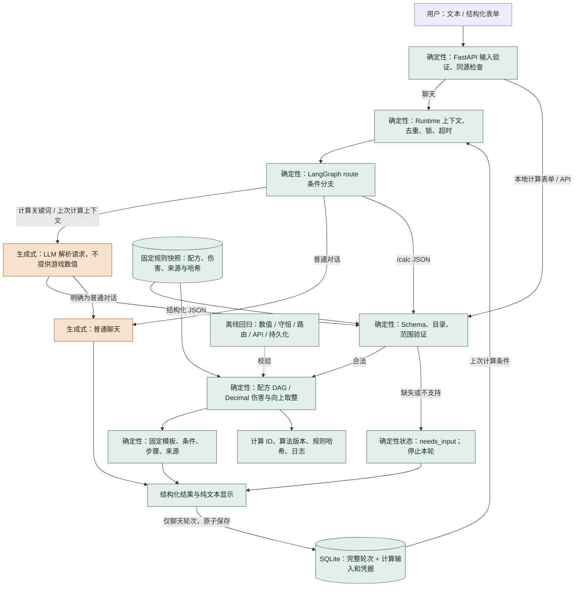

# 拆建筑与合成计算：当前实现

本阶段面向 PC 原版服，在已有 FastAPI、LangGraph、SQLite 聊天工程中加入确定性计算。模型负责把中文请求转成受限输入；游戏伤害、配方、取整、库存抵扣和结果文本由本地规则与代码负责。运行时不访问资料站。

## 使用

启动项目后打开 `/calculator`。本地计算页不需要 API Key，支持多物品目标、库存、保留资源、工作台等级、混合台火药配方和燃料展开。改动输入会隐藏上次结果，避免把旧答案当成新答案；这个页面不保存背包或历史。

聊天中可以直接提出：

- “拆一面满血石墙硬面需要多少 C4？”
- “合成 2 个 C4，我已有 10 个炸药材料和 1000 硫磺，其他库存为零，还缺什么？”
- 计算后续问：“改成 3 个”“我还有 500 火药”。模型基于上次规范输入更新条件；结果会再次展示实际计算条件。
- “取消计算”或切换普通话题会清除计算上下文。模糊套装需逐件明确，不会自动填成某个套装。

也支持在聊天中输入 `/calc` 加 JSON，完全绕过模型。请求通过相同 schema 和计算器，成功结果随聊天轮次保存。

```json
{"operation":"raid","target":"building:base-wall:stone","hp":500,"count":1,"side":"hard","methods":["explosive.timed"]}
```

```json
{"operation":"craft","goals":{"explosive.timed":2},"inventory":{"explosives":10,"sulfur":1000},"reserve":{},"workbench":3,"gunpowder_recipe":"workbench","expand_fuel":false}
```

HTTP 接口：`GET /api/calculations/catalog` 返回支持目录、来源和 JSON Schema；`POST /api/calculations` 接收上述 JSON，返回规范输入、结果、过程、来源、算法版本、计算 ID 和确定性中文文本。未知物品、未知目标、修改服、非法数量、超出满血的 HP、未支持的伤害方法会被拒绝，不能提交自定义 damage 或 recipe 绕过规则。

## 当前范围与证据等级

| 内容 | 当前支持 |
|---|---|
| 规则集 | PC 原版；不支持 Console、自定义伤害或配方 |
| 拆除目标 | 木、石、金属、装甲墙；木门、金属门、装甲门、车库门，共 8 种 |
| 爆炸物 | C4、普通火箭、豆罐炸药包、高速火箭、豆罐雷，共 5 种 |
| 血量 | 每个目标整数当前 HP；省略按满血；1–20 个相同类型、血量的独立目标 |
| 制作 | 60 个配方；爆炸物、部分武器工具，以及面罩、胸甲、连帽衫、裤子、靴子、路标护裙 |
| 目录 | 99 个物品 ID；进入目录不意味着该物品可制作 |
| 库存 | 成品、中间材料、获取边界材料均可抵扣；保留量不参与制作 |
| 优化 | 所列单一爆炸物方案按新增硫磺排序；不是混搭最优，也不代表时间、风险和全部资源最优 |
| 未支持 | 爆炸弹武器差异、火焰、近战、溅射共享、维修、混合血量、多条备选生产路线、战斗伤害、自动识图 |

数据取自 [RustData 计算器](https://rust-data.com/zh/tools/raid-calculator) 的公开数据，以及六件衣甲的公开制作页面。规则包在 `src/rust_coach/calculations/rules.json`，抓取日期 2026-11-01，来源数据版本 `v4:3:66a9a92f0d54f50e`。这是资料站版本，不是 Rust 游戏 build。未核验对应游戏 build，未经游戏内实测；不能宣称与当前线上服务器绝对一致。每次结果均展示此边界。

不同资料站存在冲突，例如石墙豆罐炸药包数量；本实现不混合冲突数据，也不通过投票掩盖冲突。选择了可追溯的单一快照。本版本不能被当成经游戏实测认证的规则包。应在上线给玩家使用前补充游戏内伤害与配方验收记录。

伤害按来源的十进制文本保存，用 `Decimal` 计算。来源有 `51.500000000000014` 等浮点尾数，当前保留原值，不擅自截断；满血参考数量逐项回归。输入只接受整数 HP。结果精确性指给定这份规则快照与适用条件时，计算可重复、过程可核对。

## 数据流与模块边界



Graph 只负责路由和结束。`CalculationService` 处理模型提取、校验失败与澄清；`Calculator` 是不依赖 LLM/HTTP/SQLite 的业务模块；`RuleCatalog` 读取并验证快照；`presentation.py` 组装固定答案。普通对话不强制走计算解析。代码中的历史 `UnavailableExtensions` 仍是未注册的旧占位对象，实际计算通过新 `calculations/` 包接入。

`ChatState` 保存当轮消息、路由、上一计算输入、待澄清原始请求、结果与回复；SQLite `turns.calculation` 保存完整规范输入、澄清上下文、结果和依据，旧数据库自动增加可空列。两者不属于长期玩家记忆。计算中不会更新真实背包或自动把上轮计划当成已执行。

澄清以一条完整 `needs_input` 轮次结束。下一轮根据上轮结构化输入继续，进程重启也可恢复。这里不需要挂起图的 `interrupt()`，因此没有人为加入 Checkpointer；将来需要长任务中断再引入。每次图有明确终点，递归上限为 8。

## 计算规则

### 合成

1. 目标、库存和保留量采用独立映射；不修改调用方对象。未知库存用 `null`，只计算总需求；明确 `{}` 代表零库存；已提供清单未列项目按零处理，并在答案中说明。
2. 依赖图按“所有父需求先于共享子材料”排序。汇总共享需求后才抵扣库存、按配方产出量向上取整，避免分别展开每个目标产生重复批次或库存重复使用。
3. 计算 `批次 = ceil((需求 − 可用库存) / 每批产出)`，将实际原料需求传递到下游。返回制作余量、库存抵扣、库存剩余、保留量和每步完整物料。
4. 反向输出步骤，得到可执行的“先中间材料、后成品”顺序。用户先获得叶子材料后，可以按步骤完成所有目标。
5. 默认低级燃料、组件、木材及矿产为获取边界；不估算回收、采集或冶炼。显式选择燃料展开或直接以燃料为制作目标时，使用动物脂肪和布配方。
6. 普通火药配方每批 10：硫磺 20、木炭 30；混合台每批 10：硫磺 20、木炭 20。混合台必须显式选择。工作台等级与蓝图状态独立检查，不把材料够用说成现在能制作。

例：2 个 C4、已有 10 炸药材料和 1000 硫磺、其他库存零、普通火药配方，结果需额外 2300 硫磺、4500 木炭、300 金属碎片、90 低级燃料、10 布和 4 电子零件。原有 10 炸药加新造 30 炸药组成总共 40 炸药。

### 拆建筑

按目标/受击面/爆炸物查询实际伤害，`每目标数量 = ceil(当前 HP / 每次伤害)`，再乘目标数量。不能先把不同物体的 HP 池化。爆炸物总量送入同一个合成引擎，逐方案复用相同库存条件，不能在候选方案间共用已经消耗的库存。

所有方案都是假设比较，不执行背包扣减。已有成品或火药会降低“新增硫磺”需求；排序结果不代表满足蓝图、工作台、组件、风险或时间要求。火箭发射器、研究和工作台建造成本不含在消耗品配方中。

## 失败、时延与成本

结构化表单和 `/calc` 零模型调用；普通聊天通常 1 次；自然语言计算通常 1 次提取，数值与最终文本不再调用模型。提取遇到 JSON/schema 不合法、输出截断或空模型响应最多再试 1 次，仍失败则澄清或返回模型错误。认证、限流、网络和超时不会自动重试。整体受 Runtime 超时限制，不产生无限循环。

当前配置的模型服务在部分非流式 Responses 请求中返回 `completed` 但 `output=[]`。计算解析专用 adapter 使用 Responses SSE 接收正文增量，并要求收到成功的终止事件；忽略 reasoning，不接受 function call，流中断不使用半份结果。界面仍在完整 JSON 校验与计算后一次性显示，不将不完整模型输出展示为结果。普通聊天的调用方式保持原有配置；Chat Completions 模式仍使用非流式接口。

本机 100 次“20 面石墙、5 种方案”核心函数微基准：p50 约 0.033 ms、p95 约 0.064 ms；这不包含 HTTP、浏览器与模型耗时，也不是生产 SLO。主要延迟来自文本解析模型。

日志只写计算 ID、operation、快照 ID 或失败类别，不记录密钥或整段用户内容。计算 ID 是规范输入、规则包 SHA-256 和算法版本的哈希；SQLite 保存结果本身，规则升级后旧轮次仍可查看，不会静默重算。

## 验证与更新

`uv run pytest -q` 覆盖：固定资源例子、全部目标/方法/受击面的快照参考数量、阈值与逐目标取整、保留库存、共享依赖、批次余量、配方切换、科技不足、输入拒绝、自然语言解析失败、HTTP 和跨重启澄清。80 组固定种子生成案例通过独立执行账本检查：逐步扣除输入并加入产出后，必须能满足全部目标，且余量守恒。

这些测试证明算法与快照内部一致；同源参考数量测试不能独立证明网站数据与游戏一致。真实模型抽取与浏览器冒烟测试应与离线测试结果分开报告。

2026-11-01 本次验收记录：

- `uv run pytest -q`：110 项通过。
- 两个前端脚本通过 `node --check`；`uv build` 成功，wheel 内包含规则包与计算页面；`git diff --check` 通过。
- 使用配置的 `gpt-5.6-sol` 实际调用，验证了“2 个 C4 + 10 炸药 + 1000 硫磺”的结构化提取与 2300 硫磺缺口；续问改为 3 个时保留库存，缺口变为 4500 硫磺；修改服自定义伤害请求得到 `needs_input`，没有计算结果。这是少量冒烟样本，不是自然语言总体准确率评测。
- 浏览器经过完整聊天链路得到满血石墙硬面 2 个 C4 和对应公式；本地表单验证同一合成例子、库存抵扣和依据显示；修改输入后旧结果自动隐藏。
- 已确认并修复该服务的非流式 Responses 正文缺失问题对计算解析的影响；SSE 回归包含缺少结束事件、流式错误、非法工具调用、空正文和过大响应拒绝。

更新规则的步骤：

1. 使用公开来源获取新候选快照，保留完整 URL、抓取时间、来源版本和哈希。目标 `source_hash` 基于 Python `json.dumps(data, sort_keys=True)` 规范序列化的完整响应对象；衣甲 `recipe_sources.sha256` 基于页面响应字节。计算器的公开端点为 `/zh/tools/raid-calculator/data?target=<id>&hp=<full_hp>`，不在用户请求链路动态访问。
2. 对比目标 HP、各面伤害、配方产出、原料和工作台；冲突条目先记录和验证，不直接覆盖旧数值。衣甲来源记录在 `recipe_sources`。
3. 用游戏内样本验证伤害阈值、残血、批次与工作台，补足 game build 和验证记录。当前 `game_build=null` 不得冒充已知版本。
4. 更新 snapshot ID，运行离线测试并人工审阅事实变更。旧快照通过 Git 版本保留；当前服务进程重启后读取新包。
5. 更新说明中标注验收范围和未解决冲突，再发布。若未知新版本是否兼容，继续显示固定快照适用边界，不承诺实时准确。

当前未实现自动版本采集、生产规则发布平台、跨版本路由、混搭优化或独立可信的游戏规则认证服务。
