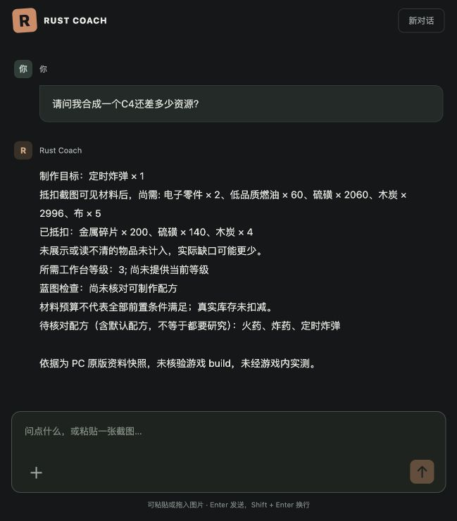

# 截图续问与主聊天界面修复

日期：2026-11-02。模型沿用用户配置，PC 原版固定规则快照。

后续“同条消息发图并问 C4”回归发现，通用画质备注仍会过滤已读清的材料，且识别结果排在结论之后。此问题已单独修复，最新 313 项测试和真实模型记录见 [识别与抵扣一致性修复](vision-deduction-regression.md)。下文保留上一次修复记录。

## 实际原因

在本地会话记录中复现了“先发背包图，再问合成一个 C4 还差多少资源”的失败：第二轮 `visual=null`、计算 `inventory=null`。

1. Runtime 只有看到“截图、这些、继续”等词才恢复上一轮图片。原问法不含这些词，因此没有把图片送到计算链路。
2. 图像被判为 partial，且一个物品没有数量。自动库存只在整张图片满足完整盘点时生成，已经读清的金属、硫磺等也一起被丢弃。

## 当前行为

- 自然语言追问自动恢复同一档案上下文、最近十二轮内的最新图片，允许中间有普通文字轮次。新图片替换旧图片；取消、删除、死亡/丢包、换服、明确不用旧库存会阻断恢复。显式 `/calc JSON` 仍使用自身参数。
- 单图、单容器内的清晰物品与数量按不重复槽位汇总；未知项排除，不使其他已知材料失效。多图/多容器仍不自动相加。
- `inventory_complete=false` 的局部预算抵扣可见材料，回复明确给出抵扣项和剩余需求，并说明实际缺口可能更少。不会将局部预算升级为完整盘点或可执行性保证。
- 已有 v3 自动草稿在读取时从原观测重建库存，无需用户重发。重建不刷新观测时间；过期/他人/旧图不抵扣。
- 主页面移除档案选择、表达设置、逐项编辑、取证记录、表达校验及原始 JSON。只保留新对话、聊天输入、图片预览/移除与发送；粘贴、拖入和选择文件均可用。
- 原始报告、来源、校验、版本和确认 API 保留在后端。用户可直接要求“详细列出计算过程和来源”，本轮以详细回答展示，不必操作设置面板。

## 验证证据

`uv run pytest -q`：**307 passed in 6.48s**。视觉测试共 69 项；新增自然语言 C4 续问、间隔普通轮次、局部库存保留、死亡/切档案/取消/删除/明确总需求/过期边界和局部建议状态测试。增加对话请求详细过程与来源的渲染测试。JavaScript 语法检查、`git diff --check` 通过。

真实浏览器在用户原会话重发同一句“请问我合成一个C4还差多少资源？”，没有重新发送图片，也没有增加“截图”等提示词。结果使用之前保存的识别数据：

- 已抵扣金属碎片 200、硫磺 140、识别出的木炭 4。
- 按这些可见材料计算，剩余电子零件 2、低品质燃油 60、硫磺 2060、木炭 2996、布 5。
- 回复明确标注局部库存范围，未知物品未计入；这验证的是历史识别数据的衔接和计算，不是对图标识别准确率的认证。

浏览器还实际验证了图片粘贴产生预览、移除预览、纯文字发送、刷新恢复及定位最新回复。主页面 DOM 中 `details=0`、`select=0`，没有“表达规范与校验记录”；控制台没有 error。历史回复内容原样保留，不改写此前错误回答。

游戏规则仍来自固定资料快照，未核验当前游戏 build。图片识别仍可能出错；本次没有绕过识别不确定性、版本或时效限制。
