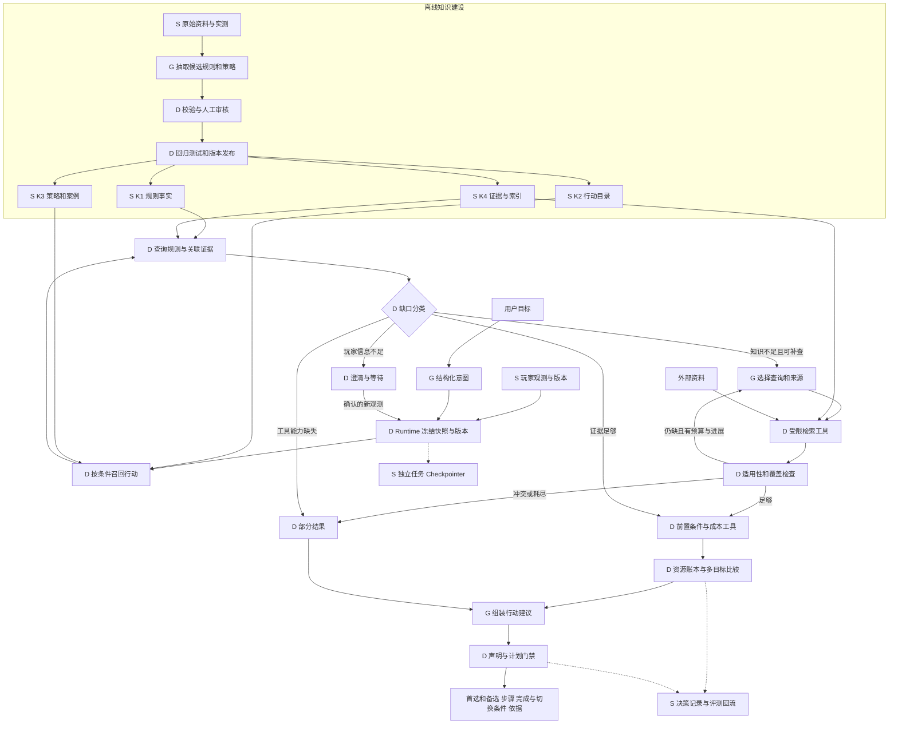

# 决策建议需要怎样的知识层：调研与实施建议

后续游戏领域调研见 [Rust 实际来源与决策知识建设](rust-domain-knowledge-research.md)：补充了数据站、攻略、社区的实际核查，以及回收供电条件、维护授权口径和开发分支污染等具体发现。

调研日期：2026-11-01。范围：PC 原版 Rust，在已实现的玩家状态与确定性计算之上，设计“结合资源、科技、基地和阶段，在多个目标间权衡并给出可执行建议”的知识层。本次交付是调研与设计，不包含决策/RAG 代码实现，也不声称已验证推荐效果。

## 1. 结论

建议采用 **版本化游戏规则 + 结构化行动目录 + 有条件的策略知识 + 按需证据检索**。默认流程是“状态与约束 → 候选行动 → 查依赖知识 → 计算可行性 → 比较取舍 → 输出步骤”。

**Agentic RAG 不是首版产生可执行建议的必要前提；它适合作为按需启用、预算受限的取证子流程。** 它负责发现还需查哪些证据、选择来源和补查，不负责证明资源够用、决定玩家目标权重或保证游戏数值正确。完整产品可以保留该能力，但无需让每个决策都进入检索循环。

这与 `architecture.md` v2 将向量数据库、实时搜索和 Agentic RAG 设为必备的预设不同。本报告是针对当前实现和本次问题的重新评估建议；没有静默修改既有架构承诺。若保留原目标架构，也应把“具备检索能力”和“每次请求必须调用它”分开。

## 2. 项目现状与真实缺口

本次检查代码与实际加载的目录，而非依赖旧设计文档的完成状态：

| 已检查位置 | 当前证据 | 对决策建设的含义 |
|---|---|---|
| `player_state/schemas.py`、`domain.py`、`store.py` | 18 个事实字段、分容器库存、时效/失效、版本与来源 | 可提供冻结的玩家上下文；信息是玩家自报，不是游戏实时真值 |
| `calculations/catalog.py`、`rules.json` | 99 个物品、60 个配方、8 类建筑目标；`game_build=null`，标为第三方未实测快照 | 能复用已有计算，但不能把“规则内算对”称为“当前游戏版本已核验” |
| 当前规则目录中的 ID 检查 | 未收录 `scrap`、`workbench1/2/3`、`door.hinged.metal`、`lock.key`、`cupboard.tool` | 当前目录不能直接核算“冲科技还是补门锁/维护”；状态页有名称提示不等于计算器有规则 |
| `calculations/engine.py` | 可处理配方依赖、共享库存、保留资源、工作台与蓝图待核验项 | 可做候选行动成本子工具；没有研究路径、建造升级、维护、旅行和风险模型 |
| `workflows.py`、`runtime.py` | 状态查看、计算、普通聊天三路；普通聊天明确没有决策与检索能力 | 不能只给聊天提示词加“结合状态建议”就宣称完成 |
| `extensions.py` | Knowledge/Decision/Search 为接口及 unavailable 占位 | 没有知识发布、检索、策略校验或决策排序实现 |

当前最高价值工作是补齐首批决策的**知识依赖闭包**：一个行动所需的前置条件、规则、成本和完成标准全部有着落。增加大量攻略文章无法替代这些缺口。

## 3. 外部调研依据与证据限度

| 来源 | 本次实际读到的内容 | 支持什么，不支持什么 |
|---|---|---|
| [LangChain Retrieval](https://docs.langchain.com/oss/python/langchain/retrieval) | 区分 2-Step、Agentic、Hybrid；Agentic 由 LLM 决定何时/如何检索；已有 SQL 等知识可直接作为工具或上下文 | 支持自适应检索、无需先建向量库；不证明本项目使用 Agentic 后一定更好 |
| [LangGraph 自定义 RAG 教程](https://docs.langchain.com/oss/python/langgraph/agentic-rag) | 检索工具、图节点、条件边、查询与回答的分流 | 可作为编排参考；教程中的“模型直接回答”不能绕过本项目数值与证据门禁 |
| [Adaptive-RAG，2024，摘要](https://arxiv.org/abs/2403.14403) | 按问题复杂度选择不检索、单次或迭代检索；在开放域 QA 数据集评估效率与准确性 | 支持分层路由的研究动机；本次未复现论文，不能外推 Rust 决策提升幅度 |
| [Facepunch：Meta Madness，2024-05-02](https://rust.facepunch.com/news/meta-madness) | “Tech Tree Changes”说明科技树解锁成本曾调整，且与研究台研究路径区别处理 | 说明必须建模不同解锁路径和版本；历史税率不能直接作为 2026 当前数值 |
| [Facepunch：Waves Of Change，2024-04-04](https://rust.facepunch.com/news/waves-of-change) | Retro Tool Cupboard 段落涉及维护时间、资源、建筑块数量，更新项含维护计时变化 | 支持维护判断需要观测与规则；不能由“主要石质基地”推出维护清单 |
| [LangGraph Interrupts](https://docs.langchain.com/oss/python/langgraph/interrupts) | 持久 checkpointer、同一 thread ID、`interrupt()`/`Command(resume=...)`，恢复时节点会重跑 | 支持多轮补充信息与恢复；状态业务库不等于 graph checkpoint |
| [LangSmith RAG 评测教程](https://docs.langchain.com/langsmith/evaluate-rag-tutorial) | 数据集、答案正确性/相关性、检索质量评测 | 是检索评测参考；决策还要验证资源、前置条件、取舍和行动结果 |

资料于本次直接读取原始页面/官方 Markdown；AnySearch 匿名搜索受限，未保存其返回凭据。Facepunch Wiki 的 `Building` 地址返回 404，未作为事实依据。本次不是全网穷尽调查，也未完成当前 Rust build 的规则认证。

## 4. 将知识分成四类，玩家状态保持独立

| 层 | 主要内容 | 表示与查询 | 谁保证正确性 |
|---|---|---|---|
| K1 规则与事实 | 物品/别名、配方、蓝图/科技树、工作台、建造升级、维护、获得方式 | 规范 ID、带单位数值、关系表/JSON；精确查询与图遍历 | 数据审核、版本发布、领域校验、游戏内受控实验 |
| K2 行动模型 | 能做什么、需要什么、消耗什么、按什么顺序、如何确认完成 | 结构化 ActionDefinition；受限谓词和已注册工具 | 代码检查前置条件、资源、依赖和能力覆盖 |
| K3 策略与反例 | 何种情况下优先维护、补安全缺口、发展科技、获取资源、被袭后恢复 | 条件化策略卡、案例、失败/反例；标签过滤后文本/语义检索 | 领域审核；经回放评测验证适用性，始终保留例外 |
| K4 原始证据 | 官方更新、版本化资料页、专家说明、实测记录 | 文档与正文片段、定位/哈希、引用关系 | 来源、适用版本、冲突和审核记录 |

玩家状态是另一条数据线：现在有什么、在哪里、还能玩多久。它按 scope/revision/observed_at 读取，不能混入公共向量库，也不能被攻略中的典型玩家状态覆盖。策略偏好是目标输入；“进取”不等于关闭资源和前置条件检查。

首版不需要独立知识图谱数据库。配方与科技树天然包含关系，可以先用 JSON/SQLite 边表和确定性遍历；只有多跳关系查询规模与运维需求实际增加时再评估图数据库。GraphRAG 与这里的 Agentic RAG 是不同概念。

### 4.1 K1：建立可计算的依赖，而非收藏数值段落

建议实体：`Item`、`Recipe`、`UnlockPath`、`WorkbenchRequirement`、`BuildUpgradeRule`、`UpkeepRule`、`AcquisitionMethod`。关系例如 `requires_item / unlock_requires / consumes / produces / requires_station`。

- 科技：区分制作成本、工作台建设成本、解锁成本；科技树路径需要处理祖先节点、共享前置、已解锁部分；研究台路径需要目标物品和对应设施/规则。不能简单把目标蓝图标价当总投入。
- 建造：建筑块数量、当前等级、目标等级、建造权限、放置条件参与判断。“基地主要等级”不足以给出精确全屋升级预算。
- 维护：已有维护时间可用于风险判断；补充多少材料还需要实际维护清单/消耗与建筑情况。不得从总血量、基地主要等级或一张截图臆造维护公式。
- 获取：分开固定产出、随机产出、玩家效率估计。采集/跑图/回收的时间、回报、遇敌风险并非稳定常数；缺乏数据时给区间或未知，不生成精确每分钟收益和成功率。
- 持有不等于可用：基础状态仅有容器内容；远处箱子、队友携带、工具柜维护储备不能默认进入同一个可花费钱包。

推导知识分两种：公式/依赖推出的精确量交给代码；“优先发展还是加固”的选择由条件、目标和不确定性共同决定。前者可预计算，后者不能压成一张永远有效的答案表。

预计算适用于科技路径结构、固定配方成本、标准目标拆除成本。缓存键至少含规则发布版本、算法版本和完整条件；库存抵扣、蓝图已解锁情况、共享资源要按本轮重新计算。策略卡保留公式/工具引用，不复制易陈旧的数值。

### 4.2 K2：行动目录是“可执行”的核心

一个行动至少描述：

| 字段 | 作用 |
|---|---|
| `id / revision / kind / supported_rulesets` | 稳定身份、版本、是否观察/制作/建造/研究/移动 |
| `goal_tags / candidate_triggers` | 适用于哪些目标，如何进入候选集 |
| `required_observations` | 具体字段、容器覆盖、所需新鲜度及缺失时的问题 |
| `preconditions / contraindications` | 前置条件与不适用条件；结果为 true/false/unknown |
| `cost_model_ref / rule_dependencies` | 成本工具与规则依赖；不能是模型生成的任意表达式 |
| `resource_scope / reserve_policy` | 允许使用的资源、保留约束、不可重复花费 |
| `effects / duration_model` | 确定的局部模拟效果与不确定效果分别保存 |
| `steps / completion_checks / stop_conditions` | 操作顺序、完成标准、中止或切换条件 |
| `evidence_refs / verification_level` | 适用性依据、事实/经验/待验证标记 |

例如 `base.check_upkeep` 可以是观察行动：要求能访问工具柜并读取维护信息，完成标准是得到新观测；不能把建议查看当成已经查看。`base.extend_upkeep` 则需要维护资源清单、可访问库存和已审核成本模型，依赖不全时是 conditional/blocked，而不是换句话说“多放点材料”。

技术上用 Pydantic schema + 代码注册的谓词/效果函数即可，例如 `inventory_covers`、`blueprint_available`、`station_accessible`。不要允许 YAML 内嵌 Python、任意 SQL 或未经审核的公式；LLM 只能选择 action ID、填已允许参数和提出草稿。

### 4.3 K3：策略必须保留条件、取舍与反例

建议策略卡示意，以下是产品启发式草案，不是已证实的游戏最优策略：

```yaml
id: policy.offline_readiness_before_expansion
revision: 1
status: draft
kind: heuristic
goal_tags: [preserve_base, technology_progress]
applies_when:
  all:
    - predicate: has_base
    - predicate: plans_to_go_offline
signals_to_check:
  - base.entrance_secured
  - base.upkeep_minutes
  - session.online_minutes
  - session.offline_minutes
recommend_candidates:
  - base.check_entry
  - base.check_upkeep
  - base.fix_verified_entry_gap
  - base.extend_upkeep
  - technology.unlock_target
tradeoff: 修复已确认的安全或维护缺口可能延后科技投入
exceptions:
  - 玩家已决定放弃这处基地
  - 关键状态未知时先核对，不能宣称缺口已确认
stop_when:
  - 已核验缺口得到处理，或现有能力无法处理
evidence_refs: []
```

发布校验应拒绝这种缺证据的 draft 成为可靠策略。策略的“推荐优先级”不是硬游戏规则；固定成本、条件性作用、专家经验和用户偏好必须可区分。案例要记录当时资源、版本、队伍、威胁、耗时、结果及反事实局限；成功视频或用户点赞不构成因果收益证明。

阶段用作候选召回标签，不能作单一决策开关。刚开服但资源充足与晚期刚被偷家需要不同动作；实际可用科技、资源、基地和时间约束优先于“发展中”标签。当前阶段是玩家自报，不能悄悄替换成模型推断。

## 5. 知识如何变成多目标权衡

检索只能找到依据，真正的权衡要有单独的决策用例：

1. 冻结本轮玩家快照、规则版本、策略发布版本；提取目标、可用资源范围、时间和风险偏好。
2. 从行动目录和策略卡召回少量候选，首版建议比较 3–5 个有实际差异的选项，并包含维持现状/先观察。
3. 对每个行动评价前置条件；未知不等于满足。必要信息缺失时提出最能改变排序的一两个问题，或输出明确的条件分支。
4. 计算候选及短行动序列成本。单独比较可用同一初始库存，但把多个行动组成计划时必须在同一虚拟资源账本顺序扣减；不能把两个“单独够做”说成“都够做”。不写回真实状态。
5. 先处理用户明确的硬约束，例如保留维护资源、在线时间、最大可承受损失；再做 Pareto 支配筛选与目标比较。缺失成本/风险不能当成零，未知维度不能被宣布严格支配。
6. 没有可靠风险概率时，展示安全缺口、投入、暴露时长、科技进展和可撤销性等维度，不计算假精确的“生存概率提高 37%”。需要打分时明确其为产品偏好分，并做权重/时间区间敏感性检查。
7. 输出首选、一个备选、暂缓原因、第一步、完成标准与切换条件。排序在合理假设下会反转时，明确何种条件改变结论。

行动状态可为 `feasible_under_observations / conditional / blocked / unsupported`；证据状态另设 `supported / partial / conflicted`，不能混成一个模型置信度。可执行也分层：可以立刻核对工具柜，不代表系统已具备精确补足维护量的能力。

**示例（假设输入，不是对当前用户的诊断）：** 玩家自报有基地、入口已锁、还可在线 20 分钟、预计离线 8 小时；刚读取工具柜显示维护 2 小时，想研究一个蓝图。

- 可支持的判断：按这些观测，现有维护时间不能覆盖离线计划，应把核对/补充维护列入候选。
- 下一步可执行动作：查看工具柜具体维护资源需求和当前资源，确认可调用哪些容器；同时确认要研究的蓝图及已解锁路径。
- 获得规则和状态后，工具计算维护保留量、研究总成本与剩余资源，再比较“先维护再研究”和“暂缓研究”。仅有维护小时数时不能编出要补多少石头。
- 若维护已足够、玩家确认放弃基地，或资源允许两项都做，结论应改变。策略不能机械变成“永远先加固”。

“被偷家，布局哪里有问题”还需要布局/门路/薄弱面等观测以及结构诊断知识；当前字段无法证明攻击路线。知识层应提出检查项，不伪造基地拓扑，也不假定已经存在最短入侵路径求解器。

## 6. 检索流程：先按条件找对知识，再按语义补召回

输入不应只是原问题字符串，而是 `EvidenceNeed`：目标/action IDs、实体、所需 claim 类型、规则版本、适用条件、已知证据和具体缺口。状态查询不经过公网检索。

建议顺序：

1. **规范化与过滤**：中文别名映射到 ID；按 PC/原版、规则发布、审核状态和行动条件过滤。build 未知时保留为未知，不把最新抓取页等同当前版本。
2. **结构化直查**：读取行动、规则、配方/科技依赖以及策略关联的证据；已关联的依据按 ID 读取，无需让向量搜索重新发现。
3. **策略与案例召回**：先目标/场景标签、关键词；对同义表达、长尾解释和案例增加向量召回。双路可用 RRF 融合，再检查适用性；语义分高不能越过版本和条件门禁。
4. **返回完整语义单元**：策略卡保留适用条件、例外、步骤和依据，不能只返回“优先加固”一句。长文按标题/主张切分并可回取父段落；不同表格行的单位、版本和表头必须同取。
5. **证据充分性检查**：覆盖每个候选的关键前置、成本与取舍，区分 supported/missing/conflicted。不用“检索到 5 篇”或 LLM 自评高分代替充分性。

建议 `EvidenceBundle` 包含 `claims[]`、`supporting_spans[]`、`applicability`、`contradictions`、`missing_requirements` 和 release ID。每条数字声明指向规则与 calculation ID；经验判断指向策略卡与证据片段；玩家事实指向 observation/revision。

首版小规模卡片可用 Git 版本化 JSON + 进程内过滤/SQLite，文本索引后加；SQLite FTS 中文需处理分词/字符切分与别名，不能直接套英文默认效果。语义召回收益应通过 Recall@k 等评测确认，再增加 embedding 与索引。若采用原方案 PostgreSQL + pgvector，可同时容纳结构化与文本/向量数据，但迁库不是验证决策闭环的前置条件。现有聊天服务兼容接口不证明它支持 embedding，需要单独验证服务、模型和维度。

## 7. 是否需要 Agentic RAG：按缺口类型决定

| 场景/缺口 | 正确处理 | 是否升级 Agentic RAG |
|---|---|---|
| 已审核行动、规则和策略覆盖日常优先级问题 | 固定检索 + 可行性计算 + 比较 | 通常不需要 |
| 配方/科技树多跳关系 | ID 查询、图遍历、共享资源计算 | 多跳本身不构成需要 |
| 背包未知、状态过期、基地结构没给 | 向玩家核对或给条件分支 | 公网搜索解决不了 |
| 没有维护/建造计算能力 | 返回 unsupported/局部建议，补建设任务 | 搜到文字不能临时当工具 |
| 已知策略不覆盖的新场景，存在多个来源或冲突 | 根据缺口改写、分解、选择来源、补证据 | 适合受限子图 |
| 用户追问某次补丁是否改变决策 | 查官方更新、比较规则依赖、说明适用性 | 可按需启用；不直接热更新数值 |
| 最新动态邻居威胁/资源箱状态 | 玩家新观测或未来授权遥测 | 静态 RAG 不具备现场真值 |

Agentic RAG 不要求互联网；它可在本地规则查询、策略检索和证据读取之间选择工具。一次固定的混合检索也不等于 Agentic RAG。外层 Plan-and-Execute 规划解决决策问题，内层只规划证据获取，避免两个循环重复规划同一目标。

子图建议：`inspect_gap → choose_query/source (LLM) → retrieve (代码) → assess_evidence (代码 + 可选语义审核) → sufficient / retry / partial`。

- 开始前写出本次需证明的主张和停止标准。
- 限制为初始检索后最多 2 次补查、总取证工具调用最多 4 次；这是初始工程预算，非测量结果，允许配置调整。
- 无新证据 ID、问题缺口未缩小、来源冲突无法消解、达到时间/token 预算时终止。
- 只允许 schema 化工具调用；URL 抓取限制协议/域名、重定向和私网地址，网页正文视为不可信数据。
- 当前网页提供临时证据，可以形成带限制的定性回答；精确规则变更进入离线审核与测试发布，不能由 Agent 改写 `rules.json` 后立即计算。
- LLM 可帮助判断“片段是否支持主张”，但不是最终真值验证器。失败时输出部分结果或澄清，不让模型记忆填补规则空白。

## 8. LangGraph 接入与数据流

图例：D 为确定性代码/工具；G 为 LLM；S 为存储。D 表示处理可复现，不表示输入事实天然可信。此图是待实现方案。



建议新增一个 `decision_subgraph`，而非重写计算短路径。领域函数负责候选筛选、谓词、成本、资源分配与比较；Graph 只安排节点、条件边、预算和恢复。Knowledge service 返回证据，不能悄悄更新玩家状态。

`DecisionState` 保存可序列化引用：`intent`、`player_ref`、`rules_release`、`policy_release`、`candidate_ids`、`evidence_need/bundle`、`evaluations`、`missing_fields`、`budget`、`answer_spec`。不要把数据库连接、工具对象或无限量全文塞进 State。并行分支只产候选结果；合并计划的资源分配由单一节点完成。

若实现跨轮持久澄清，接入 durable Checkpointer 和独立 `task_id/thread_id`，用 `interrupt()` / `Command(resume=...)`；恢复后重新检查状态新鲜度及知识版本，只使受影响计算失效。中断节点恢复会从头执行，写入和外部副作用要幂等或移到独立节点。当前 `compile()` 没有 checkpointer，不能把现有会话保存宣称为这项能力。新增接口按锁定 LangGraph 版本验证，不直接照抄最新文档中的可选 API。

输出门禁至少检查 action ID 存在、无遗漏关键前置、无资源重复支出、数字有计算凭据、策略有适用条件、每一步有完成标准。生成文本若不通过，回退为已验证字段模板；不能靠一次 LLM 自检保证正确。

## 9. 知识入库、版本与失效

建议最小记录：

- `KnowledgeRecord`：id、kind、schema_version、ruleset、build 或明确 unknown、effective_from/to、source_published_at、retrieved_at、content_hash、source_refs、verification_status、reviewed_at。
- `PolicyRecord`：上述元数据加适用条件、例外、行动引用、规则依赖、作者/审核者和版本。
- `EvidenceSpan`：来源 URL、正文定位或实测记录 ID、原文片段、内容哈希；不能只保留搜索摘要或一个首页链接。
- `KnowledgeRelease`：规则/行动/策略与索引版本映射；发布不可变，active 指针可回滚。请求固定一个兼容 release 集合。

来源选择按主张类型决定：官方更新适合证明“发生了某项变更”；经许可的实际游戏数据和受控实验适合验证数值；社区资料用于补充、交叉核对；专家攻略适合条件性策略。不能机械认为旧官方文档必然优于新实验，也不能把转载同一来源当两份独立证据。

流程为 `收集 → 保存原始快照 → 抽取候选 → 结构化校验 → 冲突检查/实测/专家审核 → 回归 → 发布`。抓取与转载须符合来源授权和使用条款。LLM 辅助编辑不能直接成为正式规则。

当科技树、维护或配方变化时，根据 `rule_dependencies` 标记相关行动/策略待复核，失效预计算和检索缓存。`retrieved_at` 只是抓取时间，不是生效版本；对无明确 build 的资料不能“最后抓到的获胜”。旧版本供历史回放，不能无提示参与当前建议。

缓存分层：规则与证据按 release/content hash；行动评价按相关状态字段投影哈希、观测新鲜度、目标/偏好、工具与策略版本。只用 state revision 不够，因为同一版本随时间会过期。时间变化也要失效涉及维护、可用时间的评价。

## 10. 怎么证明值得引入 Agentic RAG

先建立相同数据与模型下的对照，而非只展示一条成功回答：

| 实验臂 | 能回答什么 | 用途 |
|---|---|---|
| A：状态 + LLM | 依赖模型知识和提示词 | 基线，测泛化但无可靠保证的行为 |
| B：结构化规则/行动 + 固定证据检索 + 计算验证 | 首批常见场景闭环 | 建议先实现的可控基线 |
| C：B + 文本/向量混合召回 | 改善同义表达、案例和长尾召回 | 隔离 embedding 的实际收益 |
| D：C + 有预算 Agentic 取证 | 补查、来源选择、冲突和版本调查 | 隔离 Agentic 的增量价值 |

建议首批 120 个独立标注场景：常规状态决策 40、缺失/过期/部分库存 30、资源竞争与偏好反转 20、知识缺口/版本冲突 20、工具不可用/预算耗尽 10。另做成对反事实：只改变在线时间、维护覆盖、资源范围、基地是否保留或科技目标，检查推荐是否合理变化。按场景模板与版本隔离训练/调优和测试，防止同题改写泄漏。

每题 gold 包含可接受候选集合、不能推荐的行动、必须追问项、关键依据、数值结果和完成标准；多目标问题不强制唯一自然语言答案。由熟悉 Rust 的评审检查，并记录分歧。

必须同时测：

- 检索：关键证据 Recall@k、适用条件/版本命中、冲突识别、引用确实支持主张的比例。
- 数值与约束：成本正确率、共享库存重复支出、非法前置、旧状态/错误版本使用、误判“可执行”的比例。
- 决策：下一步具体性、完成/切换条件齐全率、备选覆盖、取舍解释、反事实敏感性与排序稳健性。
- 弃答：应澄清时能否识别、可回答问题是否过度拒绝；只看低错误率会奖励“什么都不说”。
- 工程：P50/P95 延迟、调用次数、token/实际费用、缓存命中、超时降级与恢复正确性。

初始发布门禁建议：测试集上资源超支/硬约束违规/错误版本冒充当前数值为 0，所有精确数字有可重算依据；对已覆盖问题单独报告回答率。0 个观察到的失败不是对真实世界 100% 正确的证明。决策质量与召回阈值由首轮专家标注基线确定，不能凭空宣布已达到某个准确率。

只有 D 在“需要补证据”子集上显著改善关键证据覆盖和可执行性，且没有越过约束与成本预算，才扩大 Agentic 的使用范围；常见路径不应因为长尾收益承担全部延迟。线上反馈作为 badcase 线索，不能直接把“存活了”或“被偷家了”当作策略因果标签。

## 11. 推荐落地顺序

1. **第一批知识闭环**：围绕下线准备、科技投入、被袭后恢复、下一步资源目标，人工整理约 10–15 个小行动及 20–30 张策略卡。数量是范围预算，验收以依赖闭包和场景覆盖为准。补齐实际需要的工作台/门锁/维护/蓝图路径规则，未核验规则显式限制能力。
2. **固定决策链路**：接现有状态与计算器，新增必要领域工具，做三值前置校验、虚拟资源账本、首选/备选和缺失信息处理，建立 B 基线。
3. **检索增强**：在真实同义表达/长尾失败上补文本与向量召回，形成 C；不要为几十张可按标签定位的卡片先建设大规模向量服务。
4. **受限 Agentic 子图**：只对可补齐的知识缺口开放工具选择与补查，形成 D；版本和数字仍走同一发布、计算与输出门禁。

建议模块落点为 `knowledge/{schemas,repository,retrieval,ingestion}` 与 `decisions/{actions,policies,evaluate,schemas,workflow}`，可先用少量文件，职责稳定后再拆分。复用 `player_state` 与 `calculations`，不把 SQL、配方和多目标排序塞进 Graph 节点。

首版应交付的是“能说明为什么在这份状态下选这一步、它需要什么、缺什么、如何完成及何时换方案”的决策闭环。检索方式应服务这个目标，并通过对照评测决定复杂度。
