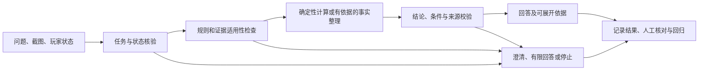

# Rust Coach Agent 改进优先级与验证规划

修订日期：2026-11-05

本文整理自本轮仓库分析及用户确认：**没有硬性技术要求，优先可靠演示**。内容是后续实施建议，不代表文中的改进已经落地。分析时仓库 HEAD 为 `eba8e58`，业务修复基线为 `8a32e00`；剩余可投入时间和目标游戏版本尚未确定。

## 1. 结论

当前最值得深入的是**目标 4：幻觉控制**，推荐做到 C「重点深入」。重点不是再增加一个模型或一个 Agent，而是让核心演示中的数值和事实回答具备完整的可信链路：输入有来源，规则有适用范围，结果可重算，未知条件不会被模型擅自补全，最终回答保留必要的限制。

目标 7「效果验证」需要作为前置基础工作，但不应单独成为主要建设方向。先用一组独立案例测清当前错误来自输入、状态、规则、路由还是表达，再针对高影响问题修复。这样既能证明收益，也能避免为了“控制幻觉”盲目增加拦截。

本项目没有已确认的向量检索、实时搜索或持久中断恢复硬性验收要求。当前应优先可靠演示；向量库、多 Agent 和生产级持久恢复暂缓，只有评测证明现有检索或工作流成为瓶颈时再投入。

必要前置工作是建立小型、独立核对的评测基线，而不是先扩展架构。推荐场景为：上传背包截图，询问制作十个 C4 的资源缺口，继续询问拆一面石墙的方案，再补充石墙剩余血量。该流程已经具备运行基础，下一步应证明每一步采用了正确的前提。

## 2. 当前现状

### 2.1 已有能力

当前系统是本地 Web 应用和 FastAPI 后端，使用 LangGraph 组织固定工作流，SQLite 保存会话、状态、证据和评测产物，并接入兼容的文本/视觉模型及受限网页取证。主要业务能力包括：

- 文本请求、图片附件、玩家状态和多轮追问的接入。
- 计算、建议、状态查询、普通对话和视觉观察的分流。
- 制作配方依赖展开、批次处理、已有成品及中间材料抵扣。
- 墙门生命值和爆炸物伤害的确定性计算。
- 玩家状态的作用域、修订号、有效期和死亡、被袭等事件失效。
- 截图上下文识别、局部库存推断，以及可读数量的有限抵扣。
- 固定主题的网页检索、正文提取、来源白名单、快照和引用校验。
- 新手路线的阶段结构、逐阶段引用、语义复核、有限修复和有依据的备用路线。
- 人设策略、受保护事实块、表达校验、确定性回退和 SSE 阶段进度。
- 请求去重、超时、有限重试和多类离线测试。

### 2.2 已测证据与边界

本轮重新运行得到：

- Python 测试：487 项通过。
- 前端 DOM 测试：16 项通过。
- 已保存的截图流程包括制作 C4、满血石墙比较和补充 250 HP 后重新计算。
- 已保存的新手流程中，三个独立新手问题的模型调用数为 2、3、2；已有基地追问未重新要求工具和睡袋；精确计算为零模型调用。
- 历史人设样本为 27 轮，早期记录的整体 p50 约 3.775 秒、p95 约 29.455 秒、最长约 63.363 秒；样本小且版本较早，不构成生产 SLA。

这些证据证明当前测试覆盖范围内的代码行为和若干真实流程能够运行，不能证明当前游戏规则已经在游戏内核验、截图中的所有图标识别正确、网页引文语义上支持结论，或任意自然语言都能被准确路由。规则快照当前明确标记为第三方快照、游戏 build 未知、未经游戏内验证。

## 3. 八个目标的优先级

排序表示新增投入的优先级；目标 7 的基线工作虽然排第二，但在实施顺序上必须先做。

| 排序／目标 | 要改善的场景与当前程度 | 关键缺口 | 可展示变化 | 成本、依赖与推荐深度 |
|---|---|---|---|---|
| **1／④ 幻觉控制** | “炸石墙要几颗”“按截图还差多少材料”。已有确定性计算、输出保护和有限降级 | 缺少输入、规则、最终结论的独立联合验证 | 数值可重算；前提不足时澄清或降级，不假装确定 | 成本中；依赖⑦及②⑤⑥的必要能力；**C** |
| **2／⑦ 效果验证** | “如何证明答得对”。已有测试、真实调用脚本和少量评测 | 缺少统一金标、独立人工核对、前后对照和错误归因 | 能区分正确、误答、误拒和边界处理 | 成本低至中；服务④；**B** |
| **3／⑤ 玩家状态建模** | 同样的问题在新手、已有基地、死亡或旧截图下应不同 | 状态冲突、适用性和建议质量的系统评估仍不足 | 建议真正随处境变化，过期库存不再误用 | 成本中；依赖状态样例和评审；**B** |
| **4／② 知识库与推理** | 资料给出伤害和公式，玩家问“需要几颗炸药” | 检索质量、规则适用条件和推导证据需要单独度量 | 能解释“资料事实→公式→计算结果”的链路 | 成本中；依赖来源审核；**B** |
| **5／① 意图理解** | 区分解释、制作缺口、拆墙比较、建议和追问 | 缺少独立路由评测和复杂混合意图样例 | 少走错处理链路，少产生无关澄清 | 成本低至中；依赖表达样例；**B** |
| **6／⑥ 知识时效** | 玩家询问当前补丁下的数值 | 快照有日期和哈希，但 build 为空，没有更新认证闭环 | 明确区分“按某快照计算”和“已核验当前版本” | 基础成本低，持续成本高；**B** |
| **7／⑧ 延迟与成本** | 识图、检索和回答等待时间过长 | 真实阶段耗时、token usage 和供应商费用不完整 | 能定位慢点，避免盲目换模型或并发改造 | 基础成本低；依赖实际测量；**B** |
| **8／③ 人设一致性** | 简洁、详细、受挫和身份问题下保持同一 Coach | 仍缺独立盲评，但已有统一策略和表达校验 | 语气稳定且不牺牲数值准确性 | 暂缓新增机制；保留现有能力；**A** |

### 3.1 目标之间的关系

八个目标可以合并成三个工作包，但保留原编号：

1. **可信回答：④为主，②提供规则和证据，⑥提供版本边界，⑦负责验收。**
2. **理解玩家处境：①识别任务，⑤提供当前条件。**
3. **交付体验：③控制表达，⑧控制等待和调用成本。**

“引入 RAG”解决的是找不到合适证据的问题，“增加多 Agent”解决的是复杂任务协作问题。当前主要风险是输入误读、状态误用、规则未核验和结果缺乏独立证明，因此不能把这些技术本身当作目标。

### 3.2 为什么④优先于第二名⑦

效果验证必须先动手，但它是本次改进的依据。只增加报表，用户得到的答案不会自动变好。因此，主要实现投入放在④，⑦作为前置和验收基础。若基线发现现有可靠性已经足够，应停止增加防护，把资源转向⑤，而不是为了完成一个“幻觉控制项目”继续添加检查。

现有测试、真实样例和调用脚本使这个选择具备实施基础；它既能影响用户看到的答案，也能通过前后对照证明。代价是本轮会减少长尾知识覆盖、个性化表达和复杂 Agent 工作流的建设时间。对于优先可靠演示的目标，这一机会成本是可接受的。

### 3.3 为什么暂不优先扩展知识检索

知识检索的改善只有在它改变了最终答案时才有用户价值；而当前已经存在一条确定性计算链路，能够直接处理高价值的数值问题。先做可靠性基线，可以回答两个关键问题：

- 当前错误主要来自找不到资料，还是来自已有资料没有被正确推导？
- 当前规则和截图输入是否足以支撑演示？

如果评测发现证据召回是主要失败原因，②就前移；如果发现规则快照或截图识别是主要问题，则应先修④内部的输入和事实边界，而不是建设向量数据库。

### 3.4 各目标做到什么程度即可

| 目标 | 本轮范围与“足够”的证据 | 暂不投入及收益下降原因 |
|---|---|---|
| ① 意图理解／B | 覆盖计算、解释、建议、状态、任务切换和追问；检查最终执行分支及参数，而非只检查初始路由标签 | 不训练专用分类器，不建设通用多意图规划器；有限高频任务优先修实际混淆 |
| ② 知识与推理／B | 核对演示规则、公式和适用条件；为少数攻略主题标注所需证据是否取到 | 不建设全量向量库或知识图谱；没有召回失败证据时，增加索引的收益未知 |
| ③ 人设／A | 保留现有能力，在可靠性回归中确认不同表达不改变数字、条件和来源即可 | 暂停新增角色风格；当前主要可信度缺口不在语气，盲评证明其阻碍使用后再启动 |
| ④ 幻觉控制／C | 打通输入、规则、计算、表达、异常和评测；满足第 5.4 节停止条件 | 不追求所有游戏知识都能回答；范围扩大将快速增加来源审核和标注成本 |
| ⑤ 玩家状态／B | 覆盖当前、过期、历史图、他人图、死亡后和冲突状态；同题不同状态应产生合理差异 | 不接实时遥测，不建设完整世界模型；复杂模型无法补偿缺失观测 |
| ⑥ 知识时效／B | 核验演示规则的版本，或明确未核验；冲突与更新不能被忽略 | 不自动采集后直接发布；低频演示阶段人工审核小范围规则更可控 |
| ⑦ 效果验证／B | 有独立金标、错误分类、未参与调试案例和前后对照 | 不建设大规模评测平台；先证明答案标准可信，再扩样本与自动化 |
| ⑧ 延迟与成本／B | 记录真实调用耗时、调用数、可获得的 usage，区分冷缓存、热缓存和重试 | 不先做多模型调度或并发架构重写；瓶颈未测清时容易优化错位置 |

本轮没有目标需要直接投入 D「进一步扩展」。以上基础能力可以服务同一个可靠性切片，不需要拆成八项独立工程。

### 3.5 判断可信度与可能改变排序的证据

已有计算、状态和验证机制的判断可信度高，有代码和测试支持。当前缺少独立金标、规则 build 核验和完整业务评测的判断也有直接证据。各目标的相对增量收益属于设计判断，可信度中等；当前没有足够样本推断真实用户错误率。

现有截图流程证明读数进入了计算，但没有证明物品身份正确。查看原图后，部分图标与输出物品映射仍需要独立人工复核；应作为待确认疑点纳入基线，不能预先记为正确或确诊错误。

使用 M0 的有限案例即可验证排序，无需先实施全部方案：

| 首轮诊断结果 | 调整方式 |
|---|---|
| 路由或参数抽取是主要错误来源 | ①成为首个修复点，必要时升为主目标 |
| 截图识别或状态误用造成主要错误 | 先强化输入核验与⑤，不先改生成提示词 |
| 正确证据存在但经常取不到 | ②前移，比较固定主题、关键词及语义检索的实际收益 |
| 规则与目标版本不符 | ⑥成为阻塞项，停止宣称相关数值适用于当前版本 |
| 可靠性已满足停止条件，但建议不贴合玩家 | 主目标转向⑤ |
| 超时或费用阻碍演示 | ⑧上调，先恢复可用流程 |

仍可能改变计划的条件是剩余时间、目标游戏版本及可核验环境、演示更侧重数值计算还是开放策略建议。技术硬性要求的疑问已由用户明确排除。

## 4. 首选目标设计：可靠的事实与数值回答

### 4.1 代表场景与完成标准

代表场景：

1. 上传当前背包截图。
2. 询问“造十个 C4 还差多少资源”。
3. 继续询问“拆一面石墙最省资源的方案是什么”。
4. 补充“它还剩 250 血”。

优化前后应能观察到以下差异：

- 物品身份和数量分别核对；身份不清的图标不会悄悄参与精确抵扣。
- 局部截图只被描述为“根据可见库存计算”，不会冒充完整盘点。
- “最省资源”明确比较指标和范围：当前是已收录单一爆炸物方案的新增硫磺。
- “未提供血量”和“明确受损但血量未知”采用不同处理。
- 血量追问只更新拆墙任务，不继承已经完成或尚未执行的制作假设。
- 结果能追溯到状态来源、规则快照、公式和计算步骤。
- 版本未知、状态失效、证据不足时，回答会明确限制，而不是给出看似精确的数字。

### 4.2 子问题

| 子问题 | 输入 | 处理 | 输出与作用 |
|---|---|---|---|
| 任务确认 | 当前消息、有限历史 | 识别制作、拆除、解释、建议和追问；区分任务切换 | 明确计算目标，避免算错问题 |
| 状态确认 | 截图、自报、状态档案 | 核对主体、时间、覆盖范围、修订号和冲突 | 带来源的可用状态及未知项 |
| 规则确认 | 目标、材质、伤害方式、快照 | 检查版本、适用条件和数据完整性 | 可执行规则，或明确限制 |
| 确定性执行 | 核验后的参数、规则、库存 | 展开配方、批次、抵扣、阈值和资源比较 | 可重算结果和推导记录 |
| 交付与验证 | 结果、条件、引用、未知项 | 保护关键断言，检查不当确定性和虚假操作回执 | 最终回答、依据、错误分类和反馈记录 |

### 4.3 方案比较

| 方案 | 工作方式 | 优点 | 成本与不足 |
|---|---|---|---|
| **A：现有链路＋针对性回归** | 保留现有计算和输出校验，只补已知失败测试 | 最快，适合时间极少 | 可能遗漏规则真实性、图像身份和跨层条件丢失 |
| **B：按声明类型核验（推荐）** | 数值交给工具，玩家事实追踪状态，机制事实追踪证据，按失败类型澄清或降级 | 可利用现有代码，错误容易定位，能形成对照实验 | 需要独立标注、少量元数据和验收规则 |
| **C：每轮增加独立模型复核** | 第二次模型检查参数、依据和回答，不通过时重写 | 对复杂语义和自然语言边界有帮助 | 增加延迟和费用；两个模型可能共同犯错，不能认证游戏规则 |

推荐 B。模型负责自然语言理解、候选组织和解释；规则负责边界和约束；工具负责计算；存储负责保留观测、规则和证据版本。只有评测证明复杂语义是主要问题时，才对少量机制声明使用 C。

### 4.4 核心数据流

对于“资料给出防御值和公式，玩家问需要几颗炸药”的问题，应采用：

> 审核后的事实与公式 → 带适用条件的规则 → 运行时计算 → 可重算结果。

若已经知道有效伤害，数量可按：

\[
N=\left\lceil\frac{H}{D_{\mathrm{有效}}}\right\rceil
\]

如果只有基础伤害和防御参数，则必须先有经过核验的有效伤害公式。模型不能临时猜减伤关系，也不能直接把基础伤害当作目标实际伤害。多个独立目标应分别取整，不能先合并血量。

当前规则快照下，石墙满血为 500，C4 对该目标的记录伤害为 275，因此结果为两颗；250 血时为一颗。这说明现有快照和算法如何推导，不等于已经认证当前游戏版本。

材料需求随后经过配方依赖、制作批次和库存抵扣计算，不需要预存所有问题的最终数量答案。生成层保护的也不仅是数字：目标、血量、命中条件和版本限制必须与结果一起保留。否则即使“2”没有改变，条件性结论仍可能被表达成无条件保证。

沿用现有状态和证据存储即可。用户自报、截图观测与默认假设分开记录；来源冲突且影响结论时只追问必要字段。无需为这轮工作新增独立数据库或通用事实平台。

### 4.5 异常处理

- 参数缺失且影响结果：提出具体澄清；合理默认值必须在答案中说明。
- 物品身份或数量不清：排除该项或请求补图，说明它会影响完整性。
- 历史图、他人图或过期状态：不作为当前本人库存。
- 规则不支持、来源冲突或版本不明：限制答案范围，不从模型记忆补数字。
- 引用存在但不支持结论：删除或收窄声明，不能只因为字面匹配就放行。
- 超时、检索失败和计算失败：保留不同错误类型，不能统一说成“证据不足”。

用户纠正应形成新观测，不自动证明上一轮建议已被执行。有限修复预算继续保留；重复生成本身不是新的事实依据。

### 4.6 本轮边界

**必须完成：**

- 独立核对演示范围内的规则和截图样例。
- 补齐基线暴露的关键路由、状态或证据缺口。
- 使关键数值、条件和依据能够互相对应。
- 统计错误确定性回答、误拒答、必要澄清和边界处理。
- 完成真实界面流程和未参与调试案例的验证。

**可选增强：**

- 对有歧义的图像区域局部重读。
- 对少量机制声明复用语义复核。
- 增加简短、可展开的依据展示。

**明确暂缓：**

全量知识图谱、通用向量库、多 Agent 协商、混合爆炸物全局优化、实时游戏遥测、全自动规则发布和生产级多用户并发。

## 5. 实施与验证里程碑

以下工作量是熟悉仓库的一人估计，不含外部游戏核验等待时间，也不是已经完成的结果。

| 里程碑 | 可交付能力与主要工作 | 验证方法与完成标准 | 风险 | 估计 |
|---|---|---|---|---|
| **M0：可信基线** | 建立 24 个独立案例，覆盖计算、截图、路由、建议和失败边界；记录当前输出和首个错误环节 | 每例都有独立预期行为和依据；能区分输入、规则、路由、生成错误 | 标准答案与实现共享错误 | 0.5–1 天 |
| **M1：输入与规则核验** | 核对演示规则；补物品身份、状态有效期、版本和任务切换边界 | 规则证据独立可查；过期、历史和歧义输入不被当作当前确定状态 | 版本难确认、截图标注不充分 | 0.5–1 天 |
| **M2：关键失败修复** | 按影响优先级补校验、澄清、降级和受保护断言 | 关键失败案例处理正确；没有用大量无效拒答换取低错误数 | 过度拦截导致可用性下降 | 1–1.5 天 |
| **M3：对照与演示验收** | 固定代码、模型、规则和数据集；完成前后对照和浏览器演示 | 保留集、真实端到端流程和正常/失败场景均可复现；剩余边界有记录 | 上游模型和网页波动，小样本偶然通过 | 0.5–1 天 |

### 5.1 建议的评测集

首轮可以使用 24 个案例，建议分成四组，每组 6 个：

- 文本计算：数量、血量阈值、成品抵扣、批次、优化指标和不支持条件。
- 截图与状态：清晰、局部、模糊、历史、他人、失效。
- 意图与多轮：术语解释、制作与拆除切换、补充血量、否定条件和任务追问。
- 事实与攻略：相关证据、无关引文、缺证据、版本冲突、已有基地和新手场景。

至少三分之一案例应在规则和提示词调试后仍保持未参与调试。标准答案必须来自独立规则、人工核对或原文证据，不能直接复制系统当前输出。

同一图片的轻微改写不能分散到调试集和保留集，以免形成数据泄漏。每例记录预期行为、独立依据、实际输出及首个错误环节；有争议的答案先标记争议，不强行算作通过。

### 5.2 指标与人工评审

建议按文本、截图、多轮和事实建议分组报告：

- **端到端正确完成率**：任务、输入、规则、结果和必要条件全部正确的比例。
- **错误确定性回答数**：前提或事实不成立，却给出确定结论的次数。
- **误拒答率**：支持范围内、信息充分，却无必要地拒答或要求补充的比例。
- **边界处理正确率**：对过期、歧义、冲突和无依据案例的处理是否正确。
- **依据可追溯性**：关键结论能否对应观测、规则、公式或原文。
- **延迟和成本**：端到端耗时、各阶段耗时、重试数、可获得的 usage；无法取得的费用明确留空。

建议质量单独由人工按“符合玩家状态、证据充分、步骤可执行、取舍和不确定性表达合理”评审。事实错误不能被自然语气或步骤详细抵消。模型裁判可做辅助，不能替代人工校准和独立事实依据。

优先由熟悉 Rust 的另一人隐藏方案名称进行评审；如果只能作者自评，应明确记录评审身份和争议项。不把模型自报置信度当作准确率，也不把外层工具次数当作完整模型费用。现有部分 trace 耗时仅覆盖事件创建，不能直接作为业务阶段耗时。

### 5.3 对照实验

固定代码、规则、模型配置和数据集版本，对比当前实现与改进实现。先用固定证据回放获得可重复结果，再用少量真实模型和检索验证。对不稳定案例重复调用，报告每次结果和失败次数，不能只保留最好的一次。

“测试通过”只能证明代码行为通过既定检查，不能直接替代用户效果改善。若前后没有实质差异，应记录为“未证明增量收益”。

### 5.4 停止条件

以下是建议阈值，不是当前已测结果：

1. 演示范围的规则和截图样例都有独立依据；无法认证的版本限制被明确展示。
2. 保留集没有关键的错误确定性数值、错误库存抵扣、假引用或过期状态误用。
3. 支持范围内、信息充分的案例达到约 90% 的正确完成率，同时单独报告误拒答率。
4. 关键失败案例能够正确澄清、降级或停止，不是简单全部拒答。
5. 相比基线，高影响问题确实减少，且没有明显增加无效澄清。
6. 核心演示可以重复执行，依据可查，已知限制能够解释。

达到这些条件后，应停止在幻觉控制上继续堆检查，转向玩家状态或知识检索。若基线本来已经满足条件，也应直接停止追加机制。

如果只剩一两天，缩小到“石墙拆除、C4 合成、一组人工标注截图”；可以减少攻略主题和可选语义复核，但不能删掉独立金标、保留案例和真实端到端验证。

### 5.5 可复现的面试演示

建议用约五分钟展示正常计算、截图抵扣、血量追问、历史图失效和展开依据。准备固定证据回放作为可重复检查手段，同时演示一次真实浏览器上传和问答；明确说明哪些是回放、哪些是实时调用。

正常场景包括清晰截图、已有成品抵扣、血量阈值和已有基地后的路线调整。关键失败场景包括物品身份不清、旧图或他人图、受损但血量未知、任务切换、无关引用、版本冲突及服务超时。演示既要证明能回答，也要证明知道何时必须限制结论。

保留集观察到零关键错误只代表该批样本的结果，不能推广为真实世界零风险。

## 6. 后续目标启动条件

| 目标 | 启动条件 | 暂缓损失与节省 |
|---|---|---|
| **⑤ 玩家状态** | 数值可靠后，仍频繁忽略已有进展、约束或目标 | 暂时少一些个性化；节省复杂状态扩展和迁移成本 |
| **② 知识检索** | 正确证据存在却经常召回不到，或作业新增明确检索要求 | 长尾覆盖受限；节省索引维护和调参成本 |
| **① 意图理解** | 独立案例显示路由或参数错误是主要失败来源 | 暂时保留部分澄清；避免过早建设通用语义路由 |
| **⑥ 知识时效** | 项目需要跨补丁持续使用，或现有规则已证实过期 | 不能承诺实时最新；节省采集和发布工程 |
| **⑧ 延迟成本** | 实测等待或费用已经阻碍演示和使用 | 保留长尾等待；避免未经测量牺牲质量 |
| **③ 人设** | 盲评表明语气漂移、重复或表达边界明显影响使用 | 个性化较少；把时间留给事实可靠性 |
| **⑦ 评测扩展** | 模型、规则和场景频繁变化，人工运行成为瓶颈 | 自动化程度有限；保持评测透明易维护 |

## 7. 证据索引

以下路径用于核对事实，文档中的“建议阈值”和“未来工作量”不应与已测结果混淆：

其中 `data/` 下的真实调用报告是本地保存、未纳入 Git 的材料，其他检出环境可能没有这些文件。可共享的行为说明与复现入口见[截图修复记录](inventory-raid-fix.md)、[新手路线说明](onboarding-guides.md)及[人设验证记录](persona-verification.md)。

- 当前能力与边界：[`README.md`](../README.md)
- 规则快照、版本和验证状态：[`src/rust_coach/calculations/rules.json`](../src/rust_coach/calculations/rules.json)
- 制作与拆除计算：[`src/rust_coach/calculations/engine.py`](../src/rust_coach/calculations/engine.py)
- 截图库存推断与排除原因：[`src/rust_coach/vision/context.py`](../src/rust_coach/vision/context.py)
- 玩家状态有效期和事件失效：[`src/rust_coach/player_state/domain.py`](../src/rust_coach/player_state/domain.py)
- 建议证据与回答校验：[`src/rust_coach/advice/service.py`](../src/rust_coach/advice/service.py)
- 输出保护及未证明的自由文本语义：[`src/rust_coach/presentation/validation.py`](../src/rust_coach/presentation/validation.py)
- 截图流程保存结果：[`data/inventory-raid-smoke.json`](../data/inventory-raid-smoke.json)
- 新手路线真实调用结果：[`data/onboarding-stability-results.json`](../data/onboarding-stability-results.json)
- 人设验证及其限制：[`docs/persona-verification.md`](persona-verification.md)
- 早期总体架构与未实现的目标能力：[`docs/architecture.md`](architecture.md)
