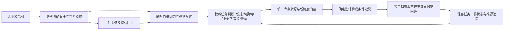

# 意图理解与玩家状态实施记录

主线：截图制作 → 拆墙 → 补充血量 → 状态变化后重新计算。

用户确认策略：明确报告死亡且背包丢失后，立即持久失效旧背包并将当前背包清零；保留历史。玩家状态按服务器和清档跨会话复用。演示使用已确定的规则快照，不扩展 P2。

## 逐步验证任务

| 顺序 | 任务 | 设计目标 | 验收证据 | 状态 |
|---|---|---|---|---|
| 1 | 权威路由和任务生命周期；支持切换、补充、更正、取消 | 目标1：用户意图进入正确执行链路 | 路由/实际节点一致；制作→拆墙→血量端到端测试 | 已实现并定向验证 |
| 2 | 明确状态事件持久写入、历史保留、跨会话复用 | 目标5：计算基于当前状态 | 死亡清零、历史、幂等、失败重试、跨会话测试 | 已实现并定向验证 |
| 3 | 文本/截图/档案形成有来源的任务状态；统一计算门禁 | 目标1+5：参数继承与事实使用正确 | 来源冲突、未知、过期、任务切换、状态变化测试 | 已实现并定向验证 |
| 4 | 临时自报状态进入建议评估；持久事实和推断分离 | 目标5：建议前置条件随当前处境改变 | 建议评估和档案不被隐式覆盖测试 | 已实现并定向验证 |
| 5 | 分层评测、HTTP/SSE链路、说明与演示 | 目标1+5：可复现验证与解释 | 固定案例报告、回归、链路核验 | 已完成 |

## 工作区边界

开始时 `evals/inventory_baseline.py`、`evals/inventory_evidence.py`、`pyproject.toml`、`tests/test_inventory_evaluation.py` 和新增 `evals/__init__.py` 已有未提交改动。本任务保留这些改动；新增独立意图/状态评测，不覆盖库存评测工作。

## 用户能力

- 截图制作、拆墙及补充血量共用同一条计算链路。任务切换清除旧制作目标；普通聊天插话后可继续原任务；重启后仍可读取工作状态。
- `/state` 和自然语言状态查询使用同一个确定性节点。最终路由、实际执行节点、任务动作和原因一起保存，不再出现元数据标成聊天而实际执行状态查询。
- “我刚死了，背包丢了”立即提交持久事件。旧背包记录失效并归档，当前背包为空清单。装备和相关短期观测按死亡规则失效；基地箱子不清零。
- 新聊天复用最后明确关联的服务器/清档档案；“我换服了”解除旧关联并要求选择新档案。档案不是聊天历史副本。
- “我有1级工作台”“我已经有基地”“我还能在线20分钟”等明确自报进入有期限的临时状态，可改变本轮计算前置条件或建议的缺失字段判断；档案不会隐式覆盖。更广泛字段仍可使用既有表单或文本草稿确认。
- 单格明确纠正（如“硫磺数量改为150”“不是齿轮，是电子零件”“硫磺保持未知”）生成新的视觉证据版本。原图、原始识别和来源时间保留，不自动写回档案，不把纠正时间当作新的截图时间。多格不明确纠正返回可操作错误。
- “只用档案背包”“只用截图”“只用文本”“只算总需求”可消除来源歧义。多来源不静默覆盖或求和。

## 端到端数据流



事件在耗时模型调用之前写入 SQLite，回答保存与事件写入是两个有明确边界的事务。模型失败不会撤销已经上报的死亡。重试通过请求身份和事件回执幂等恢复，不能再次清空死亡后重新盘点的背包。生成期间或保存事务前发现档案版本变化，返回明确冲突，旧结果不发布。

计算及建议共用库存解析门禁。它分别记录文本、截图、档案的选择与排除原因、完整性、观测时间、规则快照和档案版本。首次截图计算也经过该门禁，不再绕过档案冲突检查。

## 关键取舍

| 决策 | 原因与代价 |
|---|---|
| 规则快速路径 + 受限模型解析 | 状态查询、标准拆墙和已知目标的血量追问无需模型；其他计算参数最多两次解析。保留自然语言能力，但不宣称覆盖所有表达。 |
| 单一任务工作状态 | 足以覆盖制作→拆墙→血量和插话恢复；混合多目标先澄清，不实现通用规划或 Checkpointer。 |
| 明确事件直接持久化 | 遵循用户确认策略，避免死亡后继续使用旧背包。高精度表达规则排除历史、假设、否定和引用；无法识别的表达不会擅自清零。 |
| 来源资格与模型置信度分开 | 模型自报置信度不是校准准确率。计算资格检查主体、时间、完整性和来源冲突；推断图片得到的预算保留条件性。 |
| 临时事实与档案分离 | 本轮自报可以及时影响行动条件；来源冲突显式展示，跨会话事实仍来自确认过的共享档案。 |
| 规则快照固定 | 本轮采用既定 `rustdata-pc-vanilla-2026-11-01`；没有修改规则数值或伪造 game build 认证，评测固定同一规则哈希。 |

## 验证入口

初次实现检查点（下述559项与旧报告保留历史身份；最新审查见后文）：

| 验证 | 结果 | 证明范围 |
|---|---|---|
| 全量 Python 测试 | 559 项通过 | 原有功能回归与新任务、状态、视觉纠正、评测链路 |
| 前端 DOM 测试 | 16 项通过 | 聊天输入、图片、SSE、失败重试和详情展示 |
| 状态页脚本语法检查 | 通过 | 新增失效历史展示的 JavaScript 可解析 |
| 固定 HTTP/SSE 评测 | 40/40 案例、54 轮通过 | 脚本化模型下的完整服务和状态契约；不是模型准确率 |
| 同契约基线对照 | 10/40 → 40/40，无回退案例 | 包含新增路由、来源和事件元数据要求；不将缺字段算作模型误判 |
| 真实文本模型冒烟 | 6/6 轮通过，3 次调用 | 制作、任务切换、血量补充、死亡清零、跨会话和临时科技条件 |
| 补丁空白检查 | `git diff --check` 通过 | 补丁格式 |

真实冒烟使用当时配置的 `gpt-5.6-sol` / Responses。三次调用分别约 3.7、4.8、4.7 秒，另三轮走确定性路径；这是一次小样本，不作为服务 SLA。报告记录调用次数、usage、输入状态、结构化任务与回答。未开展本轮真实视觉模型或完整浏览器验收。

- `tests/test_intent_state.py`：事件持久化、失败重试、跨会话读取、任务生命周期、临时事实、并发版本冲突、模型库存证据。
- `tests/test_vision.py`：实际上传、视觉候选、制作→拆墙→血量、用户纠正、来源冲突、旧图不能越过死亡水位、临时科技不改变图片档案版本。
- `tests/test_intent_state_evaluation.py`：40 个固定案例通过 HTTP/SSE，缺结果不能被误判为安全通过；不兼容评测拒绝对比。
- `evals/intent-state-cases.json`：40 个案例、54 轮，包含路由、任务、库存、事件、图像、临时状态和失败场景。
- `evals/results/intent-state-v1-baseline-2026-11-05.json`：基线源代码 `9f6ab3f` 在临时目录、临时数据库上执行同一新契约的结果。
- `evals/results/intent-state-v1-current-2026-11-05.json`：新版本执行与对照，包含源码、数据集、判定器、规则哈希和逐轮首错。
- `evals/results/intent-state-v1-live-2026-11-05.json`：有调用预算的真实文本模型冒烟；独立于固定模型夹具评测。

固定案例使用脚本化模型输出和合成图片，检查实际 HTTP/SSE、上传、数据库、任务和计算链路。该通过数包含新增元数据要求，不能解释为模型识图或语言理解准确率。测试图不冒充用户原图；本轮没有将未知标注改成金标。

复现离线评测：

```sh
uv run python -m evals.intent_state --output data/intent-state-evaluation/local.json
uv run pytest -q
node --test tests/test_chat_ui.cjs
```

真实模型冒烟有费用，显式运行；使用临时数据库，不读写用户档案：

```sh
uv run python -m evals.intent_state_live --live --max-model-calls 3 --output data/intent-state-evaluation/live-local.json
```

## 审查后检查点（2026-11-05）

深度审查及逐项修复见 [审查报告](intent-state-audit-2026-11-05.md)。初次实现报告保留原样；本次增加否定/愿望事实、科技幻觉、并发改绑、明确来源选择、视觉纠正和评测伪成功检查。

| 验证 | 最新结果 |
|---|---|
| 全量 Python 测试 | 584项通过，12.95秒 |
| 前端 DOM 测试 | 16项通过 |
| 状态页脚本语法、补丁空白 | 通过 |
| 固定 HTTP/SSE 评测 | 40/40案例、54轮通过，`intent-state-v1-audited-2026-11-05.json` |
| 加严后的真实文本冒烟 | 6/6轮通过、3次 `gpt-5.6-sol` 调用，`intent-state-v1-live-audited-2026-11-05.json` |

真实冒烟额外核验实际计算成功及非空结果、两C4硫磺缺口3400/4400和1级工作台阻塞；三次调用约5.8、4.4、4.3秒。上述结果仍不是模型准确率或服务SLA。输出文件现在禁止覆盖已有证据，复现应选择新路径。

## 面试演示

1. 在玩家状态页关联服务器/清档，完整盘点背包并记录工作台。
2. 上传一张已核对图片，问“制作两个C4还差多少”。展示图中可用材料、未知项和来源；如同时选择了档案容器，先展示冲突，再说“只用截图”。
3. 问“改成拆一面石墙最省资源”，然后“它还剩250血”。检查任务从制作切到拆墙，血量追问继续同一拆墙任务，库存没有被实际扣减。
4. 说“硫磺数量改为150”，展示新证据和重新计算，同时查看原识别仍存在。
5. 说“我刚死了，背包丢了”。刷新状态页，看到当前空背包和失效历史；新建聊天，再用档案背包计算，使用的是同一份空背包。
6. 说“我有1级工作台，继续计算”，展示本轮科技条件变化与档案保持原值。
7. 展示固定评测中来源冲突、旧图、未知血量和失败重试案例，解释模型抽取、事实资格、算术和表达分别验证。

## 边界

- 没有接实时遥测；状态仍依赖玩家上报。明确死亡按约定清零背包，不推断遗失物被找回。
- 图片身份错误仍可能来自视觉模型。此次改进的是来源使用、纠正和任务衔接，没有训练或更换识图模型。
- 当前文本自报快速路径覆盖有限字段，其他状态使用既有确认 API；不支持自动资源增减记账，不自动递减在线时长。
- 跨会话复用的是玩家档案；当前任务及未保存的临时自报不自动跨会话迁移。
- 多意图规划、实时世界模型、向量库、多 Agent 和生产检查点属于 P2，未实现。
- HTTP/SSE 集成测试不等于完整浏览器验收；真实文本冒烟也不等于真实视觉效果评测或统计准确率证明。
