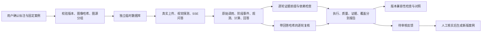

# 库存评测 V2 实施与演示报告

日期：2026-11-05。目标：完成目标 7 的小型评测闭环，以可靠演示为优先。范围为十个 C4 制作、库存图、状态隔离、制作切换拆墙与未知血量澄清。本次没有改动 `src/` 中的业务实现，没有实施 P2。

系统现在可以回答：一次回答是否真的执行完成、采用了哪些可核实前提、最早在哪一轮发生分歧、错误是否进入预算或最终回答，以及结论来自自动检查还是人工／代码代理复核。**它没有让 Coach 自动识图更准确。**

## 1. 已实现的用户能力

| 实施任务 | 对应设计目标 | 已实现能力与验证 |
|---|---|---|
| M0：冻结案例与证据 | 可信、版本化的案例和证据 | 保留原八案例与原始结果；增加三张用户确认的图片、九个案例；文件哈希、图源分组和标注依据可查 |
| M1：执行与判断 | 隔离执行；证据感知的逐项评测 | 复用上传、视觉探测、SSE、独立临时数据库；记录全部计划案例；预算耗尽停止，未执行案例明确标记 |
| M2：归因与复核 | 找到最早有证据的分歧；复核闭环 | 所有轮次均检查；标注未知传播到下游；缺输出不能判正确；复核与具体回答哈希绑定并合并入评测结果 |
| M3：反馈与对照 | 反馈形成审核候选；版本比较与新图验收 | CLI 生成待审核反馈；只有人工确认后生成新版案例；不兼容版本拒绝可比性；完成新图真实运行和保存结果重判 |

这些是一个本地评测工具链，复用当前应用。没有新增微服务、向量库、多 Agent 裁判、线上自动发布或自动改写玩家记忆。

## 2. 端到端数据流



业务输入和业务结果没有变；新增的是输出之后的可审计链路。原始模型推断保存在 `visual` 和调用回复中，人工事实保存在案例标注中，最终建议保存在 `assistant` 中，判定器比较它们而不相互覆盖。

每个自动检查包含轮次、预期、实际、状态、依赖、具体证据字段及可用的工作流事件引用。最早分歧按轮次和工作流依赖定位；下游检查保留上游失败引用。该机制提供可解释诊断，不声称通过干预实验证明了因果根因。

旧图／对手图被库存门禁挡住时，视觉错误仍报告为错误，但注明未传播到本轮预算。过期案例前一轮识别回答也接受检查，不能因为后一轮拒绝抵扣就把整段会话判为正确。

## 3. 设计决策与取舍

- **执行、质量、证据、覆盖分开。** HTTP 完成不等于任务正确，服务错误不等于合理拒答。缺计算时“未使用无效库存”为 `blocked`；规则或标注未核验为 `pending`；保守省略可读材料为 `partial`。
- **未知不造金标。** 第二行不确定物品、蓝色液体容器和锤子保持未知。未标注的额外数值观测不能直接判断为正确或错误，其相关抵扣仍待核实。已确认格子的确定性错认与覆盖不足分开统计。
- **独立算术与前提正确性分开。** 手算表根据独立 Wiki 配方编写，仅覆盖十个 C4、普通工作台火药、不展开燃油，包含成品 C4、炸药和火药抵扣。即使错误库存下算术正确，也不代表答案正确。没有调用生产 Calculator 生成金标。
- **复核有身份和作用范围。** 本轮最终表达由代码代理逐轮审阅，身份明确记录为 `coding_agent`；图片标注由用户确认。两者不能冒充独立人工盲评。复核不能覆盖自动已确认的错误，也不能认证未验证的游戏规则。
- **原始输出不变。** 新判定和复核生成新文件。实时捕获与最终重判的判定器源码哈希分别保留；最终重判使用完成后的判定器。对照显式区分保存结果重判和真实模型执行。
- **同源图片不伪装成独立样本。** 宽图与旧图属于同一场景；另两张图属于两个新场景，各自的多轮和历史变体跟随原图分组。本轮首次运行后，它们已是已见案例。
- **预算限制可执行。** 每次模型调用前检查调用次数，墙钟预算能取消在途任务；预建清单保证剩余案例可见。费用无账单时为 `null`，不能用调用次数声称美元费用上限。

## 4. 完成的验证

全量 Python 回归 **517 项通过**，其中评测相关 **30 项通过**。覆盖缺失输出、标注不确定性传播、错误状态使用、覆盖不足、早轮错误优先、复核绑定与冲突、独立中间材料算术、图源分组、图像篡改、反馈审核、真实 HTTP/SSE 驱动、模型调用预算和在途时间预算。

端到端测试使用确定性测试模型，验证创建会话、上传图片、视觉探测、问答、SSE 解析、SQLite 留存及隔离；它只证明软件链路。另实际运行配置的模型完成新图评测，结果如下。未开展浏览器交互验证，不能把 ASGI HTTP 链路称为浏览器验收。

对同一捕获结果和同一复核重新判定两次，九个案例判定一致，对照兼容性通过，新模型调用为零。另以旧判定与新判定做对照，工具明确报告判定器／复核协议不兼容，不把状态差异归为模型收益。

业务源码哈希与原真实基线一致，规则文件哈希也一致；`git diff --check` 通过。旧基线数据和原结果未修改。

## 5. 实测结果

### 新图片批次

真实执行时间：北京时间 2026-11-05 04:33:42 至 04:39:25。主模型与视觉模型均为当时配置的 `gpt-5.6-sol`，接口为 Responses。完整配置及哈希在报告中保留。

| 指标 | 结果 | 范围与解释 |
|---|---|---|
| 案例／对话轮次 | 9／12 | 三张图，其中两个新独立场景 |
| 模型调用 | 19 | 视觉 15、文本 4；包括视觉探测 |
| 服务失败／未执行 | 0／0 | 本批全部执行完成 |
| 合并复核后的质量 | 5 fail、3 pending、1 pass | 不是整体准确率 |
| 按实际采用库存检查制作算术 | 8／8 匹配 | 错误识别得到的错误库存仍然是错误前提 |
| 历史／对手／过期库存隔离 | 3／3 匹配 | 其中历史和对手图有潜在视觉错误，但未抵扣 |
| 必要澄清 | 1 项通过 | 受损石墙 HP 未知，没有默认满血 |
| 聊天 HTTP 耗时 | p50 20.848s；p95 91.322s | 12 个样本；不含探测和初始化，不是生产 SLA |
| 供应商返回 token | 输入 132267；输出 15245 | 19 次均返回 usage；账单金额未知 |

| 案例 | 最终状态 | 有证据的结论 |
|---|---|---|
| 宽图制作 | pending | 六格识别与重复木头汇总正确，制作缺口匹配；游戏 build 未验证 |
| 零件图制作 | fail | 齿轮20→电子零件20；电子零件2→炸药2，错误进入材料抵扣 |
| 混合图制作 | fail | 燃油157→动物脂肪，燃油缺口报600而非443；电子零件另有覆盖损失 |
| 零件历史图 | fail | 相同视觉错认存在，但被历史库存隔离挡住；最终只列总需求 |
| 混合对手图 | fail | 齿轮和电子零件错认，未用于本人预算；最终回答边界正确 |
| 混合图过期 | pending | 已确认八项识别正确，过期隔离正确；锤子命名、液体单位表达及规则版本待核实 |
| 零件图任务切换 | fail | 制作→拆墙→250 HP 切换正确；错误的炸药库存继续影响后续预算 |
| 空库存文本制作 | pending | 总需求正确；游戏 build 未验证 |
| 受损但血量未知 | pass | 必要澄清，未生成满血结果；表达已复核 |

逐轮表达复核记录五轮错误确定性回答，分布于三个案例；另有一轮表达待核实。没有观察到新的无谓拒答证据，但样本小且复核并非独立盲评。

### 旧基线重新判定

旧的 16 次运行保留不变。原自动判定为 5 fail、11 pending；V2 自动逐轮检查为 8 fail、8 pending，合并表达复核后为 **8 fail、6 pending、2 pass**。

变化来自评测覆盖：补出历史／对手图的潜在视觉错误和过期场景第一轮的错误回答；原先被笼统算失败的保守识别现在单列覆盖不足；正确血量澄清经复核后可以通过。**这些是判定能力的变化，不是模型效果变化。** 原基线14个制作结果与实际采用库存下的独立算术仍全部匹配。

## 6. 未完成与限制

- 当前游戏 build、石墙 HP／爆炸伤害及全部比较方案没有独立的版本匹配认证，因此相关案例继续待核验。不会为了得出“全通过”移除这些条件。
- Coach 的图标识别错误仍存在，本轮只建设评测和暴露问题。尚未做业务修复，也没有同一未见集上的业务版本前后实验，不能宣称模型改进。
- 新图只运行一轮，只有两个新独立图源；不证明泛化或稳定性。未来调试后需要新保留样本。
- 未进行独立人工盲评、浏览器验收或供应商账单核对。反馈审核与晋升由测试和 CLI 支持，本轮没有把未经确认的模型猜测写入新金标。
- 没有上线评测平台、通用配方金标求解器、生产 trace 系统或 P2 能力。当前范围足以展示诊断闭环，不能等同全项目的质量认证。

## 7. 面试演示方式

建议五分钟：

1. 展示用户确认标注与图源分组，说明为什么宽图不能算全新样本，为什么未知物品保留未知。
2. 打开 `components_craft` 的视觉观测、实际库存、算术检查和回答：演示“算术正确，但前提错误”，首错在第0轮视觉识别。
3. 对比 `components_historical`：识图仍错，但库存门禁阻止错误进入当前预算；再展示 `damaged_unknown_hp` 的正确澄清。
4. 执行以下离线命令，把逐轮复核合并到新报告；没有网络费用，结果可复现。展示版本不兼容对照中的拒绝原因。
5. 如需现场真实调用，使用 README 的 `--live --only wide_craft damaged_unknown_hp` 命令。明确说明实时模型可能波动，保存结果重判用于稳定地展示评测机制。

```sh
uv run python evals/inventory_baseline.py \
  --cases evals/inventory-acceptance-v2.json \
  --replay evals/results/inventory-acceptance-v2-live-2026-11-05.json \
  --review evals/results/inventory-acceptance-v2-review-2026-11-05.json \
  --output data/inventory-evaluation-v2/interview-regraded.json
```

每次换新的输出文件名。反馈 CLI 的待审核→人工确认→生成新版案例，以及预算耗尽保留 `not_run` 清单，可以作为追问时的补充演示，完整命令见 [评测 README](../evals/README.md)。

## 证据入口

- [新图案例与标注](../evals/inventory-acceptance-v2.json)
- [真实模型捕获](../evals/results/inventory-acceptance-v2-live-2026-11-05.json)
- [逐轮复核记录](../evals/results/inventory-acceptance-v2-review-2026-11-05.json)
- [新图最终评测](../evals/results/inventory-acceptance-v2-reviewed-2026-11-05.json)
- [旧基线最终重判](../evals/results/inventory-baseline-v2-reviewed-2026-11-05.json)
- [旧／新判定不可比性报告](../evals/results/inventory-grader-v1-v2-comparison-2026-11-05.json)
- [同版本重判复现检查](../evals/results/inventory-v2-reproducibility-2026-11-05.json)
- [原始独立规则证据](../evals/results/inventory-rule-evidence-2026-11-05.json)

原始提示和较大调用记录另存于被 Git 忽略的 `data/inventory-evaluation-v2/`。公开结果不含提示正文或图片 Base64，但保留模型回复及应用结构化输出，足以复查本批判断。
