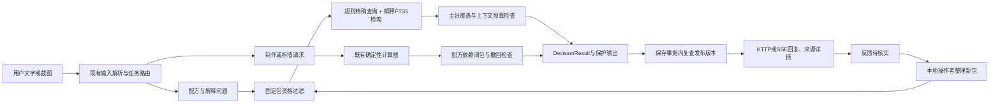

# G02/G06 固定演示知识实施记录

## 范围与验收任务

采用 `rustdata-pc-vanilla-2026-11-01`，不修改游戏数值，不认证游戏build。用户不安排Rust独立人工评审；程序核验、代理整理与独立人工认证必须分开表述。沿用当前单体、SQLite、规则计算、图像与状态链路，不建设P2。

| 顺序 | 任务 | 对应目标 | 验证方式 | 状态 |
|---|---|---|---|---|
| 1 | 冻结规则与证据包，保存检索基线与24案例标准 | G02证据构建、G06版本边界 | 包完整性、来源、版本资格、固定语料回放 | 完成 |
| 2 | 精确规则查询与全文片段检索接入真实聊天/计算 | G02准确率与效率 | HTTP/SSE、截图制作、拆墙、机制追问 | 完成 |
| 3 | 失效、缓存、旧对话、反馈与发布回退 | G06防止陈旧知识污染 | 错版本、撤回、重启、失败和在途变化测试 | 完成 |
| 4 | 对照评估、回归与演示步骤 | G02/G06效果证明 | 固定基线/过滤/检索对照、预留案例、成本与边界 | 完成 |

基线代码：`f120a366c286c60f3a7a6506521036886c77a93c`。开始时presentation-materials已有改动，本任务保留。前一分析轮相关175项测试通过，不能当作新实施验收。

## 设计约束

- 公开网页、模型输出和用户反馈不能在线修改规则。原文存在不等于支持主张，更不等于认证当前版本。
- 固定包的版本与抓取时间、游戏build分开。正常数值按快照计算；最新版本问题明确超出认证范围。
- 结构化规则直接查询，解释片段使用本地全文检索；所有结果携带来源与采用/排除原因。
- 小范围机制解释使用受约束的已整理主张，模型不能扩写新游戏事实；未知主张明确缺证据。
- 现有非核心玩法建议保持其原有链路和未认证标记，不把这些网页自动升级为演示规则。
- 审核身份为代理整理或本地操作者；不伪造独立专家审核。真实视觉、游戏内认证与总体准确率不由固定夹具证明。

## 1. 已实现的用户能力

- 可以直接询问 C4、炸药、火药的配方、工作台条件和来源，或在拆墙后追问“为什么250血还需要一颗C4”。无需模型生成数值或解释。
- 支持十二个有限解释主题：拆除取整、多目标、单一方案比较范围、库存抵扣、科技条件、批次、混合台、燃油展开、版本、未知血量、伤害条件和资料冲突。未收录机制明确缺证据，不自动改用网络或模型补全。
- 原有截图制作、切换拆墙、补充血量继续使用原输入和计算链路；生成结果附知识包、规则依赖和限制。知识查询不会扣库存，也不会把图像识别自动升级为人工确认。
- “最新补丁”、不同日期、主机版、修改服等请求会说明范围不适用；不会把演示日期当作游戏build认证。
- 回复详情可查看已采用、未采用的证据，并选择该回答真实引用的一项依据提交反馈。反馈只进入待核实记录。
- 无密钥可使用 `/knowledge C4配方是什么`、`/calc JSON` 和计算器页面。中文自然问法在已配置聊天界面同样可用；当前新增解释正文以中文为主。

## 2. 端到端数据流



`LocalKnowledge` 使用现有 `ConversationStore` 的 SQLite 连接；运行时注入聊天计算服务、建议服务的计算器及独立计算 API。模型仍可解析自然语言任务、识图或提出建议候选，但这些输出不成为权威数值。算术继续使用原 DAG 展开、整数批次与 Decimal 拆除公式。

知识问答先识别有限实体、机制主题和范围。规则按 ID 查询，解释通过英文主题标签映射和 SQLite FTS5/BM25 排序；资格过滤包含快照、平台、规则集、分支、采用状态和撤回记录，排除对象不能进入候选结果。随后检查所需规则和机制主题是否覆盖，最多五段、6000个正文字符。解释 ID 改名后仍能通过 FTS 找到，测试防止全文索引成为摆设。

固定包结果携带 release ID/hash/revision、已选与已排除证据、缺口和限制。查询 trace 记录采用状态、选取/排除数量、正文长度、耗时、缓存命中和调用量；正文经过既有保护层输出。缓存以完整发布引用和查询需求隔离，撤回或切换包后不会命中旧缓存。

新回答保存前在同一 SQLite 写事务中重新核对发布引用；在途切包或撤回返回409，不保存旧回答。历史文字中失效的版本对不再进入模型上下文，旧的已计算结果不能用相同请求ID冒充当前结果重放。旧计算的**输入**可作为续算条件，但必须重新计算和核对依赖；旧输出不是新事实。界面保留历史记录，详情明确它只是生成时的状态。

## 3. 关键设计决策

默认包 `demo-knowledge-2026-11-01-v1` 共84个单元：69个结构化规则记录（60配方、8目标和1混合台配方）、12个实现机制说明、3段已保存Wiki原文。配方和目标文本由冻结目录生成；安装时必须与目录一致，不能拿另一段文字冒充同一条规则。包的规则hash与当前引擎也必须一致。

- 规则SHA256：`11033e0ec886eb101a301c7e3e4ecc8fc9c30a23afeacc67679fecd710bbb3d5`。
- 规范化包SHA256：`768bde461cabd576d6dfcf15640c08a69c991822b112b9dd6dc8325cb2032dc3`。
- 采用标记 `snapshot_checked` 只代表本快照内可用；`snapshot_only`、`implementation_explanation`、`excerpt_crosscheck_build_unknown` 分别区分规则、实现说明和原文交叉核对。
- 三段Wiki摘录沿用已有报告的URL、正文hash和抓取时间，抓取日期晚于演示快照也不会被解释为build认证。石墙HP与C4伤害仍没有独立游戏内核验。
- 发布包同名不可覆盖；安装候选不自动替换正在使用的包。显式切换要求已核对的包hash和本地操作说明，记录发布审计；相同操作可回退。回退不会恢复已经撤回的证据。
- 反馈审核可标记 `rejected` 或 `needs_release`，均不修改规则。新资料必须另建包，数值变更不属于本次固定版本范围。

选择本地全文检索和确定性解释，是为了小范围稳定演示和可追溯性。没有增加向量库、图数据库、代理协作、自动更新发布或通用语义判别器。长尾问法、任意多主张论证和未知游戏机制仍不保证覆盖；系统只输出已登记信息，不补推断。

## 4. 验证与证据

### 2026-11-05 深度审查后检查点

最新审查、严重度问题表、修复、限制与面试问答见 [G02/G06深度审查](knowledge-audit-2026-11-05.md)。以下初次实施的618项、24案例与原报告保留历史身份。

审查后全量657项Python测试通过（19.33秒），18项DOM测试通过，脚本语法与补丁检查通过。新增39项审查检查；目录内60个配方名称精确命中。加严判定器下原24案及新增18案分别全部通过，均非真实玩家准确率。最终报告为 `knowledge-fixed-audit-v4-2026-11-05.json`、`knowledge-audit-v4-2026-11-05.json`，完整测试记录为 `knowledge-audit-final-tests-v2-2026-11-05.xml`，均位于 `evals/results/`。

修复内容包括普通配方/生命值问法的本地路由、最长实体匹配、跨包同证据撤回、日期/build范围检查、所有有知识上下文的回答重放校验、损坏缓存重检索和索引重建。网页证据TTL贯穿历史、续问、重放及发布，并向后续引用历史的回答传播。具体取整追问复用Calculator并保存推导；缺证据不再声明已支持结论。规则和知识包正文未改变。

索引恢复入口：`uv run python -m rust_coach.knowledge.manage --database data/knowledge-demo.sqlite3 rebuild-index`。它不会解除撤回或认证新版本。20组本地冷/热查询p50分别约2.392/1.944ms；B2整体仍不比粗主题过滤更快，不宣称全局提速。

### 初次实施检查点

2026-11-05，本任务基线全量584项通过；实施后全量 **618项通过（17.42秒）**，新增34项参数化后的Python验证。前端 **18项DOM测试通过**，`node --check src/rust_coach/static/app.js` 与 `git diff --check` 通过。

核心覆盖：

| 链路或失败 | 可检查的证据 |
|---|---|
| 无模型HTTP/SSE配方、来源和反馈 | `tests/test_knowledge.py`；NoModel替身一旦被调用立即失败 |
| 截图制作→拆墙→250血→解释→撤回后续算 | `tests/test_vision.py::test_screenshot_craft_raid_explanation_and_revocation_use_one_release`；整个链路只调用一次视觉替身 |
| 计算API与建议候选不能使用被撤回依赖 | 直接计算、聊天、建议三种入口均覆盖；展开燃油和混合台路径单独测试 |
| 发布失败、哈希不匹配、规则文本伪造 | 包保持不变；模拟索引插入失败验证整笔回滚 |
| 错版本、错平台、错分支、pending/conflicted/revoked | 排除原因可见，不能渲染为有效依据 |
| 缓存、重启、回退、历史与在途变化 | 旧缓存不命中；撤回持久化；在途变化不保存旧回答 |
| 反馈不会变成规则 | 仅允许真实引用；重复请求一致返回，冲突409；删除会话同步删除反馈 |
| 引用与表达 | 原文元数据与已有抓取报告逐字段一致；保护输出不允许模型改数值 |
| UI | 离线知识命令可发送；反馈绑定原会话与原引用，重复点击不重复提交 |

十个C4的原料结果与既有独立配方工作表相同：硫磺22000、木炭30000、金属碎片2000、低品质燃油600、布50、电子零件20。该工作表不由业务目录计算预期值，但其网页build仍未知；不能据此宣称当前正式服正确。

旧意图评测只有一个预期有意调整：`concept_after_craft` 中“解释一下合成批次”保持chat路由，模型调用从1改为0，因为现在由本地知识解释。旧报告保留原数据hash，不与新数据直接混算。

## 5. 固定评测结果与解释边界

数据：[knowledge-cases.json](../evals/knowledge-cases.json)。首轮与最终结果分别保存在 [首轮报告](../evals/results/knowledge-fixed-first-2026-11-05.json) 和 [最终报告](../evals/results/knowledge-fixed-final-2026-11-05.json)，没有覆盖旧输出。报告记录基线commit、数据、判定器、知识代码、规则和发布包hash。

共24案，配方、拆墙、版本、失败、补充机制和生命周期六组各4案。16个开发案例、8个首轮运行前冻结的预留案例；预留查询所属的燃油、混合台、未知血量、冲突处理、批次和库存机制未用于开发案例。所有策略共享规则语料，这**不是来源独立、人工盲测或真实外部问法集**。首轮与最终B2均为24/24，没有根据预留结果修补检索。

| 策略 | 通过/总数 | 预留通过/总数 | 平均正文字符 | 查询p50/p95（ms） | 模型/网络调用 |
|---|---:|---:|---:|---:|---:|
| B0 既有粗主题谓词的离线适配 | 4/24 | 2/8 | 105 | 0.659 / 0.868 | 0 / 0 |
| B1 同一粗主题谓词加资格过滤 | 7/24 | 2/8 | 84 | 0.674 / 0.737 | 0 / 0 |
| B2 精确规则＋资格过滤＋全文解释 | 24/24 | 8/8 | 133.04 | 1.538 / 1.736 | 0 / 0 |

B0/B1复用当前 `web.relevant()` 的主题词判断，在与B2相同本地语料、五段/6000字符预算下对照；它们**不是旧版在线网页与模型的重跑结果**。24/24只表示固定证据选择、范围和拒答契约通过，不是游戏知识正确率。B2此次耗时比粗过滤更高，正文也更多；不能宣称整体提速或token降低。耗时仅为单次冷查询，排除安装、视觉、模型和网络时间。

## 6. 未实现与剩余限制

- 按用户确认，不安排独立Rust专家复核，不认证游戏build，不提供自动实时更新。当前不会自动判断未知新补丁与固定快照是否相同。
- 通用玩法建议继续使用原网页取证链路和未认证标记；本次并未消除所有开放式建议中的“原文存在但不支持结论”问题。新核心解释采用整理后的有限主张，避免自由扩写。
- 自动冲突发现、解释内容真实性审核、通用语义召回、英文解释本地化和在线热更新平台不在本次范围。候选包的操作说明是本地发布记录，不能冒充独立专家认证或自动语义证明。
- 本次未新增付费真实模型评测或浏览器视觉验收；截图链路验证使用视觉替身，前端用DOM测试。它们证明软件链路，不能证明真实识图准确率；既有真实截图评测记录仍单独保留。

## 7. 面试演示

先用演示数据库启动，避免撤回操作影响日常记录：

```sh
COACH_DATABASE_PATH=data/knowledge-demo.sqlite3 uv run uvicorn rust_coach.app:create_app --factory --host 127.0.0.1 --port 8000
```

1. 输入 `/knowledge C4配方是什么`，展示无模型也能查规则、看到来源与未认证边界。
2. 配置视觉服务后，上传既有库存图并问制作缺口；接着输入“改成拆一面石墙最省资源”“它还剩250血”“为什么250血还需要一颗C4”。展示状态沿用、确定性公式及对应目标证据。若只演示离线链路，用 `/calc {"operation":"raid","target":"building:base-wall:stone","hp":250,"methods":["explosive.timed"]}`，本快照得到一颗C4；这不代表游戏内核验。
3. 输入 `/knowledge 最新版本C4配方是什么`，展示明确的 `latest_unverified`；再试主机版或不同日期，展示范围阻断。
4. 展开来源详情，对实际引用提交“其他攻略数值不同”的反馈；用下列 `feedback` 命令看它仍为待核实，计算规则没有改变。
5. 在演示数据库撤回 `raid:building:base-wall:stone`，重复拆墙或追问计算；展示阻断，旧缓存与相同请求ID也不能绕过检查。换包或重启不会自动清除撤回。

```sh
uv run python -m rust_coach.knowledge.manage --database data/knowledge-demo.sqlite3 status
uv run python -m rust_coach.knowledge.manage --database data/knowledge-demo.sqlite3 feedback
uv run python -m rust_coach.knowledge.manage --database data/knowledge-demo.sqlite3 revoke demo-knowledge-2026-11-01-v1 raid:building:base-wall:stone --reason '演示：该目标记录待复核'
```

候选发布流程：`export` 导出包 → 用新ID整理内容和采用状态 → `install` 校验并保存候选 → 查看安装返回的hash → `activate` 带相同hash及操作说明切换。导出拒绝覆盖已有文件；回退同样激活旧包hash。

```sh
uv run python -m rust_coach.knowledge.manage --database data/knowledge-demo.sqlite3 export data/knowledge-candidate.json
# 编辑候选文件，必须使用新的id；固定数值规则不可更改
uv run python -m rust_coach.knowledge.manage --database data/knowledge-demo.sqlite3 install data/knowledge-candidate.json
uv run python -m rust_coach.knowledge.manage --database data/knowledge-demo.sqlite3 activate YOUR_NEW_RELEASE --sha256 HASH_FROM_INSTALL --review-note '已核对固定范围与来源；未认证游戏build'
```

复现验证：

```sh
uv run pytest -q
node --test tests/test_chat_ui.cjs
node --check src/rust_coach/static/app.js
uv run python -m evals.knowledge --output data/knowledge-evaluation-new.json
```

面试讲法：“系统会区分计算规则、原文摘录和实现说明。它按固定包推导与解释；资料不适用或被撤回时停止采用，并把依据、限制和失效原因留给用户检查。”
