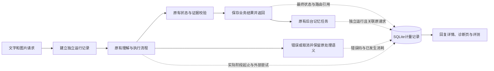

# 延迟与成本：可核验的调用与时间线

2026-11-05深度审查更新：原始实施验证对应 `932f7de`；后续问题、修复与当前证据见[审查报告](latency-cost-audit-2026-11-05.md)。目前完成计量链路和故障回归，真实速度／费用可接受仍未验证；原33条报告不作为修复后源码的验证。

本轮按已确认方案实施，并遵守后续约束：**不新增整次请求的共享预算**。原有请求超时、服务内修复次数、评测运行预算均保留。没有增加模型调度、并发重构或收费估算规则。

## 用户能力与设计目标

回答下方新增“查看处理耗时与调用”，按需读取本次请求的所有尝试。成功重放显示为复用，不把原回答曾消耗的调用重新记到重放中。后台记忆有独立记录，并提示尚未完成时稍后刷新。

访问 `/performance` 可查看最近运行，包括没有保存聊天回答的失败、取消、繁忙拒绝、视觉探测、上传和状态预览。记录以文本展示，不渲染HTML。页面和API读取失败均明确提示，不显示伪造的零消耗。

这一轮提供可解释的基线与诊断能力，**不声称真实模型已经变快或降低了账单**。截图复用、标准拆墙及血量追问的零模型路径原本已经存在；本轮让其实际调用量可以被核对。

| 实施任务 | 对应设计目标 | 验证方式 |
|---|---|---|
| 请求运行、真实阶段和调用尝试分开记录 | 测清真实消耗 | 慢模型、嵌套和并行span、失败和取消测试 |
| 包装模型入口，记录网页实际请求 | 避免外层一次工具调用掩盖内部多次调用 | 建议结构修复计3次，视觉结构修复计2次 |
| 记录缓存命中、草稿复用、路由和解析方式 | 解释不必要工作是否发生 | 截图制作→拆墙→250血，冷/热查询、成功重放 |
| 前台、后台、探测、上传和预览分开 | 可靠交付与完整归因 | 后台绑定原请求，失败无聊天轮次但仍留账 |
| usage归一化、未知成本、错误计量告警 | 可信成本口径 | 缺失、部分、冲突、非法usage以及数据库故障测试 |
| HTTP/SSE离线评测、页面与API | 用证据验证效果 | 固定夹具，多次重复，质量和调用数同时断言 |

共享预算控制不在本次实现内；不因观测到超时而自动降低答案校验要求。状态、知识版本、计算和生成保护边界沿用现有实现。

## 端到端数据链路



每次传输尝试都有独立run，关联会话和request ID；同请求失败后重试产生新run，成功重放也有新run但零新增模型调用。业务响应不嵌入动态计量字段，因此原有成功请求重放与刷新恢复的响应一致性不变。

模型包装器围绕每次complete测量，记录角色、模型、API模式、端点哈希、文本字符数、图片数、输出上限、返回长度、截断、usage及错误。生产适配器额外记录是否进入HTTP发送边界；该标记不证明供应商实际接收或收费。测试注入模型明确标识为injected，不能当作真实网络调用。网页请求逐次记录主机、方法、状态和持续时间，不保存查询字符串、请求头或正文。

阶段用单调时钟测量开始和结束，UTC时间只用于关联。父阶段包含子阶段和模型调用，不能累加为总耗时。首条进度只代表正在工作，不是首个有效答案。服务端run不包含浏览器传输；附件上传独立计时，尚未关联浏览器点击到渲染的完整交互。旧架构事件的伪阶段耗时改为null，实际阶段以计量span为准。

后台任务不继承前台计量上下文；任务队列中的原请求与origin run引用在重启后仍可关联。没有前台上下文的直接模型调用建立独立运行，避免无声遗漏。强制进程终止可能留下running记录，系统不会把它改写为成功。

## 成本与计量完整性

- input/output、prompt/completion两种usage命名归一；总数、cached和reasoning明细保留不同含义，不重复相加。
- cached token和reasoning token是细分指标，不额外加到总数上。不从字符数或图片字节推算实际收费。
- usage标记missing、partial、complete或invalid；冲突、负数、布尔值、非法类型及不一致总数不能进入合计。
- 汇总提供已知值之和、报告该字段的调用数和总调用数。仅有total的提供方仍是partial，不补造输入输出分布。
- 无价格表与供应商账单，billed_cost为null。无外部调用用no_external_calls表示，不等同于机器运行没有成本。超时、取消不视为免费。
- 计量写入失败记录脱敏错误日志，并将可返回报告标为incomplete；不替换正确业务回答，也不静默输出完整账目。数据库完全不可用时API明确失败；未持久化的记录无法在重启后恢复。
- run及span开始时先保存running，再更新终态。崩溃留下的running只表示终态未知，不宣称生产级持久恢复。
- 会话删除级联删除其计量记录；无会话的探测等记录留在本地数据库。没有新增生产多租户权限或自动保留期平台。

## API与复现

- `GET /api/conversations/{id}/performance?request_id={uuid}`：同请求前台尝试及关联后台任务，返回后台记忆状态。
- `GET /api/performance?limit=100`：最近运行，包含独立探测、上传、预览；超出窗口明确truncated，汇总只覆盖返回记录。
- `GET /performance`：本地诊断页；记录不包含提示原文、图片、模型回复、密钥或原始端点。

离线验证无需密钥、网络或日常会话数据库：

```sh
uv run python -m evals.performance --repetitions 3
uv run pytest -q tests/test_performance.py
node --test tests/test_chat_ui.cjs tests/test_performance_ui.cjs
```

评测只向标准输出输出JSON，不覆盖已有报告。合成图和固定模型返回经过真实应用上传、HTTP/SSE、计算、保存和计量API。每轮独立临时数据库，模型夹具固定等待5毫秒。模式明确为synthetic_model_real_application_http_sse，不能当作真实截图识别率、模型延迟或线上费用。

覆盖冷/热识图、拆墙切换、血量追问、冷/热知识查询、本地计算、成功重放、失败、失败后重试、结构修复。预期调用数与关键业务结果同时检查。少于20次不计算p95；这些是开发回归，没有独立盲测声明。

已保存报告见 [performance-fixture.json](../evals/results/performance-fixture.json)，包含源码与规则hash、每次结果和统计口径。源码变化后需重新运行，不能把旧报告作为当前性能。

原始实施验证：全量Python 684项通过（25.04秒），前端DOM 20项通过；11场景各重复3次，共33/33通过。定向测试包含27项，已包含在全量数中，不额外相加。报告中的冷识图每轮1次调用、热复用0次、拆墙与血量追问0次、结构修复2次；模型延迟为固定夹具，毫秒数不证明真实服务提速。`git diff --check`、报告源码hash和材料相对链接检查通过；未运行付费模型或真实浏览器验收。

审查后验证为705项Python、20项DOM、强化交付与独立调用账本检查后的33/33；见[当前报告](../evals/results/performance-audit-2026-11-05.json)。计量连接遇到锁立即降级，running和v2缺span报告incomplete，流中已经收到的usage在后续失败时保留，后台运行包含提交阶段。旧记录不做伪造回填。

## 面试演示

1. 启动应用，打开聊天页与 `/performance`。发送本地拆墙计算，展开计量，说明为何无需模型。
2. 上传库存截图制作，再切换石墙并补充250血。核对是否仅在必要阶段调用视觉模型；离线夹具不能冒充真实识图。
3. 原样重放请求，观察新run为复用且没有新增模型调用；原业务回答不变。
4. 运行离线故障评测，展示模型超时、结构修复和失败重试各自留账。工具调用成功不等于输出通过业务校验。
5. 展示后台独立关联、usage缺失与费用未知，解释为何调用次数不能冒充账单。

## 限制与停止边界

本轮完成计量、解释和可复现验证，不新增共享预算、不自动取消可选步骤、不变更局部超时或修复、不跳过质量检查。没有证据支持修改图像清晰度、提示词、模型或缓存有效期，因此保持现有策略。未实施P2的多模型调度、分布式队列和生产计费平台。

真实供应商性能、账单金额、浏览器首个有效答案时间与新模型对照仍需另行采样；本地夹具通过不能替代这些证据。每个span的SQLite写入仍有观测开销，duration在自身终态写入前截止；不能把计量前后的不等条件样本拼接为提速结论。计量连接不再等待锁；业务连接锁等待和同步磁盘I/O仍可能延迟取消，未声称硬实时SLA。
