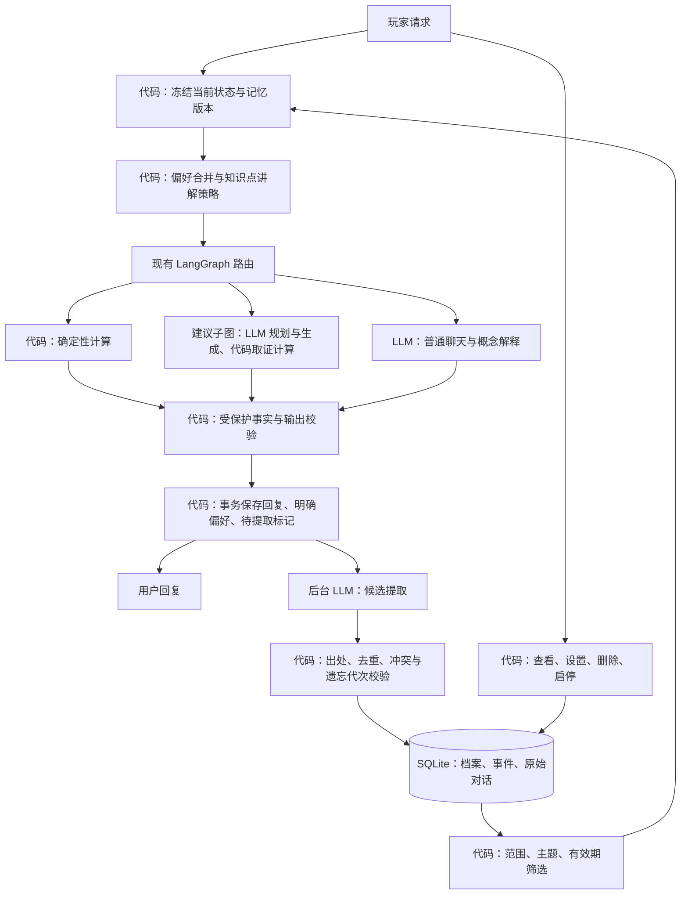
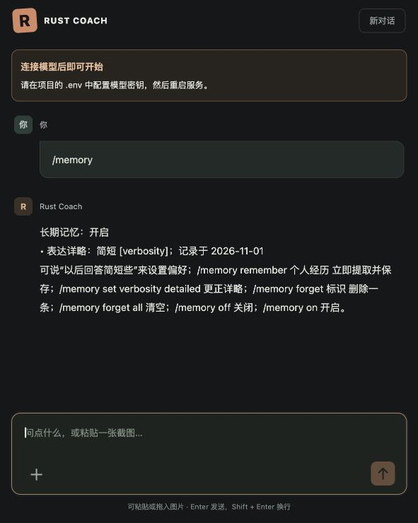

# 玩家记忆与循序讲解

本阶段复用 SQLite、现有 LangGraph 和表达层，实现跨会话个人偏好、自报习惯、关键历史和知识点讲解进度。没有增加向量数据库、独立 Agent、外部任务队列或在线裁判。

## 使用

普通聊天中的“以后回答简短些”“我通常独狼”等明确陈述在该轮成功保存时同步写入。只对自己的长期陈述生效；“这次简短点”仅影响当轮。关键经历、自然语言更正和学习证据按需在回复后提取，默认超时二十秒。后台尚未完成时，下一轮可能暂时读不到新记忆。

需要立即核对记录结果时使用：

| 输入 | 行为 |
| --- | --- |
| `/memory` 或“你记住了什么” | 查看档案、历史来源日期及可删除标识 |
| `/memory remember 昨晚我的基地被偷家了` | 等待一次结构化提取和写入，成功后才返回保存回执 |
| `/memory set verbosity concise` | 长期简短；可选 `standard`、`detailed` |
| `/memory set terminology plain` | 易懂称呼；可选 `game_terms` |
| `/memory set guidance guided` | 逐步解释；可选 `auto`、`practice`、`independent` |
| `/memory set language zh` | 中文；可选 `auto`、`en` |
| `/memory forget play_style` 或“忘掉我的独狼习惯” | 删除该习惯及历史证据，不从旧消息重新提取 |
| `/memory forget learning.craft_batches` | 删除合成批次的学习进度 |
| `/memory forget 事件标识` | 删除指定历史事件 |
| `/memory forget all` | 清空长期记忆，并停止向模型发送此前的会话历史 |
| `/memory off` / `/memory on` | 暂停或恢复长期记忆读取、写入；恢复时不回扫暂停期间的对话 |

管理入口保持在现有聊天中，没有新增设置面板。没有模型密钥时仍可通过 `/memory` 查看、设置固定偏好和删除；自然语言经历抽取需要模型服务。

“忘掉”不会擦除原聊天记录，但相关原消息及引用过该记忆的轮次不再进入模型上下文。删除会话会同时撤销依赖该会话的记忆；另一个会话独立确认的新偏好保留。关闭长期记忆并不关闭当前会话的正常上下文。

## 数据与边界

原始 `turns`、`player_state` 保持原职责；增加两张表：

- `coach_profiles`：本地玩家的字段级档案、学习进度、版本、启停状态及遗忘代次。
- `coach_memory_events`：有来源的偏好观察、历史事件、学习证据和撤销记录。保留原消息标识，撤销后清空派生内容。

当前身份固定为单机 `local`，不是多用户隔离方案。偏好与通用知识点跨会话使用；历史事件绑定服务器/清档档案。无档案时记录为 `unscoped`，可跨无档案会话回忆，但不归入某个基地。绑定档案后默认只读该档事件；明确要求“跨服复盘”“上一档”等才可读取其他范围，并携带原范围。

事件保存玩家原文和记录时间，不把“昨晚”擅自换算成确定的发生时间，不存模型补写的事故原因。历史检索先按范围、主题和记录时间筛选，读取最近一百条候选，最多注入三条。并非无限历史检索；没有召回证据时不能声称完整了解过去。

表达偏好持续有效，习惯和学习进度的使用窗口暂设九十天，过期保留供查看但不注入。该窗口是工程默认值，不是经验证的人类遗忘规律。当前状态的有效期仍由 `player_state` 独立管理。

当前明确要求优先于长期偏好；显式会话设置和本次请求设置也可覆盖个人默认。临时偏好不持久化。习惯只来自自报，不自动从在线时间、消费或失败次数推断性格或风险承受能力。多个事件不会自动被总结成“你总是犯同样的错”。

## 写入与故障处理

LLM 只生成受限类型的候选；代码检查字段、逐字出处、主体线索、长期或临时语义以及已知规范值。引文、假设、队友描述和敏感凭据不进入个人记忆。保守规则可能漏记复杂表述，可改为直接陈述或使用固定设置命令。原文匹配不是语义真实性证明。

明确规则能识别的偏好和成功轮次在同一个 SQLite 事务中保存。主回复失败时不会留下这种偏好写入；相同请求重放不重复写入。记录话题讨论只表示发生过讨论，不代表解释质量或玩家掌握已验证。

需要模型的提取任务写在该轮内部 `memory.extraction` 元数据中，单进程 worker 按 sequence 处理，不占主回复的模型调用链路。旧版本轮次不自动回扫。启动时恢复 pending；关闭时取消网络等待，任务保留。普通失败标记 failed，不自动无限重试；跨重启的中断尝试最多两次。需要重试可显式发送新的 `/memory remember`。

删除、关闭和删除会话递增遗忘代次；在途提取回写时再次检查，旧任务不能复活删除内容。旧偏好任务不能覆盖更新的明确偏好；学习证据允许与更新的话题讨论合并，但不会覆盖更新的求助反馈。

公开 Turn 的记忆引用与回答保持不变，后台任务状态不暴露在不可变回复中。管理 API 可查询待处理任务数量。日志记录状态、写入数量、版本和尝试次数，不打印个人原文。记忆内容随相关请求发给已配置的模型供应商；搜索引擎不会收到个人记忆。

## 循序讲解

当前支持十个知识点：库存范围、合成批次、中间材料抵扣、工作台与蓝图、拆除条件、入口检查、维护与离线准备、目标取舍、版本依据、纪念碑路线。

每个知识点独立保存讨论记录、最近学习信号和有限的解释证据。不同任务的解释证据才能累计；重复请求、重复原文、同一教学任务内的改述不会重复升级。

| 证据 | 讲解方式 |
| --- | --- |
| 未知、只讨论过、当前表示不懂 | 先解决任务，再逐步说明必要概念 |
| 自报理解，或一次模型评估的解释证据 | 减少重复定义，提供关键提示；不强制测验 |
| 不同任务中有两次不同的解释证据 | 省略基础定义，讨论条件与取舍 |
| 当前明确要求基础讲解或跳过基础 | 本轮要求优先 |
| 当前紧急、正在受攻击或马上下线 | 行动和阻塞条件优先，暂停教学 |

两次证据是可调整启发式，不是统计意义的掌握证明。模型判断解释是否符合知识点提示；代码只验证出处、结构和最低解释特征。结果标记为 `model_assessed`，不能据此推导战斗技能或执行成功率。错误判断可用自然语言求助、固定讲解设置或删除知识点纠正。

“继续上次的讲解”可从个人档案选取最近讨论的知识点。讨论记录与解释证据分开：仅听过讲解不会晋级。已讨论的话题先简短衔接，仍允许玩家要求重讲。

教学上下文进入普通聊天、建议生成以及计算报告的解释部分。数值、引用、可行性和前置条件继续由原业务链路负责。少量明确的概念解释走聊天短路径；明确计算请求仍走计算器。当前没有课程图谱、自动测验、完整技能诊断或经过玩家实验验证的学习效果模型。

## 运行时结构

筛选、策略和写入是普通服务函数，不分别建立 Graph Node。`ChatState.memory_context` 是本轮只读投影；`ResponseContext.teaching` 约束解释；`Turn.memory` 留存读取版本、字段及事件引用和讲解方式。建议子图显式接收记忆，计算解析器不接收历史记忆作为库存。继续使用现有短请求持久化，不引入 Checkpointer。

## 配置与 API

`COACH_MEMORY_CONTEXT_CHAR_LIMIT=3200` 限制额外记忆正文字符数，计入现有历史预算；字符数不等于 token。`COACH_MEMORY_TIMEOUT_SECONDS=20` 限制每次提取等待。普通轮次零新增模型调用；命中提取条件时额外一次，显式 remember 最多一次。日志和轮次记录支持按数据观察命中率与实际开销。

| 接口 | 用途 |
| --- | --- |
| `GET /api/memory` | 查看档案、最近事件及 pending 数量 |
| `POST /api/memory/preferences` | `{ "key": "verbosity", "value": "concise" }` |
| `POST /api/memory/settings` | `{ "enabled": false }` |
| `DELETE /api/memory/{key-or-event-id}` | 删除指定记忆，`all` 表示清空 |

接口延续本机单用户、同源限制和聊天写入锁，不提供公网身份认证。

## 验证

`tests/test_memory.py` 覆盖跨会话与重启、当轮覆盖、引文/假设/第三方拒绝、事务与重放、启停、按服隔离、遗忘及在途竞争、学习证据去重、知识点独立性、讨论与掌握分离、提取超时与重启、当前计算隔离、建议链路传递、API 校验。

`uv run python docs/run_memory_smoke.py` 使用本地配置的模型和临时数据库，只发送合成文本，产生 `memory-live-results.json`。实际调用会消耗模型额度。八项合成样例通过，包括历史提取、假设拒绝、正确/错误解释、自报理解、跨会话召回、遗忘后不编造和两种讲解模式。此结果不是整体准确率或真实教学效果的估计。

本阶段完整回归为 370 项通过，构建与前端语法检查通过。浏览器使用独立临时数据库和空模型密钥，验证固定偏好设置、新会话中的读取及消息渲染，没有向实际玩家档案写入样例。

后续应以真实玩家的任务完成、术语理解、重复说明和纠正频率做对照实验；自动测试通过只能说明已覆盖的软件行为符合预期。
