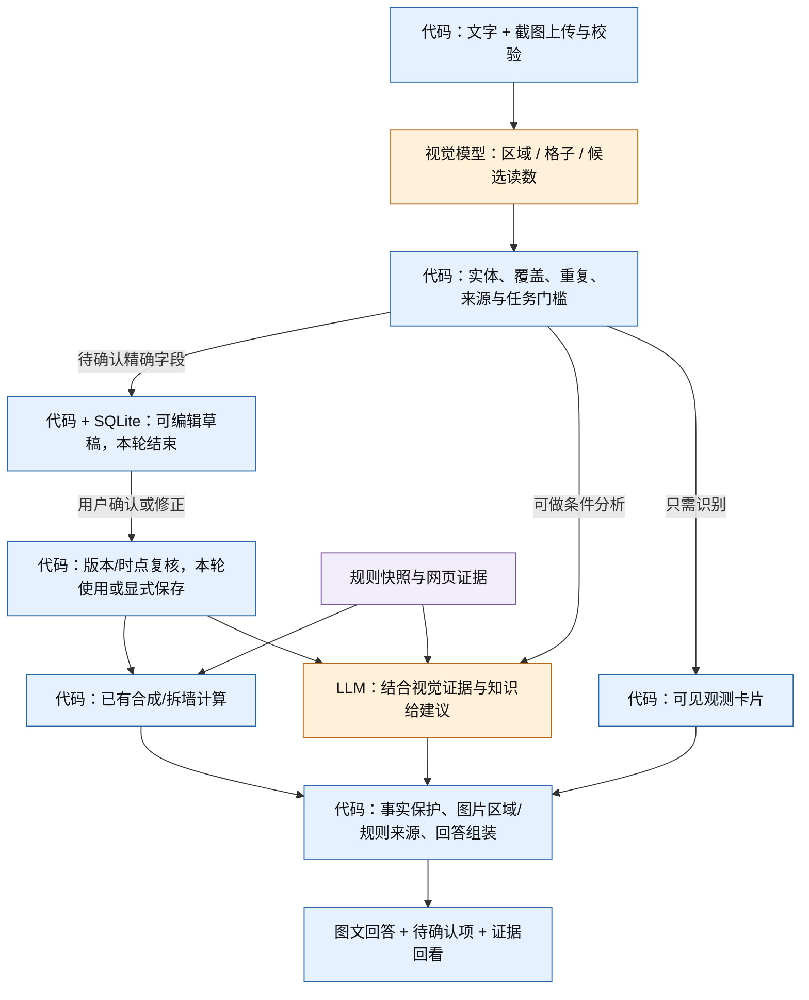

# Rust Coach 截图输入：实现方案

日期：2026-11-02。状态：**已实现受限首版；本文件保留最初设计与目标指标**。实际模块、差异、测试和未完成的规模评测见 [实施说明](multimodal-implementation.md)。范围是背包、基地、装备栏截图及其多轮追问，不含视频流、游戏自动控制或实时遥测。

后续交互调整：用户已选择默认自动使用截图。当前实现无需填写时间或逐项确认；结合对话判断截图主体与时间，无相反说明默认当前本人，识别后直接计算/建议。本文中的强制确认步骤仅保留为历史设计，实际行为以 [实施说明](multimodal-implementation.md) 为准。

建议新增一个轻量视觉观测子图：**截图 → 有区域来源的候选观测 → 代码校验 → 按需确认 → 现有计算/建议链路**。视觉模型负责从画面提取信息，不能直接修改库存、认定完整基地拓扑，或输出未经计算工具支持的消耗与伤害。

## 1. 需求与产品行为

| 玩家输入 | 应提供的结果 | 必须保留的边界 |
| --- | --- | --- |
| 背包截图 + “这些还差多少才能造装备？” | 逐格物品草稿、数量疑点、容器范围；确认后生成配方、缺口与来源 | 未显示物品未知；制作目标、工作台、可制作配方另行核对 |
| 基地截图 + “这里哪里有问题？” | 标注图中可见结构和具体区域，给局部检查顺序与有依据的条件建议 | 单张外观图不证明内部连接、门锁权限、工具柜、全基地安全或昨晚突破原因 |
| 自己/对手装备栏截图 + “这套打得过吗？” | 分开识别主体、装备/快捷栏/持有物，提示缺失条件，给可执行的对抗或撤离条件 | 当前没有战斗计算器，不能因接入图片就声称精确伤害、TTK 或胜率 |
| 只有截图 | 先展示简短识别概况和“盘点 / 算缺口 / 看布局 / 看装备”的任务选择 | 不猜测玩家要拆家、自动规划花费或自动保存 |
| 多张截图 + “合起来看看” | 先确认同一时点还是前后变化、同一容器还是不同容器、本人还是对手 | 不自动累加重复截图或跨时点数量，不把不同视角拼成已证实的拓扑 |

不要求每张图片先填长表单。只在当前结论真正依赖时追问；用户可先得到“图中可见什么”和条件建议。涉及精确库存、科技前置、实际缺口或写入档案时，才出现可编辑的确认卡片，支持一次核对整组字段。

**两个独立操作：**“确认这些读数，仅用于本轮”和“确认并保存到当前档案”。允许分析敌人的装备或过去的基地照片；这类图不能默认保存成玩家当前状态。

## 2. 当前代码已具备什么，缺什么

| 当前位置 | 核查结果 | 拟议改动 |
| --- | --- | --- |
| `contracts.py` | `ModelMessage.content` 仅字符串；`ChatRequest.message` 必填；Turn 无附件 | 增加附件引用、图文输入块、视觉观测/草稿引用；有附件时允许空文字 |
| `llm.py` | Responses 与 Chat Completions 文本适配；已支持上游流式 Responses | 分离请求组装与传输，增加显式图片块序列化，复用错误处理和流式解析 |
| `app.py` | POST 全局只接受 JSON；CSP `img-src 'self'`；无上传路由 | 仅附件路由允许 multipart；流式限量读取；本地预览需要受限 `blob:` |
| `runtime.py` / `workflows.py` | 文本路由、冻结状态、请求去重、总超时、最终组装；无持久 Checkpointer | 在已有业务路由前增加视觉子图，冻结附件集合和预算；保留无图路径 |
| `player_state/service.py` | 文本提取只返回用户待确认草稿 | 复用确认体验；视觉草稿另存储、版本化，不能直接当 `StateChanges` |
| `player_state/schemas.py` | `source` 仅 manual/text_confirmed；equipped 仅作为容器，无槽位属性 | 增加受控 image_confirmed 来源、证据引用和装备槽位观测结构 |
| `player_state/domain.py` | 完整库存 replace；局部 patch 会降为 partial；TTL、失效事件、未知与零已区分 | 复用这些规则；增加图像观测时间、装备/基地局部观测失效 |
| `player_state/store.py` | observation_id 幂等、expected_revision 乐观锁、SQLite 事务 | 确认草稿消费与状态提交需同一事务，防止双重保存 |
| `advice/service.py` | 可结合状态与检索做条件建议，无战斗模拟与基地突破求解 | 接收视觉证据包，核对声明的观测引用；不新建替代的决策 Agent |
| `presentation/` | 已保护工具数值、候选和限制；能力提示当前明确不支持截图 | 仅在视觉能力探测与评测通过后打开 vision 能力，增加图片证据块 |

当前安装的 LangGraph 为 1.2.19。项目已有职责边界可以保留，主要新增 `attachments/`、`vision/` 两个模块，并扩展现有状态/表达层，不需要先引入向量库、多 Agent、消息队列或图数据库。

## 3. 模型与接口选择

继续保留用户配置的 `https://cf.api.fan/v1` 与 `gpt-5.6-sol`。官方视觉文档列出了该模型家族的图像 detail 行为，但**官方能力不证明第三方代理已正确开放同名模型、图片传输或对应参数**。本次只做设计，没有调用该代理进行视觉测试。

实施的第一道门是能力探测：使用本地生成的非隐私测试图，验证图片确实被读取、文字和指定区域能被定位、多图可区分、流式 Responses 正常结束。还要测试不支持 detail、损坏图片、拒绝、截断、限流的错误行为；仅 HTTP 200 或 `/models` 列表不足以通过。

拟新增 `COACH_VISION_ENABLED`、`COACH_VISION_MODEL`、`COACH_VISION_BASE_URL`、`COACH_VISION_API_MODE`、`COACH_VISION_API_KEY`。视觉模型/地址默认继承现有配置；独立凭据可选，不更换聊天模型。探测失败返回 `vision_unavailable` 并保留文字能力，允许以后配置已验证的视觉服务。

`/api/config` 区分 `configured`、`probe_status` 和 `enabled`，不能仅根据有密钥就显示“截图识别可用”。证据记录模型名、代理配置指纹、探测时间与解析版本。

### 3.1 输入序列化

内部使用供应商无关的 `TextPart(text)`、`ImagePart(attachment_id, region_id, detail)`。业务层只拿附件 ID，不接收任意外部图片 URL、文件路径或未经批准的文件字节。

Responses 的请求内容形态如下，示例只表示接口协议，配置是否兼容仍须探测：

```json
{
  "model": "gpt-5.6-sol",
  "stream": true,
  "store": false,
  "input": [{
    "role": "user",
    "content": [
      {"type": "input_text", "text": "提取图 A 中可见的库存格子，数量看不清就保留未知。"},
      {"type": "input_image", "image_url": "data:image/png;base64,<由服务端读取并编码>", "detail": "high"}
    ]
  }]
}
```

Chat Completions 使用 `text` 与 `image_url: {url, detail}` 内容块，不能直接复用 Responses 的 `input_image` 字段。结构化输出若代理已验证支持，可以启用 JSON Schema；否则使用现有 JSON 提示 + Pydantic 校验。两种方式都不能保证识别语义正确。

首期直接发送经归一化、按用户遮盖后的图片 data URL，避免公开链接或依赖上游 Files 生命周期。图片只发给已配置的模型服务，不发给网页搜索；`store=false` 不代表第三方代理的零留存承诺。

### 3.2 感知方案

首版采用原生 VLM 一次输出“区域类别 + 候选观测”，代码按需裁剪复读。暂不默认叠加独立 OCR、物体检测模型或图像向量检索。

原图小数字应优先保留分辨率。默认 detail 由已探测的配置选定；支持 `original` 时可对密集数字区域使用，未支持时用原分辨率局部裁剪 + `high`。不要认为 `auto` 总便宜，也不要把所有 4K 截图压成低清缩略图再要求精确计数。官方文档明确提醒小字、计数、空间定位和缩放存在误差。

本地工具仅开放尺寸检查、裁剪、旋转、缩略图，不给视觉模型通用 Python 执行器。独立 OCR 后续只有在标注集证明能降低关键数字错误时才加；两个识别器一致也不自动等于正确。

## 4. 输入、附件与存储

### 4.1 上传交互

支持选择文件、拖拽、剪贴板粘贴；发送前显示缩略图，允许删除、裁剪和遮盖聊天框、服务器名、地图坐标等区域。说明图片将发送到配置的模型服务。默认不扫描目录，不读取剪贴板中未主动粘贴的内容。

每张图可选填“本人 / 对手 / 队友 / 不确定”和“刚截取 / 历史 / 不确定”。不把上传时间当截取时间。任务只做静态识别时无需强制补时间；要推断当前状态或保存档案时必须确认主体、时点和范围。

建议首期本地产品限制：PNG/JPEG/WebP 静态图片，每条最多 4 张，每张最多 8 MiB、解码后最多 2000 万像素、任一边最多 8192 像素。限制可配置，**不是供应商配额声明**。超限提示先裁剪或分批；拒绝 SVG、动画和损坏文件。

上传先执行流式字节上限，再执行文件签名、真实解码、像素上限和帧数检查。解码在有资源/时限控制的本地工作单元中完成，不能只信 MIME、扩展名或 Content-Length。归一化方向、颜色模式，剥离 EXIF；生成受控格式图片及缩略图。临时原始文件及时清理。

### 4.2 对象生命周期

| 对象 | 存储 | 生命周期与职责 |
| --- | --- | --- |
| Attachment | `data/attachments/` 私有目录 + SQLite 元数据 | 保存用户发送/遮盖后的规范图；不是知识库资料 |
| Region / Transform | 元数据内 JSON | 记录规范图和模型输入/裁剪之间的坐标变换、哈希 |
| VisualObservationDraft | SQLite | 原始候选、区域、未知、解析版本、草稿 revision 和待续目标 |
| AcceptedObservation | 本轮上下文或玩家观测历史 | 用户确认/修改后的字段；保留原候选与修正来源 |
| Turn.visual | 对话 JSON | 附件/草稿/观测引用、确认状态、使用范围与结果证据 |

首期默认建议：未使用附件和待确认草稿 24 小时过期；已用于回答的图保留 7 天，可由用户显式延长或删除。具体时间是产品初值，按实际需求调整；资源清理采用启动时和请求间的限量扫描，首期无需后台队列。

删除会话清理该会话独占附件；已被独立保存的玩家观测引用的图，只有用户明确保留证据时延长保留。删除原图后保留最少的哈希/引用 tombstone 与历史结构化结果，显示“原图已删除，无法重新核验”，不得还显示可查看原图。用户可进一步删除对应观测和缓存。像素缓存、缩略图和裁剪须联动清理。

文件不放 `/static`；通过会话内附件 ID 路由读取，校验会话归属和删除状态，固定 Content-Type、nosniff、no-store。当前无多用户身份认证，仍限本机单用户；将来开放网络必须增加实际 owner 身份隔离，不能把随机 ID 当鉴权。

缓存按规范图 hash + 裁剪/处理参数 + 模型配置 + 提示/Schema/目录版本计算，限定在同一会话内复用。只缓存感知结果，状态有效期和确认状态每次重新评估；相同图片不会因为再次上传而变成“新的当前库存”。不做跨用户图像去重。

## 5. 观测契约：先记录看到的，再决定能使用什么

推荐三层结构：

| 层 | 核心字段 | 信任语义 |
| --- | --- | --- |
| `AttachmentRef` | id、conversation_id、sha256、width/height、received_at、capture_time/status、subject | 可追溯的图，不等于当前玩家状态 |
| `VisualObservationDraft` | id/revision、attachment_refs、intent_hint、regions、slots、scene_objects、relations、unknowns、issues、extractor_version | 模型候选；只能条件使用 |
| `AcceptedObservation` | draft_id/revision、accepted_fields、user_edits、coverage、scope、observed_at、confirmed_at、purpose | 玩家确认的观测；仍非自动游戏遥测或规则实测 |

候选字段要包含 `value_status = readable | ambiguous | occluded | absent_in_visible_region | unknown`，以及可定位的 `EvidenceRef(attachment_id, region_id, bbox, coordinate_space)`。`readable` 也只是模型判断，不是已校准正确率；不使用“模型置信度超过 0.9 就写入”的规则。

以下为背包局部读数示例，数值仅用于解释协议：

```json
{
  "draft_id": "vd_example",
  "revision": 1,
  "subject": "unknown",
  "observed_at": null,
  "time_status": "unconfirmed",
  "view_kind": "inventory",
  "container_id": null,
  "coverage": "partial",
  "slots": [{
    "slot_ref": "image_a.inventory.row_1.col_2",
    "item_id_candidate": "sulfur",
    "raw_label": null,
    "quantity": null,
    "raw_quantity": "1?0",
    "quantity_status": "ambiguous",
    "candidate_quantities": [100, 180],
    "evidence": {"attachment_id":"image_a","region_id":"inventory","bbox":[0.30,0.42,0.36,0.50],"coordinate_space":"normalized_image_0_1"}
  }],
  "issues": ["quantity_ambiguous", "container_coverage_unknown"],
  "eligible_for_exact_inventory": false
}
```

所有枚举、范围、最大列表长度、ID 引用由 Pydantic 和代码核对。bbox 使用方向归一化图的 0..1 坐标，必须满足 `0 ≤ x0 < x1 ≤ 1`、`0 ≤ y0 < y1 ≤ 1`；经裁剪输入产生的局部坐标必须映射回规范图。模型定位本身可能错，合法坐标不证明证据包含该物品；确认界面要能点击格子查看对应裁剪。

### 5.1 背包与数量

- 区分背包、快捷栏、装备栏、打开的箱子、工具柜、制作列表和制作队列。配方“需要数量”、商店报价和制造目标不能当成已拥有库存。
- 先保留每个可见格子和候选物品；物品映射到本地规范目录。皮肤、模糊图标或相似物品允许多个候选和未知，不用最相近已收录物品代替未支持物品。
- 未显示数字不默认数量为 1；`1k`、截断数字和耐久条不擅自恢复精确值。只有对应 UI 规则已验证且表示无歧义时才能规范化，否则请求确认。
- 只有确认属于同一时点、同一容器、互不重复的格子，才可汇总物品数量。相同附件 hash 去除重复传输，近似图只提示可能重复，不静默合并。
- **现有 `InventoryChange.items` 是物品在容器内的绝对总量。局部图读出一个硫磺堆，不等于该容器全部硫磺总数，不能直接生成聚合 patch。** 要么保留逐格草稿/局部观测，要么请玩家确认该物品容器总量后才 patch。
- `complete=true` 需要用户确认所选盘点范围完整、所有未识别格已处理、重复与主体/时间已解决；缺失图块和不可辨物品不能靠勾选掩盖。玩家可用明确手工盘点覆盖未知，但记录来源为 user_corrected，不伪称图中识别成功。
- 完整性是所选容器/范围的完整性，不是全角色、全基地或全队伍资源完整。首版一个计算请求选择一个已确认容器，跨容器求和留到有资源去重与归属模型时再扩展。
- 局部数量可显示“图中已辨认部分”，不当实际库存给出精确缺口。要做预算可先提供不抵扣库存的总需求；当前计算引擎不提供数量区间求解，不能用区间中点或下限冒充实际值。

### 5.2 装备栏

引入独立 `EquipmentObservation`，字段包括 subject、槽位/区域、物品 ID、持有/穿戴/快捷栏位置、可读的配件与弹种、耐久读数状态和证据。热键栏的枪不等于当前手持；背包里的衣服不等于已穿戴。弹匣、备用弹药和仓库资源分开。

确认属于本人才可保存 `PlayerSnapshot.schema_version=2` 的 `equipment` 观测；敌人/队友装备保留为本轮视觉证据。旧 `equipped` 物品汇总不自动反推穿戴槽位，旧数据读为“槽位未知”。

不要同时把同一物品计入 equipment 槽位和 inventory 数量抵扣。保留 `item_instance_ref`，只有证据/玩家确认能证明是同一实例时才关联；首期装备不自动作为可消耗材料。

装备能支持“已识别装备、缺少哪些关键情报、应检查什么”的建议。机制性比较仍需知识依据；没有战斗引擎时，精确护甲伤害、距离衰减、TTK、命中率与胜率都保持 unsupported。

### 5.3 基地截图

采用 `BaseSceneObservation` 保存局部对象、局部关系和证据，不直接搭建完整三维基地图。对象例为可见墙面/门框/门/缺口；关系仅限画面支持的相邻、可见开口、同一画面中的遮挡等，注明是否玩家补充。

“看见一面石墙”不能更新全基地 `base.grade=stone`；“看到关闭的门”不能设置 `base.entrance_secured=true`；“看不见工具柜”不能认定没有工具柜；表面纹理不能无依据判定墙体软硬面。生命值需要清晰 UI 数字或玩家补充，不能从裂纹程度估算。

截图首先作为本轮局部证据；只有玩家明确选择保存，才写入 v2 的 `base_observations`。现有全局事实字段仅在玩家确认其全局含义时更新。死亡、被袭击、清档或TTL到期要失效相应观测，不能只清旧 facts 而让新的 equipment/base 集合继续有效。

多视角可以形成“待确认连接关系”，但不能仅凭外观相似自动认定是同一扇门、同一层或同一建筑。回答分三段：图中直接可见、可能风险及其条件、下一步最有信息价值的检查。要解释昨晚失守，应明确单张事后照片无法证明突破路径，请补充入口内外、核心区域、工具柜与已知经过。

## 6. LangGraph 与确认恢复

架构图源：[multimodal-workflow.mmd](multimodal-workflow.mmd)。蓝色为代码/规则，橙色为 LLM/VLM，紫色为存储/知识。图中视觉结果进入原有业务链，图片证据与游戏规则来源保持分离。

下图是主链路；完整图源另包含知识、存储、失败降级和评测回流。



### 6.1 状态与节点

主图 `ChatState` 增加 `attachment_refs`、`visual_draft_ref`、`visual_observations`、`evidence_refs`、`pending_confirmation`、`execution_budget`。只存 ID 与小型 JSON，不把大段 Base64 放入 Graph State、对话历史或未来 Checkpointer。

视觉子图 `VisionState` 包含处理后图引用、任务关注字段、候选、校验问题、复读计数与观测时间。简单节点设计：

| Node | 类型 | 输入 → 输出/条件边 |
| --- | --- | --- |
| `prepare_visual_input` | 代码 | 附件 → 尺寸/缓存/选定区域；不跨请求刷新观测时间 |
| `extract_observations` | VLM | 图 + 当前问题 → 类型、槽位/对象、区域、未知与意图提示 |
| `validate_observations` | 代码 | Schema、引用、物品目录、形式、覆盖、重复、冲突问题 |
| `refine_regions` | 代码 + VLM 调用 | 仅必要区域的一次复读，之后必须回校验，不无限循环 |
| `resolve_visual_use` | 代码 | 任务所需字段 → 可用本轮证据 / 待确认 / 不支持 |

`extract_observations` 同时给出 image_kind 与 task_hint，但最终业务路由优先尊重当前请求。例如装备栏截图可能问制造缺口，也可能问对抗；不能按图片类型强制选择计算器。明确 `/calc`、`/coach` 语义保留；已有 JSON 精确命令同时带图且数值来源冲突时要求选择来源，不静默覆盖。

观察类回答不必为了渲染卡片增加生成调用。基地/装备策略仍进入已有建议子图并检索必要机制；精确请求经过确认后进入已有确定性计算链路。视觉提取提示不带人设，最终解释沿用现有人设与受保护回答协议。

### 6.2 首期用持久草稿，不挂起 HTTP 等用户

建议首期延续现有交互模型：需要确认时持久化 `VisualObservationDraft` 和待续任务，返回确认卡片，本次 Graph 到 END 并释放锁。用户确认后，以新的 continuation 请求执行后半段；不是 LangGraph 原生 checkpoint 恢复。

草稿保存原目标、附件集合、主体/范围、所依据的 scope/revision、已解析任务参数、版本、请求摘要 hash 和过期时间。刷新可恢复卡片；进程重启后读取草稿继续，不重复识别成功的同版附件。它只保证这些业务检查点可恢复，不保证任意节点中断都精确恢复。

确认前再次核对草稿 revision、附件状态、scope、TTL 和档案 revision。旧草稿与新状态冲突返回 409 并展示差异；确认时间不改写截取时间。用户说“这是刚截的”或“我已重新盘点”才产生新的观测时间，并记录这是用户声明。

`accept_for_turn` 冻结本轮用户确认的输入，不更新玩家档案；`save_to_profile` 产生真实 `StateUpdate` 回执。确认只接受已列字段的编辑和显式补充，不允许客户端任意注入派生的“已完整”“已验证”“已保存”标志。

`image_confirmed` 来源由确认服务在验证草稿与证据引用后生成。普通 `/observations` 接口不能仅凭客户端提交这个 source 字符串就宣称图片已确认；领域内部 DTO 与公共输入协议须区分，或在入口强制验证草稿回执。

保存操作在同一 SQLite 事务中完成“检查草稿未消费 + revision CAS + 观测写入 + 消费草稿 + 记录 continuation”。当前 `PlayerStateStore.update` 自开连接，需要抽取可复用的事务内写入函数，不能先标记已确认再另开事务保存。使用现有纯函数 `apply_update` 做规则校验。

事务提交后再运行模型或计算，不持有 SQLite 写锁等网络。若状态保存成功而后续回答超时，返回并保留保存回执、`continuation_pending`；重试相同确认 ID 只继续回答，不再写一次状态。任务完成后原样返回结果。取消或过期草稿不再自动继续；普通“继续”若指代不清应展示待确认任务选择。

### 6.3 何时使用 Checkpointer

当产品需要长任务任意节点恢复、多轮补图都在同一任务内、跨进程 worker 或自动任务调度时，再升级到持久 Checkpointer（单进程 SQLite，生产多实例考虑 Postgres）。用 `thread_id=visual_task_id`，不能把所有会话任务混用一个恢复位置。

届时用 `interrupt()` 返回字段级确认数据，用 `Command(resume=...)` 恢复；只使用版本已支持的 API，用户确认值依旧要做业务校验。官方文档明确说明恢复会重跑中断所在节点，子图还可能重跑父节点调用部分。因此图片识别先完成并缓存，确认节点与写状态节点分开，写入仍须幂等。Checkpointer 不是玩家事实库、附件仓库或事务去重的替代品。

## 7. 可实现的 API 与文件改动

| 接口 | 用途及关键返回 |
| --- | --- |
| `POST /api/conversations/{id}/attachments` | 单文件 multipart 上传；返回附件 ID、缩略图地址、尺寸、哈希、有效期；本接口不调用模型 |
| `GET /api/conversations/{id}/attachments/{attachment_id}` | 归属校验后读取规范图/缩略图；拒绝任意本地路径 |
| `DELETE /api/conversations/{id}/attachments/{attachment_id}` | 按保留策略删除并使相关未完成草稿失效 |
| `POST /api/conversations/{id}/messages` | 扩展 `attachment_ids`、可选 subject/time 声明；图片或非空文字至少有一项 |
| `GET /api/conversations/{id}/visual-drafts/{draft_id}` | 获取可编辑候选、当前 revision、过期/冲突状态 |
| `POST /api/conversations/{id}/visual-drafts/{draft_id}/confirm` | confirmation_id、draft_revision、expected_state_revision、accepted_fields/user_edits、coverage、time、action；返回本轮上下文或保存回执及继续执行结果 |
| `POST /api/conversations/{id}/visual-drafts/{draft_id}/cancel` | 结束待续任务，不改玩家状态 |

图片＋空白文字合法；无图＋空白文字仍报错。单图上传只处理文件，消息请求才触发识别，方便发送前移除图片且避免多次自动收费。

幂等指纹扩展为文字 + 有序附件 ID/不可变哈希 + 主体/时点/作用域声明 + 本轮偏好 + 库存选择。相同 request_id 改图片返回冲突；相同字节的新请求也不自动表示新观测。确认接口用独立 confirmation_id 去重，旧轮次和旧引用不重写。

建议目录：

```text
src/rust_coach/
  attachments/
    schemas.py       附件契约
    service.py       校验、规范化、生命周期
    store.py         文件与元数据
    api.py           受控上传和读取
  vision/
    schemas.py       槽位、场景、候选、确认契约
    service.py       子图与模型输入输出
    validation.py    目录映射、覆盖、重复、冲突门槛
    drafts.py        持久草稿、确认事务、继续执行
  player_state/      扩展来源、v2 观测及失效规则
  presentation/      图像证据、未知与条件表达
  static/            上传预览、识别高亮、确认卡片
```

新增依赖优先只考虑 Pillow、python-multipart；是否加入 OCR、图像嵌入服务留待评测。图片处理执行受限，不在事件循环内长时间阻塞。

前端必须单独使用上传 helper：现有 `api()` 默认强制 JSON Content-Type，不能拿来直接传 FormData；浏览器自行设置 multipart boundary。后端仅附件上传路径放行 multipart，其他写路由继续 JSON 与同源保护。CSP 如需本地预览只扩展为 `img-src 'self' blob:`，不放开任意外链、脚本或全局 data URL。

公开响应使用结构化 `visual` 字段：`attachments`、`observations`、`draft_ref`、`confirmation_required_fields`、`analysis_scope`、`capability_limits`。老客户端仍能读 assistant 文本；新客户端展示“未确认读数”“仅局部可见”标识与可点选区域。

## 8. 知识、推理和防幻觉

图片是玩家个体证据，不是可复用的游戏规则。保存到附件/观测层，不混入公共知识库。图片显示的物品 ID 进入配方库做精确查找；游戏机制与版本资料仍走现有知识链。未来可单独维护带版本的物品图标参考，但图标匹配分数不能当数量或所属关系证明。

回答需要两类引用：`visual_evidence` 指向哪张图哪个区域、截取时间和确认状态；`knowledge_evidence` 指向配方/机制来源与适用版本。不能拿“截图里有一扇门”作为“此门需要某个数量炸药”的依据，后者仍来自规则快照及工具。

服务端派生门槛：

| 使用方式 | 允许的最低输入 |
| --- | --- |
| 描述可见内容 | 合法附件与候选；不确定项直接标示，不称已确认事实 |
| 条件建议 | 任务相关候选有证据引用，区分“如果识别正确”；关键不确定性不省略 |
| 精确数值结论 | 所用字段已确认或由既有可信结构化输入给出；库存抵扣还要求完整有效范围；其他工具前置条件满足 |
| 保存档案 | 用户明确保存、本人/当前scope、可解释时间、无未解决覆盖冲突、revision 一致 |

识别出数量不等于可以给精确结论。例如总配方需求可在库存未知时计算；但“真实材料缺口”不得计算。字段门槛必须由计算/状态服务执行，不能只在 prompt 中要求遵守。

截图里的聊天消息、路标、物品改名和叠加文字都属于不可信内容。只能当观察资料，不能覆盖系统指令、调用工具、请求凭据或修改 scope。原始 OCR 不直接拼到 system prompt；进入模型时明确带来源和用途。显示用 textContent，不执行 HTML；日志不包含 Base64、原图、密钥和完整私有 OCR。

视觉引用存在和坐标合法，只证明引用对象存在，不证明模型解读成立。基地空间关系、穿戴状态、建议与证据之间的语义一致性需要标注评测与人工审核，不能靠哈希声称无幻觉。

## 9. 多轮状态、时间与记忆

- **单任务 State：** 当前问题、附件、候选、门槛结果、预算和待确认项；按任务结束或草稿过期清理。
- **跨轮对话：** 留附件/草稿引用和当时解释。追问“这张图”需解析到具体附件；历史模型回复不能提升为当前有效状态。
- **玩家状态：** 只有用户确认并保存的观测进入 scope/wipe 隔离的版本化档案。`image_confirmed` 表示用户确认图像提取，不表示游戏 API 验证。
- **长期偏好：** 继续存原来的表达/风险偏好，不从装备皮肤、截图风格或基地外观推断玩家性格与风险偏好。

截图接收时间、声明截取时间、识别时间、确认时间分开保存。观察时间不明时不自动形成 fresh 库存；已过期或早于死亡/被袭击失效水位的截图不能覆盖较新状态。用户重发旧图不会解除水位限制。

请求快照冻结后，视觉识别期间玩家档案可能变化，确认和交付都要检查。已生成历史报告仍保留原数据，但明确标注已不代表当前状态。

## 10. 延迟、成本与失败策略

首期每张图不独立调用一个 Agent。一次请求最多 4 张图，批量提取相关区域；数量图优先只识别当前问题需要的容器和字段，目标不明则一次给概览再让用户选任务。

调用预算以整个业务任务累计，而非每个节点各自无限重试：

| 路径 | 正常模型调用 | 上限建议 |
| --- | --- | --- |
| 纯文字 `/calc`、`/state` | 0 | 保持现状 |
| 图片识别卡片 | 1 次视觉 | 关键区域最多 1 次复读，共 2 次 |
| 图片 + 制作缺口 | 1 次视觉；需要时 1 次文本参数解析 | 视觉复读和参数修复受总预算限制，最多 4 次；确认后复用解析结果 |
| 图片 + 基地/装备建议 | 1 次视觉 + 规划 + 建议生成 | 视觉复读 1 次；规划/生成共享修复 1 次，总计最多 5 次 |

草稿确认等待不占超时或会话锁；continuation 沿用同一任务累计模型预算，补充新图或明确改变目标才开启新任务版本。模型错误、截断、429 的重试也消耗预算，不在传输层再隐含无限重试。

拟定初期目标：单图草稿 p50 ≤20 秒、p95 ≤60 秒；图文建议 p95 ≤120 秒；一次连续执行硬超时 180 秒（不含玩家等待）。这些是上线前测量目标，尚未实测；现有模型曾有较大延迟波动，不能承诺供应商一定达到。

| 失败 | 行为 |
| --- | --- |
| 视觉接口不可用 / 参数不兼容 | 清晰说明不能读图，保留文本任务；不把图悄悄丢掉当完整输入 |
| 图像过大、损坏、格式不支持 | 上传阶段拒绝，指出裁剪/转格式方法，避免发往模型 |
| 小字模糊 / 遮挡 | 可解决时一次局部复读；仍不清楚则只询问该字段，不反复读相同模糊图 |
| JSON 截断 / 引用不存在 / 规范 ID 非法 | 受预算约束的修复；仍失败返回候选不可用，已有文本链路可继续 |
| 多图冲突 / 过期 / scope 不一致 | 展示冲突与选择；不自动取较大数量、较新上传或模型更自信的一项 |
| 确认后计算超时 | 保留确认/保存回执与待续状态；重复确认不能重复写档案 |
| 提供了装备图但请求胜率 | 说明战斗计算未接入，提供有证据的条件分析与缺失输入 |

观测字段包括 request/task/attachment hash、图像类型和像素量、模型配置、裁剪数、调用/修复数、延迟、读数未知率、确认修改率、取消率、错误类型。供应商返回 usage 时记录视觉/文本 token；缺少 usage 显示 unknown，不记为零。费用依据该代理实际单价配置，不套用其他模型官方报价。

## 11. 评测与验收

分开验证 **感知准确性、输入来源正确性、业务计算正确性、建议可执行性**。人工确认后的正确答案不能反过来当视觉模型原始识别准确率；同时统计修改前的错误、弃答和修改负担。

### 11.1 数据与指标

建议初始标注集至少 300 张 PC 原版截图：背包 120、装备 80、基地 100，另有 60 个多轮任务（每类 20，包含多图与冲突）。这些是拟采集样本量，不是已有数据或已通过结果。来自用户授权的截图或公开可合法使用素材，标注物品/格子/数量/区域/时间范围/可见事实/不可推断项。

覆盖不同分辨率、UI 缩放、中文/英文、皮肤、昼夜、遮挡、叠加聊天、多个同物品格子、重复图、历史图、对手图和非游戏图。训练/提示调优与保留测试按来源会话/基地/截图序列分组，裁剪或压缩变体不能跨组泄漏。

| 指标 | 验证方式与拟议门槛 |
| --- | --- |
| 格子物品与数量准确率 | 在人工判为可读的库存子集，联合精确匹配目标 ≥98%；另外报告难例和未知率，禁止只统计被模型接受的图 |
| 装备识别 | 物品、槽位、本人/对手归属分别评分；清晰样本联合目标 ≥95%，不给“识别对物品但主体错”算通过 |
| 基地观测可归因率 | 专家按区域证据评审，目标 ≥95%；未见房间/工具柜/拓扑的确定断言列严重错误 |
| 关键字段门槛 | 自动测试中未确认数量、局部库存、未知主体、旧图冲突不能产生“当前精确缺口”或未经确认写入；要求所有门禁用例通过 |
| 计算不变量 | 接收同一确认输入时，结果与直接结构化调用一致，包含来源/条件；不靠另一模型复算作为真值 |
| 交互代价 | 确认编辑数、额外提问轮数、弃答率、完成率、用户耗时；不得靠全部拒绝刷高正确率 |
| 行动性与人设 | 人工检查下一步、前置条件、完成/切换条件、是否引用图片与规则、是否伪称看到全局；与旧人设回归一起运行 |
| 成本与稳定性 | 按图像类型/分辨率分层统计 p50/p95、模型调用和 usage；验证缓存、修复上限与持续运行资源占用 |

门槛是首期提案，须根据数据校准。不把模型自报 confidence 当准确率，不用一次评测“零错”宣称线上零错；例如某类仅测试 100 例且零错误，其错误率的粗略 95% 上界仍约 3%。

### 11.2 必测工程场景

1. 同图重发、多图重叠、同一物品多堆、不同容器、先后变化都不重复计数；部分格子不能覆盖容器总量。
2. 空格、被裁掉格子、未知图标和没显示数字保持不同语义；配方需求不进入现有库存。
3. 敌人截图不能写本人装备；关门不等于上锁；局部墙体不等于全基地等级；持有工作台不等于已解锁配方。
4. 只有图片可发起识别；不发附件的旧 API、`/calc`、`/state` 和旧历史完全兼容。
5. Responses/Chat Completions 请求体、data URL MIME、多图标签、detail 降级、SSE、截断和 schema 校验均有 MockTransport 测试，再做配置代理真图测试。
6. EXIF 方向、缩放/裁剪坐标回映、不可解码文件、动画、超像素、分块上传超限、路径穿越、附件归属和 CSP 可控。
7. 刷新/重启恢复草稿；重复 confirmation_id；改字段复用 ID；状态 revision 冲突；确认前后TTL；提交后崩溃再试；图片删除后的历史引用。
8. 图片提示注入、伪造系统消息、URL/指令文字不执行；模型声称已保存不得取代事务回执。
9. UI 可逐格纠正并点开证据，正常比例和小屏幕可操作；新会话不继承附件/草稿；未完成上传不能发送半截文件。

## 12. 实施顺序与完成定义

| 阶段 | 交付 | 退出条件 |
| --- | --- | --- |
| A：能力与附件基础 | 当前代理视觉探测、上传/预览、图文协议、持久附件、错误处理 | 真正读到测试图，文本路径不退化，文件与权限测试通过 |
| B：背包闭环 | 逐格草稿、覆盖确认、本轮使用/保存、原有缺口计算、来源回看 | 真实背包任务可完成，局部数量不覆盖总量，恢复/幂等通过 |
| C：装备与基地 | 槽位与主体、局部场景、图片引用、条件建议、多图冲突 | 三类用户任务均可处理；不虚构战斗计算或完整基地拓扑 |
| D：验收与收敛 | 保留集、人工审核、成本/延迟报告、配置与操作文档 | 明确达到哪些指标，记录剩余 badcase，视觉能力开关按验收开放 |

阶段 B 不是整个多模态目标完成。完整首版必须包括背包、装备、基地三类、图文追问、多图边界、确认保存、失败降级及可追溯的评测记录。视频、自动游戏操作、全基地拓扑重建和战斗数值引擎属于独立后续需求。

本次设计已经明确 API、契约、数据流、具体改动、门槛和验收，但没有修改运行时代码或声称视觉可用。下一步实施可以直接从阶段 A 开始，不需先搭建额外的 Agent 平台。

## 13. 官方资料依据

- [OpenAI Images and vision](https://developers.openai.com/api/docs/guides/images-vision)：图像输入支持 URL/data URL/file ID、多图内容块；模型有小字、计数、空间定位和缩放限制；detail 行为依模型而异。支持本方案的接口适配与感知边界，不证明第三方代理实装能力。
- [OpenAI 多模态理解实践](https://developers.openai.com/cookbook/examples/multimodal/document_and_multimodal_understanding_tips)：先原生视觉，小字提高 detail，必要时局部裁剪复读；提供受限工具替代通用执行环境。属于通用文档任务经验，不是 Rust 背包准确率证据。
- [LangGraph Interrupts](https://docs.langchain.com/oss/python/langgraph/interrupts)：持久暂停需要 Checkpointer 与 thread_id，恢复会重跑中断节点，副作用必须幂等。支持本方案对草稿恢复与未来 Checkpointer 的明确区分。

以上正文于设计时通过 AnySearch 检索并实际读取；未用搜索摘要替代正文，也未向检索服务提交玩家图片或私有状态。
