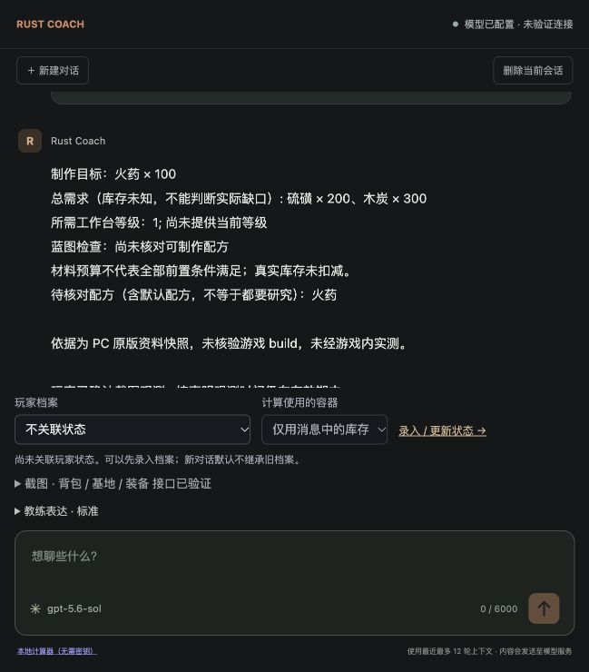
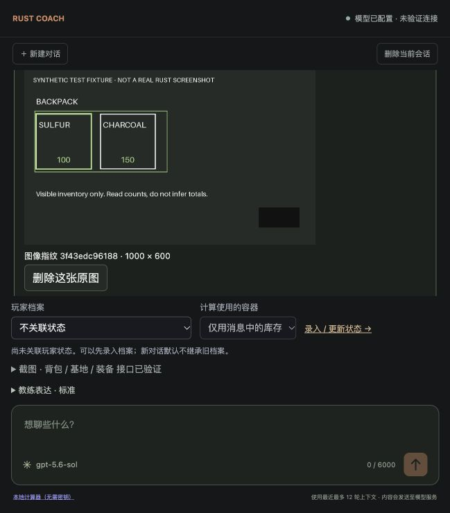

# 截图功能验证记录

日期：2026-11-02（Asia/Shanghai）。模型：用户配置的 `gpt-5.6-sol`，`https://cf.api.fan/v1` Responses，`detail=high`。这是实现验证与小样本 smoke test，**不是识别准确率认证**。

## 自动化回归

`uv run pytest -q`：**278 passed in 5.04s**，其中新增视觉测试 41 项，既有 237 项回归通过。`app.js`、`vision.js`、`player-state.js` 的 Node 语法检查及 `git diff --check` 通过。

测试使用替代模型与 HTTP MockTransport，不调用付费服务。覆盖数字/状态风险的主要约束包括：未确认不能抵扣、局部不能当完整、单格不能当总量、未知不是零、不同容器与重复槽位不能相加、旧图不能刷新时间、他人观测不能保存成本人、确认和状态写入原子性、请求幂等、保存成功但后续失败可重试、历史视觉库存不能静默继承。

## 真实模型与人工核对

| 样例 | 检查内容 | 观察结果 | 提取耗时 / provider total_tokens |
| --- | --- | --- | --- |
| 双图随机数字探测 | 两张不同图片的随机数字与顺序 | 配置接口实际读图成功，未把预期答案放在文字提示中 | 单独探测，不计入下列提取 |
| 合成背包测试图 | 文本标注硫磺 100、木炭 150；局部覆盖；制作 100 火药 | 读数正确，partial；修复后 craft 参数合法；确认后只算总需求 | 21.83s / 9,341 |
| Facepunch 工具柜裁图 | 区分维护费与下方实际物品；完整性 | 维护费 1018/26/20 与库存石头 316、金属碎片 62、木头 11 分开；修正后 partial | 28.67s / 9,195 |
| Facepunch 基地示意图 | 局部结构与不可见范围 | 识别 L 形区域、深色区域和红色标记；不认定完整拓扑、锁或突破路径 | 23.86s / 9,111 |
| 合成装备文字界面 | equipment 区域、未知数字 | 提取金属面罩、金属胸甲；quantity=null；无伤害/胜率 | 11.66s / 8,843 |

合成图明确标有 “SYNTHETIC … NOT A REAL RUST SCREENSHOT”；它们用于接口、读数和流程测试，不能评估真实 Rust 图标或装备栏识别准确率。装备主体最终以每图显式声明或待确认候选记录；仅凭该测试不声称已实现可靠的对手身份识别。

基地完整工作流另测一次：图片 → 感知 → 规划 → 本地评估 → 建议 → finalizer。关闭网络检索，规划的候选均为 observe。首选“核对建筑外观”，替代“核对周边地形”；提供具体拍摄/核对步骤、完成标准、停止或切换条件，并引用实际 observation ID。输出 `advice.status=conditional`，未写玩家档案。三个业务模型调用合计 **49.99 秒、24,687 total_tokens**（不含前置探测）；这是单次测量，不是 p50/p95。

费用未换算为金额：该代理的真实计价未获得确认，不能直接套用其他供应商价目表。上述 token 为接口报告值，可能包含代理侧提示/缓存计费统计。

## 发现的 badcase 与修正

1. 合成提取把 `gunpowder` 填入仅用于拆墙的 `target`。Schema 阻止计算，但原先的笼统修复提示仍产生同样错误。修正：提示明确 craft/raid 字段边界；重试传入字段级业务错误。相同样例复测无需修复即通过，并增加回归测试。没有删除校验以迁就模型输出。
2. 工具柜图片只有一行库存，初次 VLM 却给出 full_view。修正：明确区分完整行与完整容器，上下边界被裁切或缺少完整面板时降为 partial/unknown，并升级提取版本。相同裁图复测为 partial。**这仍是模型判断，代码无法证明画面完整；精确库存继续要求人工独立确认。**
3. 确认后的后续步骤抛出非业务异常时，错误日志变量未定义。故障注入测试发现并修复；现在保留成功回执并允许继续，不会重复更新档案。

## 浏览器实测

实际在本地 `http://127.0.0.1:8012/` 验证：选择文件、打开预处理弹窗、拖动矩形遮盖、填写图片主体/拍摄时间、提交到真实模型、失败后保留输入再试、显示逐项草稿、全部核对后确认仅用于本次任务、继续计算、刷新恢复、点击区域高亮。浏览器未记录控制台 error。

合成测试图的可见库存是硫磺 100、木炭 150，因 partial 未按库存抵扣；计算输出制作 100 火药的总需求硫磺 200、木炭 300，并说明工作台/蓝图条件未知。确认仅用于本次任务，没有写入玩家档案。此结果验证的是数据门槛及确定性工具衔接，不证明当前游戏规则经过实测认证。





浏览器裁剪、粘贴/拖入、保存到档案的代码路径已实现；本轮浏览器手动 smoke 聚焦选择文件、遮盖与仅本次确认。档案写入、裁剪坐标和数据一致性主要由自动化测试/代码检查覆盖，不声称所有交互组合都已人工点验。

## 样本来源与复现

公开配图来自 Facepunch Rust Wiki 的 [Tool Cupboard, decay and building privilege](https://wiki.facepunch.com/rust/the_tool_cupboard)。它们是旧的公开示例，不能代表用户基地或当前游戏 build。未将下载的原始公开图片加入代码交付；本地 smoke 副本在忽略的 `data/vision-eval/` 下。

| 样例 | 原图链接 / SHA256 |
| --- | --- |
| 工具柜裁图 | [Facepunch PNG](https://files.facepunch.com/wiki/files/2b7da/8d8d21f1d791477.png)；`b2e92ee4cce709a2d0183091e63848cbbe1c11aa7064e3f8c59faae73d592939` |
| 基地示意图 | [Facepunch PNG](https://files.facepunch.com/wiki/files/2b7da/8d8d2135a3d51a5.png)；`6fbd815d4c99ca6c47669b9a6ae9a1a861c2aea27673f4d8401514482056a1df` |
| 合成背包原始图 | `753f19e0db8c46e06186c719d3fadcc06d1922f48d8a401fd842ad521623ae97`；浏览器遮盖后的图片另有规范图哈希 |
| 合成装备原始图 | `593a6ae10d0c6a1e0e9843564797744ac740e67e082def11beea94997af0f8b6` |

复现命令：

```sh
uv run pytest tests/test_vision.py -q
uv run python docs/run_vision_smoke.py data/vision-eval/public-inventory.png --question '识别实际库存，区分维护费用与库存' --output data/vision-eval/retest.json
uv run python docs/run_vision_smoke.py data/vision-eval/public-base.png --workflow --question '仅给可见区域的现场观察检查清单' --output data/vision-eval/workflow-retest.json
```

真实模型脚本是主动付费验证工具，默认测试套件不会运行它。小样本结果仅能复现这几次行为；设计中的 300 图/60 任务数据集、跨分辨率与遮挡测试、识别错误率、用户确认纠错率以及 p95 延迟/成本仍待实际标注与收集。
