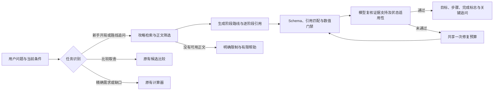

# 攻略驱动的新手引导

用户问“我是新手，什么都不懂，应该优先做什么？”时，先读取相关攻略，再给出有顺序的阶段目标。未知库存不阻止通用指导，也不被当作零或材料充足。原有“冲科技还是加固”的候选比较和精确合成计算保留独立流程。

## 问题来源

原始失败轮次已经联网，但规划器给出空主题，检索回退到版本更新，只读到官方新闻页。规划器同时被要求提供观察候选，最终把核对位置、基地、工作台和配方作为首选。这个案例的主要问题是任务识别、检索目标及计划形式，不是搜索密钥未配置。

## 执行链路



实际 LangGraph 分支为 `prepare → guide → finish`。`guide` 内部完成路线生成及独立证据复核。通常两次模型调用；结构修复、语义修复与复核改写后的局部修复共享一次预算，最多四次调用，不无限重试。SSE 上报实际检索、规划、核对与组织语言阶段。

复核将“完成标志”视为未来目标，而非已经发生的玩家状态；通用避险建议不需要额外机制引文。局部无依据措辞可在复核时直接删除或收窄，保留阶段顺序与原引用，并重新通过数值及声明校验。无法局部解决的核心动作或状态冲突才触发整段修复。

复核改写的某个字段未通过确定性校验时，记录字段路径及错误类型；预算允许时只重写该阶段，以原引用重新核对，不重新生成其他已通过的阶段。修复后的阶段 ID、引用和整条路线继续通过校验；不会因修复失败而恢复已经被复核判定有问题的旧措辞。

模型生成最多读取两篇合格正文，每篇最多一万二千字符；正文切成最多九百字符、带重叠上下文的片段。模型只选择片段编号，代码从原文生成引用。证据复核只读取被选中的片段，不重复发送整批网页，以控制输入量。证据存储仍保留抓取时的正文快照。

生成时用 `source_1_p2` 等短编号引用正文片段，代码映射回实际文档 ID 和逐字原文；阶段 ID 也由代码按顺序生成。模型无需反复抄写长哈希、引用原文或自行命名内部字段。C4、工作台等级名称及“建造一个小基地”这类普通单数行动不作为成本误拦截，精确消耗仍走数值门禁。

普通单数目标按对象短语区分，不再枚举“建造、拥有”等动词。因此“建成一个小基地”“找到一个落脚点”同样允许；带成本、消耗、上下限关系的单数描述，资源数量、基地尺寸和时长仍被拦截。该归一化仅用于校验，保留用户看到的原始自然措辞。

## 检索与来源

- 新增 `first_day` 主题，优先读取 [Falcon：Your First Day in Rust](https://falconrust.com/guides/general/first-day/)，同时使用现有 Tavily 搜索相关攻略；查询是固定公共游戏主题，不发送玩家坐标、背包或服务器信息。
- 白名单增加 `falconrust.com` 和 `www.falconrust.com`，保留 Rustafied、官方 Wiki 等来源。仍检查 HTTPS、重定向、公开 DNS、正文大小及超时，不开放任意网页请求。
- 搜索摘要和聚合答案不作为证据。新手主题要求文章标题与开局相关、正文达到最低长度并覆盖多个生存主题；新闻页和攻略目录不能充当开局路线依据。逐阶段模型复核进一步检查引用是否支持动作，字面匹配不是语义证明。
- 首选页面失败时继续尝试搜索结果中的其他文章。缺少搜索密钥时仍可直接读取登记的入口；关闭联网则不发请求，也不谎称已查攻略。
- 缓存键包含检索版本、PC 原版规则集、提供商和主题，避免使用旧的新闻缓存。新手主题读到合格正文后，即使部分来源失败也能缓存已取得的文章；下一次命中明确标记为缓存。`/search`、重新搜索和最新版本要求跳过缓存。默认 TTL 沿用六小时。
- 无法确定主题时返回有限结果，不再把未知主题默认解释为版本更新。

## 计划与表达

路线包含目标、适用假设、三到五个有序阶段、每阶段完成标志和引用、停止条件，以及最多一个追问。阶段不属于互斥候选；不累计整条路线的制作预算，也不默认前一步已经完成。

涉及辐射、火把暴露等机制的停止条件单独携带片段引用，随阶段证据一起送入复核并留存在详情中，避免只取阶段片段而漏掉停止条件的依据。

当前自报和有效玩家状态用于选择起点。没有档案时说明适用假设；已有基地、工具或睡袋时从对应进度继续。历史计划不等于已执行，旧图或他人截图不代表当前库存。上下文和语义复核共同约束适用性，没有宣称模型可以完整证明游戏状态。

默认正文显示目标、适用条件、编号步骤、最终完成标志、实际停止条件、关键追问和所引用来源。逐阶段完成条件、原文、版本限制和检索诊断放入可展开详情。详细模式展开这些内容。新手路线不打印“档案待确认”或要求先盘点全部库存。

所有路线叙述继续经过数值、虚假操作回执和无条件资源充足断言检查；序号由渲染器生成。C4、一级至三级工作台属于物品名称，可以按原名显示，引用原文中的数字也必须保留；消耗数量仍不能由模型填写。精确材料由计算器负责，不能直接把攻略中的数值变成个人缺口。资料中的绝对安全与拆除保证不采纳，证据复核会检查新增机制和当前状态冲突。

动态生成、复核或修复失败时，尝试使用 `advice/baseline.py` 中预先核对的基础路线。只有本次取得的 Falcon 首日攻略正文逐字包含全部登记的支持片段时才启用，不从另一位玩家的历史回复取建议，也不将任意同关键词网页当作证据。基础路线包含工具、睡袋、落脚点、熔炉与金属科技，每阶段有原文引用；明确已有工具、睡袋或基地就跳过对应步骤，并保留版本限制。

来源不足以支持基础路线时才返回有限帮助，且不再把所有内部失败统一描述成“依据核对未通过”。本轮资料缺失时不会伪造引用；模型超时仍受外层请求总时限约束，外层取消不能保证进入备用路线。

## 数据与验证

`advice.mode=onboarding`、`workflow=onboarding-v2`。完整阶段和逐阶段引用保存在 `advice.answer`，复核结果保存在 `advice.review`；正文快照保存在原有证据存储中。`answer_source` 区分 `generated` 与 `curated_baseline`，`diagnostics` 保存失败阶段、字段路径和错误类型；使用备用路线时不会伪造一份“模型已通过”的复核结果。架构适配器把路线传到 `DecisionResult` 和 `AnswerSpec`；呈现层保留路线顺序、假设、停止条件和证据断言。新消息使用新链路，旧消息不会自动重新生成。

```sh
uv run pytest -q
node --test tests/test_chat_ui.cjs
git diff --check
```

`tests/test_onboarding.py` 覆盖中文与英文入口、精确计算分流、取证先于模型调用、真实运行时与 SSE、持久化与幂等、已有基地上下文、档案不变、伪引用与数值拦截、真实但无关引用的复核修复、修复上限、无资料降级、来源失败后继续检索、缓存与强制刷新、关闭联网和无密钥直读。

可选的真实联网验证只使用合成问题和临时数据库，会调用本地配置的搜索与模型服务，可能产生 API 费用：

```sh
uv run python docs/run_onboarding_smoke.py --live
uv run python docs/run_onboarding_smoke.py --live --repeat 3 --output data/onboarding-stability-results.json
```

结果默认写入忽略提交的 `data/onboarding-smoke-results.json`，含实际正文、来源、检索事件和复核结果。该脚本验证原始新手问题、已有基地后的追问，以及不调用模型的精确计算。自动通过仍需阅读实际回复；模型复核、离线测试和网页引用均不等同于当前游戏版本的实测。

### 2026-11-03 稳定性修复验证

最新全套测试为 **487 passed**。新手链路覆盖真实失败记录中的“已经在所选位置建成一个小基地”、修复预算已使用的同类情况、带修饰语的普通单数目标、复核后局部修复、禁止改阶段或引入成本、来源片段缺失时拒绝备用路线，以及备用路线的会话保存和幂等重放。

真实接口在三个独立会话中重复原始问题，均返回五阶段、带来源的动态建议；模型调用数为 2、3、2。第二次发生的“一个带气闸的小基地”额外重试已进一步修正，保存的该次原始输出通过最终校验。已有基地后的追问返回四阶段发展路线，未要求重做工具和睡袋；精确计算仍为零模型调用。记录在 `data/onboarding-stability-results.json`，未写入真实玩家会话。三次通过是本次回归证据，不代表模型输出永不失败。
