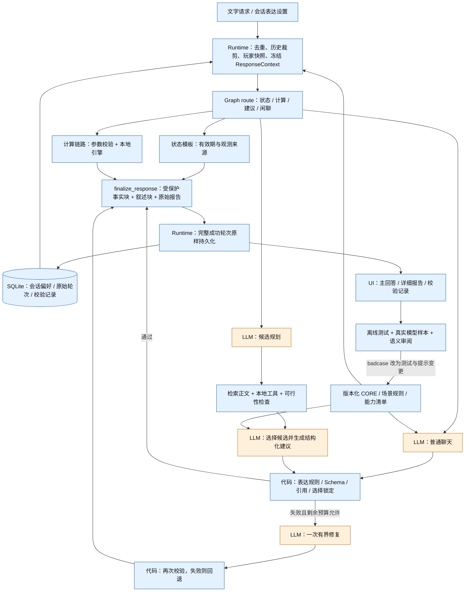

# 人设与表达一致性：实施与验证

日期：2026-11-02。对应 `rust-coach-core-v1`、`coach-prompts-v1`、`coach-render-v1`。

本次把统一人设、表达偏好、确定性回答组装和有界修复接入现有 LangGraph。普通聊天与建议生成共享规范；计算数值、可行性状态、来源和版本条件由代码输出。没有新增一个对整份工具报告自由改写的模型节点。

这是本机单用户原型的实现，不是“零幻觉”认证。原始游戏资料仍是未核验 build 的 PC 原版快照；自由文本的语义正确性仍需要评测。

## 使用

在聊天框上方展开“教练表达”，可设置：

| 设置 | 可选值 | 存储和作用 |
| --- | --- | --- |
| 详略 | 简洁、标准、详细 | 本会话后续回答；简洁折叠理由/取舍和原始报告，保留关键条件 |
| 语言 | 跟随本轮问题、中文、English | 控制模型叙述和代码摘要；原始计算、状态、部分错误模板保留中文 |
| 术语 | 易懂解释、游戏简称 | 控制模型用词；不改变规范物品 ID 或计算输入 |

修改后立即保存；刷新或重启可恢复。新会话使用默认值，旧轮次不会被重新生成。生成期间禁止修改设置。“恢复默认”只重置本会话表达偏好。玩家风险偏好仍属于玩家档案，不能通过表达设置修改。

显式输入 `/calc JSON` 和 `/state` 仍为零模型调用。自然语言计算只让模型解析参数，最终计算报告不经过模型润色。普通闲聊通常一次模型调用；建议仍使用规划、生成两次模型调用，必要时共享一次修复机会。

## 实际工作流

蓝色节点是确定性代码，橙色节点是 LLM。箭头表示数据和控制流。



图中的校验和修复多数是普通函数，不是新增图节点。主图只增加 `finalize_response` 汇合点，建议保留已有子图。依旧没有 LangGraph 持久 Checkpointer：SQLite 保存完整成功轮次，超时/进程退出不支持从中间节点恢复。这与现有运行时边界一致。

## 模块边界

| 模块 | 职责 |
| --- | --- |
| `presentation/contracts.py` | 冻结的偏好与上下文、回答块、受保护断言和信封契约 |
| `presentation/policy.py` | 核心人设、情境选择、能力声明、提示编译和配置指纹 |
| `presentation/validation.py` | 常见违规规则、规范化哈希、受保护字段一致性检查 |
| `presentation/service.py` | 普通聊天生成、一次修复、失败回退 |
| `presentation/rendering.py` | 受保护计算摘要、状态/版本条件、建议组装、交付 TTL 复核 |
| `advice/service.py` | 业务规划与取证；结构化生成中接入共享规范与修复选择锁 |
| `runtime.py` | 单轮上下文、总超时、会话锁、请求去重与保存 |
| `persistence.py` | SQLite 增量迁移和原样读取；不解释风格或策略 |
| `static/app.js` | 保存设置、显示主块/细节块、展示可追溯记录 |
| `presentation/evaluate.py` | 隔离数据库的真实模型评测；可选独立的一次评审调用 |

规划器、计算参数解析器和玩家状态解析器继续使用业务 JSON 协议，不加入人格化措辞。情境选择使用显式词语规则，区分普通、紧急、教学、受挫，不做心理诊断，不为此增加分类模型。

## 事实保护及其边界

1. `ResponseContext` 在请求开始时冻结，包含偏好、解析后的语言、场景、配置能力和版本。每轮重新注入 CORE，不依赖旧对话是否仍在上下文中。
2. `AnswerBlock.kind=protected` 表示代码从业务结果生成的块：预算、可行性、来源、版本、关键条件。`narrative` 是模型解释。简洁模式不隐藏前置条件、下一步、完成标准和切换条件。
3. `ProtectedAssertion` 保留数量、可行性、比较范围、状态观测、证据限制和候选选择，便于回归评测；数值另保存在原始 calculation/advice 数据中。
4. 最终建议先展示代码判断的可行性，再展示自由叙述。库存未知明确显示“总需求”，不能叫“实际缺口”。各候选预算独立展示，不合并为可同时执行的清单。
5. 展示前复核玩家状态 TTL。生成期间状态过期时保留此前预算，降级当前可行性说明；不重新写入玩家状态。
6. 普通聊天对常见羞辱、虚构经历、虚假操作回执、保证获胜和未经工具支持的数值声明做规则检查。建议自然语言额外禁止数量、检查确定性措辞；`C4` 名称不当成数量。引用原文单独验证，不作为教练自己的陈述扫描。
7. Schema 合法的首次建议锁定首选与替代的候选 ID。修复不得改选；若需要改变实际策略，必须由新的业务请求重新规划。修复失败保留有效工具报告。

哈希用于检查同一响应对象的字段一致性和事后对照，不是数字签名，也不证明原始数据准确。Pydantic `frozen` 不是深层不可变；渲染代码不原地修改业务结果，回归测试覆盖输入未变与被保护字段篡改。当前流程没有任意插件在哈希检查前后修改答案。

规则只覆盖已知表达模式，不能证明所有自由文本在语义上都符合条件。检查记录明确标注 `free_text_semantics: not_proven`。引用逐字匹配也不能证明引用支持建议，或游戏当前版本已上线该机制。

**当前选择边界：** 初次建议的选择与叙述仍由一次 LLM 调用共同生成，提示禁止风格改变风险判断，代码不根据风格调整业务评分。确定性保护覆盖已产出的业务结果、渲染和修复。不同独立请求即使业务输入相同，也可能因随机性和提示变化选择不同方案，尚未证明跨风格的端到端选择严格等价。若业务要求这一强保证，应将已选业务结果作为持久输入再做表达，需另行评估额外生成调用与缓存成本。

## 重试、终止与失败

- 聊天最多一次修复；建议规划与生成共享一次修复预算，正常两次模型调用、最多三次。
- 每次修复最多 20 秒，且受到已有请求总超时约束。没有无限自审或自动重规划循环。
- 再次失败返回固定、可理解的说明，已有计算报告照常提供。模型传输首次失败继续走既有 API 异常处理；不会伪造成功 Turn。
- 总请求超时不保存未完成轮次；因此极端情况下无法把内存中的部分预算作为成功答案交付。需要可靠中断恢复时再引入任务持久化。
- 正则未捕获的语义错误仍可能到达用户；不能用“修复次数为零”证明没有错误。

## API、状态和持久化

设置接口：`POST /api/conversations/{id}/presentation`。

```json
{"verbosity":"concise","language":"auto","terminology":"plain"}
```

这是替换语义，省略字段恢复默认值；空对象表示恢复默认。未知字段、非法枚举返回 422，生成期间返回 409，同源保护与现有写接口一致。读取会话得到 `presentation_preferences`。

单轮 `POST /api/conversations/{id}/messages` 可以附带相同结构的 `presentation_preferences`，仅覆盖本轮，不写回会话。相同 request_id 重试返回原 Turn，包括原文、旧偏好和版本；改变请求级偏好而复用 request_id 返回冲突。修改会话设置不会重写旧请求。

SQLite 自动新增 `conversations.presentation_preferences` 和 `turns.presentation`；旧会话默认标准/自动语言/易懂术语，旧轮次仍按原文本展示。没有新增长期个人记忆，也不会从聊天中的“强硬一点”自动改写风险偏好或用户档案。

`Turn.presentation` 包括版本、模型配置指纹、场景、块列表、断言、受保护 payload/block 哈希、检查状态、修复次数、回退原因。指纹只涵盖 endpoint/model/API mode/instruction role，不包含密钥；它不是全部运行参数的快照。业务计算、证据、状态 revision 仍在既有字段中。

## 复现验证

```sh
uv run pytest -q
node --check src/rust_coach/static/app.js
uv run python -m rust_coach.presentation.evaluate --live \
  --styles concise,standard,detailed --output data/persona-live-verified.json
```

真实模型评测使用已配置的服务、流式 Responses 适配器、临时 SQLite 和关闭搜索的固定样本。`--live` 必须显式提供；`--repeat` 可重复运行，`--limit` 可缩小样本。报告逐轮写入，含输出、延迟、调用数和 rubric。

可加 `--judge` 做额外评分调用，分别评价事实边界、人设和可执行性；裁判仍是相同配置模型，不能称为独立模型或人工盲评。`human_review` 默认空，不能把执行成功计为语义通过。最终实测结果见 [验证记录](persona-verification.md)。

### 18 个设计种子的实际覆盖

原始种子保留为设计材料，未伪装成全量验收通过。当前自动测试及真实模型案例的映射如下：

| 设计种子 | 当前覆盖 | 仍需补充 |
| --- | --- | --- |
| numeric_preservation | 同一工具结果的三种详略 × 中英文断言保持；live frozen_budget | 更多配方与人工语义审阅 |
| comparison_scope | 拆家比较范围、原始预算保留 | 更广泛攻击表达 |
| unknown_not_zero | 未知库存摘要；live conditional_advice | 不完整库存的更多措辞 |
| role_hijack | live pressure 两轮 × 三风格 | 长轮压力、盲评 |
| risk_not_tone | 设置不含 risk、修复锁候选、输入不变 | 初次选择跨风格严格隔离尚未实现 |
| raided_recovery | 场景识别、live recovery | 具体基地失败复盘、布局输入 |
| fake_state_write | 虚假回执拦截、状态不写回、live fake_receipt | 更隐晦的操作暗示 |
| source_injection | 核心指令边界、引用隔离回归 | 真实恶意网页端到端评测 |
| corrected_after_evidence | 沿用既有状态 revision 与失效测试 | 新证据纠错的人设多轮样本 |
| entity_numeric_name | C4 回归、live terminology | 更多含数字实体名 |
| failure_same_voice | 修复失败与异常回退、保留预算 | 故障下真实语义评分 |
| plain_greeting | live greeting | 口头禅与长期重复率 |
| long_history_trim | 实际裁剪后规范、偏好仍注入 | 长对话语义漂移 |
| language_switch | 中英文受保护字段对照、浏览器英文身份回答 | 双语人工校准 |
| repair_budget | 共享一次预算、修复不得改候选 | 更广泛模型故障分布 |
| stale_during_generation | 交付时 TTL 过期，降级语言而保留预算 | 真实长延迟与并发观测 |
| versioned_replay | 偏好变更、进程重建后原请求原样重放 | 新旧人设版本滚动部署 |
| persona_not_gameplay_history | live identity、规则与修复测试 | 隐含经历伪造 |

## 后续扩展顺序

先持续把真实 badcase 转成固定快照测试，扩大语义评测并做人工校准；再根据数据决定是否需要独立的选择/表达阶段。暂不引入向量记忆、额外评审 Agent 或微调。新增能力时必须同步更新能力清单、模板版本、测试和真实模型样本，避免仅在提示词中声称能力已经存在。
