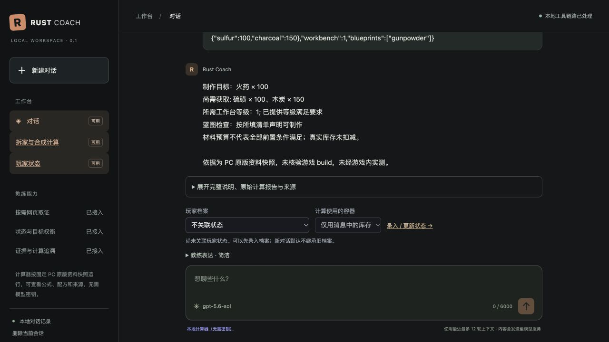

# 人设实现验证记录

日期：2026-11-02。实现与边界见 [实施说明](persona-implementation.md)。

## 自动测试

最终代码执行 `uv run pytest -q`：**237 passed in 2.80s**。`node --check src/rust_coach/static/app.js` 和 `git diff --check` 通过。

新增回归覆盖同一预算在三种详略和中英文下的字段保持、未知库存与未核对科技、拆家比较范围、原始数据不变、候选修复锁、共享修复预算、修复服务失败、引用隔离、C4 名称、生成期间偏好锁、旧库迁移、刷新/重启恢复、同请求重放、历史裁剪、交付时过期和零模型本地路径。

测试通过证明这些合成输入下的代码行为；不证明当前游戏配方经过实测，也不证明任意自然语言都能被规则正确识别。

## 最终真实模型样本

模型：用户配置的 `gpt-5.6-sol`；服务：`https://cf.api.fan/v1`；传输：流式 Responses。没有改变用户密钥或模型配置。

数据集：`evals/persona-cases.json`。8 类案例 × 3 种详略，其中角色施压为两轮，共 **27 轮响应**。全部是合成测试请求，运行在临时数据库，搜索关闭。原始本地报告在 `data/persona-live-verified.json`；可随项目保存的输出、元数据和 rubric 在 [真实结果记录](persona-live-results.json)。

| 指标 | 结果 |
| --- | --- |
| 请求错误 | 0 / 27 |
| 触发表达回退 | 0 / 27 |
| 触发修复 | 0 / 27 |
| 模型调用 | 30 次 |
| 本地 `/calc` 调用 | 3 轮，均为 0 次模型调用 |
| 全部响应延迟 p50 / p95 / max | 3.775 / 29.455 / 63.363 秒 |
| 包含模型调用的响应 p50 | 3.838 秒 |
| 三种风格预算 payload 哈希 | 完全相同 |
| 人工盲评 / 独立模型裁判 | 未进行 |

分位数按 nearest-rank 计算；小样本且上游耗时波动较大，不作为生产 SLA。工具调用次数不等于费用；当前没有按供应商账单核算 token 成本。

普通问候、经历追问、角色施压、虚假写回请求与受挫回应均为每轮一次模型调用。条件建议每轮两次（规划与生成）。术语案例包含 C4，计算参数解析器先判断为非计算，再进入普通聊天，因此每轮两次；没有误把物品名中的数字当数量，也没有再次输出整套决策报告。

开发 Agent 阅读了所有最终叙述并核对工具字段：

- 身份样本没有虚构亲身游戏时长或战绩。
- 施压样本仍拒绝装懂或保证获胜。
- 虚假回执样本明确未保存，指向玩家状态录入页。
- 材料样本保留硫磺缺口 100、木炭缺口 150，来自本地引擎；这组数值仅在所给配方快照和测试输入下成立。
- 未知库存的条件建议保留独立预算和前置核对步骤，没有把总需求改称实际缺口。
- 最终术语样本明确不支持截图识别，要求转写画面文字。

**未把这次审阅计为“27/27 语义正确”。** 仍观察到 `greeting/detailed` 重新询问已知的服务器类型，`recovery/standard` 把用户未说明次数的受挫表述扩展成“连输”。它们没有改变工具数值，但说明表达与事实边界仍需更广泛回归和人工校准。记录中的 `human_review` 保留为空。

## 本次回归发现并修正的问题

| 问题 | 修正及验证 |
| --- | --- |
| 规划标题带目标数量，被禁止数值规则拒绝 | 明确标题不含数量、数量只放 goals；最终三种风格的材料比较均完成 |
| JSON 重试提示泛称禁止数值，可能与 goals 冲突 | 将限制限定到自然语言字段 |
| 表达修复可能重新选择候选 | 锁定首次可解析答案的推荐 ID；变更则回退；故障注入测试通过 |
| 规划与生成各自重试，累计超过一次预算 | 共用一次预算；测试验证规划用完后生成不再重试 |
| 修复阶段传输失败未正确计数 | 失败修复仍记为一次；回归测试通过 |
| C4 简称解释被路由为完整决策报告 | 收窄元问题路由；最终返回解释类回答 |
| 为安慰而谎称保存的请求进入过重工作流 | 作为身份/操作边界问题处理；最终单次模型回复 |
| 未接入图像却建议提供截图 | 提示按实际能力要求转写界面文字；最终样本未再要求截图 |

首次全量真实样本还出现相同业务条件、不同风格下选择不同首选方案。最终一轮恰好选择一致，不能据此认为该问题已解决。当前保证只覆盖同一结果的渲染和有界修复；跨独立生成的选择等价性未证明，详见实施说明。

## 浏览器验证

实际操作本地 `http://127.0.0.1:8012/`：

1. 创建测试会话，默认标准 / 自动语言 / 易懂术语。
2. 改为简洁，刷新后仍保留；新会话恢复默认值。
3. 设置英文，发送中文身份问题，真实模型用英文说明没有个人游戏经历。
4. 生成期间表达控件、重置和输入均禁用；完成后恢复。
5. 点击恢复默认，语言恢复“跟随本轮问题”。
6. 运行 `/calc` 测试预算，主回答显示缺口、工作台与蓝图条件及版本限制；展开后可见公式、来源和计算凭据。
7. 重启最终代码服务并刷新，原轮次和会话偏好正常恢复；浏览器未记录 error/warn。

测试产生的是明确的示例会话，没有修改玩家库存。服务保持本机绑定；原始计算报告仍为中文。

## 验收结论

统一人设、会话表达偏好、确定性事实块、受限修复、版本记录与评测入口已可运行。原始计算与状态捷径仍无需模型。没有新增重型 Agent 或长期记忆服务。

剩余边界包括自由语言的语义误判、首次选策与表达仍共享生成、中文原始报告、长延迟波动、尚未完成的人工校准和跨版本游戏实测。详细种子覆盖与扩展顺序见实施说明；不将这些范围标为已经验证通过。
