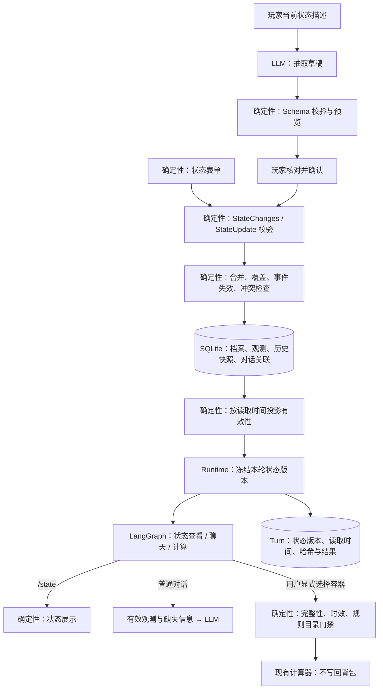

# 玩家状态建模

玩家状态作为独立业务数据接入 Agent：支持录入、局部更新、按时间失效、查看历史，并在对话、截图计算和条件建议中使用。意图与状态的新链路、验证和演示见 [实施记录](intent-state-implementation.md)。没有接入自动游戏遥测。

## 使用路径

1. 启动服务，打开 `/player-state`，按“服务器标识 + 清档周期标识”创建档案。当前服务仍为本机单用户，玩家身份隐含为本地用户；没有多用户认证隔离。
2. 录入库存容器和科技、基地、阶段、时间、目标及偏好。表单无需模型密钥。
3. 也可用文字描述当前状态。模型生成待确认草稿，页面显示字段、数量和库存覆盖范围；确认保存前不会改动档案。可取消或编辑 JSON 草稿。
4. 在状态页点击“关联到当前对话”。新建聊天会继承最后明确关联的档案，复用相同服务器和清档的数据；切换档案不复制库存。解除关联后，新聊天也不再默认关联。
5. 聊天输入 `/state` 或“查看我的状态”可用确定性模板查看档案，无需模型。明确当前本人死亡或背包丢失会直接保存事件、失效旧背包并清零当前背包；假设、否定、历史和引用不会写入。其他自报事实仅用于任务上下文，或经状态页确认后保存。
6. 需要档案库存时，可说“只用档案背包”或通过消息的 `player_inventory_container` 选择容器。档案容器必须完整、未过期；与截图或文本并存时明确选择一个来源，不自动合并。任务续问保留容器选择，但每轮重新读取当前版本。

例如完整盘点 `backpack`：`sulfur=1000`、`explosives=10`，其他物品为零。选择该容器，输入 `/calc {"operation":"craft","goals":{"explosive.timed":2}}`，按当前规则包得到新增硫磺 2300 等缺口；真实库存不会扣减。

独立 `/calculator` 页面仍使用自身表单库存，不隐式读取聊天档案。聊天输入显式库存又同时选择档案容器时，会要求消除歧义，不把两份资源相加。

## 模型与语义

### 状态档案

`scope` 包含不可变的 `id / server_id / wipe_id / label / ruleset`；支持 PC 原版。服务器与清档周期组合唯一。新清档创建新档案，资源、科技、偏好均不自动继承。当前偏好存放在该档案内，没有额外的跨服长期记忆服务。

`snapshot` 包含 `schema_version / revision / facts / containers / invalidations`。写入成功时版本递增；读取产生 `evaluated_at` 与当前有效性投影。时间自然流逝不会生成新版本。

| 字段组 | 已实现内容 |
|---|---|
| 资源 | 按容器 ID 记录物品 ID 与绝对数量；随身背包、装备、储物箱、工具柜或自定义容器 |
| 科技 | 工作台等级、已确认可制作的配方列表 |
| 基地 | 是否有基地、入口是否封闭上锁、主要建筑等级、缺口描述、维护时间、位置 |
| 当前处境 | 玩家位置、队伍人数、在线队友、剩余在线时间、预计离线时长、已观察到的威胁 |
| 阶段 | 玩家自报阶段、清档后小时数；不根据装备或工作台自动推断阶段 |
| 目标与偏好 | 当前主要目标、稳健/均衡/进取偏好 |

每个事实和每个库存条目包含 `value / observed_at / expires_at / observation_id / source / verification`。来源为 `manual` 或 `text_confirmed`，验证等级始终是 `user_reported`；文本由模型解析不意味着内容经游戏验证。

缺失字段表示未知。`0` 是明确的零，`false` 是明确的否，空的已知蓝图列表表示没有记录已确认项，不代表全部配方未解锁。蓝图列表一次提交替换该字段，补充解锁时请提交完整的“已知可制作”列表；未列项保持未知。

物品使用规范 ID，允许录入规则目录之外的游戏物品，例如废料。仅记录状态不意味着已支持该物品的配方。调用计算器时，仅把目录覆盖的库存传入，并在结果列出未纳入的目录外物品。

时间字段是观测时的值，不自动推算维护消耗、实际退出游戏或队友离线。例如“还可在线 30 分钟”会保留其观测时间，不承诺十分钟后仍剩 30 分钟。未来决策模块应根据事件或重新确认处理动态时间。

### 库存覆盖

- `patch`：仅更新提交物品的绝对数量，保留其他条目及它们各自原有时间；覆盖等级变为 `partial`，不续期未提交的条目。
- `replace + complete=true`：用户确认已完整盘点该容器，替换其当前清单；未列物品可按零处理。空清单表示明确空容器。
- `replace + complete=false`：替换成部分观测，未列物品未知；API 和文本草稿支持此方式。
- 不接受“增减量”作为绝对数量。没有可靠基准时，不将“又捡了 100”写成“现在有 100”。
- 只允许完整且所有条目仍有效的容器用于精确缺口计算。部分盘点不会偷偷补零或变成确定性资源不足结论。
- 各容器相互独立，不猜测箱子是否可达，也不进行资源转移。选择容器表示用户明确要求以该容器的库存为计算范围。

## 新鲜度、冲突与失效

当前有效期是保守工程默认值，不是游戏规则：库存/位置/在线队友/剩余在线时间/威胁 30 分钟；入口/损伤/维护与离线计划 120 分钟；工作台、基地概况、队伍规模、阶段、目标 24 小时；已知蓝图 7 天；风险偏好 30 天。定义集中在 `schemas.py` 与 `domain.py`，以后可以按遥测与评测调整。

有效状态分为 `fresh / stale / invalidated`。`fresh` 仅表示仍在使用窗口内，不保证游戏中没有发生未上报变化。API 和页面保留过期值及来源供核对；发给模型的事实与物品只包含有效观测，同时明确缺失/过期字段，不能用过期值填补空白。

| 事件 | 失效范围 |
|---|---|
| `death` | 旧 `backpack` 记录失效并归档，当前 `backpack` 清零；`equipped`、`session.*` 与非基地视觉观测失效 |
| `backpack_lost` | 旧 `backpack` 记录失效并归档，当前 `backpack` 清零，相关视觉观测失效 |
| `raided` | 所有容器、`base.*`、`session.*`，作为保守重新盘点策略 |
| `blueprint_reset` | 已知可制作配方列表 |
| `invalidate_all` | 当前档案的全部已知字段与容器 |

用户也可以清除指定事实或失效指定容器。一般失效保留未知语义；按已确认产品策略，死亡或背包丢失是明确空背包事件，当前清单为 `{}`，旧背包保存在 `retired_containers` 与历史版本，不能重新抵扣。其他容器没有被清零。失效水位阻止旧观测和旧图重新生效。随身物品使用约定 ID `backpack` 或 `equipped`，自定义名称不会被猜成随身容器。

聊天事件先原子写入，再生成回答；生成失败仍保留事件。重试同一请求从 `chat_state_events` 读取回执，不重复清零后续新盘点的物品。未关联档案时返回明确错误，不虚构服务器。明确说“我换服了”会解除当前关联并要求选择新档案，旧档案不被删除。

提交包含 `expected_revision` 和唯一 `observation_id`。SQLite `BEGIN IMMEDIATE` 在一个事务里完成版本检查、状态合并和观测写入：

- 同一观测 ID、相同内容重试，返回原版本，不重复应用。
- 相同 ID 用于不同内容、旧版本并发写入、回填早于已有记录/失效事件的观测均返回 409。
- 非法数值、缺失时区、超出一分钟时钟容差的未来时间、矛盾队伍人数等拒绝且不部分写入。
- 当前数据限每档案 20 个容器，每容器 150 种物品；条目数量上限 100 万，单次最多更新 10 个容器。

## 数据流与代码边界



| 文件 | 职责 |
|---|---|
| `player_state/schemas.py` | 字段目录、严格输入契约、字段类型、默认有效期 |
| `player_state/domain.py` | 纯合并规则、失效、新鲜度、上下文裁剪、计算库存门禁 |
| `player_state/store.py` | SQLite 事务、幂等、版本、历史读取与会话关联 |
| `player_state/service.py` | 模型解析草稿、确定性状态展示 |
| `player_state/api.py` | API、预览超时与并发控制 |
| `runtime.py` | 加载当前关联快照、冻结本轮引用、隔离跨档案历史 |
| `workflows.py` | `/state` 短路径，并将状态传递到计算节点 |

`player_scopes` 保存当前快照；`player_observations` 保存每次成功变更和完整结果快照；`conversation_player_scope` 单独保存当前对话关联。删除会话会删除关联，但不会删除档案。暂不提供档案永久删除接口。

本轮 `Turn.player_state_ref` 保存 scope ID、revision、读取时间、请求中的容器选择和投影哈希。实际继承的容器和计算来源另在任务工作状态及计算凭据中记录。生成过程中档案变化时拒绝发布旧快照计算或建议，保存事务中再次核对版本；关联切换受 Runtime 对话锁保护。

普通对话只装入相同档案范围的历史，切换到另一个服务器/清档档案时不向模型复用原档案的对话片段。状态上下文最多约 12000 字符，裁剪后明确标记覆盖不完整，不把被省略的物品当成零。历史预算会计入状态上下文，但这仍是字符预算而非 token 预算。

计算续问保留上次目标，但剥离此前自动注入的档案库存/科技，再读取本轮快照；因此“改成三个”不会继续使用上轮已经过期的资源副本。计算合并之前还会重新检查经过模型解析等待后的有效期。

本阶段没有长执行任务或中途挂起需求，因此仍不引入 Checkpointer。状态业务表负责跨轮持久化，后续决策子图的执行检查点应独立存放。

## API

| 方法与路径 | 功能 |
|---|---|
| `GET /api/player-state/fields` | 字段、物品别名提示、有效期和输入 schema |
| `GET /api/player-state/scopes` | 档案列表 |
| `POST /api/player-state/scopes` | 创建服务器/清档档案 |
| `GET /api/player-state/scopes/{scope_id}` | 当前快照；可加 `?revision=1` 读取历史 |
| `POST /api/player-state/scopes/{scope_id}/observations` | 幂等提交已确认观测 |
| `POST /api/player-state/scopes/{scope_id}/preview` | 文本抽取草稿，不写状态 |
| `GET /api/conversations/{conversation_id}/player-state` | 当前对话关联及状态 |
| `POST /api/conversations/{conversation_id}/player-state` | 关联 `scope_id`，或 `null` 解除 |

观测请求示例（时间必须换成真实观测时间，revision 必须来自当前快照）：

```json
{
  "observation_id": "780d8e54-3d41-45c6-9637-3620a5c372ed",
  "expected_revision": 0,
  "observed_at": "2026-11-01T12:00:00Z",
  "source": "manual",
  "changes": {
    "facts": {"technology.workbench": 2, "progress.stage": "developing"},
    "inventory": [{
      "container_id": "backpack",
      "mode": "patch",
      "complete": false,
      "items": {"sulfur": 1000, "scrap": 50}
    }]
  }
}
```

聊天消息新增可选字段 `player_inventory_container`。它只选择已关联档案中的一个容器，不接受客户端伪造的快照。未选用时传 `null` 或省略。请求 ID 相同但消息或所选容器不同，返回冲突；成功请求重放仍返回原结果及原状态引用。

## 验证与边界

自动测试覆盖未知与零、部分与完整盘点、未更新条目不续期、事件失效、回填旧数据拒绝、幂等、版本冲突、事务回滚、跨服/清档隔离、历史与重启恢复、有效性投影、模型上下文预算、文本草稿不自动写入、计算的库存门禁和续问更新。

初始状态阶段的历史验证为 157 项通过，包含并发写入竞争、历史凭据重建和过期回归；当时前端脚本检查与构建通过。当前版本的验证结果以 [意图与状态实施记录](intent-state-implementation.md) 为准。

初始状态阶段的真实模型冒烟记录（不代表本次新代码的真实模型验收）：

- “1000 硫磺、10 炸药，还有其他材料未盘点；二级台；在线 30 分钟”提取为部分库存和对应事实。
- “又捡了 100，但不知道之前多少”返回需要当前总量，没有生成虚假库存。
- “再在线 30 分钟、离线 8 小时、先加固基地”生成 30/480 分钟及目标的待确认草稿，确认后才递增版本。
- “按已选择的背包库存，合成 2 个 C4 还缺什么？”读取完整盘点中的 1000 硫磺、10 炸药，得到新增硫磺 2300 等缺口，并保留所用状态版本。

浏览器验证了创建示例档案、完整库存、科技/基地/阶段表单、文本预览确认、聊天关联及从档案计算缺口。少量真实样本不代表自然语言抽取总体准确率；文本草稿保留人工核对环节。

已知边界：未接自动遥测、增量资源自动记账、基地拓扑或阶段自动推断。当前事实主要来自玩家自报和明确确认的图片；有效期内仍可能发生未上报变化。模型识图不等于人工确认。关联对话的有效状态会发送至配置的模型服务。
