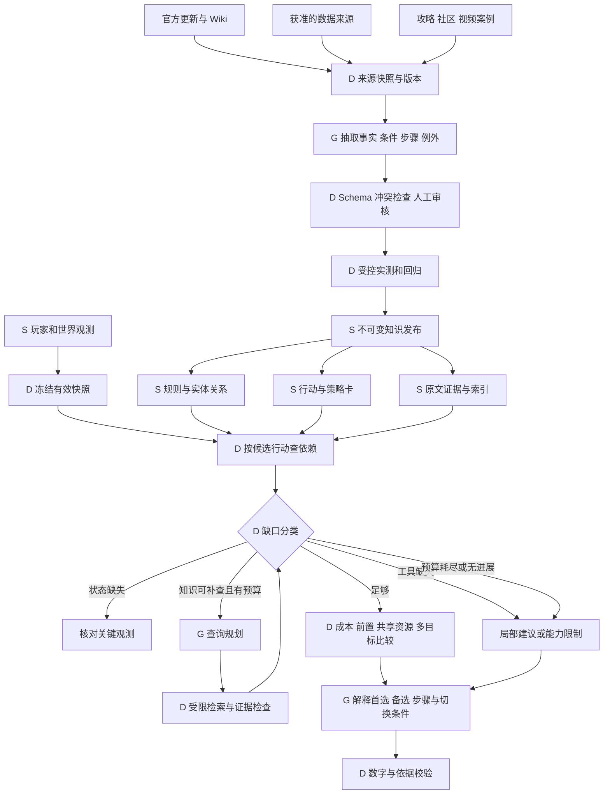

# Rust 实际来源调研：建设支持可执行决策的知识层

调研日期：2026-11-01。目标：PC 原版 Rust Coach，结合背包、科技、基地、阶段与玩家偏好，在多个目标间给出可执行建议。

这份报告补充[上轮架构调研](decision-knowledge-research.md)，重点是实际游戏资料、数据站、攻略与社区。附 [26 项来源审核清单](rust-source-audit.json)，包含访问时间、响应哈希、阅读范围、短摘录和限制。清单属于研究记录，不是已认证的生产规则包。本次未修改运行时代码。

## 1. 结论

Rust 已有丰富的物品资料、工具和攻略，可以作为知识建设原料；但不能统一切块放入向量库后，就让模型生成可靠决策。

本次实际发现：旧版攻略、未写全条件的 Wiki、开发中预告和已经展示新物品的数据页同时存在。即使两个数据站一致，也未必证明适用于玩家当前服务器。

建议建设 **有版本和条件的机制事实 → 可校验的行动 → 有例外的策略 → 场景化证据**，另外读取玩家状态与世界状态。常规问题按行动依赖直查和计算；证据不足且能通过资料补齐时，再启用受限 Agentic RAG。

首批围绕四个闭环建设：**科技投入、下线前准备、资源获取、被袭后恢复**。先确保这些行动的前置条件、成本、步骤、完成和停止条件有完整依据，再扩展攻略数量。

## 2. 实际查了哪些来源，如何使用

本次通过公开搜索发现候选并读取来源页面。审核清单收录 26 个入口/页面：15 个读到相关正文，1 个目录，3 个动态工具/文档外壳，2 个仓库 README，1 个视频元数据；其余 4 个因访问验证或内容提示未读到正文。不能称为 26 份已验证游戏事实。搜索摘要只用于发现来源，不认证规则。

| 来源与已核查页面 | 能提供什么 | 建议用途与限制 |
|---|---|---|
| [Facepunch 官方新闻](https://rust.facepunch.com/news)，读了 Power Trip、Breach and Clear、Workbench upgrades | 发布日期、机制变更、条件、服务器调整项 | **优先**作为规则变更输入；转为结构化规则并核对后续补丁 |
| [Facepunch 托管 Wiki：工具柜](https://wiki.facepunch.com/rust/the_tool_cupboard)、[回收机](https://wiki.facepunch.com/rust/Recycler) | 权限、维护、回收机制与数值候选 | **逐条审核**；官方域名不代表每页及时更新或开发者认证 |
| [RustData 工作台](https://rust-data.com/zh/items/workbench2)、[版本列表](https://rust-data.com/zh/builds) | shortname/ID、中文名称、配方、设施、制作时间、回收、来源、修理表格 | 主数据候选；发现版本适用疑问，未确认稳定公开 API 或批量授权 |
| [RustHelp 工作台](https://rusthelp.com/items/workbench-level-2)、[回收工具](https://rusthelp.com/tools/recycler)、[科技树](https://rusthelp.com/tools/techtree) | 物品规则、多语言目录、回收条件、科技树工具 | 补全和交叉核对；科技树仅见工具外壳；与另一站一致不代表独立验证 |
| [Rustafied 建筑指南](https://www.rustafied.com/building-in-rust/) | 门锁、气锁、TC、软硬面、外墙检查项 | **优先人工整理为行动与诊断卡**；精确成本/伤害另行验证 |
| [Rustafied 绿卡解谜](https://www.rustafied.com/monument-puzzle-basic-green-solutions) | 道具要求、遗迹变体、操作顺序、目标奖励 | 适合提取行动 SOP；当前入口状态、补丁、搜刮情况仍需核对 |
| [Rustafied Blueprints 3.0](https://www.rustafied.com/blueprints-30-progression-in-rust) | 蓝图概念、服务器范围、历史获取方式 | 不整篇进入当前库；包含工作台随机实验等历史机制 |
| [Rustafied 2026-10-29 开发报道](https://www.rustafied.com/updates/2026/10/29/blueprint-changes-roaming-scientists-and-more) | 蓝图改造、开发动向、待发布改动 | 版本预警；明确尚在发布前平衡，不能当作已上线规则 |
| [IQRust API 仓库](https://github.com/NotPatch/iqrust-api) | README 中的物品 JSON、配方、掉落字段示例 | ETL/实体映射候选；未核实 build、数据来源、再利用许可 |
| [Rust Reference AutoUpdated](https://github.com/RogueAssassin/Rust-Reference-AutoUpdated) | README 声称镜像 Carbon 元数据，保存 JSON、哈希、变更和历史 | 更新管线参考；未实测 API、未确认上游及镜像许可 |
| [RustMaps API 文档](https://api.rustmaps.com/docs/) | 地图服务入口，文档配置包含 APIKey | 路线上下文候选；动态文档及配置可见，完整接口响应未核验 |
| [Rust+ 官方介绍](https://rust.facepunch.com/companion/) | 配对服务器、地图、队友、事件、售货机、智能设备 | 经授权的动态观测候选；没有承诺完整背包和已解锁蓝图读取 |
| [r/playrust 示例帖子](https://www.reddit.com/r/playrust/comments/145sxlc/15_solo_tips_from_8k_hour_solo/) | 玩家问题、经验争议、失败案例线索 | 搜索发现但正文 403；不声称读过评论，不据此制定策略 |
| [Bilibili：2×2 开荒基地示例](https://www.bilibili.com/video/BV1NuptzhExL/) | 中文教程、术语和作者线索 | 仅核验元数据，未观看或获取字幕；页面明确禁止未经授权转载 |
| [Steam 社区攻略](https://steamcommunity.com/app/252490/guides/?browsefilter=toprated)、[Rustafied 论坛](https://forum.rustafied.com/) | 指南与讨论入口 | 前者停在内容偏好提示，后者 403，未阅读正文 |
| [RustLabs](https://rustlabs.com) | 历史常用数据入口 | 本次跳转至 wiki.rustclash.com 后返回 403，不作为已核验数据源 |

社区优先提供“玩家在什么条件下遇到困难”和“策略为什么失效”，不能直接提供确定性真值。后续经授权采集帖子/视频时，记录作者、日期、平台、服务器规则、版本、是否转载、队伍、步骤时间点与反对意见。热度和标题中的“2026”不能代替验证。

中文检索也发现 Rust 游戏、Rust 编程语言、相关移动游戏和搬运内容混杂。应固定 `game_id=rust_pc`，保留中文俗称到规范 ID 的映射，并做内容级过滤，不能只匹配“Rust”或“腐蚀”。

## 3. 五个会改变设计的实际发现

### 3.1 回收收益是条件规则，不是物品的固定属性

[官方 2026-08-06 Power Trip](https://rust.facepunch.com/news/power-trip)说明绿色回收机的基础效率与获得电网供电后的效率不同，最大供电还影响处理时间；红色回收机另有使用条件。与此同时，[Wiki Recycler](https://wiki.facepunch.com/rust/Recycler)以没有电网限定的方式呈现 60% 和 5 秒。

不能把两页都检索给模型，让它选一个数字；也不能取平均。需要 `recycle_rule(item, recycler_type, power_condition, rules_release)`，并把静态产出和动态“能否安全带回”分开。

**决策影响：**选择回收地点还需比较距离、往返时间、携带损失、现场威胁和电网状态。条件未知时给分支或核对问题。随机返还的期望值不能当作保证足够制作的数量。

### 3.2 维护依赖授权与服务器规则，不能由队伍人数推算

[官方 2026-09-03 Breach and Clear](https://rust.facepunch.com/news/breach-and-clear)描述了维护的群体规模机制：考虑 TC 授权、密码锁授权和一定时间内撤销过的授权，服务器可通过 ConVars 修改相关行为。

当前状态里的 `session.team_size` 不是这个计数口径。“主要石质、六人队”也不足以算维护量。旧 [TC Wiki](https://wiki.facepunch.com/rust/the_tool_cupboard)适合解释维护、权限和建筑连接，但显示很久以前更新，不能当作完整的新版本模型。

优先使用玩家刚读取的 TC 消耗清单/时长，绑定具体建筑与 TC；若界面显示已包含相关税率，不应再次叠加。加固可能增加后续维护成本，多建筑/多 TC 必须分别处理。

**决策影响：**“把所有金属都用于升级”可能破坏离线保障，行动效果必须包括持续成本，而不仅是当次材料支出。

### 3.3 最新抓到不等于已经上线

本次读取 [RustData 工作台](https://rust-data.com/zh/items/workbench2)和 [RustHelp 工作台](https://rusthelp.com/items/workbench-level-2)，页面已显示基础蓝图碎片作为制作材料；[Rustafied 2026-10-29 报道](https://www.rustafied.com/updates/2026/10/29/blueprint-changes-roaming-scientists-and-more)则将相关进度改造描述为 upcoming，明确仍在发布前平衡。

RustData [版本列表](https://rust-data.com/zh/builds)展示“线上”版本号，但本次没有证明上述每条物品事实与其绑定。**本报告不判定哪个页面代表玩家当前正式服，也不认定某数据站错误。** 这说明必须保存分支与生效状态；不能用网页多数票或抓取日期定案。

科技路径的成本不应固定为单一 `scrap_cost`，而应是通用 `cost_items[]`、研究方式、前置节点、设施和版本。未知适用性的精确数据先隔离为待审。

### 3.4 同一攻略站内也有不同年代的机制

Rustafied 的 [Blueprints 3.0](https://www.rustafied.com/blueprints-30-progression-in-rust)仍介绍工作台以资源换随机蓝图的实验机制；当前新闻又介绍未来变更。页脚年份不能证明正文已更新。

审核单位应该是 **具体主张/规则/策略条目**，而非站点。一篇文章中的蓝图概念可能有用，获取路径则需要历史标记。

**决策影响：**先验证研究、科技树、交易或直接获取成品等路径是否在当前规则中存在，再比较成本。地图清档也不等于蓝图清档；当前项目新档案重新确认全部科技是保守工程策略，不是游戏规则。

### 3.5 旧遗迹流程和工作台等级不足以描述全部前置条件

[绿卡攻略](https://www.rustafied.com/monument-puzzle-basic-green-solutions)有清晰道具、插保险丝、开开关、刷卡步骤。但 [Breach and Clear](https://rust.facepunch.com/news/breach-and-clear)引入部分遗迹入口障碍，[Power Trip](https://rust.facepunch.com/news/power-trip)引入世界级供电依赖，[工作台更新](https://rust.facepunch.com/news/upgrade-hard-raid-harder)引入附加升级。

不能把这些变化无差别套到所有旧路线：每条 SOP 应绑定具体遗迹、变体和规则依赖，按影响范围复核。

**决策影响：**“有卡”或“有二级台”不证明行动就绪，还可能需要保险丝、可用入口、设施类型、附加模块和现场状态。

## 4. 应建设的业务知识对象

关系表/版本化 JSON 为主，文本和向量用于策略、案例与解释证据召回。首期无需图数据库；配方、解锁关系可用边表和代码遍历。

| 对象 | 核心内容 | 支撑判断 |
|---|---|---|
| `Item / Alias` | shortname、数字 ID、中文/英文/俗称、单位、实体类型 | 消歧；皮肤资产与局内资源分开 |
| `Recipe / Transformation` | 输入、批次产出、时间条件、设施、解锁、随机性 | 制作、熔炼、回收、修理的资源变化 |
| `UnlockPath` | 获取方式、前置节点、已解锁复用、所需物品/设施 | 科技总投入，而非目标节点标价 |
| `BaseMechanic` | 建筑块、材质、朝向、连接、门路、TC、权限、维护 | 缺口、升级预算和后续维护影响 |
| `AcquisitionMethod` | 地点、前置、消耗、确定/概率产出、风险因素 | 采集、回收、购买、任务、遗迹路线 |
| `MonumentProcedure` | 地点变体、步骤、道具、入口/供电、验收/撤退 | 可执行的获取 SOP |
| `ActionDefinition` | 规则引用、所需观测、受限前置谓词、成本工具、效果、验收 | 能否做、缺什么、先做哪一步 |
| `PolicyCard` | 目标、适用状态、例外、候选动作、取舍、依据 | 有条件的优先级 |
| `Case` | 当时状态/版本、行动、结果、失败原因、偏差 | 反例、长尾解释、评测题 |
| `EvidenceClaim` | 原文定位、主张、条件、版本、支持/冲突关系 | 逐条追溯与失效重审 |

四条首批决策的最低知识覆盖：

| 决策 | 知识依赖 | 要核对的状态 | 输出要求 |
|---|---|---|---|
| 科技还是加固 | 解锁路径、设施/建设成本、基地缺口、维护机会成本 | 具体蓝图、设施、可访问资源、离线计划 | 方案成本与阻塞、首选步骤、切换条件 |
| 下线前做什么 | 门锁/TC 检查、维护、存放/备份与复活准备 | 时间、缺口、各 TC 显示、保留资源 | 短操作清单、完成验证、未解决风险 |
| 材料该留还是回收 | 近期目标配方、回收条件、替代获取方式 | 目标、材料、解锁、电网/回收机、路线 | 保留清单、可回收部分、产出范围与退路 |
| 被袭后恢复还是迁移 | 权限/结构检查、最低恢复、迁移步骤、机会成本 | TC 归属、可封闭性、设施、残余资源、威胁 | 先核对项、两类备选、止损和验收 |

完整布局诊断需要拓扑：建筑块/房间/门节点，连接/通行边，材质、血量、朝向、权限和观测覆盖。只有主要材质和文字损伤时，输出检查项，不能声称找到了攻击最短路径或全屋抗炸成本。

阶段应反映落脚点、生产能力、替代装备、资源来源和科技路径的组合。玩家自报阶段可以用于召回，但不能覆盖实际约束；晚期服务器上的被袭玩家仍可能需要恢复行动。

## 5. 怎样把资料变成可执行行动

### 5.1 建筑攻略 → 处理已确认的入口缺口

来源：RA01 的门锁、气锁、门与软硬面段落；成本另取已认证规则。不能只抽一句“优先做气锁”。

```yaml
id: base.fix_entry_gap
status: draft
source_refs: [RA01]
required_observations:
  - current_entry_layout
  - door_and_lock_state
  - building_privilege
  - accessible_inventory
  - remaining_online_time
preconditions:
  - confirmed_entry_gap
  - supported_layout_and_placement
cost_tool: plan_build_and_craft
steps:
  - 核对入口、权限与缺口
  - 按核算结果准备构件与门锁
  - 按已验证布局完成安装
  - 检查开闭路径、锁定状态和维护变化
completion_checks:
  - 目标缺口已关闭，门锁已核实，仍可正常进出
stop_conditions:
  - 权限或放置条件不满足
  - 资源侵占已确认的维护储备
  - 出现新威胁，原操作不再可行
```

草案仍需绑定版本、布局规则和成本工具才能发布。原攻略也区分单人钥匙锁与多人协作便利性，不能把“换密码锁”当作所有玩家的硬规则。

### 5.2 回收数据 → 保留目标材料后选择回收地点

来源：FP02、FW02/FW03、RH03 和物品回收表。

明确近期目标 → 计算需保留的组件/成品 → 生成可回收清单 → 根据已核验回收机/电网条件计算 → 比较往返时间、暴露和损失上限。

某组件回收价值高，不代表应该全部分解；它可能是下一步制作的必要输入。输出具体到保留数量、可回收数量、成立条件和产出范围。未认证规则时不给假精确数值；没有现场观测时不编造遇敌率和死亡率。

### 5.3 维护与科技资料 → 判断能否同时完成两个目标

来源：FW01、FP03、科技/配方资料与玩家新观测。

按具体 TC 和离线计划保留维护资源，再核算目标科技路径，比较“维护后研究”“先研究但缩小建设范围”“本轮只补缺口”。每个备选可以独立从同一初始库存评价，但最终行动组合必须共用模拟账本，不得重复花材料，也不写回真实背包。

若玩家明确放弃旧基地，维护并非必须；若时间资源允许，两项目标可顺序完成。应解释哪些条件会反转排序，而非永远推荐保守选择。

## 6. 版本、条件与证据契约

每条事实至少包含：

```text
claim_id / subject_id / predicate / typed_value / unit
conditions / exclusions / rule_dependencies
game_id / platform / server_ruleset
branch: live | staging | announced | historical | unknown
game_build / effective_from / effective_to
published_at / retrieved_at / last_verified_at
source_id / source_locator / source_content_hash
evidence_type / verification_status / reviewer
```

生命周期为 `candidate → reviewed → tested → published → superseded/quarantined`。审核与测试都要明确验证方式；不能把抓取成功升级成规则认证。本报告清单全部为 research_only。

冲突按条件、版本和来源谱系拆分：回收效率可能因供电不同；开发预告不能混入正式服；两个站转载同一上游不算独立验证。当前 build 无法确认时，精确结果只能绑定明确快照假设或返回不可算，不能标成“当前原版准确值”。

推导保留 `规则 claim IDs → 算法版本 → 玩家/世界状态引用 → 计算结果 → 推荐理由`。公式和资源变化交给经过测试的代码；不要从网页临时生成表达式/代码执行。

预计算固定配方、版本化科技路径、固定条件转换；库存、解锁、保留和现场条件在本轮处理。缓存包含规则/算法版本、条件和输入哈希；状态会随时间过期，只用 revision 不够。

## 7. 为使用这些知识，需要哪些增量状态

现有来源、TTL、revision 和未知语义可以复用。以下为建议，尚未实现；按候选行动需要询问，不要求玩家一次填满。

| 状态组 | 增量信息 | 使用时机 |
|---|---|---|
| 服务器 | build/分支、规则覆盖、地图标识、map wipe 与 blueprint epoch | 依赖版本变动的机制/数值 |
| 资源范围 | 容器地点、可达性、归属、保留资源、是否允许使用 TC 储备 | 跨容器行动和资源冲突 |
| 科技 | 目标蓝图、可使用设施类型、工作台等级/升级模块、可研究物品 | 路径比较与精确耗时 |
| 基地 | 各 TC 清单/时长/时间戳、权限、缺口，必要时实际税率/授权口径 | 维护、加固、恢复 |
| 世界 | 位置、电网/设备、入口障碍、交通、近期威胁 | 跑图、回收、交易与获取 |
| 玩家约束 | 在线/离线计划、多目标、损失上限、协作与熟练度 | 这些因素能改变候选排序时 |

优先询问会改变首选行动的一两个缺口，也可先给“观察/核对”的可执行步骤。未知不能被当作 false、零或满足前置。

Rust+ 等接入走独立 Observation 管线，需逐字段验证能力。RustHelp 的 inventory viewer 描述的是 Steam 皮肤资产，不是局内背包。地图 seed/size 也不能单独证明地形版本或现场威胁。

## 8. 知识生产与在线使用



D=确定性代码/工具，G=LLM，S=存储；可复现处理不表示输入事实天然可信。模型辅助抽取，独立规则/测试和审核控制发布。

检索顺序：实体 ID → 版本/分支/条件过滤 → 行动依赖直查 → 策略标签/关键词 → 必要时向量补召回。切块以机制主张、完整行动或策略为单位，保留条件、例外、表头和来源，不把前置要求与步骤分离。

Agentic RAG 适合查“资料为何冲突”“补丁影响哪些行动”，不能搜索出玩家当前箱子内容，也不能替代没有实现的计算器。可从初次检索后最多两轮补查开始；无新证据、预算耗尽或冲突不可解时输出部分结果。在线资料不能直接改正式规则。

日常决策先做可行性与硬约束验证，再比较材料、时间、风险暴露、目标进展、持续维护和可撤销性。不可靠的风险概率不要强行转换为统一收益分；偏好打分应标明为产品启发式，并测试排序对权重/时间变化是否稳健。

## 9. 首批内容与落地顺序

先做 12 类小行动，按工具覆盖逐个发布；数量仅是范围控制，验收看依赖闭包和场景覆盖：

| 行动族 | 三类首批行动 | 主要依据 |
|---|---|---|
| 下线准备 | 检查入口/门锁；检查各 TC；按清单补维护 | RA01、FW01、FP03 |
| 科技投入 | 核对目标/路径；核算设施/研究/制作；安排资源保留 | 数据页待审规则，RA02 历史反例，RA04 发布风险 |
| 资源获取 | 保留目标组件；选择回收方式；执行具体遗迹变体补给步骤 | FP02、RH03、RA03 |
| 被袭恢复 | 检查权限/可封闭性；核算最低恢复；比较恢复或迁移 | FW01、RA01；另需专家和案例补充恢复策略 |

“恢复或迁移”的最优策略不能从这些页面直接证明，应经专家标注与案例形成条件性判断。首期可提供有依据的备选和取舍，不假称已有成功概率模型。

实施顺序：

1. 确认主数据取得方式/权限、ID、分支与 build，把本次实际冲突加入验证集。
2. 补齐首批机制与成本工具；复用玩家状态和计算器，建立前置检查、模拟资源账本和完成验收。
3. 人工审核少量策略及反例，覆盖放弃基地、时间不足、单人/团队、资源够同时做两件事等状态。
4. 从行动反向挂接证据，再在实际同义表达/长尾失败中验证向量检索收益。
5. 有基线后引入 Agentic 补查和经字段验证的地图/Rust+ 观测能力。

## 10. 针对本次发现的验证集

不能只测“文章相关”，至少覆盖：

- 回收机相同但供电不同，收益不可无条件复用；随机收益不可当保证值。
- 授权口径不同于队伍人数；TC 已显示含税消耗时不能重复加税。
- 开发预告、旧版攻略与当前事实同场检索时不混版本。
- 地图清档不证明蓝图清档；阶段标签不覆盖实际科技能力。
- 多行动不重复花材料；回收计划保留近期目标依赖物。
- 只有主要材质/单张截图时，不给全屋预算或攻击路径结论。
- 未读视频内容，不根据标题生成建筑步骤；搜索摘要不变成论坛共识。
- 改变离线时长、基地保留意愿、资源可达性或损失上限，推荐应产生有依据的变化。

比较固定规则/行动检索、增加向量召回、再增加 Agentic 的三组效果，分别测关键证据覆盖、可执行率、约束违规、过度拒答、P95 延迟和费用。当前没有执行推荐质量实验，不报告准确率提升或游戏实测结论。

## 11. 与当前项目的衔接

当前代码仍是受限的 60 个制作配方与 8 类建筑计算；已有状态版本/来源/有效性可复用。下一步新增数据时，沿用规范 ID 与可追溯契约，但不能把站点存在某条配方等同于完成当前版本认证。

建议 `knowledge` 管来源、claim、版本发布和检索，`decisions` 管行动、策略、可行性和比较；LangGraph 只编排取证、澄清与验证。本次没有将第三方页面接成生产服务。

此次相对上轮设计的关键增量是：**规则条件与世界状态必须显式化，可信度必须落实到具体主张及版本。** 在此基础上，把攻略转成可校验行动，才能让建议随玩家处境改变并真正可执行。
