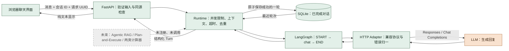

# 首版实施说明

> 此文保留纯聊天骨架阶段的设计记录。2026-11-01 已接入拆建筑与合成计算，当前数据流、模块、持久化变更、测试和范围以 [计算实施说明](calculations.md) 为准。下文“计算未实现”“图只有 chat”等仅描述此前阶段。

2026-11-01。首版目标是运行一个可进行简单 LLM 对话的 Agent 界面，同时保留未来扩展的位置。游戏知识、决策和强计算不属于本次验收。

## 运行数据流

绿色为代码与存储组件，橙色为生成式模型，灰色为尚未接入的能力。这里的图是首版实现，不替代目标架构图。

## 模块职责

| 模块 | 当前职责 | 后续扩展位置 |
|---|---|---|
| `app.py` | HTTP、生命周期、错误返回、静态资源 | 多用户认证、流式接口、请求追踪 |
| `config.py` | 环境配置与密钥读取 | 增加 provider、预算和功能开关 |
| `contracts.py` | 消息、回复、会话、请求校验 | 经调研后新增业务输入输出类型 |
| `runtime.py` | 装配图、构建有限上下文、超时、重复请求处理 | 任务调度、业务路由与总预算 |
| `workflows.py` | 最小聊天图 | 业务子图分别放入独立模块，不把业务逻辑全部塞入节点 |
| `llm.py` | `ChatModel` 协议、Responses / Chat Completions HTTP adapter | 替换 provider 或增加流式模型 adapter |
| `persistence.py` | 本地 SQLite 会话存储 | 需要多用户与迁移时替换存储实现 |
| `extensions.py` | 知识、搜索、决策、两类计算器占位 | 完成业务调研后确定成功返回契约并实现 adapter |
| `static/` | 聊天、配置反馈、当前会话恢复 | 图片上传、证据卡、计划展示 |
| `tests/` | 技术链路测试 | 后续新增独立游戏业务评测集 |

`extensions.py` 当前是不可用能力的最小接口形状，返回类型只有 `CapabilityUnavailable`，并非已经定稿的生产业务契约。后续需增加带来源、版本与验证状态的成功结果类型。占位对象没有注册为模型工具，也没有插入聊天图，不会向用户输出模拟检索或计算结果。

## 状态与执行边界

- 单次任务：`ChatState` 只包含模型输入与回复，驻留本次图执行内存中。
- 跨轮会话：SQLite 是唯一历史来源；浏览器 localStorage 仅保存当前会话 ID，不允许客户端上传伪造的助手历史。
- 长期记忆、玩家状态：尚未实现；不把普通聊天自动当成可信玩家状态。
- Checkpointer：当前图无中途用户交互或长任务，无需 checkpoint。未来需要中断、恢复、重规划时再接入，checkpoint 不替代对话业务表。
- 成功的一轮 user/assistant 原子保存；超时、认证失败和不合格响应不会产生半轮历史。
- 相同会话与请求 UUID 已有成功结果时直接返回；UUID 被用于不同内容时拒绝。用户重试失败消息时前端复用 UUID；刷新会丢失尚未成功的草稿。
- 去重保证止于已保存结果；若外部模型已生成但本地保存前进程崩溃，重试仍可能再次计费，不承诺跨系统 exactly-once。
- 一次只接受一个生成请求，其他请求返回 `chat_busy`。默认整体超时 90 秒，不自动重试计费调用；用户可主动重试。
- 默认使用最近最多 12 轮完整问答，按 24000 字符预算截断。字符限制是粗略成本控制，不等于 tokenizer 的 token 数，模型上下文限制需实际 provider 确认。

## 错误与日志

API 错误格式为 `{"error":{"code":"...","message":"..."}}`。区分未配置、凭据错误、限流、网络错误、超时、响应不兼容和会话冲突；第三方响应原文与密钥不返回客户端。未知异常记录错误编号和异常类型，不记录提示词或密钥。Uvicorn 提供请求访问日志，首版未接入分布式 tracing、模型用量计费统计与业务 badcase 平台。

模型输出以 `textContent` 显示，当前不渲染 Markdown/HTML。固定提示词约束教练语气和能力声明，但尚无领域事实验证器，不能保证模型不会输出未经核实的游戏信息。

## 后续推进顺序

1. 用本地有效密钥确认模型连通、普通多轮对话质量与接口参数兼容。
2. 专项调研游戏资料、版本策略、玩家状态字段、业务规则和真实验收样例。
3. 定稿证据与计算结果契约，接入知识库和检索；证据来源与版本先可追溯。
4. 按目标架构增加 Agentic RAG、决策子图与需要时的 Checkpointer；调研后实现两个计算器。
5. 增加事实验证、版本回归、业务评测和性能观测，再验收游戏教练能力。

本阶段技术测试不会替代第 2 步的业务调研，不宣称首版已经具备可靠的游戏决策能力。
