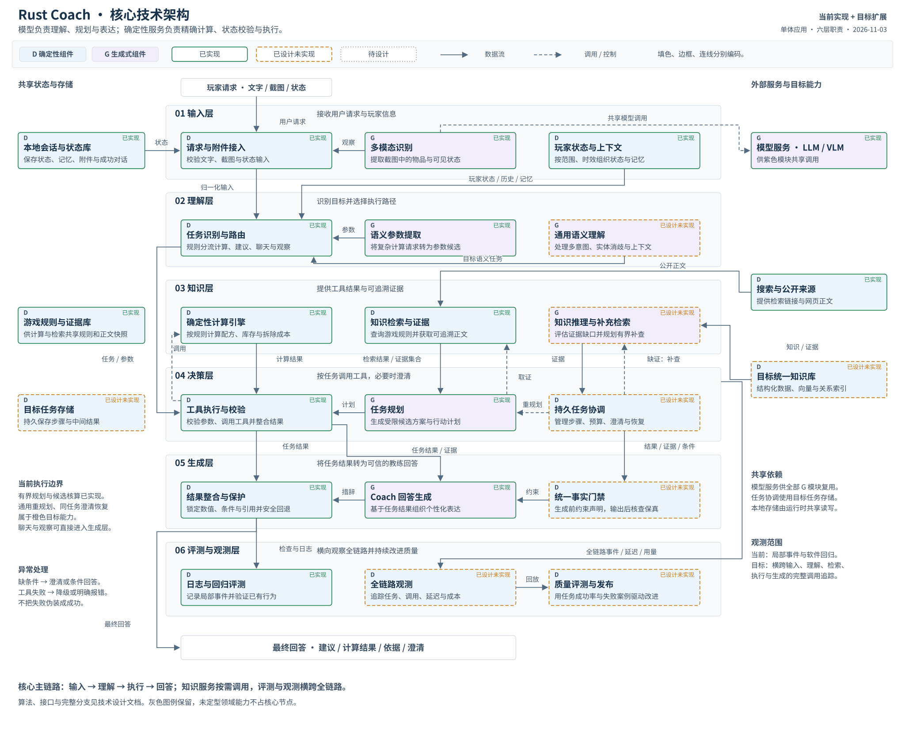

# Rust Coach 技术设计文档

版本：v1.2 · 2026-11-03  
审计基线：2026-11-03 当前工作树，源码 HEAD 为 `8a32e00592593902555c05e4ee81017f3a8b58de`（包含截图库存与标准拆墙解析修复）；代码定位及验收记录见第 10 节。

**Rust Coach 是面向 Rust PC 原版游戏的本地教练 Agent（能够按任务调用工具的模型应用）。当前已落地“文字/图片输入 → 规则路由 → 确定性计算或有界取证建议 → 受保护回答 → 本地审计”。目标是在这些服务上补齐统一知识检索、可恢复的任务执行和质量闭环，保留简单问题的短路径。**

大语言模型（LLM）负责抽取候选、规划取舍和组织表达；视觉语言模型（VLM）负责识别截图。配方展开、资源抵扣、伤害阈值、来源校验和状态更新由 Python 代码执行。模型不会操作游戏，也不负责精确数值运算。

## 1. 项目概述与核心能力

后端采用 Python 3.12+、FastAPI HTTP 框架、Pydantic 数据校验和 LangGraph 状态图编排；浏览器是原生 HTML/CSS/JavaScript。SQLite 和本地附件目录承载持久化。各层属于同一个模块化单体，不需要六个服务或多 Agent 协商。

| 能力 | 已实现范围 | 仍需补齐的范围 |
| --- | --- | --- |
| 对话与输入 | 多轮文字、最多四张截图、上传校验、请求幂等、阶段事件 | 通用文本状态抽取、复杂多意图和跨模态消歧 |
| 精确计算 | 60 个配方、8 类墙门、5 种爆炸物；批次和中间材料抵扣 | 不支持混搭全局最优、战斗伤害、完整基地拓扑 |
| 玩家状态 | 容器库存、科技、基地、阶段、时间、目标；版本、范围、时效 | 自动游戏遥测、多用户访问控制 |
| 条件建议 | 最多三个替代候选；网页正文取证；候选独立预算；新手攻略阶段与复核 | 任意步骤计划、动态工具循环、同任务持久澄清 |
| 个人记忆 | 表达偏好、自报习惯、历史事件、知识点学习证据和遗忘 | 统一知识/记忆查询协议及更完整的评测 |
| 表达与观测 | 自然短答、可展开计算/来源、规则门禁、局部 trace、测试和人设评测 | 全链路费用、语义证据门禁、Badcase（失败案例）与发布闭环 |

当前仅用于本机单用户、单进程运行，默认绑定 `127.0.0.1`。模型走可配置的 OpenAI-compatible Responses 或 Chat Completions 接口；搜索使用 Tavily。未配置模型仍可用直接计算和状态管理；搜索密钥缺失会尝试已登记网页，`search_provider=off` 则关闭联网。

六层顺序是职责的阅读顺序，**不是每个请求依次经过六个节点的流水线**。知识层被理解/决策按需调用，评测与观测横跨整个请求。

## 2. 总体技术架构与架构图

### 2.1 统一图例与阅读方法

核心架构总览用一张 SVG 展示六层，每层三个核心模块；内部函数、重试步骤和细分工具留在正文。图中以**填充色和 D/G 前缀表示组件类型，以边框表示实现状态，以箭头线型表示关系**，三个维度互不替代：

| 维度 | 视觉约定 | 含义 |
| --- | --- | --- |
| 组件类型 | 蓝色方框 D | 确定性代码、结构化查询、校验和规则执行 |
| 组件类型 | 紫色圆角框 G | LLM/VLM 或嵌入模型驱动的角色 |
| 存储位置 | 主体两侧蓝色 D 节点 | 确定性读写的数据库、文件、索引或检查点 |
| 实现状态 | 绿色实线边框 | 指定范围已接入代码；不代表外部服务必然可用或事实已认证 |
| 实现状态 | 橙色虚线边框 | 已有设计，运行链路尚未实现 |
| 实现状态 | 灰色点线边框 | 仅提出需求边界，仍待领域数据和详细设计 |
| 关系 | 实线箭头 | 数据流，包括结果返回、存储读写和观测数据 |
| 关系 | 虚线箭头 | 控制流，包括调用、分支、重试、调度和发布许可 |

节点标为“规划”时，涉及它的关系同样属于目标设计；不能只凭箭头线型判断是否已实现。所有 G 角色复用模型适配器，图中不重复画每条 HTTP 往返线。Tavily 被画为 D 外部检索依赖：当前请求关闭生成式答案，只使用返回链接并另行抓正文。

六层严格按输入、理解、知识、决策、生成、评测与观测纵向排列。共享状态、外部模型、搜索与存储放在两侧；灰色仅保留图例，未定型的新领域工具不占核心节点。存储节点代表职责域，不要求独立数据库；普通聊天和观察可以直接进入生成层。

### 2.2 单图核心架构总览

目标图保留当前计算、网页取证、状态、记忆和回答链路，把新增的语义理解、完整 RAG、通用执行循环和观测平台拆成橙色节点。RAG（检索增强生成）指先找证据、再据此生成；Agentic RAG 进一步允许模型规划查询、按证据缺口有界补查。



[打开完整 SVG](technical-architecture-target.svg)。总览保留 18 个层内核心模块、6 个共享依赖；既有知识图谱设计合并到橙色“目标统一知识库”的关系索引中。采用固定网格与正交线段生成，编辑源见 [build_architecture.py](diagrams/build_architecture.py)。

### 2.3 当前与目标的阅读边界

绿色“任务规划”限于当前有界候选与行动计划，绿色“工具执行与校验”限于现有服务的参数门禁和候选核算；不能据此推断已实现任意任务的通用 Planner/Executor。通用步骤协调、同任务澄清恢复与逐调用预算归入橙色“持久任务协调”。

混合职责拆为模型规划/表达和代码执行/校验。图中取证箭头表示建议服务的主要协作关系，实际普通建议先规划、新手引导先取证，详细顺序在第 4 节说明。视觉计算直接使用识图参数，不强制再次调用文字模型。

所有紫色模块共享外部模型协议；本地会话/状态库由运行时共享读写，目标任务存储供持久协调使用。图中仅绘制关键依赖，其余共享关系用简短说明表示。早期三份 Mermaid 及细节图保留为历史调研资料，不作为此总览的编辑源，也不要求读者组合多图才能理解系统。

## 3. 六层架构详细设计

### 3.1 输入层：把不可信输入变成有出处的数据

输入层解决“这份文字、截图和玩家条件属于谁、是否合法、哪些信息真正可见”。`app.py` 校验请求格式、同源和大小；`ChatRequest` 限制消息及附件字段；`AttachmentStore` 校验图片格式、像素、会话归属，去除原始元数据并生成标准图片和缩略图。

当前 `InputLayer` 的 `TextExtractor` 是命令/关键词规则，不是 LLM；`CrossModalFusion` 把视觉物品观察包装成带来源的状态候选，不等同于完整冲突求解。VLM 通过 `VisionService` 输出 `VisualExtraction`，包括物品身份、数量是否清晰、区域、主体、覆盖和未知项；代码做 Schema（字段结构与约束）校验。接口随机数字探测、缓存和一次模糊数量裁图复核都已存在，探测通过不证明 Rust 图标识别准确。

玩家状态输入包含两条通道：表单/文本预览确认后写入档案，以及聊天读取的已绑定档案快照。当前截图默认按当前本人理解，上传时间是拍摄时间的假设；旧图、他人图、失效图不能抵扣当前库存。单图中 `kind=inventory`、物品明确、数量可读、槽位唯一的格子可以抵扣，容器类型未知时只能视为局部库存；逐项排除原因保存在 `excluded_observations`。

- **输入**：用户文字、附件引用、图像上下文、玩家档案引用。
- **输出**：`ParsedInput`、视觉证据/草稿、unknowns、来源记录。
- **协作**：交给理解层；自动截图仅服务本轮/续问。需要写长期玩家档案时仍走显式确认 API。
- **已设计未实现**：通用文本语义抽取、完整跨模态指代与冲突协议；不凭 `ParsedInput` 类型存在就认定这些能力已落地。

### 3.2 理解层：明确目标、参数、范围和路由

理解层决定“问题是什么、应该走哪条路径”。当前 `UnderstandingLayer.interpret()` 根据候选构造 `CoachTaskRepresentation`，包含意图、目标、状态引用、不确定性和 route；`workflows.route()` 再结合显式命令、上轮计算/建议、教学请求和视觉任务选择真实节点。

参数提取按职责归入理解层，代码目前分布在 `CalculationService` 和 `VisionService` 中：`/calc JSON` 直接校验；`calculations/requests.py` 对标准中文墙门省资源比较做严格整句匹配；其他自然语言计算和续问由 LLM 提交 JSON，再由代码校验。省略血量的标准请求使用目录满血/硬面假设，明确受损、修改服、指定武器等附加条件不能被快捷规则忽略。

- **输入**：`ParsedInput`、有效状态引用、受范围限制的历史和能力信息。
- **输出**：`CoachTaskRepresentation`、可选 `DecisionRequest`、工具参数候选、实际分支。
- **协作**：普通聊天直接进入生成；状态/观察走短路径；精确计算走 SimpleCall；建议走有界子图。
- **已设计未实现**：LLM 多意图分解、实体消歧、知识辅助理解、澄清后递增 revision 并保留有效成果。

当前置信度是规则赋值，`uncertainty` 也是粗粒度投影，不是统计校准结果；`route.selected` 事件在部分业务路由覆盖之前记录，不能单凭该事件当作最终分支金标。普通聊天漏路由时会提示使用 `/coach`、`/search` 或计算器。

### 3.3 知识层：提供可追溯事实、证据与精确计算

知识层区分四类材料：**K1 游戏规则与事实、K2 行动定义与工具能力、K3 条件策略与反例、K4 原始证据**。玩家状态和个人记忆保持私有范围，不能当公共游戏规则。

当前 K1 是 `rules.json / Catalog` 固定快照和确定性 `Calculator`；K4 是 `WebResearch / EvidenceStore` 的网页正文；K2/K3 尚无正式、版本化的行动/策略目录。当前检索返回普通字典 `documents/events/warnings/queries/cache_hit`，不是已实现的完整 `KnowledgeQuery → EvidenceBundle` 协议。

- **输入**：`CalculationRequest`、固定主题、强制刷新标记；目标扩展为 `KnowledgeQuery/EvidenceNeed`。
- **输出**：计算字典及 provenance（来源与版本记录）、正文快照和警告；目标为声明级证据集合。
- **协作**：决策层调用检索和计算；生成层读取结果和引用，不能修改规则或自行重算。

目标 RAG 用“查询规划/改写 G → 检索协调 D → 结构化/关键词/向量/关系查询 D → 语义证据评估 G → 覆盖与冲突门禁 D”组成。缺资料且有预算才补检索；缺玩家条件返回 `needs_input`；冲突无法消解则保留条件、部分回答或不可用。通用证据语义评估仍未实现；新手引导的 `GuideReview` 是局部模型复核，不等同于通用证据认证。

### 3.4 决策层：工具执行与任务协调

决策层控制“做哪些步骤、工具能否执行、何时停止”。当前 `DecisionLayer` 只登记 `calculation` 和 `recommendation` 两种服务：SimpleCall 调用 `CalculationService`；PlanExecute 适配器调用整个 `AdviceService`。它会生成 `ToolCall/StepResult/DecisionResult`，但不是一个通用动态 Executor。

当前 Planner 是 `plan` 产生最多三个互为替代的候选，或 `guide` 产生新手阶段。当前 Executor 是 `evaluate` 对 craft 候选调用 Calculator、重查 TTL（有效使用期限）、检查缺字段、工作台和蓝图。一个候选内的多个制作目标统一核算，多个候选各自使用同一冻结库存，不能叠加成同时可行。

`ToolRegistry` 限定无副作用服务；`BudgetLedger` 每个外层请求消费一步/一次调用。内部搜索、模型和候选计算没有逐次计入这个账本；`DecisionRequest.deadline_ms` 也不是当前总超时的执行器。实际限制来自 runtime 的 timeout、子图递归上限、Schema 数量约束和有限修复。

- **输入**：任务目标、状态快照、库存来源、检索证据及上一轮结构化结果。
- **输出**：`DecisionResult` 和原业务结果，保留计算、候选状态、引用、缺口和限制。
- **目标扩展**：Planner 生成依赖步骤；代码检查 Schema、能力、依赖环和成功标准；Executor 逐步调用工具；StepVerifier 验证结果与进展；只有未完成或失效步骤进入 Replanner。
- **任务停止**：已完成、预算耗尽、无进展、不可用、取消或缺用户信息。缺用户信息持久挂起，不能无限占锁或假造默认值。

目标 Checkpointer 保存任务工作记忆、游标、工具结果和预算。用户补充后比较玩家 revision 与知识 release，按依赖失效重算；外部副作用若未来引入，需单独授权契约、幂等键和审计。当前只是新一轮追问，已成功请求可重放，未完成主图不能跨进程续跑。后台记忆任务和视觉草稿的持久恢复不等于主 Agent checkpoint。

### 3.5 生成层：先守住事实，再组织教练表达

生成层把结果转成直接、友好、条件清晰的回答。当前普通聊天由 `generate_chat` 生成；建议措辞位于 `AdviceService.compose`，新手阶段在 `guide` 中生成。物理文件跨层不改变职责：规划选择属于决策，语言组织属于生成。

`presentation/policy.py` 合并本轮要求、会话设置、长期偏好与知识点教学策略；`finalize_response` 用确定性模板写入计算结果、候选可行性、状态过期提示、依据和可展开详情。`ProtectedAssertion` 保留数字、条件、选择和来源；`AnswerEnvelope` 保存区块、hash、检查、修复和回退原因。

当前 `AnswerSpec` 在 `finalize_response` 尾部由 `DecisionResult` 转换，作为审计投影留存；实际渲染仍读取 `calculation/advice/visual` 原业务数据。**“先编译 AnswerSpec、再让 LLM 只填叙述槽位”是目标流程，不能说当前所有生成已由它约束。**

- **输入**：任务结果、工具报告、引用、状态限制、`ResponseContext`。
- **输出**：主回答、详情、引用和 `Turn.presentation`。
- **当前校验**：候选 ID、quote 逐字匹配、数字/人设禁用表达、条件状态、hash 一致性和交付时状态过期提示。
- **实际边界**：这些门禁不能证明自然语言语义正确；hash 检查不能证明上游事实真；一般聊天没有领域事实裁判。失败按业务分支回退或返回 API 错误，不能一律伪装成成功回答。

### 3.6 评测与观测层：区分软件正确与任务真正完成

当前 `TraceContext/SpanEvent` 已接入请求、路由、知识适配、决策和生成事件，随成功 Turn 的 `presentation.architecture.trace` 留存。Logging（日志）记录阶段结果与错误码；SSE（服务端事件推送）显示实际执行阶段，正文收集完成后一次展示。`EvalCase/EvalRun/EvalReport/BadcaseRecord` 类型、路由评分函数、pytest 和人设评测脚本存在。

当前 `emit_trace.duration_ms` 测量的是**事件对象创建时间**，不是被描述的检索/模型/工具调用时长；没有完整 span（一次真实操作的开始与结束区间）。建议链路另有真实 `elapsed_ms` 总时长；模型适配器可返回 usage，视觉部分保存用量，但还没有统一 tokens（模型计费文本单元）和金额账本。失败请求、记忆管理短路径也未统一进入持久 trace。

- **输入**：局部事件、业务报告、错误码、测试案例；目标包含每次模型/工具调用的时间与费用。
- **输出**：当前本地审计和离线评测；目标为可回放 trace、质量指标、Badcase 和发布门禁。
- **为什么存在**：只有区分路由错、证据缺、计算错、状态过期和表达漂移，才能把失败变成可验证的改进，而不是只看回复是否流畅。

## 4. Agent 核心执行流程

### 4.1 当前真实分支

主图由 `build_chat_graph()` 构建：`START → visual_input → route`，再进入 `chat / calculate / player_state / advice / visual_calculate / visual_observe`，最终 `finalize_response → END`。这是实际节点图，不能用通用 Planner/Executor 想象替换。

计算参数抽取若返回 `chat=true`，`calculate` 会转入 `chat` 再生成回答；它不会执行计算，也不会作为缺字段错误处理。

| 请求类型 | 当前执行 | 失败与补充方式 |
| --- | --- | --- |
| 普通对话/概念解释 | 受范围限制的历史 → generate_chat → 表达检查 → finalize | 首次模型异常传播；表达不合格至多一次修复，仍失败固定回退 |
| 明确计算 | /calc JSON、标准拆墙规则或文本模型 → Schema/库存门禁 → Calculator → 固定数值 | 缺字段/不支持返回 needs_input，下一轮保留目标和待补充信息 |
| 图片计算 | VLM 抽取目标 → 可读库存筛选 → VisionService.calculate → Calculator | 未识别项排除；过期/他人图不抵扣；未知目标请求补充 |
| 一般取舍 | prepare → plan → retrieve → evaluate → compose → finish | 规划失败直接 finish；结构修复预算全链最多一次；无证据不能放行机制策略 |
| 新手引导 | prepare 先检索 first_day → guide 内生成与 GuideReview → finish | 无正文直接有限帮助；有界修订仍失败则 unavailable |
| 状态/视觉观察 | 模板展示快照或可见观测 | 不把观察提升成完整状态或游戏结论 |
| 记忆管理/直接 API 计算 | Runtime 命令或 API 服务直接处理 | 绕过主聊天图；错误按对应 API 返回 |

一般建议并非“所有证据语义已验真后才推荐”：当前检查原文是否存在，并将建议总体保留为 `conditional`。新手复核增加一个模型判断，但也不能保证语义正确。当前没有由证据不足自动触发的通用第二次检索；`/search` 和新消息可主动刷新，完整补检索循环见橙色目标分支。

### 4.2 两条可讲清楚的端到端案例

**“这张背包图，造十个 C4 还差什么？”** 附件归属/大小校验后，VLM 读物品和数量；代码只聚合可用格子，局部图不会宣称完整盘点；Calculator 展开配方、共享中间材料并计算差额；模板输出“按可确认库存抵扣后的需求”，提示未展示材料未计入，实际缺口可能更少。数字来自规则与代码，图片身份正确性仍依赖识别质量。不会扣减玩家真实背包。

**“今晚先冲科技还是加固？”** Runtime 读取同 scope 状态和偏好；规则路由进入 advice；LLM 规划替代候选；WebResearch 获取相关正文；代码检查可支持的制作预算与状态条件；LLM 解释收益、牺牲、完成/切换条件；校验候选、引用和禁止数字；最终条件建议、计算详情、状态版本及证据 ID 留存。未收录的研究/建造/维护成本不能被当作已核算。

目标扩展在这条链路上新增“缺机制证据 → 有预算补检索；缺本人条件 → 最小澄清；依赖改变 → 重规划；无进展/预算耗尽 → partial”。内部研究执行计划与给玩家的行动计划是不同对象，后者不能冒充系统已替玩家执行游戏。

## 5. 知识库、数据管理与计算引擎

### 5.1 现有存储与版本

| 数据 | 当前落点 | 来源与更新规则 |
| --- | --- | --- |
| 配方、墙门、伤害 | 包内 `calculations/rules.json` | RustData 2026-11-01 固定快照；hash、URL、算法版本；game_build 未核验 |
| 网页正文/缓存 | SQLite `evidence_documents/evidence_queries` | URL、hash、fetched_at、可提取 published_at；不把搜索摘要当事实 |
| 玩家当前/历史状态 | `player_scopes/player_observations/conversation_player_scope` | scope、revision、观测 ID、TTL、失效水位 |
| 偏好和历史事件 | `coach_profiles/coach_memory_events` | 固定本地身份 local，来源请求、范围、遗忘代次 |
| 对话和业务审计 | `conversations/turns` | 完整成功轮次及 calculation/advice/visual/presentation/memory 字段 |
| 图片与视觉草稿 | 本地附件目录 + SQLite 附件元数据、视觉缓存/草稿表 | 原图规范化、缩略图、hash、所属会话、保留期；不把图片二进制塞进 turns |

当前 `verified` 是流程/工具状态：计算表示在当前输入与规则快照下算完，聊天节点也会给出该状态；它不是游戏版本认证或事实正确率。玩家 `fresh` 仅表示处于有效窗口，也不保证游戏中没有变化。

### 5.2 计算规则

制作依赖使用 DAG（无环依赖图）：从目标向原料汇总需求，先用明确库存抵扣成品和中间材料，再按配方批次向上取整，共享原料只计算一次，输出采购差额、剩余、制作步骤和工作台/蓝图条件。

拆除对每个目标单独计算：

`每目标数量 = ceil(当前 HP / 本规则的单次伤害)`  
`总数量 = 每目标数量 × 目标数`

伤害用 Decimal 十进制数处理阈值，随后复用制作引擎比较各单一爆炸物方案新增硫磺。默认满血来自 Catalog，不能让模型填写伤害公式或成本。`calculation_id` 由规范输入、规则 hash 和算法版本确定，可复现同一结果。

未知库存为 null，明确空库存为 {}，局部观测同时携带 `inventory_complete=false`。局部扣减后的缺口与排序可能受未计入物品影响；完整有效档案容器才支持“全部资源足够”的判断。计算不扣真实库存，多轮预算也不假设上一轮已执行。

### 5.3 检索、证据与目标发布

当前每轮最多两个主题、四份抓取正文，默认取证预算 25 秒、缓存 6 小时；显式最新或 `/search` 跳过缓存。查询由代码使用公开主题构造，不向搜索引擎发送背包/坐标/私人记忆。HTTPS 白名单、公网 DNS、逐次重定向、体积和内容类型限制保护抓取；主题词匹配只筛相关性，不证明语义支持。搜索失败可读取预登记资料，部分失败保留成功正文；`off` 不联网。

目标建立 `KnowledgeQuery`（目的、实体/声明、规则版本、scope 和预算）、`EvidenceBundle`（支持/反驳声明、出处、版本、覆盖、冲突、缺口、状态）。`sufficient/partial/needs_input/conflicted/unavailable` 都是合法结果，不能靠放宽条件制造“有证据”。

正式知识发布为：保存原始快照 → 清洗和带条件分块 → 嵌入/实体关系候选抽取 → 人工/规则审核 → 固定案例回归 → 发布不可变 `kb_release`。PostgreSQL 存 K1/K2 和发布指针，pgvector 存片段向量与 metadata（来源、版本等筛选字段），K3 保存策略卡的适用条件和反例，关系边表表达 requires/supports/contradicts 等知识图谱关系。暂不需要独立图数据库。

理解和决策可以按需查询该知识库；公开游戏知识、任务工作记忆、玩家情景事件、语义偏好保持范围隔离。图谱/向量结果仍需证据门禁，网页正文不能直接变为可执行数值规则。

## 6. 玩家状态与上下文管理

`scope` 表示服务器/清档范围，`revision` 表示已确认更新版本。`expected_revision + observation_id` 配合 SQLite 事务处理并发与幂等：重复同内容重放；重复 ID 不同内容、旧 revision、旧观测、未来时间拒绝。未知不补零，失效不抹去历史。

库存默认 TTL 为 30 分钟，其他事实按字段设置。死亡使随身容器和 session 失效；被抄家保守失效库存、基地和 session；蓝图重置影响科技。读取时投影 fresh/stale/invalidated。表单、文本确认和可选视觉确认写入长期状态；普通聊天只是临时条件。自动截图无需逐项确认即可用于本轮条件计算，但不会自动写档案。

Runtime 当前最多取最近 12 轮、约 24000 字符上下文，会话上限 100 轮；字符预算不是 token 预算。仅使用相同 scope 的历史，状态/记忆上下文也计入预算。追问计算剥离上轮自动注入的库存/科技，重新读取当前快照或有效视觉证据；读取、计算前和交付时有不同程度时效检查。

个人记忆分为情景事件（过去发生的自报）和语义偏好/习惯/学习证据。偏好可跨会话，事件按 scope 隔离；自报理解、讨论过与展示理解分开。记忆筛选是范围/主题/时间规则，非向量召回；不能作为现有库存。显式偏好随成功 Turn 事务写入，需模型提取的候选由单进程 worker 在回复后处理，pending 可重启继续。遗忘代次阻止在途任务复活删除内容。

目标的工作记忆放 TaskState/Checkpointer，保留步骤、证据需求、预算和依赖。checkpoint、业务状态历史、对话归档职责不同；生产迁移再加入身份、scope 权限、任务租约和对象存储，不把当前 local 身份当作多用户隔离。

## 7. 评测与可观测性设计

### 7.1 观测与成本

目标每次真实模型/搜索/工具调用建立 span，关联 `trace_id/task_id/request_id`、输入/理解/决策 revision、规则/提示/模型版本、参数 hash、结果引用、状态和错误码；保存结构化执行摘要，不收集模型私有思维链。

延迟拆分为排队、输入、理解、检索、工具、生成、持久化，报告 p50/p95/p99（不同百分位耗时），用户澄清等待单列。费用记录输入/输出/缓存/图片/嵌入 token、搜索次数和定价版本，区分 estimated 与 billed；未知值为空，不写零。预算在调用前预留、后结算，工具失败与重试同样计入。

OpenTelemetry 兼容后端接收 traces/metrics/logs；关系库保留 Eval 和 Badcase。错误、超时、高成本和用户纠正优先保留，正常样本按版本化采样。只存脱敏摘要和必要引用；原始图片、文本、记忆有独立访问和删除策略。

### 7.2 有真值的评测

| 对象 | 真值/验证方式 | 指标 |
| --- | --- | --- |
| 输入/理解 | 人工标注意图、槽位、主体、范围、是否应澄清 | 路由准确率、多意图 F1、漏/多澄清率 |
| 知识检索 | 人工声明-证据对、适用版本和冲突标签 | Recall@k（前 k 条召回）、支持率、冲突放行率 |
| 计算/决策 | 固定规则金标、库存守恒、条件回放、专家行动标签 | 数值正确、硬约束满足、可复现、条件完整 |
| 生成 | 受保护字段比对、引用核查、独立人工盲评 | 数字/条件保持、人设、可读性、事实漂移 |
| 端到端 | 预先定义任务结果及用户/专家核对 | 任务成功率、澄清效率、恢复率、延迟与成功任务成本 |

任务成功率分母包含已受理评测任务，分子需满足该任务的预设验收标准；HTTP 200、回答生成完或自动测试通过不等于玩家任务完成。条件性帮助、部分完成、受阻、不可用单独报告，避免靠全部拒答提升准确率。模型裁判要用人工标注校准，不能用同一次生成自证正确。

回放冻结输入、附件 hash、玩家 revision、知识 release、工具/模型/提示版本、参数和证据集合；允许措辞变化，不允许业务字段漂移。数据按来源/时间/场景切分，报告样本量、失败例和不确定区间。当前尚无可据以宣称总体正确率或上线 SLA 的独立数据集。

### 7.3 Badcase 与发布门禁

目标流程：触发 → 脱敏冻结 → 分类/严重度 → 人工金标与根因 → 修复 → 回归 → 灰度 → 发布或回滚。分类覆盖输入、路由、状态、知识、版本、工具、规划、恢复、生成、隐私、成本和延迟。

发布要求契约/隔离测试、固定计算金标、证据支持、恢复幂等、断言保真通过，并满足版本化的质量/延迟/费用阈值。具体业务阈值和样本规模尚待基线测量与人工校准，不虚构百分比。当前 Badcase 类型存在，工作流和自动发布门禁尚未接入。

## 8. 当前实现与目标架构差距

| 模块 | 已实现（绿色） | 已设计未实现（橙色） | 待设计（灰色） |
| --- | --- | --- | --- |
| 输入/理解 | 规则候选、VLM、任务契约、规则路由、局部参数模型 | 通用文本抽取、多意图/实体消歧、知识辅助路由、新 revision | 具体业务准确率阈值需数据校准 |
| 知识 | 固定计算规则、网页快照与引用、状态/记忆服务 | PostgreSQL/pgvector、行动目录/策略卡、知识图谱、统一 EvidenceBundle、release 管线 | 新领域事实与公式 |
| 决策 | 两服务适配、有界候选执行、单轮修复、下一轮澄清 | 通用 Planner/Executor/StepVerifier/Replanner、逐调用预算、checkpoint/resume | 战斗/全基地/混搭工具验收标准 |
| 生成 | 模板、ProtectedAssertion、AnswerEnvelope、局部门禁、AnswerSpec 审计 | AnswerSpec 前置事实门禁、受约束叙述槽位、统一跨层验证 | 通用语义正确性不能只靠代码保证 |
| 评测/观测 | 类型、局部 trace、日志/SSE、回归与人设评测 | 真实 span、费用账本、评测仓库、Badcase 生命周期、发布门禁 | 指标阈值与线上成功定义的场景细化 |
| 部署 | 本机单进程 SQLite、本地文件 | 身份/权限、PostgreSQL、对象存储、worker/outbox、租约和取消 | 生产容量按实际需求估算 |

绿色只代表表中所写范围。`extensions.py` 的 unavailable 占位、某个类型定义、命名为 plan_execute 的适配器，都不能作为完整目标模块已实现的证据。

## 9. 后续开发计划

按照既有六层设计与调研的依赖顺序推进，不额外引入微服务、独立图数据库或多 Agent：

| 顺序 | 交付与原因 | 验收条件 |
| --- | --- | --- |
| 1 契约与回放基线 | 保留当前服务，补路由最终分支、真实调用 spans 和结构化审计；把类型与实际执行对齐 | 任一抽样任务可定位输入、实际 route、参数、规则、来源、最终状态；错误也能追踪 |
| 2 领域知识与发布 | 建首批行动依赖、策略卡、版本/冲突规范；已有规则和网页迁入 release 过程 | 行动前置/成本/完成/停止条件有出处；未知成本明确受阻；发布可回滚 |
| 3 统一检索 | PostgreSQL/pgvector、关键词/向量融合、关系边表、EvidenceBundle 与有界 Agentic RAG | 以金标证明召回和支持改进；缺证据、冲突、预算耗尽都可终止 |
| 4 持久决策 | 拆出通用计划、Executor、Verifier、Replanner 与同任务澄清；逐调用预算 | 中断/崩溃可恢复；旧状态依赖失效；不会重复副作用或无限重规划 |
| 5 生成与质量闭环 | 前置 AnswerSpec、受控表达、完整评测仓库、Badcase 与发布门禁 | 关键数值/条件/引用稳定；严重失败能阻断发布；人工标注校准质量指标 |
| 6 按需求生产化 | 多用户身份/scope 权限、任务租约、对象存储和 worker/outbox | 隔离、并发、删除、恢复与容量实测通过后才扩大部署 |

向量库与知识图谱仍保留在正式目标中，但不是每次请求都必须调用的组件。早期架构将向量 RAG 定为目标能力，后续调研认为首版建议可先用网页取证；本文通过“保留目标、按需调用、分阶段实施”协调两者。战斗、完整基地拓扑和全局最优仅保留研究边界，先有可靠数据、公式与金标，再决定是否立项。

## 10. 事实依据与交付验收

### 10.1 源码定位与设计依据

| 内容 | 主要代码证据 | 设计/实施记录 |
| --- | --- | --- |
| 请求、幂等、超时、保存 | [app.py](../src/rust_coach/app.py)、[runtime.py](../src/rust_coach/runtime.py)、[persistence.py](../src/rust_coach/persistence.py) | [workflow-progress.md](workflow-progress.md) |
| 输入/理解/真实路由 | [input.py](../src/rust_coach/architecture/input.py)、[understanding.py](../src/rust_coach/architecture/understanding.py)、[workflows.py](../src/rust_coach/workflows.py) | [输入设计](architecture-input-layer.md)、[理解设计](architecture-understanding-layer.md) |
| 计算与参数捷径 | [requests.py](../src/rust_coach/calculations/requests.py)、[service.py](../src/rust_coach/calculations/service.py)、[engine.py](../src/rust_coach/calculations/engine.py)、[rules.json](../src/rust_coach/calculations/rules.json) | [calculations.md](calculations.md)、[库存/拆墙修复](inventory-raid-fix.md) |
| 玩家状态与记忆 | [domain.py](../src/rust_coach/player_state/domain.py)、[store.py](../src/rust_coach/player_state/store.py)、[memory/service.py](../src/rust_coach/memory/service.py) | [player-state.md](player-state.md)、[memory.md](memory.md) |
| 当前建议/新手分支 | [advice/service.py](../src/rust_coach/advice/service.py)、[onboarding.py](../src/rust_coach/advice/onboarding.py)、[decision.py](../src/rust_coach/architecture/decision.py) | [advice.md](advice.md)、[onboarding-guides.md](onboarding-guides.md)、[决策层设计](architecture-decision-layer.md) |
| 视觉与附件 | [vision/service.py](../src/rust_coach/vision/service.py)、[context.py](../src/rust_coach/vision/context.py)、[attachments/store.py](../src/rust_coach/attachments/store.py) | [多模态实施](multimodal-implementation.md)、[多模态设计](multimodal-design.md) |
| 知识/目标 RAG | [web.py](../src/rust_coach/knowledge/web.py)、[store.py](../src/rust_coach/knowledge/store.py) | [知识层设计](architecture-knowledge-layer.md)、[决策知识调研](decision-knowledge-research.md)、[游戏来源调研](rust-domain-knowledge-research.md) |
| 生成/评测/观测 | [rendering.py](../src/rust_coach/presentation/rendering.py)、[validation.py](../src/rust_coach/presentation/validation.py)、[observability.py](../src/rust_coach/architecture/observability.py)、[evaluate.py](../src/rust_coach/presentation/evaluate.py) | [生成层设计](architecture-generation-layer.md)、[评测观测设计](architecture-evaluation-observability-layer.md)、[人设实施](persona-implementation.md) |

早期 [architecture.md](architecture.md) 和 [scaffold.md](scaffold.md) 保留历史阶段，含“计算未接入”等过时描述；它们用于理解目标和演进，当前实现以源码及本表为准。总览节点按功能域合并上述服务，不承诺一节点一文件。

### 10.2 图表再生成与验收

总览采用显式坐标生成原生 SVG，避免自动布局导致跨层回边穿插。节点和关系定义在 [build_architecture.py](diagrams/build_architecture.py)，生成时同时输出 [布局清单](diagrams/architecture-manifest.json)。

```sh
python3 docs/diagrams/build_architecture.py
node docs/diagrams/validate_architecture.cjs <node_modules目录> <Chrome可执行文件> <验收输出目录>
```

验证脚本使用 Puppeteer 实际打开 SVG，测量字体边界并输出渲染图片与 JSON 检查结果；工具装在临时目录，不修改业务依赖。原 Mermaid 文件不再用于覆盖此总览 SVG。

[总览图验收记录](technical-architecture-overview-validation.md) 记录模块粒度、布局、真实渲染与可读性检查；[早期文档验收](technical-design-validation.md) 保留当时的代码回归结果。本文交付只修改文档和图表，不实现橙色模块。

