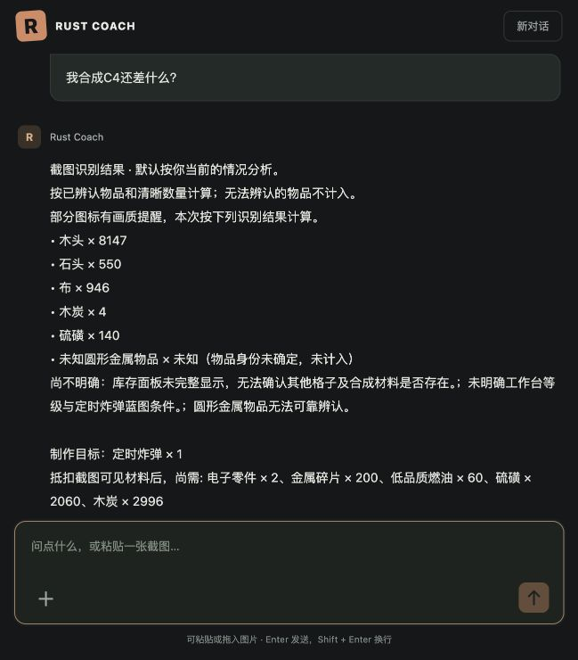

# 同轮截图计算：识别与抵扣一致性修复

日期：2026-11-02，提取协议 `visual-observations-v4`。

## 原因与修改

本次实际失败记录中，木炭 4、硫磺 140 均为 `quantity_status=readable` 且有规范物品 ID，但带有“图标受低分辨率影响”的 `uncertainty` 备注。汇总代码用 `not uncertainty` 作为准入条件，过滤了这两项；识别清单却照常显示确定数量，产生展示与计算不一致。此前用无画质备注的样例测试，未覆盖这条路径。

- 物品身份新增 `item_status`，与数量是否可读分开。已辨认、数字清晰的物品可按识别结果计算，通用画质备注不再成为自动排除条件。
- 身份有歧义、数量未知、槽位重复或范围不支持时继续排除。自动结果记录 `included_observations`，显示清单据此标注未计入项，不再悄悄丢掉材料。
- 旧草稿缺少身份字段时，以现有规范 ID 和明确歧义备注兼容判断，不重置观测时间。明确“无法确认具体物品”仍按未辨认处理。
- 视觉识别块在计算或建议回复中置于第一位，之后才给缺口、抵扣项及条件。前端和纯文本 API 使用一致的块顺序。
- 图像上下文中的 `subject=unknown` 表示自动判断，不再作为用户声明传给模型；明确目标物品但省略数量时，提示模型默认先按 1 个计算并说明该假设。

## 回归验证

`uv run pytest -q`：**313 passed in 6.78s**。新增覆盖同条消息发图与 C4 请求、带画质备注的两种身份字段输入、旧草稿恢复、建议预算共用库存、真实身份歧义排除、识别块与正文顺序、自动主体字段处理。

浏览器在本次失败的原会话重新发送原问题，复用原草稿，确认先展示识别结果，再输出木炭 2996、硫磺 2060 的剩余需求；明确列出已抵扣的木炭 4、硫磺 140。其余字段沿用原模型读数，未把该复放当作物品识别准确率认证。没有改写历史错误回复。浏览器控制台没有 error。

随后在临时数据库中用**同一张原始图片、同一个问题“我合成C4还差什么？”**重新调用真实模型，执行发图 → 识别 → 计算 → 最终回复。验证脚本启用 `--expect-used sulfur=140 --expect-used charcoal=4`，同时断言识别块最先出现；实际结果：

| 项目 | 结果 |
| --- | --- |
| 目标 | 定时炸弹 `explosive.timed` × 1 |
| 主体 | 当前本人 |
| 实际抵扣 | 金属碎片 200、硫磺 140、木炭 4 |
| 剩余需求 | 电子零件 2、低品质燃油 60、硫磺 2060、木炭 2996、布 5 |
| 第一回复块 | `visual_scope`，即识别清单 |
| 独立接口探测 | 5.01 秒，5,021 provider tokens |
| 识别调用 | 46.44 秒，10,500 provider tokens |

新图实测第一轮还发现测试请求中的自动主体值被模型解释为归属不明，以及省略数量时返回空计算目标；修正输入投影与解析提示后，同样图片和原问法通过完整断言。烟测脚本现在支持对实际抵扣与输出顺序的断言，避免把仅返回澄清回复记成计算验证成功。

这是特定故障样例的复现与回归，不证明所有图标识别无误，也不是当前游戏 build 的数值认证。运行日志和原始模型输出保留在忽略的 `data/vision-eval/`，未把玩家原图加入交付。
