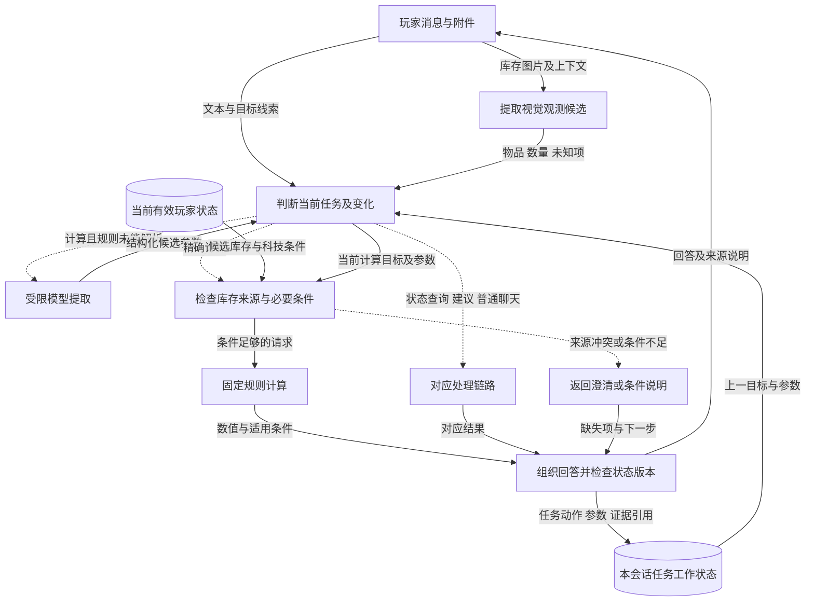

# G01 意图理解：截图制作后，接得住拆墙与血量追问

## 1. 一句话成果

系统能把截图制作、切换拆墙和补充血量组织为明确的任务变化，并送入同一计算链路；当前离线链路回归通过，真实文本已有与当前源码匹配的六轮冒烟，尚未证明真实截图识别准确率或普遍语言理解能力。[G01-E01、E02、E07](evidence.md)

## 2. 具体场景与原有问题

玩家上传库存图问“制作两个 C4 还差多少”，接着说“改成拆一面石墙最省资源”，再补充“它还剩250血”。三个句子共享库存背景，但第二句换了任务，第三句只补了条件。识别出“制作”“拆墙”两个标签还不够：旧制作目标不能混入拆墙，血量也不能脱离目标单独计算。

这是一条**用于讲解的组合场景**。当前集成测试覆盖截图制作→拆墙→血量→纠正；历史真实模型记录覆盖档案制作→拆墙→血量。两组证据不能拼成一次真实截图现场成功记录。选择这条主线，是因为错误路由会让正确计算器解决错误问题，直接破坏演示可信度。

历史同契约报告为10/40案例通过，实施版为40/40；其中包含新增任务与来源元数据要求，不能据此声称旧系统有75%的意图误判，更不能把变化解释为模型准确率提高。[G01-E05](evidence.md)

## 3. 目标如何拆解

| 子问题 | 职责 | 对结果的贡献 |
|---|---|---|
| 这轮要做什么 | 区分精确计算、建议、状态查询、普通聊天 | 最终路由与实际执行节点一致 |
| 与上轮是什么关系 | 新建、继续、更正、切换、取消、澄清 | 续问保留目标；切换清掉旧目标；插话不冒充新计算 |
| 哪些参数有证据 | 把文本和视觉候选转成受约束请求，核对当前自报 | 不把目标数量、假设或他人库存当作本人库存 |
| 不足时怎样收口 | 缺目标、受损但血量未知、混合任务返回明确澄清 | 不让不完整请求进入数值结论 |

## 4. 最终实现方案与数据流

玩家每发一轮消息触发处理。输入层接收文本、附件引用和可选档案容器；图像经视觉分析成为观测候选。理解层结合当前任务工作状态形成受约束参数，规则优先处理明确命令和标准血量追问，其他计算表达交给模型提取，最多两次解析。最终分流结果与实际执行节点一起记录。

实线表示数据，虚线表示控制触发。图中的模型回路是有次数上限的提取，非开放式自主循环。来源门禁由 G05 提供；知识层提供固定规则，决策层调用计算，生成层保留条件与错误说明。评测与观测读取路由、任务动作、实际节点和结构化结果进行核验。普通聊天保留已有任务，取消清空任务；换任务建立新目标，续问保留任务标识并递增理解版本。工作状态随回答存入对话记录，重启后读取；不是跨会话任务迁移平台。

输入→中间→输出示例（前两行为当前测试的业务摘述，第三行为历史真实文本原文节选，**不是同一次运行**）：

| 证据条件 | 输入 | 中间结果 | 输出或可观察结果 |
|---|---|---|---|
| 合成图＋固定视觉输出 | 截图材料制作火药 → 改成拆一面石墙最省资源 | 制作目标清空，operation=raid；沿用有效硫磺100 | 进入拆墙计算链路 |
| 同一集成测试 | 它还剩250血 → 硫磺数量改为150 | 保留墙目标与250 HP；新视觉版本库存150 | 重算；原始识别100仍保留，未自动写档案 |
| 历史真实文本，档案硫磺1000 | 它还剩250血 | raid，hp=250，action=continue | “新增硫磺最少的是 1 定时炸弹，需要新增 1200 硫磺” |

最后一行只比较既定规则下所列单一爆炸物的新增硫磺，不是所有资源或混搭的全局最优。完整条件与原文见[G01-E04](evidence.md)。

## 5. 为什么选择这个方案

1. **规则快路径＋模型提取。** 问题是表达灵活，但状态查询和标准追问不值得每次重新解释。实施记录已记载这一选择；“全部交模型”是本次补充比较。规则稳定处理已覆盖表达，模型补足其他参数，计算交给规则工具。代价是表达覆盖有限、需要维护边界；未见表达的澄清率明显影响体验时再扩展。
2. **单一任务工作状态。** 问题是切换与续问必须有不同语义。实施记录选择保存当前任务，混合制作与拆墙先澄清；通用多任务规划是已列为后续的替代方向。最终复用持久对话记录，没有新增独立检查点平台。代价是不能并行维护多个任务；出现稳定的多目标并行需求时再考虑扩展。
3. **统一计算入口与证据门禁。** 截图首轮和文本续问若使用不同资格判断，会出现同一库存前后解释不一致。最终将两者接到共同计算链路。保留两条独立链路是本次补充比较；共同入口便于统一冲突处理，代价是需要同时携带视觉来源、文本条件和状态版本。若不同模态有不可兼容的业务约束，再拆分提取适配，仍共享资格检查。

以上实现选择与代价不是全部预先完成的设计论证；可追溯的实施记录与本次补充比较已分别标出。[G01-E06](evidence.md)

## 6. 深入到了什么程度

- **已实现且本次验证：** 切换清目标、血量续问、插话恢复、取消与否定取消区分、未知血量澄清、明确文本任务优先于视觉分类、图像纠正保留旧版本。193项定向测试通过，其中包含同一40案例/54轮固定集；保存了审查版逐项判定的安全导出，不能重复计数。
- **已实现但验证不足：** 真实自然语言泛化、真实截图端到端体验。历史六轮文本冒烟保留作背景；新增审查版六轮与当前源码匹配，但仍只是单次文本小样本（G01-E07）。
- **有意不做：** 通用多意图规划、向量库、实时搜索扩建、生产检查点；本轮材料整理不新增业务能力。
- **当前限制：** 视觉模型仍可能错认物品；来源合格不代表识别正确；规则快路径只覆盖有限表达。未知条件必须保留，不能用确定口吻补齐。
- **材料停止标准：** 当前测试可追溯、主线有代表证据、历史与当前版本分开、缺口明确且链接可用。不以补做昂贵实验来填满结论，不宣布达到上线验收标准。

## 7. 成果与证明

| 适合进入 PPT 的结论 | 证据 |
|---|---|
| “换任务”与“补条件”有不同状态变化，计算路由可核验 | G01-E01、G01-E02 |
| 截图制作、拆墙、血量、单格纠正可共享有效证据并重新计算 | G01-E02；目前为固定模型集成验证 |
| 条件不足先澄清，模型提取不能直接决定库存事实 | G01-E03 |
| 当前40/40是工程契约回归；六轮文本冒烟与真实识图效果分别验证 | G01-E01、G01-E05、G01-E07 |

## 8. 与其他目标的关系

G01回答“玩家此刻要做什么”；G05回答“这次允许采用哪些事实”；G02提供数值规则，G07判断各阶段是否答对。最终展示只讲一次截图制作→拆墙→血量主线，G01强调任务变化，G05强调库存资格。死亡及跨会话作为 G05 补充，不抢占主线。

40案例、193项定向测试、审查版六轮冒烟均为共享证据，不能在两个目标下相加。G07旧真实图像批次保留作历史诊断，须复核其对当前实现的适用性。对应[G05材料](../G05-玩家状态建模/brief.md)与[总索引](../../README.md)。
