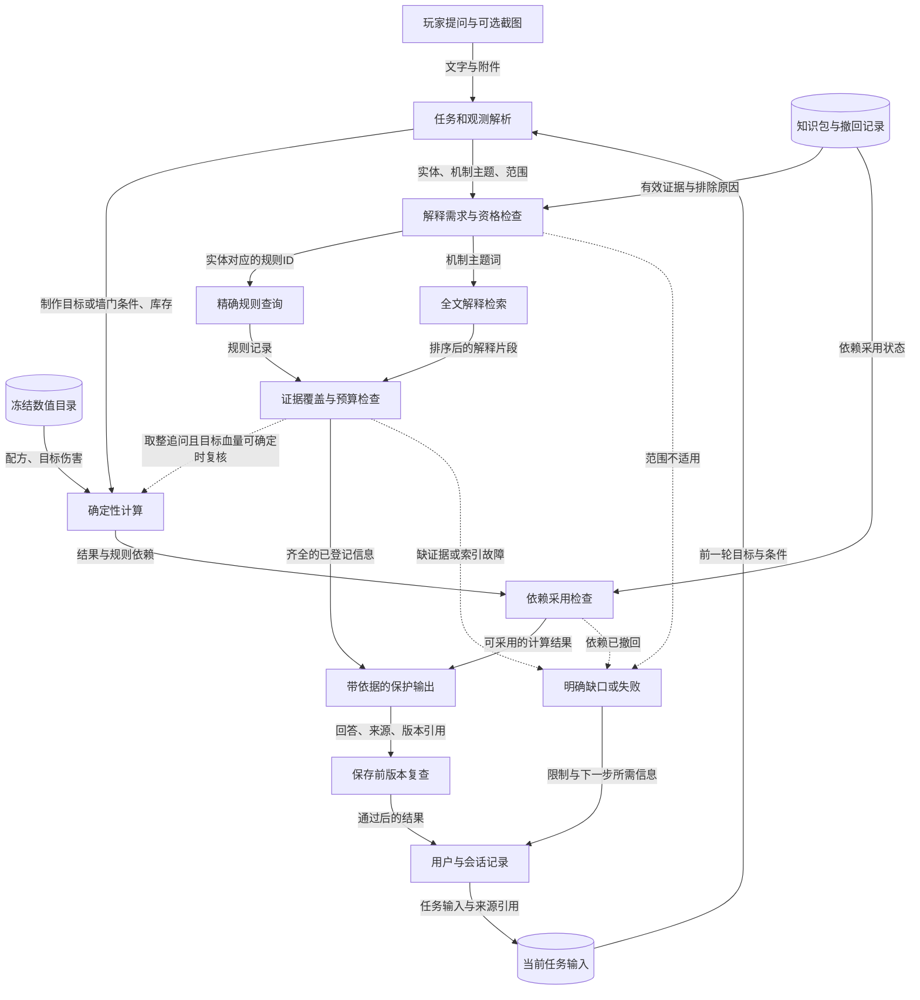

# G02 知识库设计与知识推理

## 1. 一句话成果

玩家询问核心配方或追问拆墙依据时，系统可以按固定快照取得对应规则和解释，交给确定性工具推导，并说明缺少什么依据；有限案例支持这条链路，尚不能宣称检索整体提速或游戏知识准确率提升。

## 2. 具体场景与原有问题

贯穿场景是：玩家先用库存截图计算制作缺口，再切换到一面剩250血的石墙，追问“为什么还需要一颗C4”。这是为面试组织的游戏场景；其中的截图链路有替身测试，文字计算与追问另有本地应用采集记录，不包装成一次真实游戏录像。

问题不只是能否找到带“C4”的文章。配方回答需要材料和工作台，拆墙回答需要具体目标与朝向下的伤害，解释还需要说明为什么向上取整。如果只交付相关文字，模型可能缺少计算条件，用户也无法核对数字从哪里来。这里描述的是设计风险；没有证据证明旧版在线系统曾以某个频率犯这些错误。

项目主线是可靠的制作与拆墙辅助。先把这一小段知识依赖串完整，比扩充大量攻略却无法检查答案更直接。检索准确性要落实到“该问题需要的证据是否齐全”，效率则要同时看调用量、检索成本和上下文预算。

## 3. 目标如何拆解

| 子问题 | 承担的职责 | 对最终结果的贡献 |
|---|---|---|
| 什么信息能作为依据 | 区分固定数值规则、已保存原文、实现机制说明 | 不把模型推断或网页出现过的文字直接当权威数值 |
| 这次问题究竟缺什么 | 把物品、目标、机制主题和适用范围变成检索需求 | “250血为什么需要C4”同时找目标伤害与取整说明 |
| 怎样找到足够证据 | 数值精确查询，解释全文检索，再检查主题覆盖与预算 | 结果可说明选了什么、排除了什么、还缺什么 |
| 怎样从依据得到结果 | 工具展开配方和计算拆除数量；输出前核对依赖 | 算术可复核，解释不会自行补造数字 |

资料是否仍允许采用由G06控制；本目标讨论在这些约束下如何找到和使用知识。

## 4. 最终实现方案与数据流

用户提问触发任务识别。截图先由既有视觉能力变成库存观测；它只提供玩家条件，不给知识库改规则。明确计算请求传递物品、数量、目标、朝向、血量和可用库存；机制追问传递实体、主题、范围及前一轮目标。

计算路径从冻结目录读取配方或有效伤害，用代码展开材料依赖、抵扣库存并向上取整。计算后还要检查用到的规则是否仍可采用，检查失败就不发布数值。解释路径先检查范围和证据资格，再按实体取得规则、按主题检索说明，最后检查所需规则和主题是否齐全。当前修订遇到可确定目标与血量的取整追问时，还会调用同一工具复算，避免顺着问题中的错误数量解释。两条路径在带依据的输出处汇合。

模型可用于识图和自然语言参数解析；本地知识检索、数值计算及已整理解释不依赖模型补全。存储保留不可变知识包、撤回状态、查询缓存、回答与来源引用；前一轮输入可用于续算，旧结论不能直接变成新事实。保存前还会重新检查知识版本，细节由G06展开。

实线表示数据传递或持久化读写，虚线表示条件触发。此图不是让每个请求顺次走完全部节点：配方精确查询可不做全文检索，计算也不必先检索说明。可编辑图源见[数据流图](assets/data-flow.mmd)。

本地采集的文字样例：输入一面石墙、硬面、250HP、仅比较C4；中间结果取得本快照伤害275，工具给出 `ceil(250 / 275) × 1 = 1`。接着问“为什么250血还需要一颗C4”，返回C4配方、石墙伤害记录、取整说明及规则复算结果。把问题改成“两颗”，复算仍为一颗，不接受问题中的错误数量。样例只证明指定C4条件下的路径，不证明它优于所有方案，也不证明当前正式服伤害正确。[G02-E02](evidence.md#g02-e02)

## 5. 为什么选择这个方案

**精确规则加轻量文本检索——有设计演变记录。** 问题是少量核心数值必须可核对，而解释存在不同问法。早期设计把向量检索与实时搜索列为必备；后续调研提出先完成知识依赖、按收益引入语义检索，最终实现选择本地规则直查和全文索引。这样复用已有存储，正常固定快照问题不必联网。代价是别名和主题映射有限，长尾语义召回不足；当未见问法持续失败、并有足够独立评测时再考虑向量检索。[G02-E06](evidence.md#g02-e06)

**工具推导与整理后的解释分工——实施记录已有，替代方案为本次补充对比。** 让模型根据若干片段自由计算也是可行原型，但难以保证批次、共享库存和每目标取整一致。当前把数字交给工具，把机制解释限制在已整理信息内。代价是覆盖面小、长答案可能显得机械，不能回答任意机制；需要扩大解释范围时，应先补证据和反例，再考虑受验证的生成。

**先看证据完整性，再讨论效率——本次整理的效果判断。** 也可以只比较查询时间或压缩上下文，但更快地缺少证据没有价值。现有对照中，本地完整策略的通过数更高，耗时和正文长度却也更高。因此停止在“受预算约束、无外部调用的可复核路径”，不把它包装成整体提速。是否需要进一步优化，要由真实规模、重复测量和端到端耗时决定。

## 6. 深入到了什么程度

已实现并有工程验证的部分包括：固定范围过滤、规则查询、全文解释选择、主题覆盖检查、计算依赖检查、保护输出，以及截图计算后的依据追问。解释改名仍能被检索到，缺依据不会由模型补算。共享核验结果和具体边界见证据表。

已实现但验证不足的部分包括：自然表达对实体和机制主题的映射、整理后主张的游戏真实性、通用玩法建议的语义支持关系。主题标签覆盖不等于理解了问题的每个子主张；词法相关不等于逻辑证明。默认包中的69条结构化记录、12条说明和3段摘录是可审计范围，不是用数量证明深度。

有意不做向量库、独立图数据库、自动联网更新和通用知识推理。固定演示包仍未认证游戏build，未安排独立Rust专家复核。中文主题到英文索引词的映射适合当前小范围，不证明任意语言或大语料效果。

本轮停止扩展的标准是：主线能贯通，所需证据可追溯，范围或依赖不足能明确失败，既有固定案例和关键回归有记录；不以“已彻底消除幻觉”或“已经达到生产性能”作为结论。本材料只整理这些事实，没有改业务实现。

## 7. 成果与证明

- 核心计算与依据追问可以沿同一目标衔接；确定性结果和解释证据分别可核对。[G02-E02](evidence.md#g02-e02)、[G02-E05](evidence.md#g02-e05)
- 精确查询与全文检索承担不同职责，证据不足或索引故障不会伪装成完整解释。[G02-E01](evidence.md#g02-e01)、[G02-E03](evidence.md#g02-e03)
- 历史与当前受控对照均有24案例记录；当前完整策略24/24，含13/13应答例和11/11边界例。判定器已修订，不能把它写成线上准确率从17%提升到100%，也不能跨版本宣称严格提升。[G02-E04](evidence.md#g02-e04)
- **待验证：整体检索效率提升。** 现有结果只支持零外部调用和上下文预算；没有端到端提速或费用下降证据。[G02-E04](evidence.md#g02-e04)

## 8. 与其他目标的关系

复用G01的任务理解、G05的有效库存与上下文，以及已有制作/拆墙工具；向G04提供有边界的事实来源，向G07提供可检查的证据选择与失败结果。G06负责知识采用资格和失效，G08负责将来完整的延迟与成本测量。

最终PPT中，截图输入、计算器和固定知识包各讲一次即可。G02讲“如何找到并推导”，G06接着讲“何时必须停止采用”；两个目标引用同一组24案例，不相加为48个独立案例。
