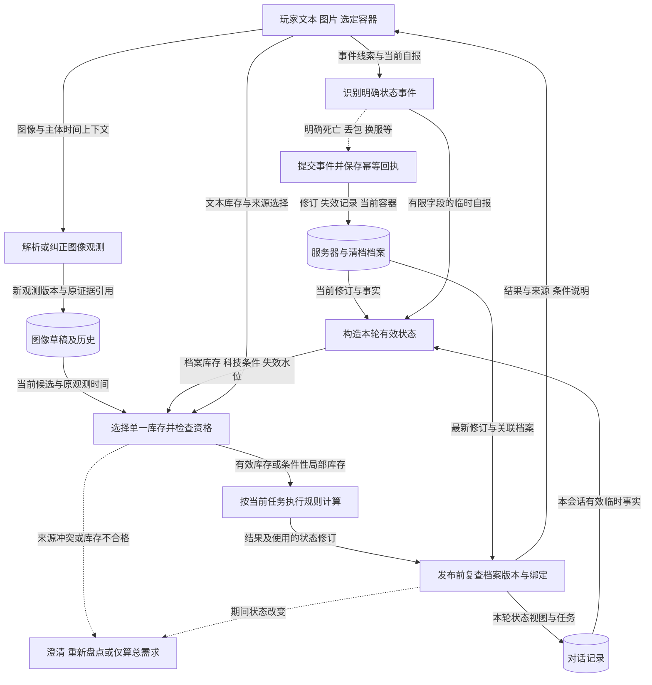

# G05 玩家状态建模：让制作与拆墙使用此刻可用的事实

## 1. 一句话成果

系统把持久档案、临时自报和图像观测分开，按来源、时间、归属与完整性决定本次计算能用什么；当前离线测试验证了冲突、纠正、失效与跨会话复用，尚未证明对真实游戏状态的自动感知或总体建议质量提升。[G05-E01～E05](evidence.md)

## 2. 具体场景与原有问题

仍从截图制作开始：图片里有硫磺，档案背包里也有一份旧盘点。玩家问“做两个C4还缺什么”，再改成拆墙。如果两份库存相加，可能把同一堆材料算两次；如果截图没看见电子零件，就当作零，也可能夸大缺口。计算器本身没有算错，前提却错了。

本场景为**组合讲解示意**，对应证据分别来自当前来源冲突测试、截图续问测试和历史真实档案计算。没有一条已保存的当前真实截图录屏可以证明整个故事连续成功。优先解决这一问题，是因为玩家需要的是与当前材料和科技条件相符的计算，而不仅是一张配方表。

历史对照只证明新契约下通过案例增加，不足以声称旧系统在所有场景都会混库存。旧真实图像批次还保留物品错认记录；本次状态建模不能被包装为已经修好视觉识别。[G05-E06](evidence.md)

## 3. 目标如何拆解

| 子问题 | 职责 | 对结果的贡献 |
|---|---|---|
| 事实属于哪里 | 档案按服务器与清档隔离，库存分容器 | 不把别的服务器、旧清档或基地箱子当成本次背包 |
| 事实何时仍有效 | 保存观测时间、有效期、失效水位、修订号 | 旧截图与死亡前背包不能因重读而恢复有效 |
| 多个说法如何采用 | 本次库存只选一个来源，科技条件独立判断 | 不重复抵扣，临时工作台自报可及时改变前置条件 |
| 状态怎样改变且可追溯 | 明确事件先写入；纠正生成新图像版本；记录来源与回执 | 失败重试不丢事件、不重复清零，原始证据可回看 |

## 4. 最终实现方案与数据流

每轮先读取当前档案与任务。明确死亡/背包丢失等事件在模型调用前独立持久化；正常请求则构造本轮有效状态。少量明确自报形成有期限的临时事实，改变本轮科技条件，不隐式覆盖持久档案。截图解析得到候选，用户明确纠正单格时生成新版本，并保留原图、原始识别和观测时间。

实线传递数据，虚线触发分支；这里没有后台实时遥测。图像草稿和档案是不同存储职责，纠正不自动写档案。共享门禁检查主体、时间、完整性、失效记录与来源冲突；档案容器须完整且新鲜，图片可用已识别的局部材料做带条件预算，未知项不能补成零。模型置信度不替代这些资格检查。

事件写入与回答保存是两个事务。事件成功后即使模型失败，用户已上报的死亡仍保留；同请求重试查回执，不再次清空新盘点库存。计算结束及保存时检查修订，保存事务还检查档案绑定，变化就拒绝发布旧快照结果。[G05-E04](evidence.md)

输入→中间→输出（不同验证来源，不能拼成一次真实运行）：

| 条件 | 输入 | 中间状态 | 返回/保存 |
|---|---|---|---|
| 当前固定集：图片硫磺100＋明确选择档案 | 截图制作一个C4 | 两份库存同时有效，ambiguous_inventory | needs_input，要求选择来源；不相加 |
| 当前集成测试：截图制作后已切拆墙并补250HP | 硫磺数量改为150 | 新图像草稿采用150，原识别仍100，墙与HP保留 | 重新计算；未写档案，不刷新截图观测时间 |
| 历史真实文本：档案工作台3级 | 我有1级工作台，继续计算 | 本轮workbench=1；profile_workbench=3 | 提示需3级工作台，说明冲突；档案保留3 |
| 历史真实文本：档案硫磺1000 | 我刚死了，背包丢了；新会话计算 | 旧背包失效，当前完整空清单，revision=2 | 新会话使用空背包；旧记录保留 |

最后两行是补充案例。面试主线仍是截图制作与拆墙，用它们解释“事实会变化”，不扩展成泛化游戏世界模型。

## 5. 为什么选择这个方案

1. **一次计算只采用一个库存来源。** 要解决图像、文本和档案可能重复描述同一堆材料的问题。实施记录选择来源资格检查与显式冲突；“自动合并并按置信度覆盖”是本次补充对比。选择单来源使预算可解释，代价是冲突时多一次用户选择，暂不支持跨容器自动汇总；有稳定的物品归属和去重规则后再考虑合并。
2. **持久档案与临时事实分离。** 要让“我只有1级工作台”马上影响计算，又不能无声改写档案。实施记录采用有期限的本轮自报和冲突说明；直接写档案、每次都要求确认是本次补充比较。代价是用户要显式保存才能跨会话复用该事实；更多字段频繁进入同样流程时，再扩展确认与字段覆盖。
3. **明确丢失事件先持久化。** 要避免已经死亡仍用旧背包，也要防止失败重试再次清空新库存。最终策略是明确上报即写入，旧背包保留在失效历史，当前背包为明确空清单，其他容器不清零。相较早期确认流程，实施记录写明这是用户确认的最终产品策略；不再逐次二次确认。代价是依赖有限表达规则和玩家如实上报；有争议、否定、假设不触发。若产品改为必须复核高影响事件，再引入待确认态。

## 6. 深入到了什么程度

- **已实现且当前验证：** 来源冲突与总需求选择、未知不等于零、旧图不能越过死亡水位、单格纠正保留原始证据、临时自报不覆盖档案、事件幂等与失败保留、跨会话档案复用、生成期间切档案/改修订时拒绝旧结果。
- **已实现但验证不足：** 玩家真实表达覆盖、完整浏览器体验、真实视觉质量、建议在真实局面中是否更好。审查版六轮真实文本与当前193项定向测试是不同条件的证据（G05-E07）。
- **有意不做：** 实时读取游戏遥测、自动资源增减记账、制作后自动扣库存、在线时长自动递减、跨会话自动迁移任务与未保存自报。当前快速自报仅覆盖少量字段。
- **当前限制：** 默认当前本人图仍是推断，必须保留不确定性；有资格采用不代表物品识别正确。过期盘点要重报，当前系统不知道玩家是否已经花掉材料。
- **停止标准：** 主线与关键失败边界有当前离线证据、所有状态变化能解释来源和保存范围，未覆盖能力列明。本材料不以构建完整状态平台或新真实模型实验为交付条件。

## 7. 成果与证明

| 适合进入 PPT 的结论 | 证据 |
|---|---|
| 制作与拆墙共用库存资格判断，冲突不静默合并 | G05-E01、G05-E02 |
| 截图纠正改变本次计算，原证据与档案边界仍保留 | G05-E02 |
| 本轮科技条件可随明确自报改变，持久档案不被隐式覆盖 | G05-E03 |
| 明确死亡后的空背包跨会话生效，失败重试不重复清零 | G05-E04、G05-E05；真实场景泛化仍待验证 |

## 8. 与其他目标的关系

G01确定当前任务；G05提供本次可用事实；G02执行规则推理；G04借此约束无依据结论；G07分别检查事实、算术和表达。来源追踪可供评测与观测使用，不等于已有全项目生产监控。

最终PPT共用一次截图制作→拆墙→250HP→单格纠正的案例和验证表。死亡、新会话、工作台作为补充；不把共享40案例或193项测试在两目标下重复相加。规则快照已经选定，与游戏build得到独立认证是两件事。参见[G01](../G01-意图理解/brief.md)、[G07](../G07-效果验证/brief.md)。
