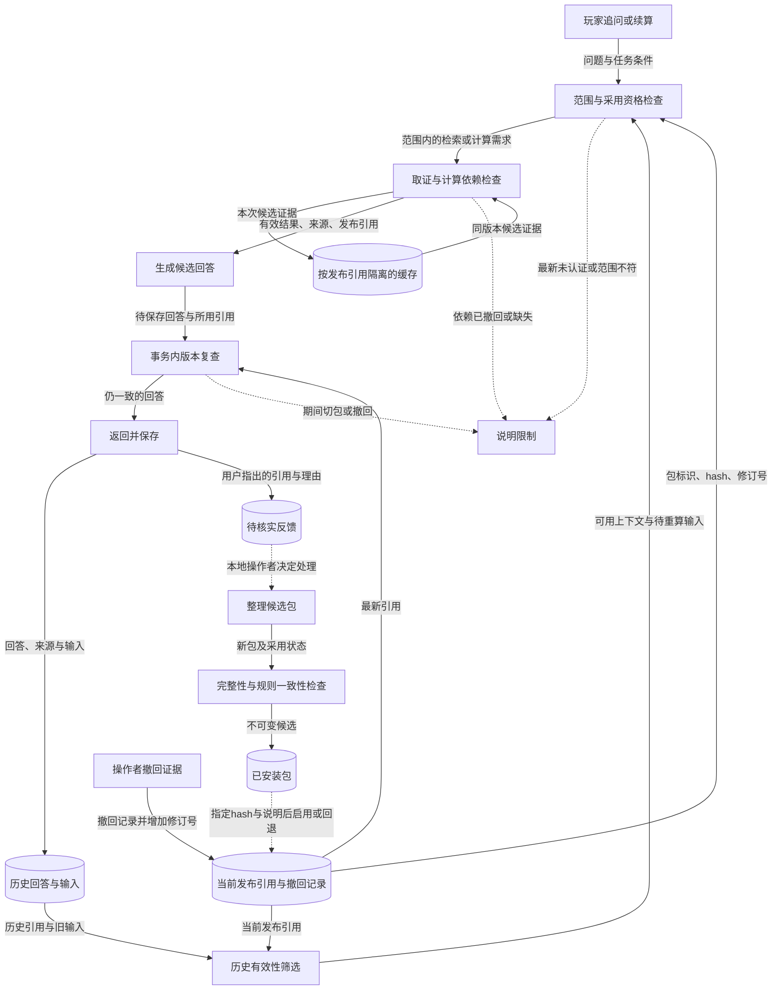

# G06 知识时效：防止旧依据继续被采用

## 1. 一句话成果

系统为固定演示知识建立采用边界：不同范围和未认证最新版本会被明确指出，撤回或发布变化会使旧缓存、历史结果和在途回答重新接受检查；这些工程机制已有有限验证，不等于自动跟随游戏补丁更新。

## 2. 具体场景与原有问题

继续G02的250血石墙场景。玩家已经得到C4计算，随后追问“最新版本还是这样吗”；或者维护者发现这条伤害依据有疑问，将它撤回。此时如果系统只重新搜索一次，旧缓存、旧聊天记录或正在生成的回答仍可能带回旧结论。

这是围绕版本变化设计的场景，不是一条真实补丁事故记录。现有资料能证明项目使用固定数值快照、外部摘录的build未知，不能证明旧版在线污染率。优先解决的是“证据不再适用时如何停止使用”，因为制作预算和拆墙建议都会依赖这些数值。

因此，本目标把“资料被抓取的时间”“演示快照日期”“游戏build是否认证”分开处理。日期新不代表适用于当前游戏，也不能仅凭玩家反馈自动改数值。

## 3. 目标如何拆解

| 子问题 | 承担的职责 | 对最终结果的贡献 |
|---|---|---|
| 当前允许依据哪个范围 | 明确快照、平台、规则集、分支和未知build | 不把固定演示数值说成任意服务器或最新补丁规则 |
| 哪些证据不能再采用 | 排除待核实、冲突、撤回或范围不符记录 | 检索命中也不能越过资格检查 |
| 旧结果会从哪里回来 | 检查缓存版本、历史引用、请求重放及在途版本 | 撤回不只影响下一次搜索 |
| 新包怎样接管 | 候选安装与启用分开，记录hash和操作说明，支持回退 | 用户反馈不直接发布，操作结果可追溯 |

## 4. 最终实现方案与数据流

在线流程由提问或计算触发，接收当前问题及保存的任务条件。首先获取当前发布包标识、内容hash、登记修订号与撤回信息；范围不符就说明限制。检索结果、计算依赖和回答都携带这份引用。

缓存键包含发布引用与检索需求。新请求组装上下文时排除已失效的历史内容；续算可复用旧输入，但重新核对计算依赖。即使生成已完成，保存事务仍会再次比较发布引用；期间发生变化就返回版本冲突，旧回答不保存。已经保存的历史记录仍可查看，但不代表最新认证。

离线维护由本地操作者触发。用户反馈先保存为待核实记录；操作者可以拒绝或标记需要另发知识包。候选包必须通过结构和冻结规则一致性检查，同名内容不能覆盖。安装候选不等于启用；显式启用使用已核对hash和操作说明并产生审计记录，回退也通过同一入口。操作说明不是独立专家认证。

实线表示数据传递或读写，虚线表示条件或人工操作触发。反馈到发布不是自动流水线；普通请求也不轮询补丁。可编辑图源见[数据流图](assets/data-flow.mmd)。

本地应用采集显示：先前石墙计算能给出一颗C4；撤回目标依据后，同样的解释变成缺证据，重新计算没有数值结果，用原请求ID重放返回409。安装一份移除了该目标的候选包，不会立即切换；启用后仍缺目标，回退原包也不恢复它的撤回记录。输入、状态和原始输出见[G06-E06](evidence.md#g06-e06)。这是合成任务的本地运行，不是线上补丁实测。

## 5. 为什么选择这个方案

**固定演示边界优先于自动追补丁——有实施记录。** 问题是新旧资料很难仅凭日期确认适用性。可选择持续抓取并自动替换，也可明确固定包；最终选择后者，先保证演示中不会默默切换数值。代价是不能回答“最新正式服一定是多少”；只有取得明确build和可靠的变更核验流程后，才重新考虑自动更新。

**发布引用覆盖整个结果生命周期——本次补充对比。** 只清网页缓存成本较低，却不能处理聊天历史和生成中的结果。当前把包标识、hash与修订号带到结果，并在保存时再核对。代价是保守失效：一次登记变化可能使未直接受影响的旧结果也需要重试。若未来并发和知识规模显著增长，再考虑按精确依赖缩小失效范围。

**不可变包与显式启用——实现已有，治理效果仍有限。** 直接改在线记录更快，但会丢失“当时用了什么”。当前采用新编号、候选安装、指定hash启用和审计；反馈只形成待处理事项。代价是需要本地操作者管理，不能自动证明解释正确。多用户协作、权限和回归发布平台属于后续条件，不在这轮单机演示内。

## 6. 深入到了什么程度

已实现并有工程验证：范围排除、依赖撤回、版本化缓存、历史过滤、重放与在途保存检查、候选安装/启用分离、回退和反馈隔离。当前审查修订还用证据内容与来源指纹传播撤回，防止只换发布编号或解释名称恢复同一证据；这一点必须以当前核验记录为准，不能用旧提交的测试代替。[G06-E03](evidence.md#g06-e03)

验证仍不足：词法规则能否覆盖任意版本说法，所有知识主张是否正确，以及操作者是否真正完成了内容审核。指纹保护并不等于识别语义相同但被改写的错误资料；审核说明也不能阻止操作者写入不可靠解释。

有意不做自动抓补丁、在线修订数值、独立专家复核和生产发布平台。冻结目录不变，游戏build继续未知；非核心开放式建议保持原来的网页链路与未认证标记，不能宣称所有回答都已免疫陈旧知识。

本轮停止标准是：有限主线能在不适用、撤回和并发变化时明确停止采用，回退与反馈不绕过检查，证据能指出采用范围。它验证的是失效机制，不是对现实游戏所有变化的自动识别能力。本次材料整理未改业务代码。

## 7. 成果与证明

- 固定快照日期、原文抓取时间与游戏build分开，最新或其他范围不会被默认为已认证。[G06-E01](evidence.md#g06-e01)、[G06-E02](evidence.md#g06-e02)
- 撤回影响查询、计算和旧结果复用；当前修订还检查相同证据跨包恢复问题。[G06-E03](evidence.md#g06-e03)、[G06-E04](evidence.md#g06-e04)
- 候选安装、启用、回退和反馈处理有可核对的状态边界，不把用户报告自动变成游戏事实。[G06-E05](evidence.md#g06-e05)、[G06-E06](evidence.md#g06-e06)
- **待验证：自动保证最新正式服正确。** 本轮没有这项能力，也没有真实补丁前后实测支持这一结论。[G06-E07](evidence.md#g06-e07)

## 8. 与其他目标的关系

G02提供规则和解释，G06控制其采用资格；G01和G05分别提供当前任务及玩家事实。规则失效与玩家库存过期是两种不同对象，不应画成同一张“记忆过期”表。

G04可复用版本限制和停止采用机制，G07可检查这些契约是否生效，G08以后再评估保守失效带来的成本。最终PPT中固定包、计算主线和共享评测只介绍一次；G06重点用“同一个问题在撤回前后为何得到不同结果”解释价值。
