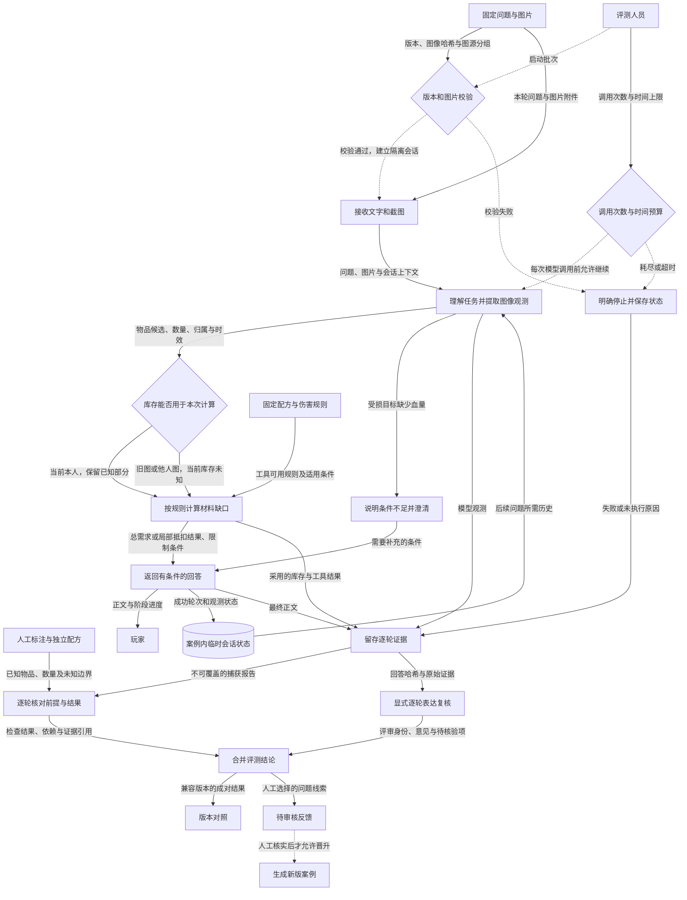

# G07 效果验证：证明回答的前提与结果是否成立

材料日期：2026-11-05。状态：本地评测闭环已实施并验证；真实模型质量仍有明确失败与待核验项。工作树包含未提交实现，版本信息见证据文件。

## 1. 一句话成果

现在能对“截图库存→制作材料缺口→多轮追问”逐轮核对事实、计算和表达，指出错误从哪里出现、是否影响最终回答，并把证据不足与正确澄清单独记录；尚未证明 Coach 整体答得更准。

## 2. 具体场景与原有问题

玩家上传一张局部库存图，问：“我还差多少资源才能造10个C4？”图里是布40、齿轮20、电子零件2。已保存的真实运行却把齿轮20识别为电子零件20，把电子零件2识别为炸药2，随后给出了看起来完整的材料清单。

这份清单的算术可以完全自洽，却因库存前提错误而少算资源。只看回答是否流畅、接口是否成功或计算器测试是否通过，都不能证明玩家拿到的是正确建议。这是已有运行记录中的失败案例，不是为了讲解虚构的“优化前表现”。[G07-E02](evidence.md#g07-e02)

项目希望玩家据此安排收集和制作，错误前提会直接影响行动。优先补上评测，是为了先定位高影响问题，再决定修识图、状态还是计算，避免把增加模型或检索组件当作改善效果的证明。

## 3. 目标如何拆解

| 子问题 | 职责 | 如何支持最终结论 |
|---|---|---|
| 正确答案依据是什么 | 保存用户确认的格子标注、独立配方和未知项 | 避免拿模型自己的输出作标准答案 |
| 应用究竟做了什么 | 在隔离会话中记录输入、观测、采用的库存、计算和回答 | 把“没执行成功”与“执行后答错”分开 |
| 分歧先在哪里出现 | 逐轮检查前提与依赖，分别衡量错认和覆盖不足 | 判断是算错了，还是把错误事实算对了 |
| 结论能否复核和比较 | 绑定回答哈希的复核、版本兼容检查、待审核反馈 | 让修复验收可重复，并防止换评分规则后宣称模型进步 |

这些职责衔接成一条证据链：先有可信参照，再捕获真实行为，最后才判断与复核。反馈可以生成新版案例，但不会自动改写事实标准或玩家状态。

## 4. 最终实现方案与数据流

### 贯穿场景：同一张图，当前库存与昨天的库存

评测人员启动一批固定案例，提供图片、问题、标注和独立配方。执行前校验图片哈希、案例版本与图源分组；每个案例使用独立的临时数据库，多轮只共享本案例的上下文。

应用先接收图片与文字。视觉模型输出物品身份、可读数量及不确定项；任务理解和库存有效性判断把这些候选转成计算允许使用的参数。若用户说明“这是昨天的截图”，图像仍可能被识别，但不能作为当前本人库存抵扣。规则和确定性工具负责展开配方、计算缺口；模型不承担材料算术的权威职责。

应用向玩家返回答案与阶段进度，成功轮次保存在案例内数据库，用于下一次追问。评测端同步把调用状态、耗时、观测、计算和回答保存为报告；临时数据库结束后删除，报告继续保留。本轮未将图像结果写入玩家长期档案。

图中实线传递业务数据，虚线表示启动、允许执行或停止等控制条件；表达复核是后续显式操作，不是系统自动安排另一位人工评审。

可重绘源文件见 [数据流素材](assets/data-flow.mmd)。独立配方只进入评测，应用固定规则只进入工具计算，不能画成共用一个标准答案。停止状态还包括剩余案例未运行，不能被算成“正确拒答”。

### 同一场景的真实输入、中间结果与输出

以下均摘自已保存批次，不是本次新模型调用，也不是示意数据。[G07-E02](evidence.md#g07-e02)

| 环节 | 零件图制作案例的记录 |
|---|---|
| 玩家输入 | “我还差多少资源才能造10个C4？使用普通工作台配方，不展开低品质燃油。” |
| 人工确认 | 布40、齿轮20、电子零件2；只代表截图可见部分 |
| 模型观测 | 布40、电子零件20、炸药2 |
| 计算采用 | 使用错误的电子零件20和炸药2抵扣 |
| 回答节选 | “1980 金属碎片”“594 低品质燃油”“21780 硫磺”；没有列电子零件缺口 |
| 独立参照 | 按已确认可见库存，应仍需电子零件18、金属碎片2000、燃油600、硫磺22000；其余未知库存可能继续减少缺口 |
| 评测结论 | 实际采用库存下的算术通过，视觉与基于正确库存的缺口检查失败；首个有证据的分歧在识图 |

把同图问题改为“这是昨天的截图”后，另一条真实记录里仍有错认，但计算库存为空缺状态，回答明确“库存未知，只列总需求”。因此可以同时得出“识图有错误”和“历史库存隔离有效”，不会给整条链路一个掩盖原因的分数。[G07-E03](evidence.md#g07-e03)

证据不足时不强行二选一：未确认标注会让依赖它的抵扣判断待核验；缺计算输出会阻断相关判断；保守省略材料记录覆盖不足。最终表达是否丢失条件、是否无谓追问，另由有身份记录的逐轮复核补充。

## 5. 为什么选择这个方案

**决策一：正确性需要独立参照。** 原有规划已经要求避免标准答案与实现共享错误，最终采用人工图像标注与独立配方手算。本次整理补充的替代对比是：直接用业务计算器出标准答案，或者只让模型给回答评分。前者容易共同算错，后者仍缺可靠事实锚点。选择独立参照的代价是标注、版本核验和有限配方范围；若扩展到大量物品与攻略，需要经过校准的更多金标和专业审核，不能直接扩张现有手算表。[G07-E04](evidence.md#g07-e04)

**决策二：保留过程和未知，比一个总分更有解释力。** 已保存旧基线与本轮实现记录表明，原判定覆盖不足会漏掉早轮错误，也会把保守识别笼统当错。本次方案把执行、质量、证据、覆盖分别记录，再检查依赖与逐轮表达。替代方案“仅看最终回答是否匹配”是本次补充的比较。代价是结果不能压缩成一个好看的准确率，仍需要复核；当标注和评审校准充分、样本具有代表性后，才考虑汇总可信指标。[G07-E06](evidence.md#g07-e06)、[G07-E09](evidence.md#g07-e09)

**决策三：先复用现有应用做小闭环。** 原有优先级记录选择可靠演示、暂缓平台化；最终使用隔离会话、既有 HTTP 接口和版本化文件。与统一生产追踪平台相比，实施和复核成本更低，但没有自动线上采样、统一发布门禁或完整业务阶段计时。早期路线图还建议24个跨场景案例与浏览器验收，实际本轮收敛为库存制作相关的新9案例及旧基线重判；这是实施边界，不能说长期方案已全部落地。只有场景与发布频率扩大、文件方式成为瓶颈时，再考虑统一存储和平台。[G07-E07](evidence.md#g07-e07)

## 6. 深入到了什么程度

**已实现且已验证：** 真实上传与多轮应用链路、隔离数据库、逐轮证据检查、未确认信息传递到下游、复核绑定、版本不兼容提示，以及预算停止。既有批次保留真实失败，本次本地517项测试通过，软件机制与模型效果分别举证。[G07-E01](evidence.md#g07-e01)、[G07-E05](evidence.md#g07-e05)

**已实现但验证不足：** 反馈审核到新版案例有代码和测试覆盖，尚无长期真实反馈修复的效果闭环；有版本对照能力，尚无业务修复前后、相同未见样本上的收益实验。代码代理表达复核不是独立人工盲评。

**本轮有意不做：** 修复 Coach 的识图行为、扩展大规模评测平台或 P2；这样能先冻结问题和验收方法，避免把更换判定器与业务优化混为一谈。本次材料整理也没有修改业务代码或重跑付费模型实验。

**当前限制：** 当前游戏 build、部分拆墙规则与方案比较缺少独立认证；只有两个新独立图源，新批次只运行一轮。浏览器验收、泛化、稳定性与总体准确率提升均待验证。

**停止扩展的边界：** 以下是据本轮交付归纳的停止条件，不冒充事前量化承诺：固定案例能执行并留下证据，已知误判有测试防护，复核可合并，保存结果可重复核对，真实失败和未知都有可定位的记录。达到的是“评测工具可用于下一轮修复”，不是“Coach 已达到可靠性目标”。早期规划中的约90%正确完成率与关键错误为零，尚未被本轮证明。

## 7. 成果与证明

1. **能区别“算术正确”和“建议正确”。** 新批次8个制作结果在实际采用库存下均符合独立算术，但零件图的前提错认仍被明确判失败。[G07-E02](evidence.md#g07-e02)、[G07-E04](evidence.md#g07-e04)
2. **能区分潜在错误与已影响回答的错误。** 历史／对手／过期库存隔离在3个对应案例中符合预期，视觉错误仍单独保留；这不是三例整体全通过。[G07-E03](evidence.md#g07-e03)
3. **具备可复核的真实运行证据。** 已有9个案例、12轮、19次模型调用；最终5失败、3待核验、1通过。本批全执行完成，不等于全答对。[G07-E01](evidence.md#g07-e01)
4. **评测机制可重复核验，模型增益仍待验证。** 本次软件测试通过，重新计算保存结果与已有结论一致；旧新评分条件不同，不能拿状态变化宣称效果提升。[G07-E05](evidence.md#g07-e05)、[G07-E06](evidence.md#g07-e06)

## 8. 与其他目标的关系

本目标复用意图理解、确定性计算与玩家状态有效性判断，为幻觉控制提供可追溯失败案例和后续验收依据。规则版本核验属于知识时效的前置工作；调用量与延迟数据可以复用到成本目标，但不能直接当作费用或生产性能证明。

最终项目 PPT 只需讲一次截图接入、计算器和库存状态模型。这里保留“独立事实→实际行为→判定→复核与对照”这条增量主线，展示怎样证明其他能力在什么条件下成立。
