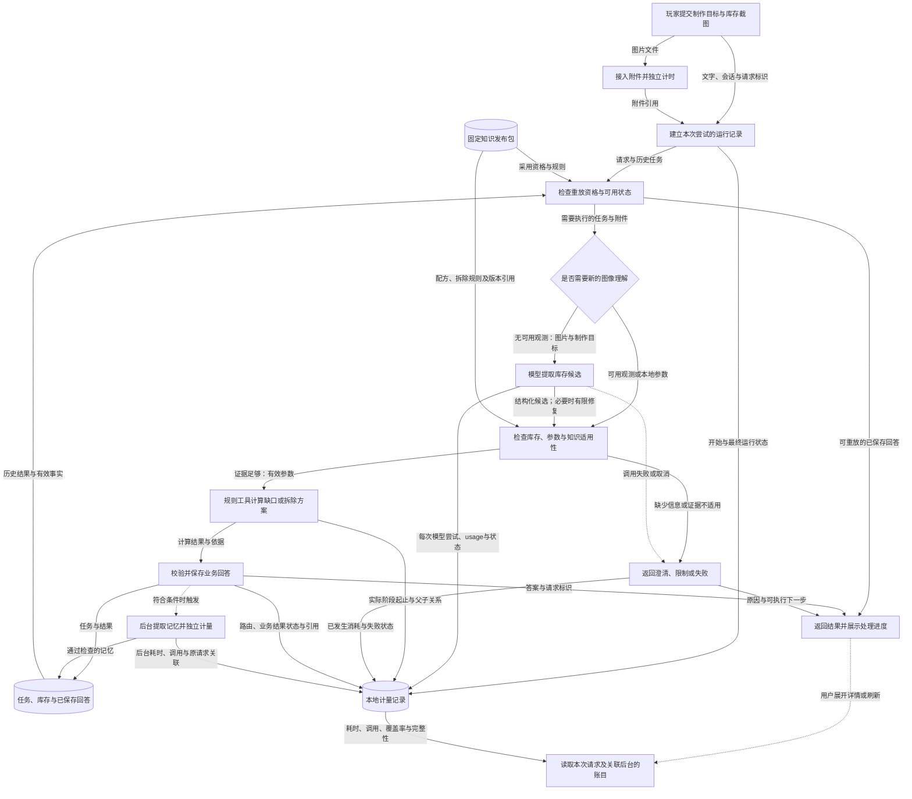

# G08 延迟与成本：先让每次等待与调用可解释

整理日期：2026-11-05。核对业务版本为 `932f7de`；本轮仅整理材料。用户暂无硬性时延或费用指标，以截图制作、拆墙计算的可靠演示为先。本文中的“调用”按模型入口尝试计数，是否到达HTTP发送边界另记。

## 1. 一句话成果

用户可以在回答下查看本次处理的耗时、模型调用与复用情况，演示者还能定位失败和后台处理的消耗；离线验证支持这些计量能力，尚未证明真实模型提速、费用下降或达到响应时限。[E01](evidence.md#e01) [E04](evidence.md#e04)

## 2. 具体场景与原有问题

**贯穿场景为示意**：玩家上传库存图说“制作十份火药”，随后改问“拆一面石墙最省资源”，再补“它还剩250血”。这条主线既有需要模型理解的图像，也有可由规则处理的参数变化。演示时，除了回答是否正确，还需要解释：这次为什么等、有没有再次识图、失败后重试是否又发生调用。

原有实现已经支持部分截图复用、本地计算和成功请求重放；这些不是本轮新增的优化。以前的架构事件不能作为完整业务阶段耗时依据，也不能仅按外层工具执行次数推算内部模型调用。没有同条件优化前实测，因此本文不编造旧延迟或节省比例。[E01](evidence.md#e01) [E03](evidence.md#e03)

优先补齐计量，是为了让可靠演示有可解释的依据：业务结果仍受库存、知识版本和计算校验约束，同时能判断消耗发生在哪一环。可接受的响应速度需要真实环境基线再定，不能从本地夹具反推。

## 3. 目标如何拆解

| 子问题 | 职责与衔接 | 对最终结果的贡献 |
|---|---|---|
| 一次请求究竟执行了什么 | 每次尝试单独记录，再关联会话、请求及业务结果；成功重放与失败重试各有自己的运行 | 避免把旧消耗记到新重放，或漏掉未保存回答的失败 |
| 等待发生在哪里 | 围绕实际阶段记录起止和父子关系；前台与后台分开 | 解释阻塞回答的工作，避免累计重叠阶段造成假总时长 |
| 外部资源用了多少 | 模型每次入口尝试和网页每次请求分别计量；记录usage是否缺失或无效 | 看见修复中的额外调用，承认账单未知 |
| 如何证明记录可信 | 接口回归同时检查业务状态与调用数，再检查故障、取消、持久化和页面展示 | 让计量结论可以复现，防止“调用少但答案已坏”被算作成功 |

## 4. 最终实现方案与数据流

截图先通过附件接口保存为可引用的附件；上传自身有独立运行，尚未拼成浏览器点击到渲染的总时间。聊天请求携带文字、附件引用、会话和请求标识，建立本次尝试的运行记录。已有流程检查重放资格、任务上下文、可用玩家事实和知识发布引用。

若需要新识图，模型把图片与目标转成库存、数量等候选；若已有有效观测，后续任务可复用。规则与校验决定候选能否参与计算，确定性工具按配方或拆除规则推导。模型负责非结构化理解，工具负责数值运算；本轮计量机制不改变二者边界，也不为省调用跳过知识撤回检查。

实线表示数据传递，虚线表示条件或异步触发。图聚焦截图与拆墙主线，后台分支只在满足条件时执行。其他建议生成、网页取证、探测与状态预览也接入计量，但不把它们画成每次制作必经步骤。独立评测消费应用输出与计量记录，不在图中冒充在线自动全量评测。

通过检查的回答和任务状态进入业务存储，用于继续追问；计量记录独立保存在同一本地SQLite中的运行表和阶段表。用户展开回答下的详情或打开诊断页时，再读取本次请求的各次尝试。符合条件的后台记忆处理使用独立计量上下文，通过原请求和原运行关联，可能与前台重叠；它不是必须等完才返回的耗时。

**示意输入与结果**：

| 时点 | 输入或中间信息 | 返回或保存内容 |
|---|---|---|
| 首次制作 | “制作十份火药”＋截图；候选库存为硫磺100，其他未确认项未知 | 通过校验后返回材料缺口及库存范围，保存任务和有效观测；记录视觉模型尝试 |
| 切换拆墙 | “改成拆一面石墙最省资源” | 切换计算任务，按适用规则返回拆除方案；可复用的观测沿用，不意味着所有截图永久有效 |
| 血量追问 | “它还剩250血”；当前任务为石墙拆除 | 血量参数变为250，重新计算；计量说明是否发生新增模型调用 |
| 展开详情 | 本轮请求标识 | 返回本次尝试、复用状态、阶段耗时和usage覆盖率；实际费用保持未知 |

表中业务信息用于解释机制，不能作为真实截图效果证据。已保存的合成评测恰好使用同样的“火药10、硫磺100”参数，但图片是纯绿色夹具、模型返回固定；实际记录摘录见[E04](evidence.md#e04)。

**失败与不足也要可解释。** 模型失败、取消或繁忙拒绝仍记录本次尝试，未形成聊天回答也可查诊断页；失败记录不保证有完整任务或trace引用。计量写入故障在可返回报告时标记不完整，并记录脱敏告警，不替换有效业务回答；若数据库完全不可用，查询明确失败。进程崩溃遗留的运行中状态表示终态未知，不是自动恢复能力。

**时间与费用口径。** 父阶段包含子阶段，不能把所有阶段相加。服务端运行不等于浏览器总等待，首条进度不等于首个有效答案。模型入口次数不等于供应商收费次数；发送标记也不证明送达。usage只合计已知值并显示覆盖数，cached和reasoning明细不重复加到总量。没有价格与账单时费用为未知；零外部调用也不等于机器运行成本为零。[E02](evidence.md#e02) [E03](evidence.md#e03)

## 5. 为什么选择这个方案

### 决策一：先测量和解释，保留现有局部限制

问题是没有真实基线，却需要保证主线演示稳定。可行替代包括新增整次请求预算、超限降级或直接换模型；最终保留原有局部超时与有限修复，只增加观测。**不增加共享预算是已确认的实施约束**，其余替代是本次整理补充的对比，不能倒写成全部预先评审过。

理由是先确认耗时来源和答案有效性；代价是本轮不能保证统一时限、自动止损或费用上限。若真实采样显示某阶段持续超出可接受等待，且有明确预算，再评估全请求控制及可选步骤降级。[E01](evidence.md#e01)

### 决策二：按实际尝试记账，分开前台与后台

只记“计算工具用了一次”会漏掉内部解析、生成或修复；只给整轮一个总数也会掩盖后台消耗。本次选择逐模型入口计量、阶段嵌套计时、后台独立关联。对比“只统计外层工具”是整理时补充的解释，实施记录明确保留了逐次计量方案。

理由是重试与修复也消耗资源；代价是更多SQLite写入、记录体积和解释成本，父子时间还可能重叠。若并发规模或锁等待成为瓶颈，再考虑异步批量写入或专门观测服务，不能先声称本地方案已具生产规模能力。[E02](evidence.md#e02) [E03](evidence.md#e03)

### 决策三：未知费用保留未知，同时核对业务与调用

从字符数估算token或套用未经确认的价格表更容易得到一个金额，但容易造成假精确；这是整理时补充的替代对比。本轮选择保存供应商usage及其完整性、已知合计与覆盖率，不推算账单；已有评测则同时检查关键业务状态和调用数。

代价是不能直接回答“每次多少钱”，固定夹具也不能证明实际提速。获得明确模型价格、真实usage和账单后可增加带版本的估算或对账；获得重复的真实截图及浏览器采样后，才讨论速度目标与优化收益。[E02](evidence.md#e02) [E04](evidence.md#e04)

## 6. 深入到了什么程度

**已实现且已验证**：独立运行和父子阶段计时；失败、取消、重放、后台归因；usage异常处理及计量故障显式化；按需详情和诊断页。此次材料核验重跑27项Python定向测试、20项DOM测试均通过；27项中已包含一次11场景夹具评测，不再叠加为新的样本数。保存的历史报告11场景×3次为33/33，源码哈希与本次核对版本一致。[E03](evidence.md#e03) [E04](evidence.md#e04) [E05](evidence.md#e05)

**已实现但验证不足**：真实供应商调用接入计量、网页请求记录及浏览器页面都有代码与隔离测试；没有本轮真实网络负载、真实截图浏览器验收或账单对照。建议结构修复的3次调用由定向测试覆盖，不属于33条报告中的场景。

**有意不做**：共享请求预算、模型调度、并发重构、价格估算及缓存策略调整。现有超时与修复限制沿用；本轮没有证据支持为了快而降低图像质量或省略状态、知识和结果校验。

**当前限制**：SQLite同步写入有观测开销，锁等待可推迟取消；崩溃可能留下运行中记录。最近查询有窗口上限且明确截断，汇总仅覆盖返回窗口。没有生产租户权限、自动保留期或完整浏览器时间线。持久化失败丢失的数据无法凭空恢复。

**停止标准与后续建议**：计量与已知失败边界有定向回归、业务状态和调用次数共同通过检查、来源版本可核对，即停止本轮扩展，交付可靠演示依据。后续先按本地计算、首次截图、有效复用、修复／失败四类采集真实基线，再商定等待阈值与费用范围；这是建议，未实现自动控制，也不把夹具毫秒数作为目标。

## 7. 成果与证明

| 适合展示的结论 | 证据与可主张范围 |
|---|---|
| 从“感觉慢”走到“能查哪次尝试、哪个阶段、多少次模型调用” | [E01](evidence.md#e01)、[E03](evidence.md#e03)、[E05](evidence.md#e05)：代码、API与DOM测试；完整浏览器体验待验证 |
| 截图复用、拆墙和血量追问的已有本地路径，可以用调用记录核对 | [E04](evidence.md#e04)：首次识图1次、热复用0次、拆墙0次、血量追问0次，每场景3次；合成夹具，不是本轮提速收益 |
| 修复和失败不隐藏，未知usage和账单不写成零 | [E02](evidence.md#e02)、[E03](evidence.md#e03)、[E04](evidence.md#e04)：视觉修复2次，建议修复3次由另一项测试覆盖；费用始终未知 |
| 真实响应速度、费用下降与可接受时限达成情况 | [E06](evidence.md#e06)：**待验证**，没有真实基线、同条件前后对照或账单 |

## 8. 与其他目标的关系

复用G01的任务分流、G02的规则计算与证据、G05的有效库存、G06的发布适用性；这些约束不能因少一次模型调用而跳过。G07判断回答质量，G08说明处理耗时和资源使用，二者共用业务样例但不把同一轮计作两份独立证明。

在“输入—理解—知识—决策—生成—评测与观测”架构中，G08贯穿执行链路，重点补充观测。最终PPT只需讲一次截图、状态和计算器；这里呈现调用对照、前后台归因与未知费用即可。旧目标材料的源码适用性见[总索引](../../README.md)，不能将旧评测的“当前版本”直接移植到本轮。
